[Deutsch](README.md) · English

# Alcatraz

Alcatraz is browser-based software for scoring competitions in motorboat slalom
or inflatable boat slalom (internationally: UIM Formula Future).
It replaces the Excel scoring – from the field of drivers through the race officials’ lists to the team competition.
On competition day it releases the starts, shows them on a scoreboard
and, if desired, receives the race officials’ values directly from a phone or tablet.
Rulebooks: the DM-Reglement (rules of the German championship, DM) and UIM rule 960 “Formula Future” with parallel
slalom.

There is **no server, no database and no login**:
all data is kept in the browser of the scoring computer and can be saved as a file.
The only exception is device operation, and only when it is deliberately switched on (Operation → Devices):
then this computer (in the app the “operating computer”) exchanges encrypted messages with the scoreboard, spectators’
phones and paired devices (start release, race officials) via a third-party ntfy server –
such as race number, name, origin and class of the drivers and the entered values, never date of birth or gender
([device operation](docs/en/betrieb.md#device-operation)).

- **App:** <https://motorbootslalom.github.io/alcatraz/> – served via GitHub Pages,
  after the first visit also without internet.
- **Single-file version:** [`alcatraz.html`](https://motorbootslalom.github.io/alcatraz/alcatraz.html) –
  a single HTML file that runs without internet on a double-click.

## Getting started

1. Open the app. Everything starts in the “Event” tab.
2. To try it out, create a sample field of drivers there at the very bottom under “Sample data”.
   Then interleaving, lists and data entry can be viewed,
   and after “Lock interleaving” also operation on competition day.
   “Reset everything” (Settings → Files) clears the browser again before the real competition.
3. Before the competition, open the app once with a network connection and wait until the footer says
   “Ready for offline use”.
   The steps: [Before the competition](docs/en/betrieb.md#before-the-competition-with-network).
4. During the competition, download a backup again and again (Settings → Files → “Backup”).

## What Alcatraz can do

- **Drivers:** exchange with Excel, race numbers, check of year of birth and class.
- **Interleaving** of the classes onto racecourses, lanes and boats; starting order of the parallel slalom.
- **Weighing** with weight lists and extra weights.
- **Race officials’ sheets** per racecourse, class, attempt and list – with course drawing, QR code and checklist.
- **Data entry:** type in the completed sheets, in the same layout as on paper; a scan jumps to the sheet.
- **Results** per attempt and overall, with the dead-heat rule of the rulebook and the notice board version under
  rule 960.
- **Parallel slalom** with preliminary heat, semi-final, final and re-run;
  individual competition over manoeuvring and parallel slalom.
- **Team competition** per club, state or country; **results booklet** for all groups after the competition.
- **On competition day:** start release, scoreboard in a second window, starting order with waiting times, spectator
  list – if desired also on other devices via a link with QR code; the start release also on a paired phone.
- **Race official devices:** race officials enter their list on a phone or tablet instead of on paper –
  with buttons, on the course drawing (“Picture”) or as a table; paper and devices can be mixed.
  Practice works without a connection.
- User interface in German and English; the lists are in the language of the rulebook.
- Runs without internet, with a second store against hard interruptions and a history to restore from.

All the details: [docs/en/funktionen.md](docs/en/funktionen.md).

## What it looks like

All images show made-up sample data from the app (UIM event “Harbour Cup”, origin country;
the parallel slalom exists only under UIM).
A click opens the image in full size; all images: [docs/bilder/en/](docs/bilder/en/).

**Before the competition**

<table>
<tr>
<td valign="top" width="260"><a href="docs/bilder/en/starter.png">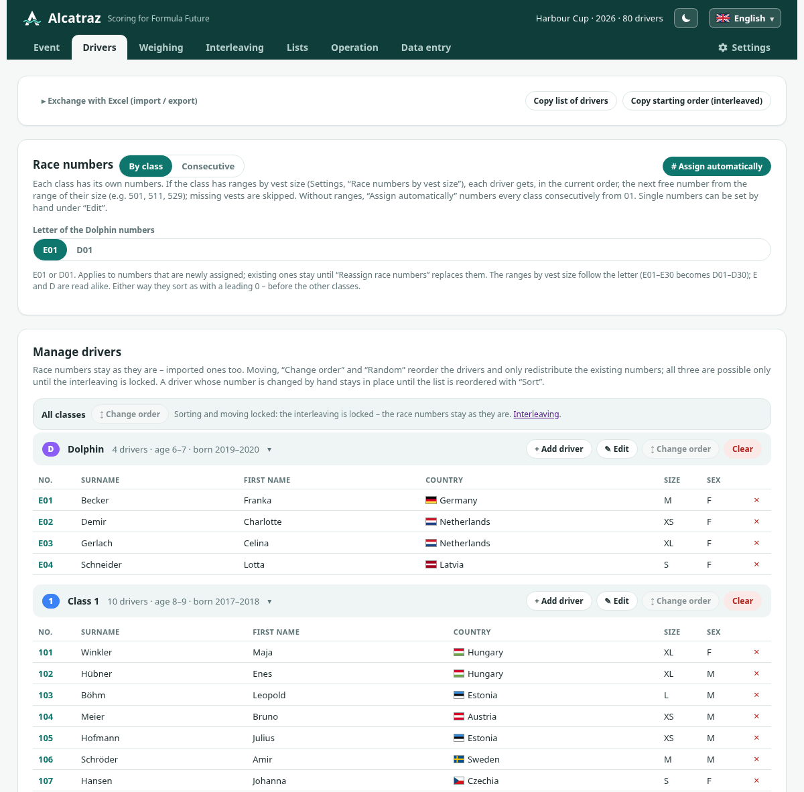</a>
 Drivers per class, with race numbers and origin</td>
<td valign="top" width="260"><a href="docs/bilder/en/verzahnung.png">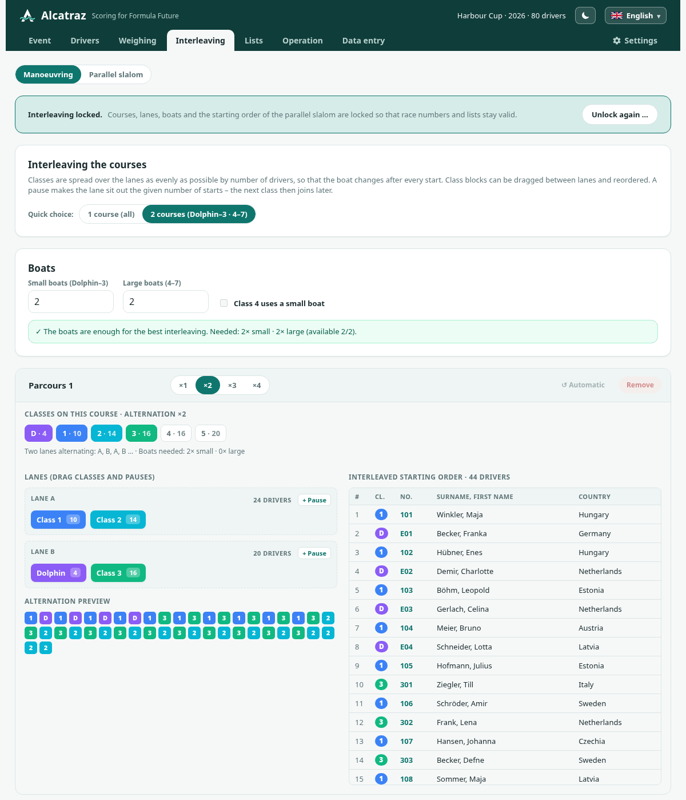</a>
 Interleaving of the classes, locked</td>
<td valign="top" width="220"><a href="docs/bilder/en/wkr-bogen.png">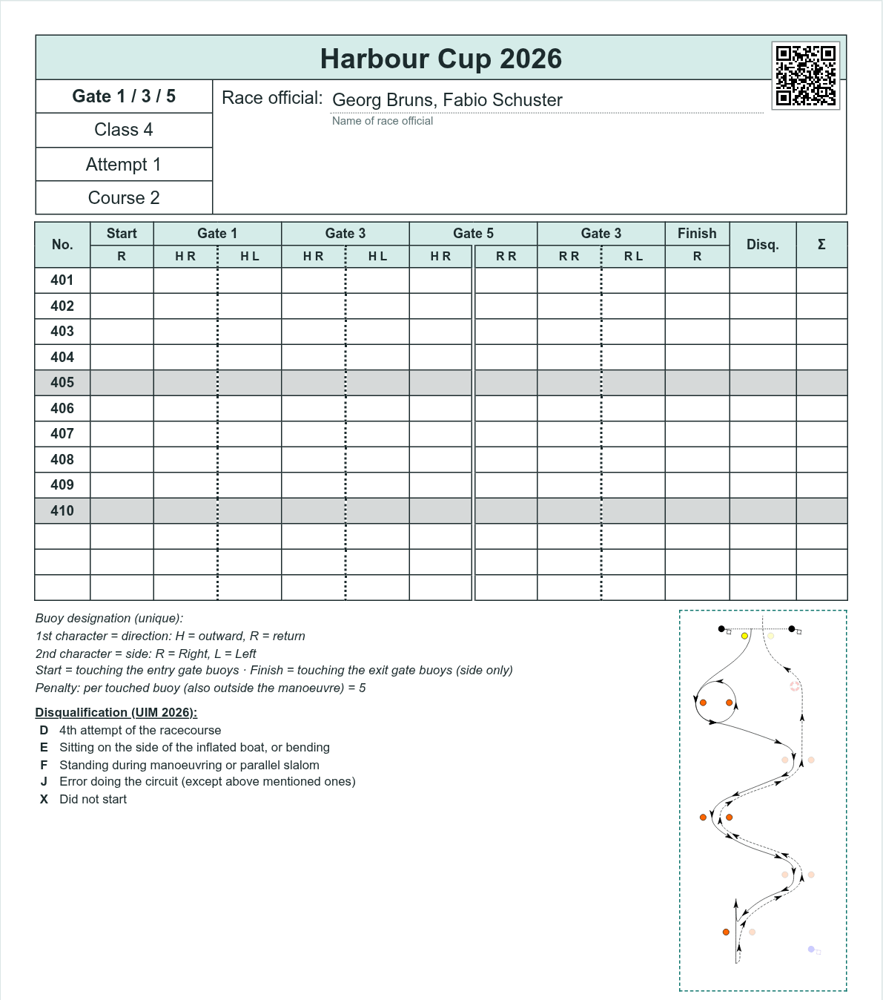</a>
 Race officials’ sheet with QR code and course drawing</td>
</tr>
</table>

**On competition day**

<table>
<tr>
<td valign="top" width="260"><a href="docs/bilder/en/start-freigabe.png">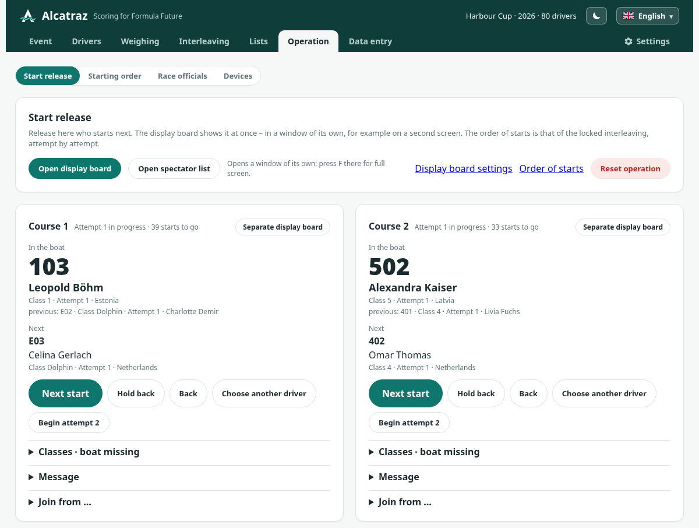</a>
 Start release on the operating computer</td>
<td valign="top" width="260"><a href="docs/bilder/en/anzeigetafel.png">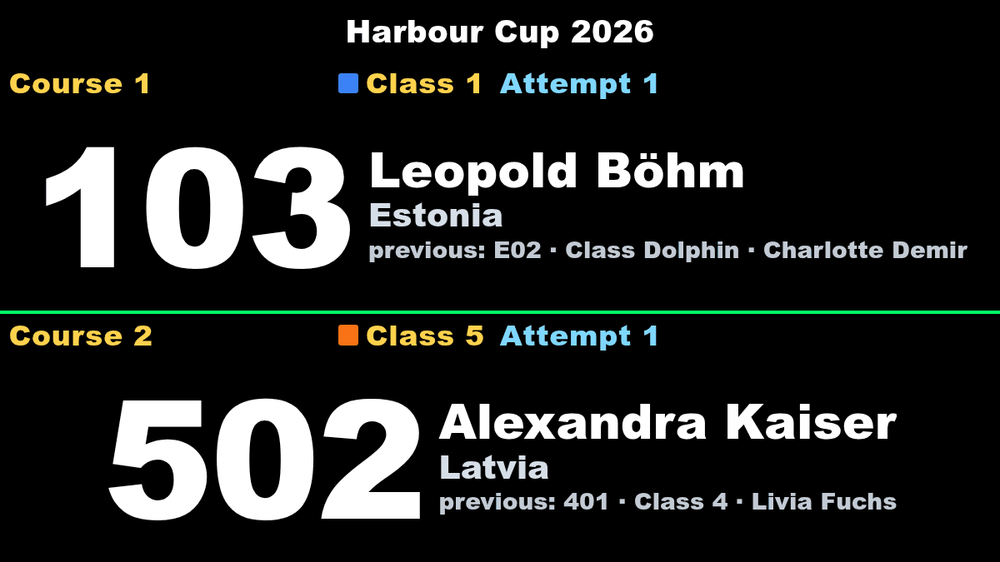</a>
 Scoreboard in the second window</td>
<td valign="top" width="180"><a href="docs/bilder/en/zuschauer.png">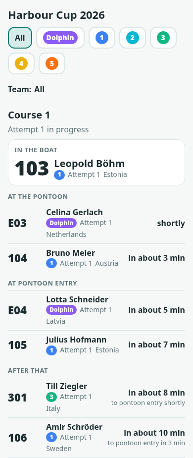</a>
 Spectator list on the phone</td>
</tr>
</table>
<table>
<tr>
<td valign="top" width="180"><a href="docs/bilder/en/wkr-handy.png">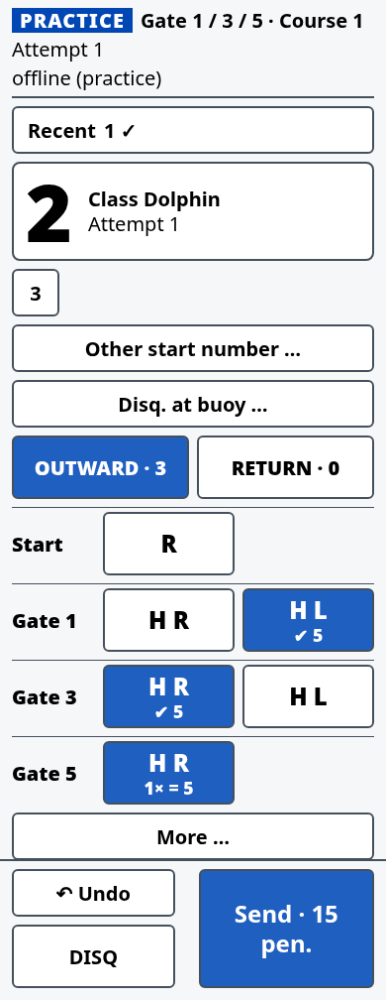</a>
 Race official form on the phone</td>
<td valign="top" width="300"><a href="docs/bilder/en/wkr-pad-bild.png">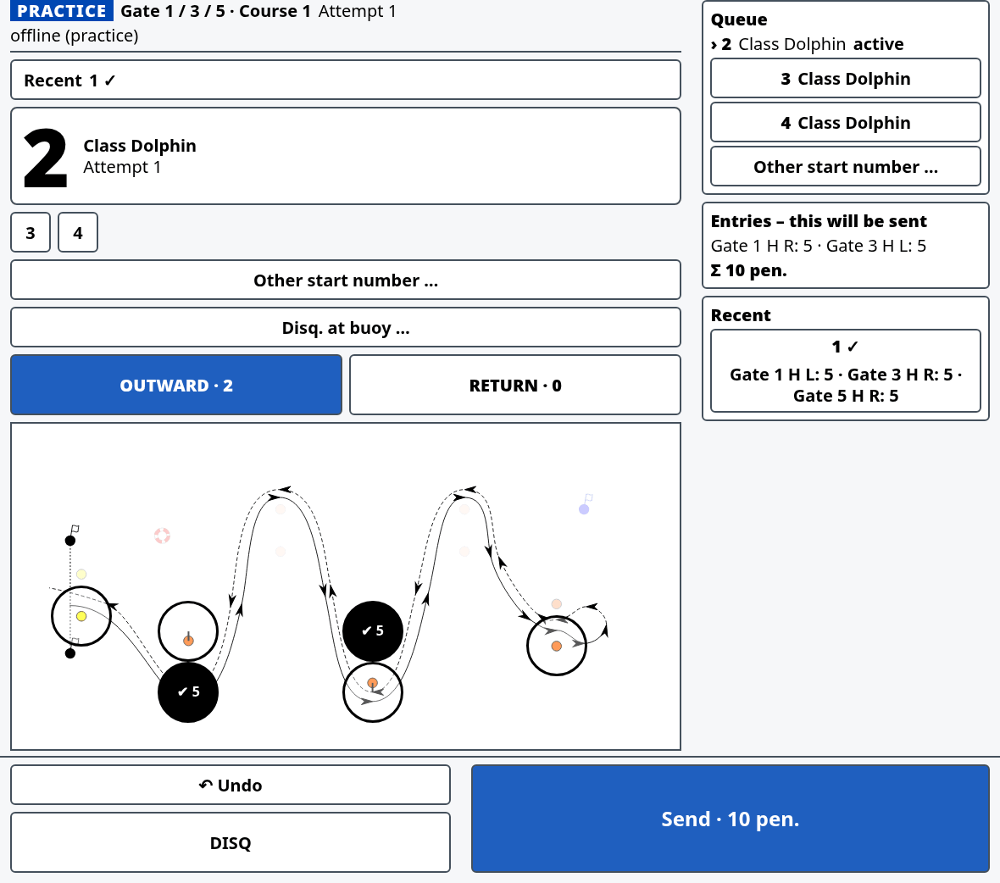</a>
 Race official form “Picture” on the tablet</td>
<td valign="top" width="260"><a href="docs/bilder/en/erfassung.png">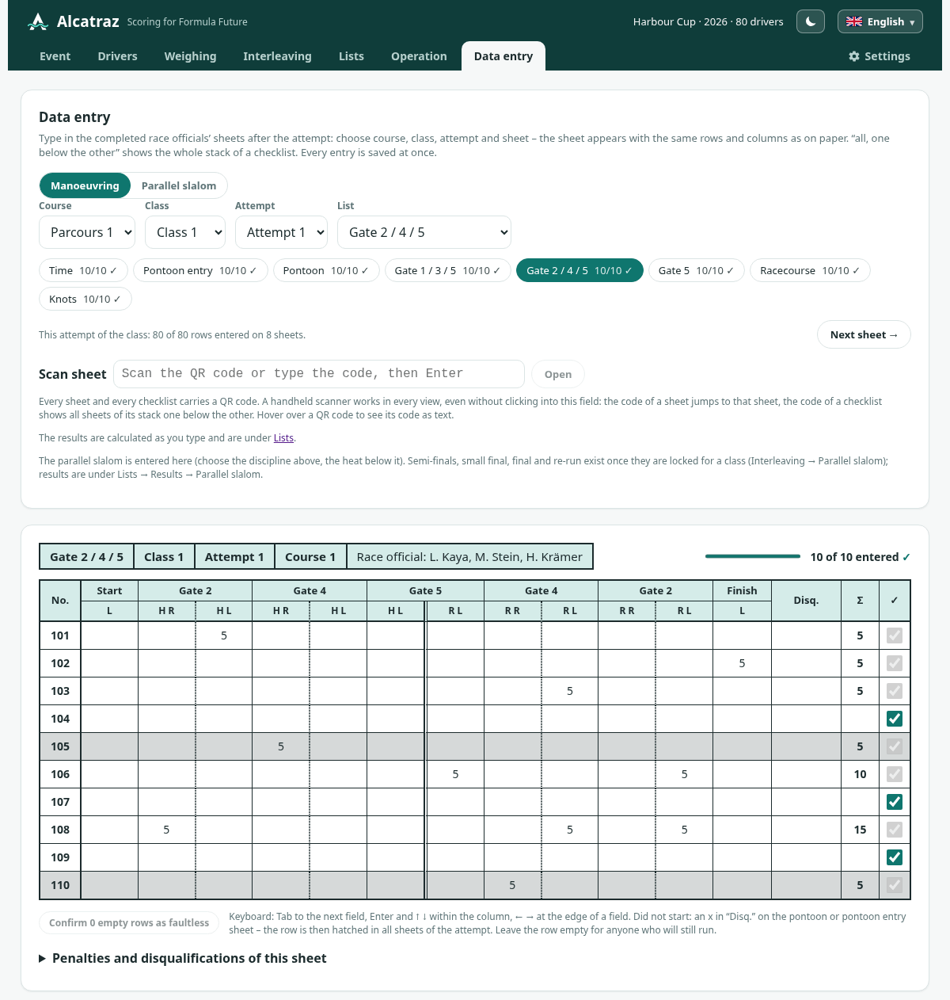</a>
 Data entry: the sheet as an entry table</td>
</tr>
</table>

**Results**

<table>
<tr>
<td><a href="docs/bilder/en/wertungsliste.png">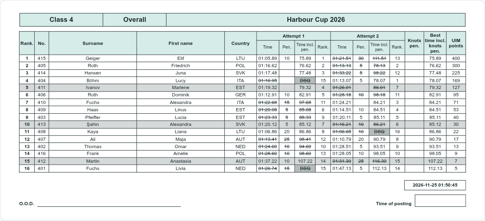</a>
 Results (overall) with UIM points</td>
</tr>
<tr>
<td><a href="docs/bilder/en/mannschaftswertung.png">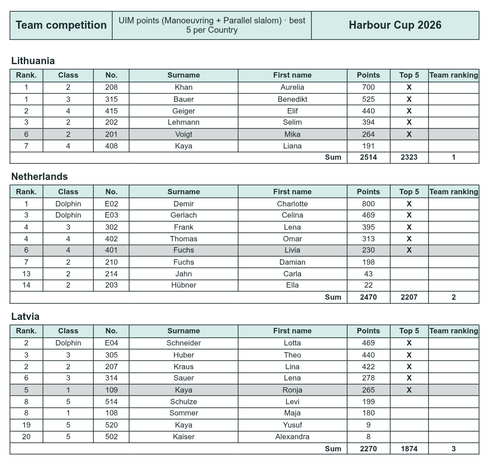</a>
 Team competition</td>
</tr>
<tr>
<td><a href="docs/bilder/en/parallel-results.png">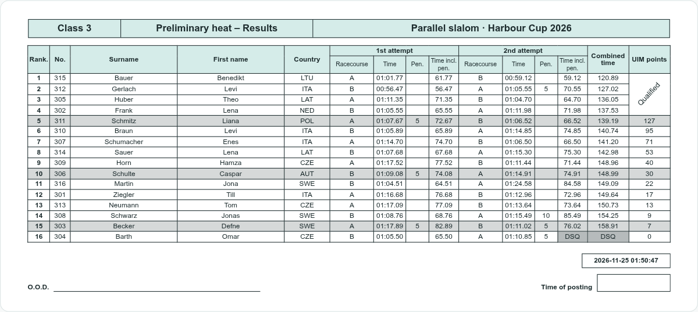</a>
 Parallel slalom (UIM only): results of the preliminary heat with “Qualified”</td>
</tr>
</table>

## Read more

- [What Alcatraz can do](docs/en/funktionen.md) – all functions by area, including origin and flags.
- [Parallel slalom and individual competition](docs/en/parallelslalom.md) – what UIM rule 960 adds.
- [Operation at the venue](docs/en/betrieb.md) – without internet, backup and history, device operation,
  procedure on competition day.
- [Field test of device operation](docs/en/feldtest.md) – checklist for the test with real devices.
- [Technology](docs/en/technik.md) – structure, offline storage, development, documentation and tests.
- [Status and origins](docs/en/stand.md) – background, merging of the prototypes, what is still open.
- [Decisions](docs/entscheidungen.md) (German) – what was decided when and why.
- [CLAUDE.md](CLAUDE.md) (German) – project map for agents and developers.
- **Deutsch:** [README.md](README.md) and the German documentation in [docs/](docs/).

## Other rulebooks

So far Alcatraz knows the DM-Reglement and UIM rule 960.
Each rulebook is a file of its own in the program (`src/config/regelwerke/`).
Associations from other countries are invited to send their rulebook:
as an issue via the [“Rulebook” template](https://github.com/Motorbootslalom/alcatraz/issues/new?template=regelwerk.yml),
with a link or PDF, classes and codes. Questions are dealt with in the issue on GitHub.

## Why the name Alcatraz?

Alcatraz is the name of a race official position.
At this position two boats are placed behind gate 5, across the racecourse.
A race official then remarked, very aptly, that at this position you feel as if you were on Alcatraz –
an island in the San Francisco Bay that used to be a prison.

## What does it all cost?

Nothing …

The program is published here with its complete source code
as [free software](http://fsfe.org/about/basics/freesoftware.en.html).
In most state associations, diligent helpers have written programs for the scoring
and guarded them like a state secret.
I do not believe that this is the right way.
I believe it achieves more if everyone can contribute their experience
to create a piece of software that everyone can use and also wants to use.
Together we can often achieve more.

## Licences

- **Program:** GNU Affero General Public License 3.0 or later ([LICENSE](LICENSE)).
- **Racecourse drawings:** from [Motorbootslalom/Parcours](https://github.com/Motorbootslalom/Parcours),
  licence [CC BY-NC-SA 4.0](https://creativecommons.org/licenses/by-nc-sa/4.0/deed.en).
  Authors and changes are listed in [`src/assets/parcours/LICENSE.md`](src/assets/parcours/LICENSE.md).
  This also applies to the drawings in the images under `docs/bilder/` (such as `wkr-bogen.png`, `wkr-pad-bild.png`).
- **Flags:** countries from country-flag-icons (MIT), German federal states public domain –
  see [Origin and flags](docs/en/funktionen.md#origin-and-flags).
