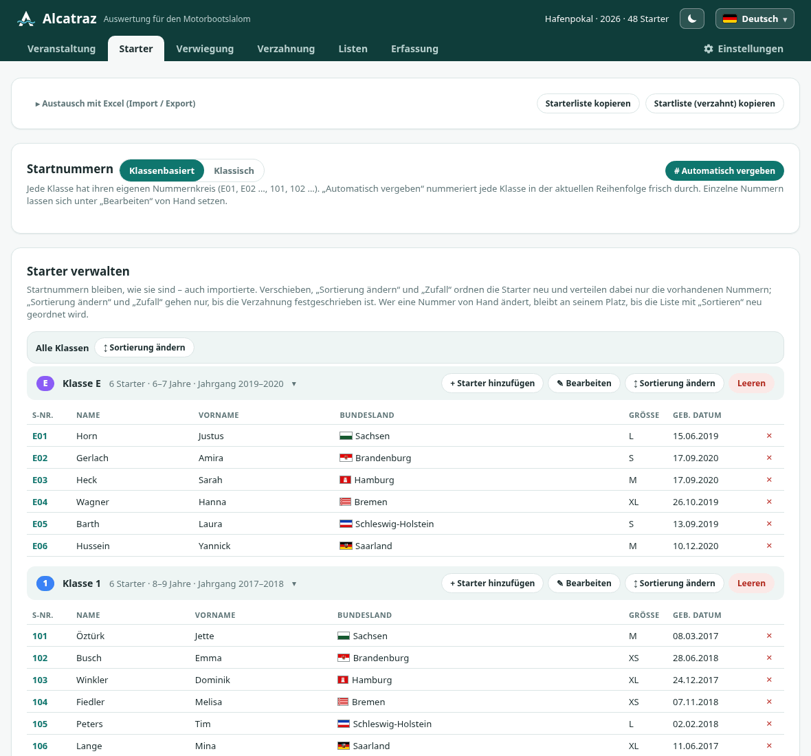
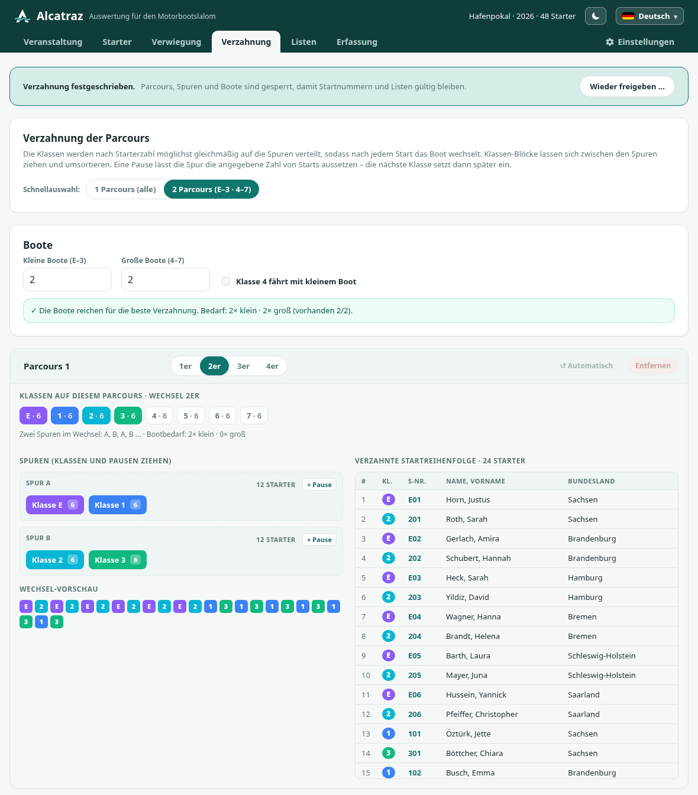
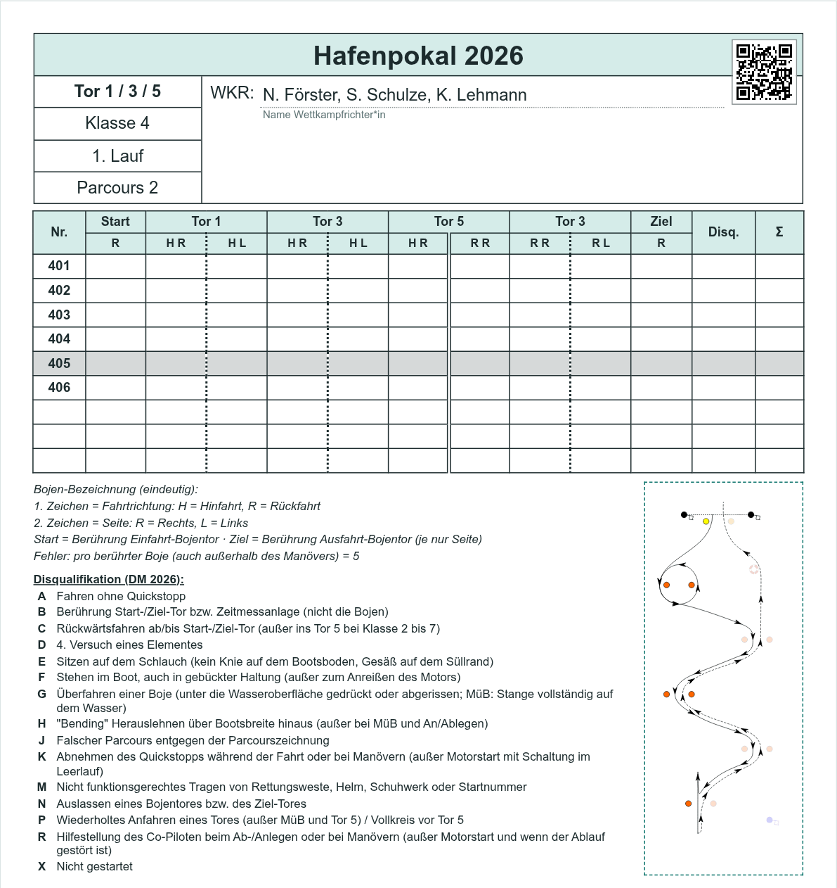
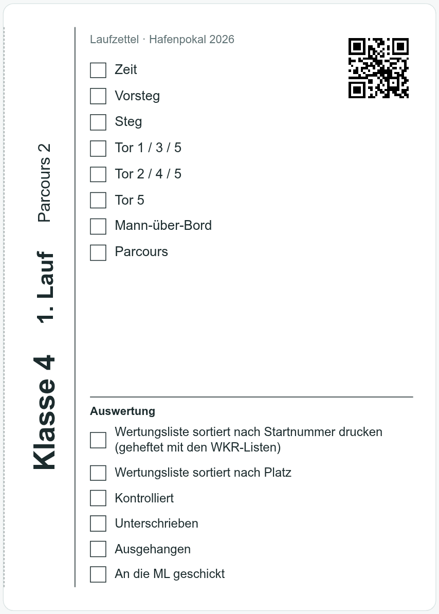
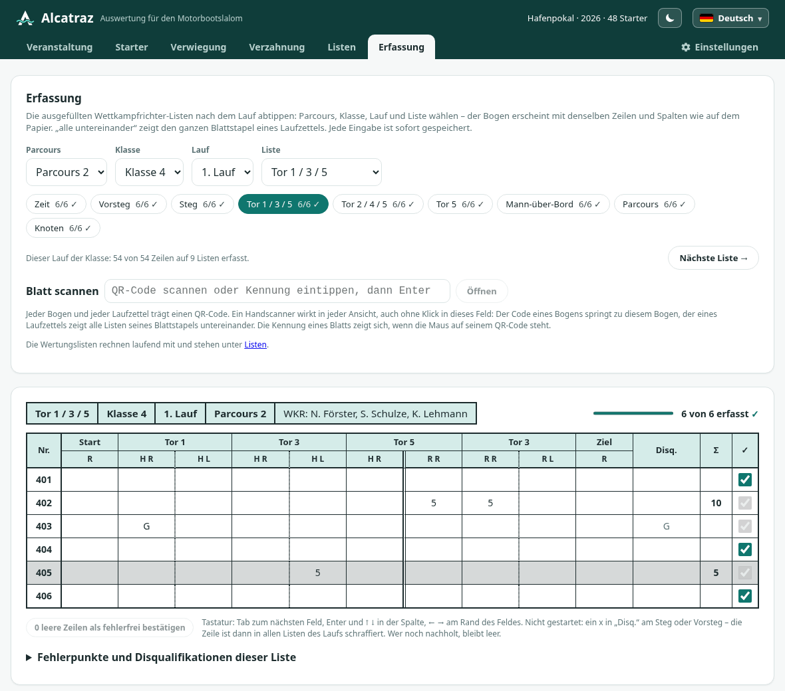
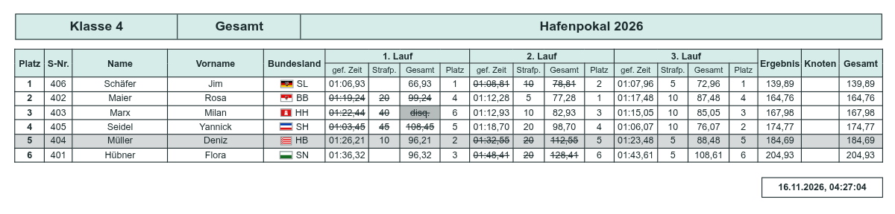
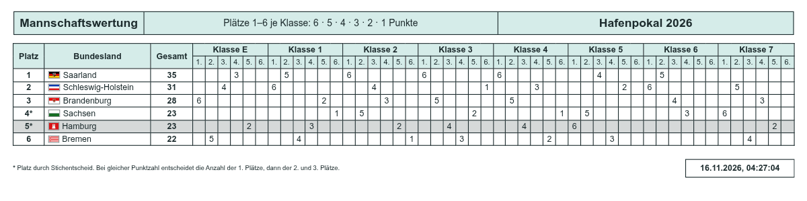
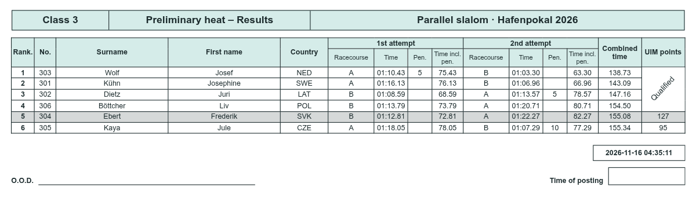

# Alcatraz

Alcatraz ist eine browserbasierte Software für die Auswertung von Wettkämpfen beim Motorbootslalom
bzw. Schlauchbootslalom (international: UIM Formula Future).
Sie ersetzt die Excel-Auswertung – vom Starterfeld über die Listen der Wettkampfrichter bis zur Mannschaftswertung.
Regelwerke: das DM-Reglement und UIM Regel 960 „Formula Future“ mit Parallelslalom.

Es gibt **keinen Server, keine Datenbank und keine Anmeldung**:
Alle Daten liegen im Browser des Auswertungsrechners und lassen sich als Datei sichern.

- **App:** <https://motorbootslalom.github.io/alcatraz/> – ausgeliefert über GitHub Pages,
  nach dem ersten Aufruf auch ohne Internet.
- **Ein-Datei-Fassung:** [`alcatraz.html`](https://motorbootslalom.github.io/alcatraz/alcatraz.html) –
  eine einzelne HTML-Datei, die ohne Internet per Doppelklick läuft.

## Loslegen

1. Die App öffnen. Alles beginnt im Reiter „Veranstaltung“.
2. Zum Ausprobieren dort ganz unten unter „Beispieldaten“ ein Beispiel-Starterfeld erzeugen.
   Danach lassen sich Verzahnung, Listen und Erfassung ansehen.
   „Alles zurücksetzen“ (Einstellungen → Dateien) leert den Browser vor dem echten Wettkampf wieder.
3. Vor dem Wettkampf die App einmal mit Netz öffnen und warten, bis in der Fußzeile „Offline bereit“ steht.
   Die Schritte: [Vor dem Wettkampf](docs/betrieb.md#vor-dem-wettkampf-mit-netz).
4. Während des Wettkampfs immer wieder eine Sicherung herunterladen (Einstellungen → Dateien → „Sicherung“).

## Was Alcatraz kann

- **Starter:** Austausch mit Excel, Startnummern, Prüfung von Jahrgang und Klasse.
- **Verzahnung** der Klassen auf Parcours, Spuren und Boote; Startplan des Parallelslaloms.
- **Verwiegung** mit Gewichtslisten und Ausgleichsgewichten.
- **Wettkampfrichter-Listen** je Parcours, Klasse, Lauf und Liste – mit Parcoursbild, QR-Code und Laufzettel.
- **Erfassung:** die ausgefüllten Bögen abtippen, in derselben Form wie auf dem Papier; ein Scan springt zum Bogen.
- **Wertungslisten** je Lauf und gesamt, mit dem Stichentscheid des Regelwerks und dem Aushang nach Regel 960.
- **Parallelslalom** mit Vorlauf, Halbfinale, Finale und Wiederholung (Re-run);
  Einzelwertung über Manövrieren und Parallelslalom.
- **Mannschaftswertung** je Verein, Bundesland oder Land; **Druckdatei** für alle Gruppen nach dem Wettkampf.
- Oberfläche deutsch und englisch; die Listen stehen in der Sprache des Regelwerks.
- Läuft ohne Internet, mit zweitem Speicher gegen harte Abbrüche und einem Verlauf zum Zurückholen.

Alles im Einzelnen: [docs/funktionen.md](docs/funktionen.md).

## So sieht es aus

Alle Bilder zeigen erfundene Beispieldaten aus der App (Veranstaltung „Hafenpokal 2026“).
Ein Klick öffnet das Bild in voller Größe.

**Vor dem Wettkampf**

<table>
<tr>
<td valign="top">
 Starter je Klasse, mit Startnummern und Herkunft</td>
<td valign="top">
 Verzahnung der Klassen, festgeschrieben</td>
</tr>
</table>

**Am Wettkampftag**

<table>
<tr>
<td valign="top" width="240">
 Wettkampfrichter-Bogen mit QR-Code und Parcoursbild</td>
<td valign="top" width="180">
 Laufzettel: hält die Blätter eines Laufs zusammen</td>
<td valign="top" width="240">
 Erfassung: derselbe Bogen als Eingabetabelle</td>
</tr>
</table>

**Ergebnisse**

<table>
<tr>
<td>
 Wertungsliste (Gesamt) mit Streichlauf</td>
</tr>
<tr>
<td>
 Mannschaftswertung, Plätze 1–6</td>
</tr>
<tr>
<td>
 Parallelslalom: Results des Vorlaufs mit „Qualified“</td>
</tr>
</table>

## Mehr lesen

- [Was Alcatraz kann](docs/funktionen.md) – alle Funktionen nach Bereichen, auch Herkunft und Flaggen.
- [Parallelslalom und Einzelwertung](docs/parallelslalom.md) – was unter UIM Regel 960 dazukommt.
- [Betrieb am Wettkampfort](docs/betrieb.md) – ohne Internet, neue Fassung, Sicherung und Verlauf.
- [Technik](docs/technik.md) – Aufbau, Offline-Speicher, Entwickeln und Tests.
- [Stand und Herkunft](docs/stand.md) – Vorgeschichte, Zusammenführung der Prototypen, was noch offen ist.
- [Fachliche Entscheidungen](docs/entscheidungen.md) – was wann und warum so entschieden wurde.
- [CLAUDE.md](CLAUDE.md) – Projektkarte für Agenten und Entwickler.

## Warum der Name Alcatraz?

Alcatraz ist die Bezeichnung für eine Wettkampfrichter-Position.
Bei dieser Position stehen zwei Boote hinter Tor 5 quer zum Parcours.
Ein Wettkampfrichter meinte dann sehr beschreibend, dass man sich auf dieser Position wie auf Alcatraz fühle –
eine früher als Gefängnis genutzte Insel in der Bucht von San Francisco.

## Was soll das Ganze kosten?

Nichts …

Das Programm wird hier mit dem gesamten Quelltext
als [freie Software](http://fsfe.org/about/basics/freesoftware.de.html) veröffentlicht.
In den meisten Landesverbänden wurden von fleißigen Helfern Programme für die Auswertung geschrieben
und gehütet wie ein Staatsgeheimnis.
Ich glaube nicht, dass das der richtige Weg ist.
Ich glaube, es bringt mehr, wenn jeder seine Erfahrung mit einbringen kann,
um ein Stück Software zu schaffen, das jeder nutzen kann und auch nutzen möchte.
Gemeinsam kann man oft mehr erreichen.

## Lizenzen

- **Programm:** GNU Affero General Public License 3.0 oder später ([LICENSE](LICENSE)).
- **Parcours-Zeichnungen:** aus [Motorbootslalom/Parcours](https://github.com/Motorbootslalom/Parcours),
  Lizenz [CC BY-NC-SA 4.0](https://creativecommons.org/licenses/by-nc-sa/4.0/deed.de).
  Urheber und Änderungen stehen in [`src/assets/parcours/LICENSE.md`](src/assets/parcours/LICENSE.md).
  Das gilt auch für die Zeichnung auf dem Bild `docs/bilder/wkr-bogen.png`.
- **Flaggen:** Staaten aus country-flag-icons (MIT), Bundesländer gemeinfrei –
  siehe [Herkunft und Flaggen](docs/funktionen.md#herkunft-und-flaggen).
