Deutsch · [English](README.en.md)

# Alcatraz

Alcatraz ist eine browserbasierte Software für die Auswertung von Wettkämpfen beim Motorbootslalom
bzw. Schlauchbootslalom (international: UIM Formula Future).
Sie ersetzt die Excel-Auswertung – vom Starterfeld über die Listen der Wettkampfrichter bis zur Mannschaftswertung.
Am Wettkampftag gibt sie die Starts frei, zeigt sie auf einer Anzeigetafel
und nimmt auf Wunsch die Werte der Wettkampfrichter direkt von Handy oder Pad entgegen.
Regelwerke: das DM-Reglement und UIM Regel 960 „Formula Future“ mit Parallelslalom.

Es gibt **keinen Server, keine Datenbank und keine Anmeldung**:
Alle Daten liegen im Browser des Auswertungsrechners und lassen sich als Datei sichern.
Einzige Ausnahme ist der Gerätebetrieb, und nur, wenn man ihn bewusst einschaltet (Betrieb → Geräte):
Dann tauscht dieser Rechner (in der App „Bedienrechner“) mit Anzeigetafel, Zuschauer-Handys
und gekoppelten Geräten (Start-Freigabe, WKR) verschlüsselte Nachrichten über einen fremden ntfy-Server –
etwa Startnummer, Name, Herkunft und Klasse der Starter und die erfassten Werte, nie Geburtsdatum oder Geschlecht
([Gerätebetrieb](docs/betrieb.md#gerätebetrieb)).

- **App:** <https://motorbootslalom.github.io/alcatraz/> – ausgeliefert über GitHub Pages,
  nach dem ersten Aufruf auch ohne Internet.
- **Ein-Datei-Fassung:** [`alcatraz.html`](https://motorbootslalom.github.io/alcatraz/alcatraz.html) –
  eine einzelne HTML-Datei, die ohne Internet per Doppelklick läuft.

## Loslegen

1. Die App öffnen. Alles beginnt im Reiter „Veranstaltung“.
2. Zum Ausprobieren dort ganz unten unter „Beispieldaten“ ein Beispiel-Starterfeld erzeugen.
   Danach lassen sich Verzahnung, Listen und Erfassung ansehen,
   nach „Verzahnung festschreiben“ auch der Betrieb am Wettkampftag.
   „Alles zurücksetzen“ (Einstellungen → Dateien) leert den Browser vor dem echten Wettkampf wieder.
3. Vor dem Wettkampf die App einmal mit Netz öffnen und warten, bis in der Fußzeile „Offline bereit“ steht.
   Die Schritte: [Vor dem Wettkampf](docs/betrieb.md#vor-dem-wettkampf-mit-netz).
4. Während des Wettkampfs immer wieder eine Sicherung herunterladen (Einstellungen → Dateien → „Sicherung“).

## Was Alcatraz kann

- **Starter:** Austausch mit Excel, Startnummern, Prüfung von Jahrgang und Klasse.
- **Verzahnung** der Klassen auf Parcours, Spuren und Boote; Startplan des Parallelslaloms.
- **Verwiegung** mit Gewichtslisten und Ausgleichsgewichten.
- **Wettkampfrichter-Listen** je Parcours, Klasse, Lauf und Liste – mit Parcoursbild, QR-Code und Laufzettel.
- **Erfassung:** die ausgefüllten Bögen abtippen, in derselben Form wie auf dem Papier; ein Scan springt zum Bogen.
- **Wertungslisten** je Lauf und gesamt, mit dem Stichentscheid des Regelwerks und dem Aushang nach Regel 960.
- **Parallelslalom** mit Vorlauf, Halbfinale, Finale und Wiederholung (Re-run);
  Einzelwertung über Manövrieren und Parallelslalom.
- **Mannschaftswertung** je Verein, Bundesland oder Land; **Druckdatei** für alle Gruppen nach dem Wettkampf.
- **Am Wettkampftag:** Start-Freigabe, Anzeigetafel im zweiten Fenster, Startliste mit Wartezeiten, Zuschauerliste –
  auf Wunsch auch auf anderen Geräten über einen Link mit QR-Code; die Start-Freigabe auch auf einem gekoppelten Handy.
- **WKR-Geräte:** Wettkampfrichter erfassen ihre Liste auf Handy oder Pad statt auf Papier –
  mit Knöpfen, auf der Parcours-Zeichnung („Bild“) oder als Tabelle; Papier und Gerät lassen sich mischen.
  Üben geht ohne Verbindung.
- Oberfläche deutsch und englisch; die Listen stehen in der Sprache des Regelwerks.
- Läuft ohne Internet, mit zweitem Speicher gegen harte Abbrüche und einem Verlauf zum Zurückholen.

Alles im Einzelnen: [docs/funktionen.md](docs/funktionen.md).

## So sieht es aus

Alle Bilder zeigen erfundene Beispieldaten aus der App (DM-Veranstaltung „Hafenpokal“, Herkunft Bundesland;
den Parallelslalom gibt es nur unter UIM).
Ein Klick öffnet das Bild in voller Größe; alle Bilder: [docs/bilder/de/](docs/bilder/de/).

**Vor dem Wettkampf**

<table>
<tr>
<td valign="top" width="260"><a href="docs/bilder/de/starter.png">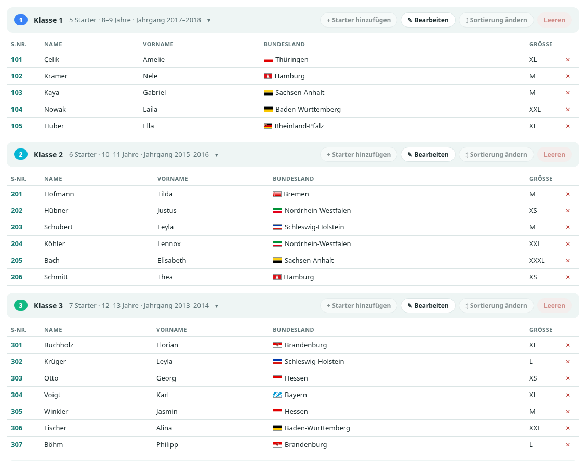</a>
 Starter je Klasse, mit Startnummern und Herkunft</td>
<td valign="top" width="260"><a href="docs/bilder/de/verzahnung.png">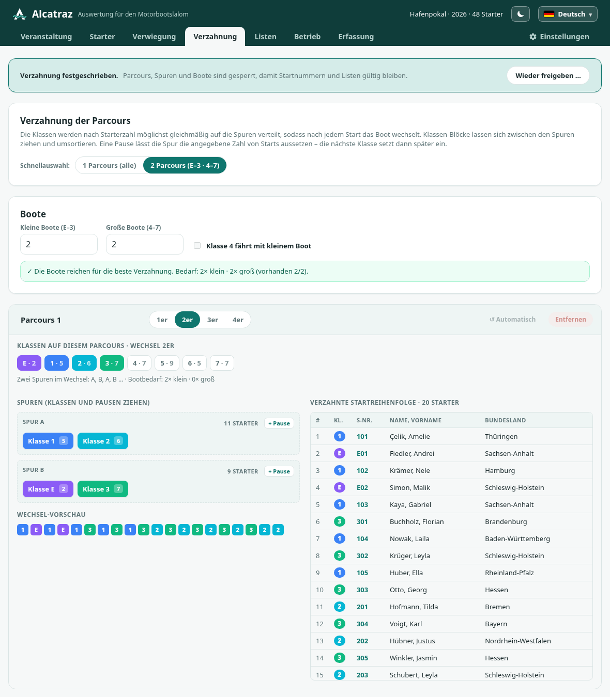</a>
 Verzahnung der Klassen, festgeschrieben</td>
<td valign="top" width="220"><a href="docs/bilder/de/wkr-bogen.png">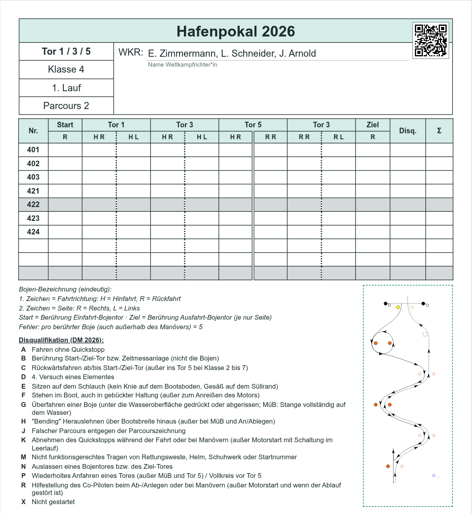</a>
 WKR-Bogen mit QR-Code und Parcoursbild</td>
</tr>
</table>

**Am Wettkampftag**

<table>
<tr>
<td valign="top" width="260"><a href="docs/bilder/de/start-freigabe.png">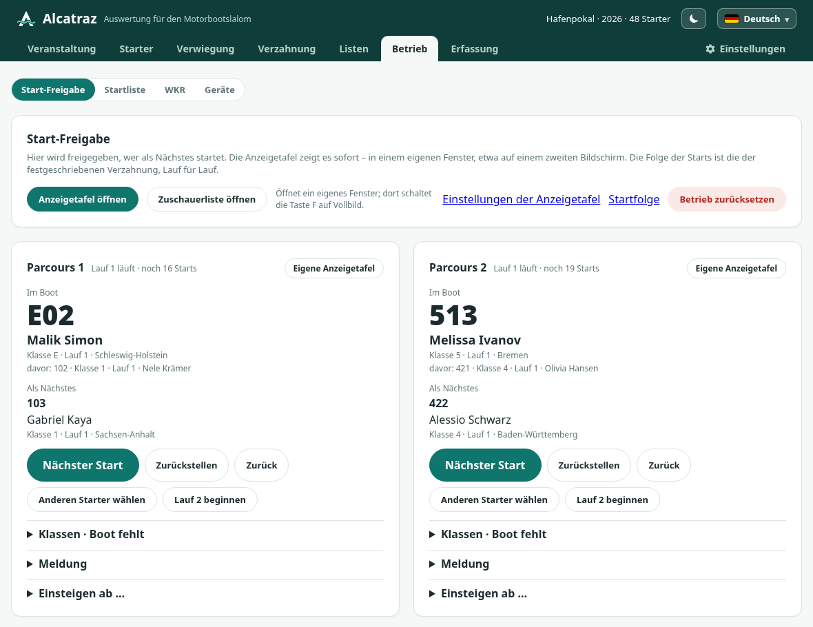</a>
 Start-Freigabe am Bedienrechner</td>
<td valign="top" width="260"><a href="docs/bilder/de/anzeigetafel.png">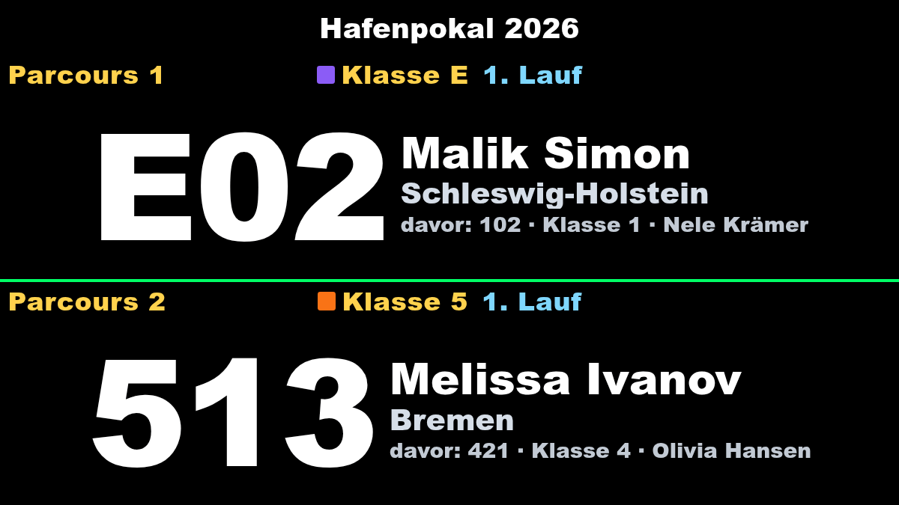</a>
 Anzeigetafel im zweiten Fenster</td>
<td valign="top" width="180"><a href="docs/bilder/de/zuschauer.png">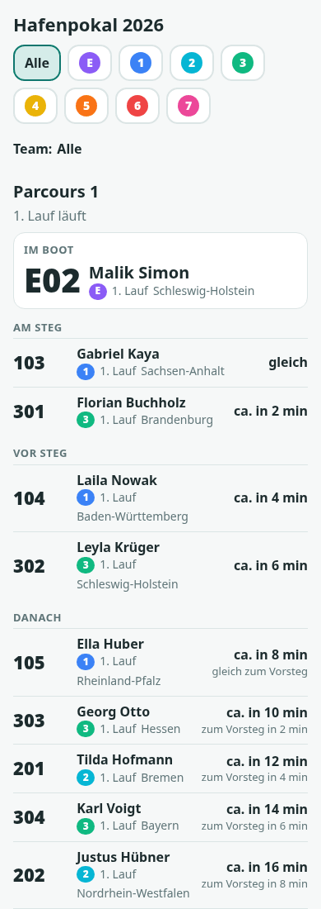</a>
 Zuschauerliste auf dem Handy</td>
</tr>
</table>
<table>
<tr>
<td valign="top" width="180"><a href="docs/bilder/de/wkr-handy.png">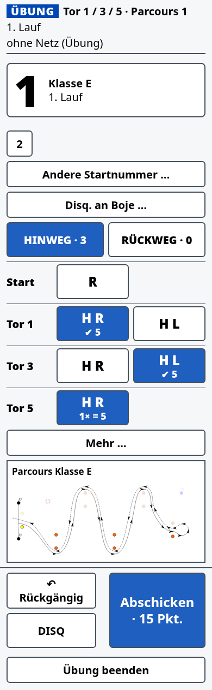</a>
 WKR-Maske auf dem Handy</td>
<td valign="top" width="300"><a href="docs/bilder/de/wkr-pad-bild.png">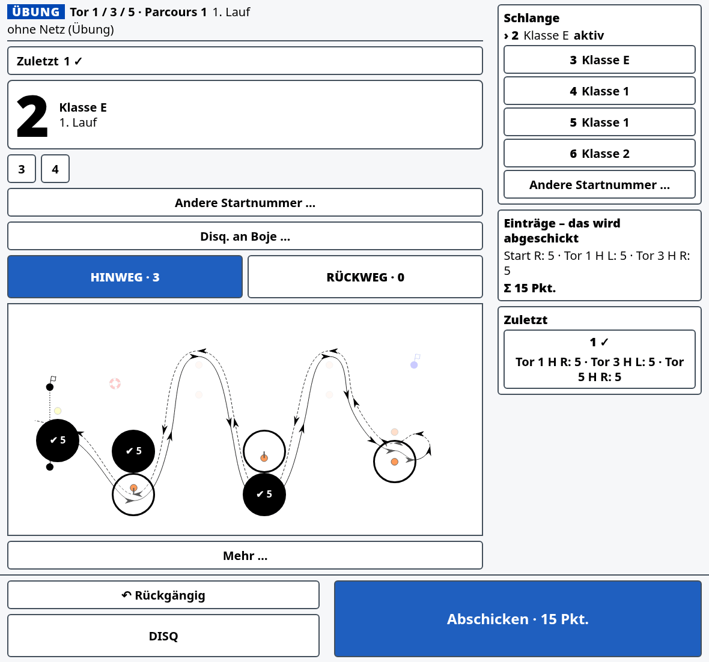</a>
 WKR-Maske „Bild“ auf dem Pad</td>
<td valign="top" width="260"><a href="docs/bilder/de/erfassung.png">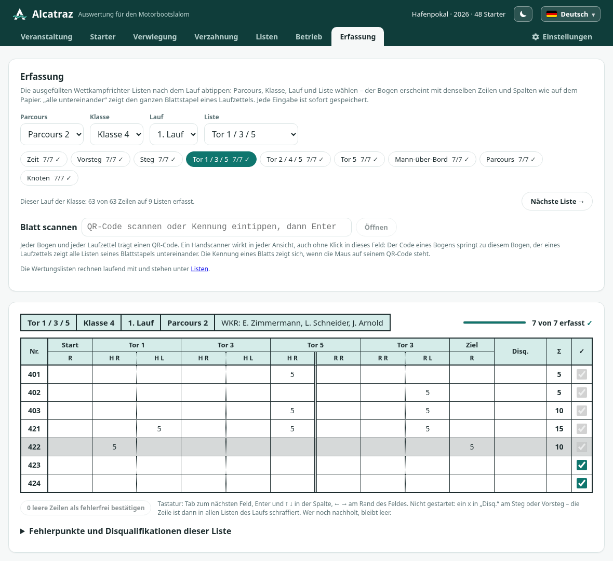</a>
 Erfassung: der Bogen als Eingabetabelle</td>
</tr>
</table>

**Ergebnisse**

<table>
<tr>
<td><a href="docs/bilder/de/wertungsliste.png">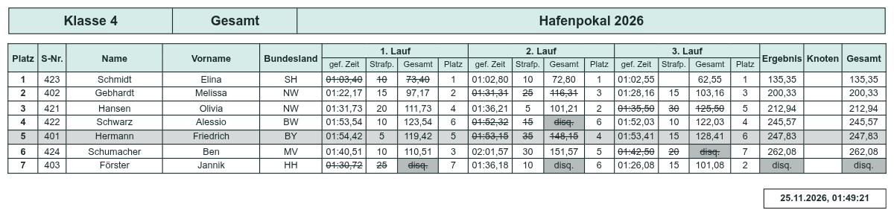</a>
 Wertungsliste (Gesamt) mit Streichlauf</td>
</tr>
<tr>
<td><a href="docs/bilder/de/mannschaftswertung.png">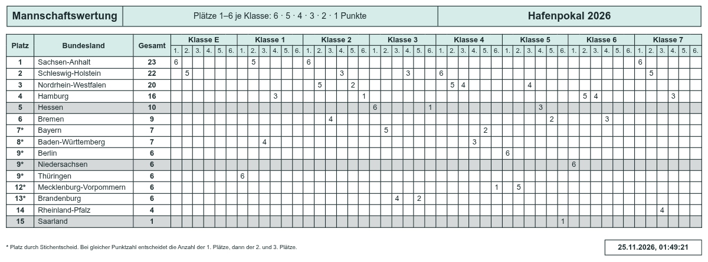</a>
 Mannschaftswertung</td>
</tr>
<tr>
<td><a href="docs/bilder/de/parallel-results.png">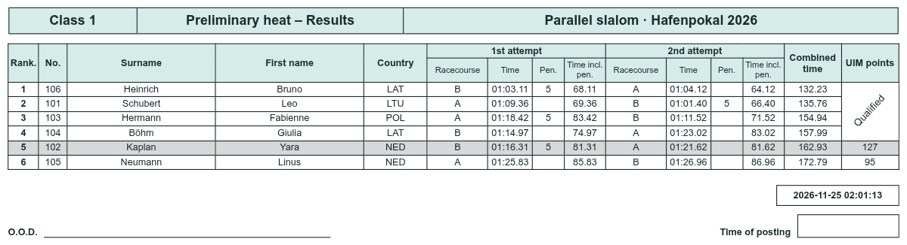</a>
 Parallelslalom (nur UIM, Listen englisch): Results des Vorlaufs mit „Qualified“</td>
</tr>
</table>

## Mehr lesen

- [Was Alcatraz kann](docs/funktionen.md) – alle Funktionen nach Bereichen, auch Herkunft und Flaggen.
- [Parallelslalom und Einzelwertung](docs/parallelslalom.md) – was unter UIM Regel 960 dazukommt.
- [Betrieb am Wettkampfort](docs/betrieb.md) – ohne Internet, Sicherung und Verlauf, Gerätebetrieb,
  Ablauf am Wettkampftag.
- [Feldtest Gerätebetrieb](docs/feldtest.md) – Checkliste für den Test mit echten Geräten.
- [Technik](docs/technik.md) – Aufbau, Offline-Speicher, Entwickeln, Doku und Tests.
- [Stand und Herkunft](docs/stand.md) – Vorgeschichte, Zusammenführung der Prototypen, was noch offen ist.
- [Fachliche Entscheidungen](docs/entscheidungen.md) – was wann und warum so entschieden wurde (nur deutsch).
- [CLAUDE.md](CLAUDE.md) – Projektkarte für Agenten und Entwickler.
- **English:** [README.en.md](README.en.md) und die englische Doku in [docs/en/](docs/en/).

## Weitere Regelwerke

Alcatraz kennt bisher das DM-Reglement und UIM Regel 960.
Jedes Regelwerk steht als eigene Datei im Programm (`src/config/regelwerke/`).
Verbände aus anderen Ländern sind eingeladen, ihr Regelwerk (Rulebook) zu schicken:
als Issue über die [Vorlage „Regelwerk“](https://github.com/Motorbootslalom/alcatraz/issues/new?template=regelwerk.yml),
mit Link oder PDF, Klassen und Codes. Rückfragen laufen im Issue auf GitHub.

## Warum der Name Alcatraz?

Alcatraz ist die Bezeichnung für eine Wettkampfrichter-Position.
Bei dieser Position stehen zwei Boote hinter Tor 5 quer zum Parcours.
Ein Wettkampfrichter meinte dann sehr beschreibend, dass man sich auf dieser Position wie auf Alcatraz fühle –
eine früher als Gefängnis genutzte Insel in der Bucht von San Francisco.

## Was soll das Ganze kosten?

Nichts …

Das Programm wird hier mit dem gesamten Quelltext
als [freie Software](http://fsfe.org/about/basics/freesoftware.de.html) veröffentlicht.
In den meisten Landesverbänden wurden von fleißigen Helfern Programme für die Auswertung geschrieben
und gehütet wie ein Staatsgeheimnis.
Ich glaube nicht, dass das der richtige Weg ist.
Ich glaube, es bringt mehr, wenn jeder seine Erfahrung mit einbringen kann,
um ein Stück Software zu schaffen, das jeder nutzen kann und auch nutzen möchte.
Gemeinsam kann man oft mehr erreichen.

## Lizenzen

- **Programm:** GNU Affero General Public License 3.0 oder später ([LICENSE](LICENSE)).
- **Parcours-Zeichnungen:** aus [Motorbootslalom/Parcours](https://github.com/Motorbootslalom/Parcours),
  Lizenz [CC BY-NC-SA 4.0](https://creativecommons.org/licenses/by-nc-sa/4.0/deed.de).
  Urheber und Änderungen stehen in [`src/assets/parcours/LICENSE.md`](src/assets/parcours/LICENSE.md).
  Das gilt auch für die Zeichnungen auf den Bildern unter `docs/bilder/` (etwa `wkr-bogen.png`, `wkr-pad-bild.png`).
- **Flaggen:** Staaten aus country-flag-icons (MIT), Bundesländer gemeinfrei –
  siehe [Herkunft und Flaggen](docs/funktionen.md#herkunft-und-flaggen).
