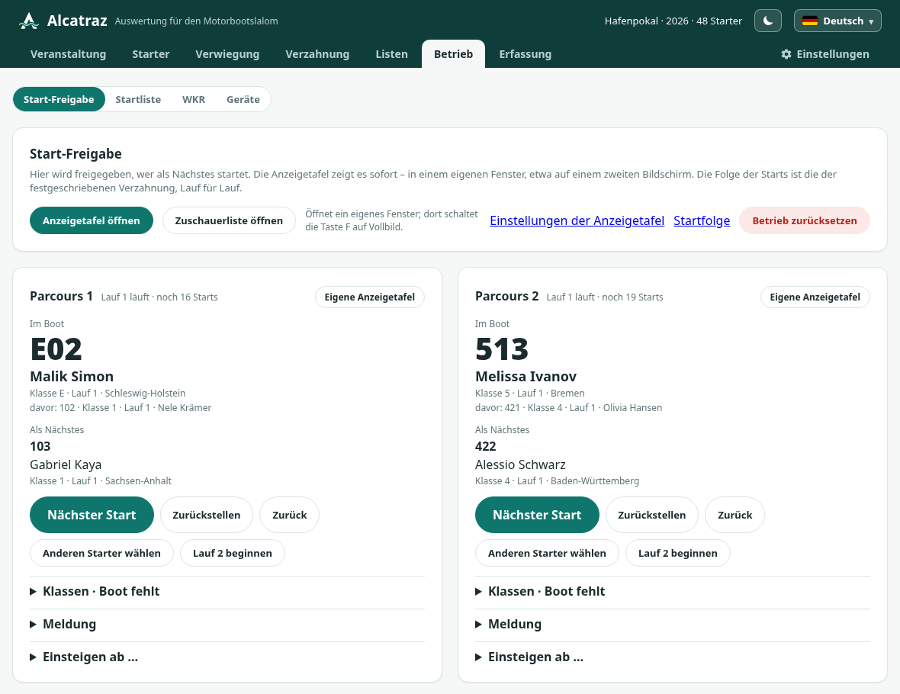
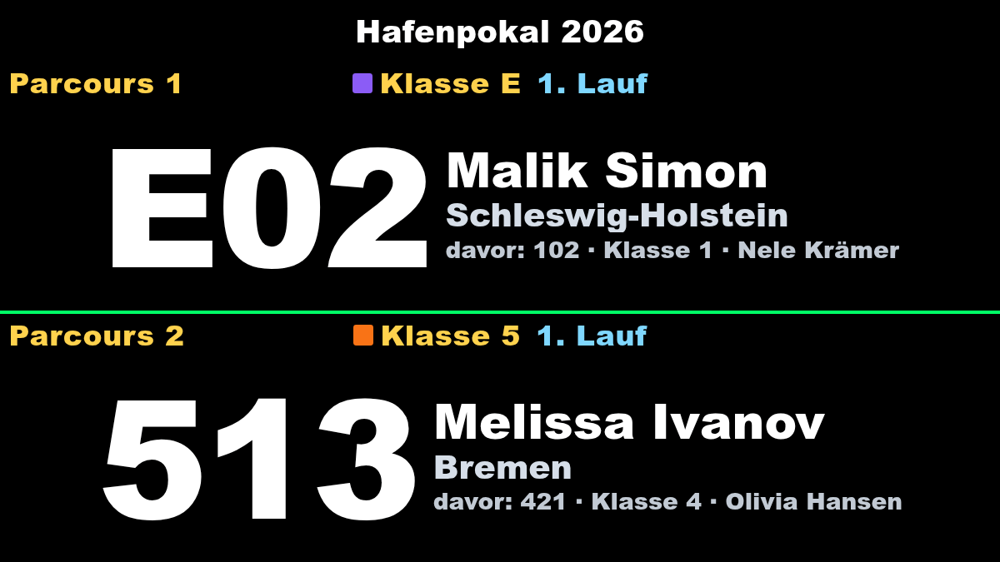
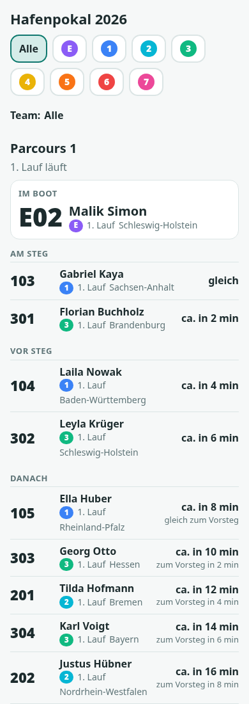
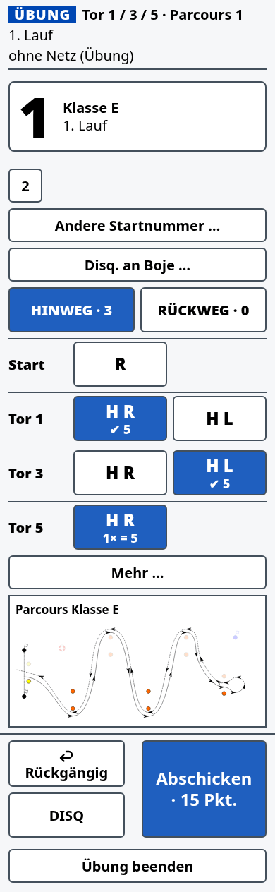
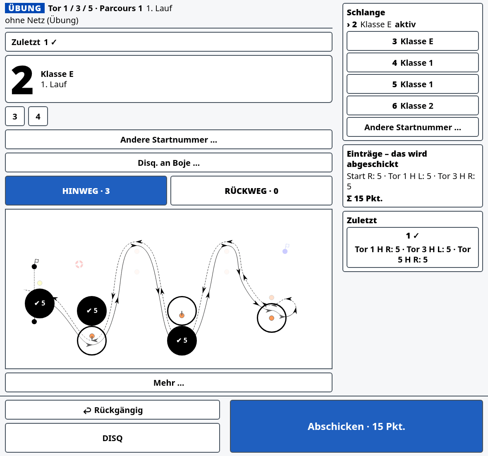

Deutsch · [English](en/betrieb.md)

# Betrieb am Wettkampfort

Was Auswerter vor und während eines Wettkampfs wissen sollten: ohne Internet arbeiten, neue Fassungen, Sicherung und
Verlauf, die Start-Freigabe mit Anzeigetafel und Zuschauerliste – und der Gerätebetrieb, der als einziger Teil ins
Netz geht (Lese-Links, Start-Freigabe vom Handy, WKR-Erfassung auf Handy und Pad).
Schritt für Schritt: [Ablauf am Wettkampftag](#ablauf-am-wettkampftag); Feldtest der Geräte: [feldtest.md](feldtest.md).
Was die App fachlich kann: [funktionen.md](funktionen.md).
Wie Offline-Speicher und Gerätebetrieb gebaut sind: [technik.md](technik.md#offline-speicher),
[Sicherheitsmodell](technik.md#gerätebetrieb-sicherheitsmodell).

## Inhalt

- [Ohne Internet](#ohne-internet)
- [Vor dem Wettkampf (mit Netz)](#vor-dem-wettkampf-mit-netz)
- [Neue Fassung](#neue-fassung)
- [Daten behalten](#daten-behalten)
- [Zwei Speicher gegen den harten Abbruch](#zwei-speicher-gegen-den-harten-abbruch)
- [Verlauf](#verlauf)
- [Grenzen](#grenzen)
- [Die Ein-Datei-Fassung](#die-ein-datei-fassung)
- [Start-Freigabe, Anzeigetafel und Zuschauerliste](#start-freigabe-anzeigetafel-und-zuschauerliste)
- [Gerätebetrieb](#gerätebetrieb): Lese-Links, [Koppeln](#start-freigabe-vom-handy-koppeln),
  [Bildschirm wach halten](#bildschirm-wach-halten), [Alle Geräte neu laden](#alle-geräte-neu-laden),
  [Kontingent](#kontingent-des-servers)
- [WKR-Erfassung auf Handy und Pad](#wkr-erfassung-auf-handy-und-pad)
- [Ablauf am Wettkampftag](#ablauf-am-wettkampftag)

## Ohne Internet

Am Wettkampfort gibt es oft kein Netz.
Alcatraz lädt im Betrieb nichts nach; die Daten liegen im Browser.
Die einzige Ausnahme ist der [Gerätebetrieb](#gerätebetrieb) – und auch der erst, wenn ihn jemand einschaltet.
Damit auch **Neuladen, ein neuer Tab und ein Neustart des Browsers** ohne Netz gehen,
legt die Pages-Fassung beim ersten Aufruf einen Offline-Speicher für das Programm an (Service Worker).
Alle Dateien – Seite, Programm, Gestaltung, Bilder und die Ein-Datei-Fassung – liegen danach auf dem Gerät.

**Was ohne Netz geht:** alles am Bedienrechner – jede Ansicht, Drucken, Sicherung herunter- und einspielen,
auch das Herunterladen der Ein-Datei-Fassung, die Start-Freigabe, die Anzeigetafel und die Zuschauerliste im zweiten
Fenster. Netz brauchen nur die Suche nach einer neuen Fassung und der Gerätebetrieb: Anzeigetafel und Zuschauerliste
auf anderen Geräten, die Start-Freigabe vom Handy und die WKR-Erfassung auf Handy und Pad.

## Vor dem Wettkampf (mit Netz)

1. Die Seite auf dem Auswertungsrechner einmal öffnen –
   in dem Browser und unter der Adresse, die am Wettkampftag benutzt werden.
2. Warten, bis in der Fußzeile bzw. unter „Einstellungen → Ohne Internet“ **„Offline bereit“** steht.
   Steht dort „Neue Fassung verfügbar“: jetzt „Update“ drücken, nicht erst am Wettkampftag.
3. Zur Probe das Netz trennen und die Seite neu laden.
4. Eine Sicherung herunterladen („Einstellungen → Dateien“) – und während des Wettkampfs immer wieder.

Reißt die Verbindung beim ersten Laden ab, versucht Alcatraz es nach 5 und nach 30 Sekunden noch einmal.
Hilft das nicht, steht „Kein Offline-Speicher“ da – mit dem Knopf „Erneut versuchen“.
„wird vorbereitet“ heißt also immer, dass wirklich noch geladen wird.

## Neue Fassung

- Sie wird nie mitten im Wettkampf untergeschoben.
  Ein Wettkampf geht über zwei bis vier Tage, und der Rechner wird zwischendurch neu gestartet.
- Der Browser sieht beim Öffnen oder Neuladen der Seite nach (und auf „Nach neuer Fassung suchen“).
  Er lädt eine neue Fassung vollständig im Hintergrund in einen eigenen Speicher.
- Solange **Starter** eingetragen sind, bleibt die laufende Fassung –
  über Neuladen, neue Tabs, das Schließen aller Fenster und einen Neustart von Browser oder Rechner hinweg,
  auch ohne Netz.
- Liegt die neue Fassung vollständig bereit, erscheint in der Kopfzeile vor „Einstellungen“ der Knopf **„Update“**.
  Denselben gibt es unter „Einstellungen → Ohne Internet“.
  Dort steht auch, welche Fassung läuft und welche bereitliegt:
  der Zeitpunkt des Builds mit Sekunden, damit zwei Builds derselben Minute zu unterscheiden sind.
- „Update“ legt den Stand zuerst im Verlauf ab („vor dem Update auf …“), schaltet um und lädt dieses Fenster neu.
  Andere offene Fenster laden nicht von selbst neu, sondern zeigen einen Hinweis.
- Ist der Stand **leer**, übernimmt Alcatraz eine bereitliegende Fassung beim Öffnen von selbst.
  Als leer gilt: keine Starter (vor dem Anlegen, nach „Alles zurücksetzen“; `standLeer` in `src/lib/eingaben.ts`).
- Die Daten im Browser bleiben in jedem Fall unverändert.
- Mit Gerätebetrieb: nach dem Update [„Alle Geräte neu laden“](#alle-geräte-neu-laden).

## Daten behalten

Sobald Starter vorhanden sind, bittet Alcatraz den Browser, die Daten dieser Seite nicht von sich aus zu löschen
(`navigator.storage.persist()`, höchstens einmal am Tag; von Hand unter „Ohne Internet“).
Ob er zugesagt hat, steht dort.
Der eigentliche Schutz bleibt die **Sicherungsdatei** –
auch die Zusage schützt nicht davor, dass jemand die Browserdaten löscht.

## Zwei Speicher gegen den harten Abbruch

Der Browser schreibt den `localStorage` gebündelt und mit Verzögerung auf die Platte.
Wird das Fenster ordentlich geschlossen, geht nichts verloren.
Bei einem harten Abbruch – Absturz, leerer Akku, Stromausfall – fehlten ohne weiteren Schutz die letzten Eingaben,
ohne dass die Anwendung es merkte.
In Chromium gemessen: alles aus der letzten Sekunde, unter Last bis zu rund einer Minute.

- Deshalb geht jede Änderung zusätzlich in einen **zweiten Speicher**, eine IndexedDB desselben Browsers.
- Dort ist sie nach wenigen Millisekunden abgeschlossen.
  Gemessen bei 336 Startern mit allen Eingaben: im Mittel 5 ms, höchstens 26 ms; bei pausenlosem Tippen höchstens 47 ms.
- Beim Start vergleicht Alcatraz beide Speicher und nimmt den neueren Stand.
  War es der zweite, steht oben **„Nach einem Abbruch wiederhergestellt … bitte die zuletzt erfassten Werte prüfen“**
  mit dem Zeitpunkt des Stands.
- Der Test dazu: zehn Eingaben tippen, die elfte, und den Browser 0, 50, 200 und 1000 ms danach mit `SIGKILL` beenden.
  Ohne zweiten Speicher fehlten jedes Mal alle elf, mit ihm keine.
  Geprüft ist das Beenden des Browsers.
  Bei einem Stromausfall kommt es zusätzlich darauf an, dass das Betriebssystem geschrieben hat;
  der zweite Speicher verlangt das vom Browser ausdrücklich („durability: strict“).

Das Tippen bremst das nicht:

- Der zweite Speicher bekommt den Text, der für den ersten ohnehin gebildet wird, und schreibt im Hintergrund.
- Es läuft immer nur ein Schreibvorgang; kommen währenddessen weitere Änderungen, wartet nur die jüngste.
- Wird die Seite verborgen oder verlassen, geht auch sie sofort hinaus.
- Mehrere Fenster vertragen sich (ein Fenster übernimmt den Stand des anderen).
  Aus dem zweiten Speicher wird nur beim Start gelesen, nie im laufenden Betrieb.
- Dabei gilt immer der ganze Stand des Fensters, das zuletzt geschrieben hat.
  Abwechselnd in mehreren Fenstern zu arbeiten ist unbedenklich,
  aber **nicht in zwei Fenstern im selben Augenblick erfassen**:
  Tippen zwei Fenster innerhalb weniger Millisekunden, kann die Eingabe des einen fehlen.
  Im Test war das nur mit erzwungenem Gleichlauf auszulösen; von Hand hat immer nur ein Fenster die Tastatur.

Gibt es keine IndexedDB (privates Fenster mancher Browser, sehr alte Browser, gesperrter Speicher),
läuft Alcatraz mit dem `localStorage` allein und sagt das unter „Dateien“ und „Ohne Internet“.
Dann gilt: nach einem Absturz die zuletzt erfassten Starter gegen die Zettel prüfen.
Beide Speicher liegen im selben Browser auf demselben Gerät.
Gegen ein verlorenes oder defektes Gerät und gegen gelöschte Browserdaten hilft nur die **Sicherungsdatei**.

## Verlauf

- Der zweite Speicher hält die letzten Stände vor („Einstellungen → Dateien → Verlauf“).
  Jeder Eintrag hat Zeitpunkt und das, was sich geändert hat:
  „Eingabe Klasse 4, 2. Lauf · 17 Änderungen“, „12 Starter importiert“, „Aufbau gewechselt“,
  „Wiederholung nach Ausfall – Werte verworfen: 101, Klasse 1, 1. Lauf“.
- Gleichartige Änderungen kurz nacheinander sind ein Eintrag
  (bis zu einer Pause von zwei Minuten, höchstens zehn Minuten lang).
- Jeder Stand lässt sich wiederherstellen.
  Der jetzige geht dabei nicht verloren; er steht dann selbst im Verlauf, man kommt also wieder nach vorn.
- **„Stand merken“** legt den jetzigen Stand unter einem Namen ab („vor dem Test“).
  Gemerkte Stände bleiben, bis man sie löscht; die übrigen weichen neueren (höchstens 100, höchstens 30 Tage alt).
- Ein Stand mit 336 Startern und allen Eingaben belegt in Chromium rund 50 bis 100 kB auf der Platte,
  100 Stände also rund 5 bis 10 MB.
- Logos stehen in jedem Stand mit: zusammen höchstens rund 0,3 MB je Stand, bei 100 Ständen also bis zu rund 30 MB
  mehr; übliche Logos deutlich weniger.
- Der Verlauf enthält Namen und Ergebnisse.
  Er liegt nur auf diesem Gerät, steht in keiner Sicherung und keiner Vorlage, und „Alles zurücksetzen“ löscht ihn mit.
  Scheitert das Löschen im zweiten Speicher ausnahmsweise, holt es die nächste Änderung oder der nächste Start nach.

## Grenzen

Der Offline-Speicher gilt je Browser und Adresse.
Im privaten Fenster mancher Browser, ohne https oder wenn der Browser ihn ablehnt, steht „Kein Offline-Speicher“ da.
Die Anwendung läuft dann, lässt sich ohne Netz aber nicht neu laden.
Der Entwicklungsserver (`npm run dev`) legt keinen an.

## Die Ein-Datei-Fassung

Die Ein-Datei-Fassung (`alcatraz.html`) gibt es unter „Ohne Internet“ zum Herunterladen,
oder man baut sie mit `npm run build:single`.
Sie läuft per Doppelklick vom Stick, braucht nie ein Netz und bekommt keine neue Fassung,
solange niemand die Datei ersetzt.
Sie hat ihren **eigenen Datenspeicher**: Stände wandern zwischen Pages-Fassung und Datei –
und zwischen zwei Kopien der Datei an verschiedenen Orten – nur über eine Sicherung.
Mit Gerätebetrieb führen ihre Links zur App auf GitHub Pages (siehe [Gerätebetrieb](#gerätebetrieb)).

## Start-Freigabe, Anzeigetafel und Zuschauerliste

Reiter „Betrieb“. Das alles läuft am Bedienrechner, ohne Netz und ohne Gerätebetrieb.
Jede Schaltfläche im Einzelnen: [funktionen.md](funktionen.md#betrieb-start-freigabe-und-anzeigetafel);
Parallelslalom (nur UIM): [parallelslalom.md](parallelslalom.md).

- **Voraussetzung:** Die Verzahnung ist festgeschrieben. Erst dann stehen Startnummern und Folge fest; vorher zeigt
  der Reiter nur den Weg zur Verzahnung.
- **Unterreiter:** „Start-Freigabe“, „Startliste“, „WKR“ (digitale Erfassung, [unten](#wkr-erfassung-auf-handy-und-pad))
  und „Geräte“ ([Gerätebetrieb](#gerätebetrieb)).
- **Start-Freigabe:** je Parcours eine Karte. „Lauf N beginnen“ gibt die Starts des Laufs frei, „Nächster Start“
  bringt den nächsten offenen Start auf die Anzeigetafel, „Zurück“ nimmt ihn zurück. Dazu „Zurückstellen“, „Anderen
  Starter wählen“ (Suche nach Startnummer oder Name, Verschieben), „Wiederholung (Ausfall) …“ (unten), „Klassen · Boot
  fehlt“, „Einsteigen ab …“ und „Meldung“ (Störung, Pause, Hinweis; mit Vorlagen). „Betrieb zurücksetzen“ im Kopf
  löscht begonnene Läufe, gezeigte Starts und Meldungen; Starter, Verzahnung und erfasste Werte bleiben. Rückfrage gibt
  es nur vor „Lauf beginnen“, solange Starts offen sind, vor „Betrieb zurücksetzen“, vor einer Wiederholung nach
  Ausfall und mit WKR-Erfassung bei Rückstand („Trotzdem weiter?“); alles andere lässt sich zurücknehmen.
- **Wiederholung nach Ausfall** (26.11.2026; nur Manövrieren, nur am Bedienrechner): Fällt ein Boot nach dem Start
  aus und bestätigt die Wettkampfleitung den Ausfall, wird der Lauf des Starters wiederholt. „Wiederholung (Ausfall) …“
  neben „Anderen Starter wählen“ zeigt die schon gezeigten Starts der laufenden Läufe (der zuletzt gezeigte zuerst,
  Suche nach Startnummer); „Wiederholen …“, dann „Werte verwerfen und wiederholen“. Alle Werte dieses Starters in
  diesem Lauf sind danach auf jeder Liste weg, auch die von den WKR-Geräten. Der Start steht unter „Wiederholung
  offen“ und fährt nie von selbst: mit „Als Nächster“ oder „Ans Ende des Laufs“ einreihen oder mit „Jetzt zeigen“
  zeigen – das geht auch vom Freigabe-Handy und in der Startliste. Auf Papier streicht der Wettkampfrichter die Zeile
  und trägt die Wiederholung in eine Leerzeile ein; die Erfassung zeigt an der Startnummer ↻. Liegt der Ausfall am
  Starter, gibt es keine Wiederholung: Der Wettkampfrichter trägt an der Boje „J“ ein (falscher Parcours). Vertan?
  „Doch keine Wiederholung“ in der Liste „Wiederholung offen“ holt die verworfenen Werte zurück, solange der Start
  nicht wieder gezeigt ist. Anzeigetafel und Zuschauerliste zeigen „1. Lauf · Wiederholung“, ohne Grund. Im
  Parallelslalom gibt es den Knopf nicht. Einzelheiten:
  [funktionen.md](funktionen.md#start-freigabe).
- **Anzeigetafel:** „Anzeigetafel öffnen“ öffnet sie in einem eigenen Fenster, etwa auf einem zweiten Monitor am Steg.
  Taste F oder Doppelklick schaltet Vollbild. Bei mehreren Parcours hat jede Karte dazu „Eigene Anzeigetafel“.
- **Zuschauerliste:** „Zuschauerliste öffnen“ zeigt je Parcours „Im Boot“, „Am Steg“, „Vor Steg“ und „Danach“ mit
  „ca. in“ und „zum Vorsteg in“; Filter nach Klasse und nach Team (Herkunft). Schmal genug fürs Handy.
- **Startliste:** alle offenen Starts in ihrer Folge mit „ca. in“ und „Zum Vorsteg“, geschätzt aus den
  Startabständen. Ziehen stellt einen Start um, nach denselben Regeln wie an der Start-Freigabe.
- **Einstellungen:** Die Verweise „Einstellungen der Anzeigetafel“ und „Startfolge“ führen zu „Einstellungen →
  Anzeigetafel“ (Kopfzeile, Logos, Namen, Herkunft, Sprache, Schriftgröße) und „Einstellungen → Startfolge im
  Betrieb“ (Verzahnung beim Verschieben halten, Starts am Steg und vor Steg, Startabstände, Rückstand und Auto-Modus
  der WKR-Erfassung).
- **Datenschutz:** Anzeigetafel, Zuschauerliste und Start-Freigabe lesen nur Startnummer, Name, Klasse und Herkunft –
  nie Geburtsdatum, Gewicht, Geschlecht oder erfasste Werte. Die Fenster von Anzeigetafel und Zuschauerliste schreiben
  nie.

## Gerätebetrieb

Anzeigetafel und Zuschauerliste lassen sich auch auf anderen Geräten zeigen – einem Bildschirm am Steg, einem Tablet,
den Handys der Zuschauer. Dafür gibt es zwei **Lese-Links** mit QR-Code, ohne Anmeldung und ohne Kopplung: Wer den
Link hat, kann lesen, aber nichts ändern. Ein **gekoppeltes** Handy oder Tablet kann außerdem die Start-Freigabe
bedienen ([unten](#start-freigabe-vom-handy-koppeln)) oder eine Liste der Wettkampfrichter erfassen
([WKR-Erfassung](#wkr-erfassung-auf-handy-und-pad)).

**Nichts geht von selbst hinaus.** Solange niemand unter „Betrieb → Geräte“ auf **„Gerätebetrieb einschalten“** drückt,
baut Alcatraz keine Verbindung zu irgendeinem Server auf (dafür gibt es einen eigenen Test). Eingeschaltet gilt:

- **Was über den Server geht:** Startnummer, Name (nach der Einstellung „Namen“ der Anzeigetafel, Vorgabe wie der
  Aushang der Wertungslisten), Herkunft und Klasse der Starter, die Folge der Starts mit Zeitpunkten, Meldungen und der
  Name der Veranstaltung. Alles verschlüsselt und vom Bedienrechner signiert.
- **Mit WKR-Erfassung zusätzlich:** die Zeilen, die die Wettkampfrichter abschicken. Ihre Geräte sehen je Liste nur
  Startnummer, Klasse und Boot (nie Namen), den Namen des Wettkampfrichters aus der Einteilung, bei einer Rückfrage den
  Wert genau dieser Zelle – und am Steg das **Ausgleichsgewicht** je Start. Daraus lässt sich bei einem leichteren
  Starter das Körpergewicht ungefähr zurückrechnen; der Hinweis vor dem Einschalten nennt diese Ausnahme.
- **Was nie hinausgeht:** Geburtsdatum, Körpergewicht, Geschlecht, Logos, die Sicherung – überhaupt nie der Stand der
  Veranstaltung, nur zugeschnittene Sichten. Anzeigetafel und Zuschauerliste zeigen nie etwas aus der WKR-Erfassung.
- **Der Server** ist ein fremder ntfy-Server (Vorgabe `ntfy.adminforge.de`, ehrenamtlich betrieben, ohne Zusage;
  änderbar unter „Einstellungen → Geräte“, reist mit Vorlage und Sicherung). Sein Betreiber sieht keine Inhalte, wohl
  aber Zeitpunkte, Größen und IP-Adressen.

Am Bedienrechner (Reiter „Betrieb“, Unterreiter „Geräte“):

- **Zwei Links:** „Anzeigetafel“ (für einen Bildschirm; die Tafel wie im zweiten Fenster, ohne Logos) und
  „Zuschauer“ (die Zuschauerliste fürs Handy). Je Link ein QR-Code, „Link kopieren“ und „Öffnen“ zum Ausprobieren.
  Läuft der Bedienrechner als Ein-Datei-Fassung von `file://`, führen die Links zur App auf GitHub Pages.
- **Fingerabdruck:** steht am Bedienrechner und auf jedem Gerät. Gleich heißt: Das Gerät zeigt wirklich diesen
  Bedienrechner – ein unterwegs ausgetauschter Link fiele hier auf. Deshalb QR-Codes möglichst vor Ort aushängen.
- **„Zuschauer-Link erneuern“** (mit Rückfrage), wenn ein Link in falsche Hände geraten ist: Der alte bekommt nichts
  mehr, die Anzeigetafel merkt nichts.
- **Verbindung:** verbunden, gestört (es wird neu verbunden), „zu viele Anfragen“ (der Server bremst; es geht nach einer
  Pause weiter) oder keine. Auf den anderen Unterreitern steht sie oben im Kopf.
- **Mehrere Fenster:** Mit dem Server spricht nur ein Fenster des Bedienrechners; die anderen zeigen dieselben Links und
  die Verbindung, ihre Knöpfe wirken über das führende Fenster. Schließt es, übernimmt ein anderes.
- **Der Raum bleibt offen**, auch über Neuladen und Neustart, bis **„Raum beenden“** (mit Rückfrage). Dann bekommen die
  Geräte die Meldung „Raum beendet“ und löschen, was sie zeigen; ohne Netz geschieht das auf den Geräten erst nach
  36 Stunden. Eine andere Veranstaltung im Browser trennt nur; der Raum gilt wieder, wenn sie zurückkommt.
- **Ein anderer Server** in den Einstellungen gilt erst für einen neuen Raum: Raum beenden, neu einschalten, neue Links
  aushängen.

Auf dem Gerät mit Lese-Link:

- Es zeigt die Anzeigetafel bzw. die Zuschauerliste, sobald der Bedienrechner etwas schickt; davor „Warte auf den
  Bedienrechner …“. Nach dem Neuladen steht sofort das zuletzt Gesehene da, auch ohne Netz.
- Über der Anzeigetafel erscheint die Leiste (Verbindung, Fingerabdruck, Vollbild, „Raum verlassen“) mit der Maus oder
  einer Berührung – und immer, wenn etwas nicht stimmt. Taste F oder Doppelklick schaltet Vollbild.
- „Seit“ und „ca. in“ rechnet das Gerät mit der Uhr des Bedienrechners (der Abstand der Uhren wird mitgemessen).
- Den Team-Filter der Zuschauerliste merkt sich jedes Gerät selbst; nichts davon geht übers Netz.
- **Raum verlassen** löscht alles, was das Gerät vom Bedienrechner hat. Was es zeigte, verfällt ohnehin 36 Stunden nach
  der letzten Nachricht.
- **Fassungen:** Bedienrechner und Geräte müssen dieselbe Fassung haben. Ist der Bedienrechner älter (etwa eine alte
  Datei auf dem Stick), steht auf dem Gerät „Bedienrechner aktualisieren“; ist er neuer, holt sich das Gerät die neue
  Fassung selbst. Sonst lädt ein Gerät nie von selbst neu.

### Start-Freigabe vom Handy (Koppeln)

Ein **gekoppeltes** Handy oder Tablet bedient die Start-Freigabe – mit denselben Knöpfen wie am Bedienrechner
(„Nächster Start“, „Lauf N beginnen“, Zurückstellen, Meldung, Einsteigen …), aber nur für die Parcours, die der
Bedienrechner ihm gibt. „Betrieb zurücksetzen“, Einstellungen und alles außerhalb des Betriebs bleiben am
Bedienrechner. Entschieden und angewandt wird immer am Bedienrechner; das Handy schickt nur Wünsche.

Am Bedienrechner (Betrieb → Geräte, Abschnitt „Gerät koppeln: Start-Freigabe oder WKR-Liste“):

- **Für das nächste Gerät freigeben:** die Parcours (unter UIM auch den Parallelslalom) ankreuzen. Nichts ist
  vorgewählt – die Start-Freigabe ist ein Recht wie eine WKR-Liste. Ein Gerät kann beides zugleich bekommen.
- **„QR-Code zeigen“** (der Hauptweg): Das Handy scannt ihn vom Bildschirm und ist sofort gekoppelt, ohne etwas zu
  tippen. Der Code wechselt alle 30 Sekunden (der vorige gilt noch 30 Sekunden, ein Foto taugt also kaum) und schließt
  sich nach höchstens 10 Minuten.
- **„Anderer Weg: Geräte-Code über Funk“** (zugeklappt): darin „Geräte-Code ausgeben“ (6 Zeichen, 5 Minuten gültig,
  für **ein** Gerät – für Handys, die den Bildschirm nicht sehen) und der **Koppel-Link** mit QR-Code und „Link
  kopieren“, den das Handy vorab braucht; den Code sagt man über Funk durch. Der Koppel-Link allein zeigt nur, was auf
  der Anzeigetafel steht – wer ihn statt des QR-Codes scannt, wird nach einem Code gefragt; das Handy sagt dann, wo der
  QR-Code zum Koppeln zu finden ist.
- **Gekoppelte Geräte:** je Gerät der Name (änderbar), die Parcours seiner Start-Freigabe (Häkchen – wirkt sofort auf
  dem Gerät), seine WKR-Listen, die Art des Geräts, gekoppelt seit und „zuletzt gehört“. Ein Gerät meldet sich nur,
  wenn es schaltet oder neu startet; „zuletzt gehört“ sagt also nicht, ob es gerade verbunden ist.
- **„Entziehen“** (mit Rückfrage): Das Gerät kann nichts mehr schalten, zeigt aber weiter, wer im Boot sitzt und wer
  als Nächstes kommt. Wieder koppeln geht mit einem neuen Code.

Auf dem Handy (`#/koppeln/…`, danach `#/geraet`):

- Nach dem QR-Code oder dem Code steht die Start-Freigabe der eigenen Parcours da, für schmale Bildschirme mit großen
  Knöpfen. Hat das Gerät auch eine WKR-Liste, steht sie als eigener Reiter neben „Freigabe“. Der Koppel-Link
  verschwindet aus der Adresse; neu laden oder später wieder öffnen über `#/geraet`.
- Nach jedem Druck sind alle Knöpfe gesperrt („Wird gesendet …“), bis der Bedienrechner bestätigt; nach 10 Sekunden
  ohne Bestätigung steht „Keine Bestätigung – Verbindung prüfen“ da, gesendet wird weiter (mit wachsendem Abstand,
  höchstens alle 5 Minuten – schont das Kontingent). Ein doppelter Druck schaltet nie zweimal. Nach dem Neuladen meldet
  sich das Handy selbst beim Bedienrechner („Verbinde …“); die Knöpfe bleiben dabei frei.
  Lehnt der Bedienrechner ab (anderer Parcours, inzwischen entzogen) oder war jemand schneller, steht das als Satz da.
- Auf einen falschen oder abgelaufenen Code antwortet niemand: Nach 15 Sekunden „Keine Antwort“ und das Formular
  wieder. Ein schon benutzter Code wird abgelehnt. Scheitert ein gescannter QR-Code, ihn noch einmal scannen.
- Nur ein Tab darf senden: Ist die Kopplung in einem zweiten Tab offen, steht dort „In einem anderen Tab geöffnet“ mit
  „Hier weitermachen“.
- War ein Handy beim Entziehen aus (auch länger als die 12 Stunden, die der Server Nachrichten hält), erfährt es den
  Entzug beim nächsten Start.
- **„Gerät entkoppeln“** löscht Kopplung und Schlüssel auf dem Handy. In der Geräteliste des Bedienrechners steht es
  weiter, bis es dort entzogen wird.
- Bei Ausfall des Bedienrechners übernimmt kein Ersatzrechner die Kopplungen (Entscheidung F4): neuer Raum, Links
  neu aushängen, Handys neu koppeln.

Grenzen: Ohne Internet am Steg stehen alle fremden Geräte; die Anzeigetafel im zweiten Fenster geht immer.
Ein Hotspot teilt sich das [Kontingent](#kontingent-des-servers) des Servers. Mit echten Handys (iPhone, Android
im Hintergrund) und dem echten Server ist der Gerätebetrieb noch nicht im Feld geprüft – dafür gibt es die
Checkliste [feldtest.md](feldtest.md).
Wie es gebaut ist: [technik.md](technik.md#gerätebetrieb-sicherheitsmodell).

### Bildschirm wach halten

Alcatraz bittet den Browser, den Bildschirm nicht abzuschalten (Screen Wake Lock): im zweiten Fenster der Anzeigetafel
und der Zuschauerliste immer, auf einem Gerät mit Lese-Link, Start-Freigabe oder WKR-Liste, solange es verbunden ist
(nicht mehr nach „Raum beendet“ oder „Raum verlassen“). Kommt die Seite aus dem Hintergrund zurück, fragt sie erneut.

Nicht jeder Browser macht mit: iPhones erst ab iOS 16.4, nie unter `http://` oder `file://`, im Energiesparmodus oft
nicht. Dann steht auf dem Gerät leise **„Bildschirm kann ausgehen – Gerät eingesteckt lassen und die Bildschirmsperre
ausschalten“** (über der Anzeigetafel nur, wenn die Leiste zu sehen ist); in der WKR-Maske ein gelbes Band mit dem Tipp
„Display-Zeit am Handy verlängern“. Abhilfe: in den Systemeinstellungen die automatische Sperre ausschalten und das
Gerät ans Ladekabel. Ob es auf echten Geräten wirkt, prüft der [Feldtest](feldtest.md).

### Alle Geräte neu laden

**„Alle Geräte neu laden“** (Betrieb → Geräte, neben „Raum beenden“, mit Rückfrage) schickt allen verbundenen Geräten –
Anzeigetafel, Zuschauer-Handys, gekoppelten Start-Freigaben und WKR-Geräten – den Befehl, sich die neueste Fassung der
App zu holen bzw. neu zu laden. Die Anzeige ist dabei einige Sekunden weg; gekoppelte Geräte bleiben gekoppelt.

- Jeder Befehl wirkt auf einem Gerät nur einmal (keine Neulade-Schleife), und nur, wenn er höchstens 10 Minuten alt
  ist: Ein Gerät, das binnen 10 Minuten wieder verbunden ist oder dann erst einen Link öffnet, lädt noch nach; eines,
  das länger weg war, nicht – dort bei Bedarf von Hand neu laden.
- Ohne Verbindung am Bedienrechner sendet der Knopf nichts („Keine Verbindung zum Server – nichts gesendet“), auch
  nicht später, wenn die Verbindung zurückkommt – sonst lüden alle Geräte zur Unzeit neu. Dann erneut drücken.
- **Nach einem Update** des Bedienrechners bietet Betrieb → Geräte den Knopf als Hinweis an („Dieser Bedienrechner
  läuft mit einer neuen Fassung …“); „Nicht nötig“ blendet ihn aus. Geräte, die neuer als der Bedienrechner sind,
  zeigen ohnehin „Bedienrechner aktualisieren“; ältere holen sich die neue Fassung beim nächsten Kontakt selbst.

### Kontingent des Servers

Öffentliche ntfy-Server erlauben ohne Konto nur eine bestimmte Zahl Nachrichten je Tag und Internetanschluss
(IP-Adresse). Abgefragt über `/v1/account` (November 2026): **ntfy.adminforge.de 17 280**, ntfy.sh 250. Alcatraz
kennt diese beiden Grenzen; bei einem anderen Server zählt es nur und warnt, sobald der Server bremst.

- Betrieb → Geräte zeigt **„Heute an den Server: n Nachrichten (m Anfragen insgesamt)“** – gezählt am Bedienrechner,
  je Kalendertag. Die Geräte zählen sich nicht mit, teilen aber über einen gemeinsamen Hotspot dieselbe IP-Adresse.
- Ab 80 % oder sobald der Server heute gebremst hat („zu viele Anfragen“), erscheint eine Warnung mit „Zuletzt
  gebremst um …“. Gebremst heißt: Nachrichten kommen verspätet an, es geht nach einer Pause weiter.
- **Überschlag:** Ein Wettkampftag mit 120 Startern und zwei Läufen braucht etwa 600 Nachrichten, mit Start-Freigabe vom
  Handy etwa 850 – weit unter 17 280 (adminforge), aber zu viel für ntfy.sh. Mit WKR-Erfassung kommen je Zeile eine
  Nachricht des Geräts und eine Sicht der Liste zurück dazu (mehrere Zeilen werden zusammengefasst), dazu ein
  Lebenszeichen je Gerät nach 60 Sekunden Stille während eines Laufs. Der Feldtest misst nach.
- Sparen: Gerätebetrieb erst einschalten, wenn er gebraucht wird; den Raum abends beenden; Lese-Links nur dort, wo
  sie nötig sind – die Anzeigetafel am zweiten Monitor kostet nichts.

## WKR-Erfassung auf Handy und Pad

Die Wettkampfrichter (WKR) erfassen ihre Liste auf einem gekoppelten Handy oder Pad – statt des Papierbogens oder
daneben. Die Zeilen gehen verschlüsselt über den Server an den Bedienrechner und landen dort in der Erfassung wie
abgetippt. Das braucht den [Gerätebetrieb](#gerätebetrieb). Gebaut 21. bis 24.11.2026 und gegen einen nachgebauten
Server geprüft; der Feldtest mit echten Geräten steht aus ([feldtest.md](feldtest.md#wkr-maske-auf-dem-handy)).
Hintergrund und Auslegungen: [vorschlag-wkr-erfassung.md](vorschlag-wkr-erfassung.md), Pläne
[W1](plan-wkr-w1.md) bis [W5](plan-wkr-w5.md), `WKR_ANNAHMEN` in `src/wkr/annahmen.ts`.

### Grundsätze

- Eine Zeile vom Gerät wird übernommen wie Abtippen: Ist die Zelle leer, steht danach der Wert vom Gerät darin. Steht
  dort schon ein anderer Wert, wird es eine **Rückfrage** am Bedienrechner – nie still überschrieben.
- Gesperrt wird nie: Die Start-Freigabe warnt oder fragt, sie hält aber keinen Start auf. Fällt ein Gerät aus, stellt
  der Bediener die Liste ab einem Start auf Papier („Papier ab Start …“).
- Nach einem Funkloch gehen die wartenden Zeilen gebündelt hinaus. Sie liegen bis dahin nur auf dem Gerät (36 Stunden);
  die Herkunft ◆ liegt nur am Bedienrechner, nie in der Sicherung.
- Nach dem Abschluss einer Liste für einen Lauf werden Korrekturen vom Gerät zu **Vorschlägen**.

### Liste zuweisen

- Betrieb → Geräte → „Gerät koppeln: Start-Freigabe oder WKR-Liste“: unter „WKR-Liste für das nächste Gerät“ die Liste
  wählen – je Parcours, im Parallelslalom je Racecourse, die Knoten-Liste unter „Am Tisch“. Am Steg dazu „ganz“, „nur
  Ablegen“ oder „nur Anlegen“. Dann „QR-Code zeigen“ oder Geräte-Code wie bei der
  [Start-Freigabe](#start-freigabe-vom-handy-koppeln). Beim Koppeln gibt es genau eine Liste.
- Aus Betrieb → WKR führt „Gerät koppeln“ an jeder Liste ohne Gerät direkt dorthin, die Liste schon gewählt.
- Mit dem ersten Gerät steht eine Liste ohne bisherigen Eintrag auf Erfassung „Gerät“.
- In der Geräteliste je Gerät: Listen ändern, „Liste dazunehmen“ und „Liste entfernen“ (höchstens 4; empfohlen ein
  Handy mit einer, ein Pad mit zwei Listen – mehr gehen, dann als Reiter), der Teil am Steg, die **Maske** („Knöpfe“,
  „Bild“ nur bei Listen mit Bojen, „Tabelle“ nur auf Pad oder Rechner; „fest“ = der WKR darf nicht wechseln) und die
  **Art des Geräts** (Handy, Pad, Rechner – das Gerät meldet sie beim Koppeln selbst). Ändert der WKR seinen Namen auf
  dem Gerät, steht hier ein Hinweis mit „In Veranstaltung übernehmen“.
- Gibt es für eine Liste keine Maske (Felder, die keine Maske kennt, etwa in einem eigenen Aufbau), steht beim Koppeln
  „Maske folgt – Papier“; das Gerät zeigt dann nur „Papier“.
- **Druck:** Unter „Listen“ entfallen die WKR-Bögen einer Liste mit Erfassung „Gerät“ und ihre Kästchen auf dem
  Laufzettel; ein Hinweis über dem Stapel nennt sie. Gedruckt werden Listen auf „Papier“ oder „beides“, pausierte und
  abgemeldete Listen und ein Steg, von dem nur ein Teil ein Gerät hat. **„Trotzdem drucken (Rückfall auf Papier)“**
  druckt alle.

### Am Bedienrechner

**Betrieb → WKR** (im Kopf der Unterreiter außer „Geräte“ steht „WKR: ! n“, solange Rückfragen offen sind):

- **Matrix** Listen × gezeigte Starts (die letzten 12, umschaltbar auf alle des Laufs): ✓ erfasst, ½ ein Teil erfasst
  (Steg), ○ offen, ○! überfällig, ! Rückfrage, V Vorschlag, P vom Papierbogen, ✕ nicht gestartet (X), – entfällt,
  » Vorsteg bzw. Steg-Ablegen: noch nicht gezeigt, schon zu erfassen, … Steg-Anlegen kommt noch. Tipp auf eine Zelle
  zeigt die Werte mit Herkunft. Je Liste das Gerät mit Verbindung: ● gehört, ◐ still (ab 90 s), ✕ weg (ab 5 min),
  ○ ruht (kein Lauf); dazu der Akku, wo das Gerät ihn meldet. Die Knoten-Liste steht darunter unter „Am Tisch (ohne
  Lauf)“ mit „n / m offen“. Ohne Gerätebetrieb zeigt die Matrix trotzdem, was beim Abtippen noch fehlt.
- **Bedienung je Liste:** Erfassung „Gerät“, „Papier“ oder „beides“; „Pausieren“, „Abmelden“, „Weiter digital“ (am
  Steg je Teil); **„Papier ab Start …“** – ab dort wird vom Bogen abgetippt, das Gerät bekommt den Hinweis; „Bitte
  Nr. prüfen“ schickt den Geräten der Liste einen Hinweis; Abschlüsse mit Name und Zeit, „Abschluss lösen“ (mit
  Rückfrage).
- **Eingang:** Rückfragen („Gerät übernehmen“ oder „Behalten“, auch für alle Zellen einer Zeile) und Vorschläge
  („Übernehmen“ oder „Verwerfen“). „WKR: so lassen“ heißt: Der WKR bleibt bei seinem Wert; entscheiden muss der
  Bediener.

**Erfassung** (Hauptreiter): ◆ an Werten vom Gerät; ▭ „Papier ansehen“ an Zeilen bzw. Zellen, für die der Bogen
gebraucht wird (Zeile fehlt, im Rückstand oder auf Papier gestellt). Wer einen Wert vom Gerät überschreibt, wird
einmal gefragt („Wert vom Gerät ersetzen?“).

### In der Start-Freigabe: Leiste, Rückstand, Parcours-Ampel, Auto-Modus

- **Leiste „WKR-Erfassung“** je Parcours: je Liste ein großes Zeichen nach Erfassungsstand – ✓ fertig, ⧗ wartet n
  (der WKR hat n gezeigte Starts noch nicht abgeschickt), ✕ Gerät weg, ▭ Papier; klein dahinter die Verbindung
  (● gehört, ◐ still, ○ ruht), „n im Gerät“ für Zeilen unterwegs, ! Rückfrage. Ein Klick führt zu Betrieb → WKR.
  Pausierte und abgemeldete Listen zählen nicht.
- **Rückstand:** Nur Listen des Parcours zählen, nie Steg oder Vorsteg – deren WKR arbeiten für sich, auf sie wird nie
  gewartet (sie stehen weiter mit ✓/⧗ in der Leiste). Hat eine Parcours-Liste mindestens so viele Starts offen wie
  eingestellt (Vorgabe 1), steht der Rückstand über „Als Nächstes“ mit gelbem Rand. Mit der Vorgabe „vor dem Zeigen
  nachfragen“ fragt jedes Zeigen **„Trotzdem weiter?“** mit Liste und Startnummer („Mann-über-Bord hat 604 noch nicht
  abgeschickt.“); „nur warnen“ und eine höhere Zahl (etwa für Tor 5 mit mehreren Booten auf dem Wasser) unter
  „Einstellungen → Startfolge im Betrieb“.
- **Parcours-Ampel:** steht, sobald mindestens eine Parcours-Liste digital erfasst wird (Tore, Bojen, Tor 5,
  Mann-über-Bord, Parcoursüberwachung, Start/Ziel, Zeit; nicht Steg, Vorsteg, Knoten).
  1. „Nächster Start“ zeigt den Starter; alle Parcours-WKR sehen ihn, die Ampel ist **● grün „Start frei“**. Solange
     sie grün ist, zählt dieser Start nirgends als offen – fährt er nicht los, fragt nichts.
  2. Fährt er durch das Start/Ziel-Tor: **„Durchs Start-Tor“** tippen (versehentlich: „Doch nicht durch“). Die Ampel
     wird auch von selbst **● rot**, sobald ein Parcours-WKR für ihn etwas abschickt. Rot bleibt sie, bis alle
     digitalen Parcours-Listen abgeschickt haben; daneben steht, welche noch fehlen. Auch die Zeit-Liste hält sie,
     bis ihre Zeit (oder „keine Zeit“) da ist.
  3. **● frei „Alle Parcours-WKR fertig – der Nächste kann“.** Mit „vor dem Zeigen nachfragen“ fragt „Nächster Start“
     bei rot „Trotzdem weiter?“; gesperrt wird nie. Papier, pausierte und abgemeldete Listen halten nichts auf. Ein X
     (nicht gestartet) gilt als durch.
  4. Die Parcours-WKR sehen auf ihrer Starterkarte einen kleinen Punkt „Start frei“ bzw. „im Parcours“. Anzeigetafel
     und Zuschauerliste zeigen keine Ampel.
- **Auto-Modus** („Einstellungen → Startfolge im Betrieb“, Vorgabe aus): Ist jede Parcours-Liste digital und hat ein
  Gerät, zählt die Start-Freigabe bei „frei“ 3 Sekunden herunter („Anhalten“ hält bis zum nächsten Start) und zeigt
  dann den Nächsten des laufenden Laufs. Nie von selbst: einen neuen Lauf beginnen, Nachzuholende oder
  Zurückgestellte zeigen, bei offener Rückfrage oder offenem Vorschlag, bei einer Meldung „Pause“ oder „Störung“, nach
  „Zurück“ oder dem Neuladen. Fehlt an einer Liste das Gerät, steht dort „Auto aus: … ohne Gerät oder auf Papier“.
- **Freigabe-Handy:** dieselbe Leiste und Ampel, ohne Werte und ohne Gerätenamen.

### Auf dem Gerät

Das Gerät zeigt nie einen Namen, nur Startnummer, Klasse und Boot. Die Maske spricht die Sprache der Liste wie der
Bogen (Vorgabe: DM deutsch, UIM englisch).

- **Verbinden:** In den ersten Sekunden steht „verbinde …“; dauert es länger, „Neu verbinden“ (lädt die Seite neu,
  Entwürfe und Gesendetes bleiben).
- **Probe:** Nach dem ersten Empfang der Liste zeigt das Gerät einmal je Raum und Liste die Probe mit dem Start „P“ –
  Schritt für Schritt Code tippen, „↩ Rückgängig“, Hauptknopf; auf Bojen-Listen auch eine Berührung, eine Disq. an
  einer Boje und den Rückweg. Es wird **nichts gesendet**. „Überspringen“ geht immer, „Mehr → Probe“ wiederholt sie.
- **Knöpfe** (Steg, Tor 5, Mann-über-Bord, Vorsteg): je Code ein Knopf; ein Tipp zählt +1, „↩ Rückgängig“ im Fuß nimmt
  den letzten Tipp zurück (der Pfeil nach links ist eine kleine Zeichnung; auf Handys von 360 bis 412 px Breite steht er
  über dem Wort, auf breiteren Geräten daneben). Codes, die laut Regelwerk in der Klasse nicht gelten, sind ausgegraut,
  aber drückbar. Ein Code zählt höchstens so oft, wie er in einem Lauf vorkommen kann (3; Tor 5 „nicht mit gesamter
  Länge eingefahren“ 1); „2. und 3. Versuch“ zählt bis 2, der dritte Tipp setzt Disq. D („nächster = Disq. D“, dann
  „Disq. D gesetzt“). Am Steg schaltet ein Gerät für den ganzen Steg zwischen „Ablegen“ und „Anlegen“.
- **Disq.:** „DISQ“ im Fuß öffnet die Buchstaben („FEHLER“ führt zurück). Der erste Tipp merkt vor („noch einmal
  tippen“), der zweite setzt. X gibt es in den Disq.-Knöpfen nur am Steg-Ablegen und am Vorsteg; es fragt noch einmal
  groß nach.
- **Abschicken:** Hauptknopf „Fehlerfrei ✓“, mit Einträgen „Abschicken · n Pkt.“. Danach liegt ein Overlay über der
  Maske – „wird übertragen …“ bzw. „gesendet – wartet auf Bestätigung …“, dann „✓ übernommen“ –, danach Blitz (und
  Vibration, wo es sie gibt), und 1 s lang nimmt die Maske nichts an (Schutz gegen Doppeltipp). Ohne Bestätigung ist
  das Overlay nach höchstens 3 s weg; nach 10 s steht im Kopf „Keine Bestätigung – Verbindung prüfen“.
- **Zuletzt:** die eigenen Zeilen mit Stufe (✓ übernommen, ↑ unterwegs, ! Rückfrage, ✗ abgelehnt, V Vorschlag); ein
  Tipp öffnet die Korrektur („alt → neu“). „Rückgängig“ steht 6 s nach dem Abschicken bereit: Wartet die Zeile noch,
  kommt sie zurück in die Maske, sonst öffnet es die Korrektur.
  Eine Rückfrage steht als Band da („Bedienrechner: Start 23 steht dort anders …“) mit „Korrigieren“ oder „So lassen“.
- **Andere Startnummer …** wählt einen Start aus der Schlange, aus „danach“ oder „Zuletzt“, etwa wenn zwei Boote
  zugleich auf dem Wasser sind.
- **Hinweise des Bedieners:** „Bediener bittet: Start 601 prüfen“ mit „601 öffnen“; „Bedienrechner: Ab Nr. … gilt der
  Papierbogen“.
- **Wiederholung nach Ausfall:** Wird ein Start nach einem Ausfall wieder gezeigt, kommt er wie ein neuer Start aufs
  Gerät – auch auf eine Liste, die den Lauf schon abgeschlossen hat (dann wird die Zeile am Bedienrechner ein
  Vorschlag). Eine Zeile, die noch zum abgebrochenen Versuch geschickt wird, lehnt der Bedienrechner ab: „Dieser
  Versuch wurde nach einem Ausfall abgebrochen – der Start wird wiederholt. Die Zeile ist nicht übernommen.“
- **Ohne Verbindung:** rotes Band „Keine Verbindung seit n min – weiter erfassen, n Zeilen warten“; nach 5 Minuten
  dazu „Länger weg? Papierbogen ab Nr. …“.
- **Liste abschließen:** Nach dem eigenen Lauf erscheint das Band „1. Lauf ist vorbei – Liste abschließen?“ mit dem
  Zweck: Unterschrift für den Lauf, ersetzt die Unterschrift auf dem Bogen. Läuft der Lauf noch, fragt das Gerät
  „1. Lauf läuft noch (604 unterwegs) – trotzdem abschließen?“. Die Prüfansicht zeigt „n abgeschickt“, „n offen: …“,
  „n X: …“ und alle eigenen Zeilen (Tipp öffnet die Korrektur). Der Name des Wettkampfrichters ist aus der Einteilung
  der Veranstaltung vorbelegt und gilt als Unterschrift; bei offenen Starts „Rest auf Papier“ ankreuzen. Am Steg mit
  Teil schließt das Gerät nur seinen Teil.
- **Mehr:** Bemerkung, „Pausieren (Papier)“ und „Weiter digital“, „Abmelden“ (die Liste geht vom Gerät, der
  Papierbogen gilt), „Nicht gestartet · Disq. X“ (unten), Name, Ansicht, Maske, Sprache, Probe. **Ansicht:** „Wie
  Gerät“ (Vorgabe: hell oder dunkel wie das System), Sonne (schwarz auf weiß), Hell, Dunkel; „Linkshand“ spiegelt den
  Fuß. **Sprache:** unter DM wechseln nur die Bedientexte, unter UIM auch Codes und Titel. Alles gemerkt auf dem Gerät.

**Nicht gestartet · Disq. X:** unter „Mehr“ für den gezeigten Start, mit großer Rückfrage („23 nicht gestartet?“), auf
jeder Liste mit Disq.-Feld (Tore, Tor 5, Mann-über-Bord, Parallelslalom, Steg, Vorsteg; nicht Zeit und Knoten).
Eingetragen wird X allein ins Disq.-Feld dieser Liste. Am Bedienrechner wirkt es wie jedes X: Matrix ✕ auf allen
Listen, der Start entfällt in diesem Lauf und in der Wertung, er fällt aus der Schlange aller Geräte, die
Parcours-Ampel gilt als durch. Steht im Disq.-Feld schon ein anderer Buchstabe, wird es eine Rückfrage. Wer sich geirrt
hat, korrigiert über „Zuletzt“: Die Korrektur beginnt ohne X („doch gestartet“); am Steg-Ablegen und am Vorsteg, wo X
unter den Disq.-Knöpfen steht, wird es dort abgewählt. Hat ein Starter ein Tor ausgelassen, ist das kein „nicht
gestartet“, sondern J an einer Boje des Tors (Disq. an der Boje).

**Steg:** Das Ablegen läuft der Start-Freigabe voraus wie der Vorsteg – seine Schlange hat schon die nächsten freien
Starts (so viele wie „Starts am Steg“, mindestens einen), bevor sie gezeigt werden. Das Anlegen läuft nach: Es bekommt
einen Start erst, wenn er nicht mehr „Im Boot“ ist – der nächste wurde gezeigt oder der Lauf ist zu Ende. Ein Gerät für
den ganzen Steg zeigt nie denselben Starter zugleich im Ablegen und im Anlegen. Im Teil „Ablegen“ steht neben der
Startnummer das **Ausgleichsgewicht** („AG 4 kg“, „kein AG“ oder „AG: Gewicht fehlt“), nur zum Lesen. Gepflegt wird es
nicht am Steg: Ein in der Verwiegung nachgetragenes Gewicht kommt mit der nächsten Sicht von selbst aufs Gerät; auf der
Papierliste „Ausgleichsgewichte“ bleibt bei einem nicht gewogenen Starter ein Feld zum Eintragen von Hand.

### Masken für Bojen, Zeit, Knoten und Geübte

- **Bojen** (Tor 1/3/5, Tor 2/4/5, Parcours mit Start/Ziel, Listen der Aufbauten, unter UIM Parallelslalom): je Halt
  eine Zeile, die beiden Bojen eines Tores nebeneinander wie auf dem Bogen. Ein Tipp = eine Berührung (5 Punkte), ein
  zweiter nimmt sie weg; die Torbojen von Tor 5 zählen jede Berührung (höchstens 9). Tor 1 auf der Rückfahrt hat zwei
  Zeilen (2. Durchfahrt = Speedrunde). Hat eine Klasse mehr als sieben Zeilen, teilt ein Umschalter „HINWEG · n |
  RÜCKWEG · n“; er wechselt nie von selbst. Reihenfolge unter „Mehr → Ansicht → Bojen“ (Maske „Knöpfe“): „Rückweg
  gedreht“ (Vorgabe, jedes Tor auf beiden Reitern an derselben Stelle), „Fahrtfolge“ oder „Alles untereinander“. Beim
  ersten Start einer neuen Klasse im Lauf steht 2 s „Achtung, Klassenwechsel! Klasse n“; unter den Knöpfen die
  Parcours-Zeichnung der Klasse.
- **Disq. an der Boje:** „Disq. an Boje …“ und „DISQ“ im Fuß fragen „Disq. – an welcher Boje?“ (oder „Keine Boje /
  ganzer Parcours“; „← Zurück“ führt von den Buchstaben zur Frage zurück); ein **langer Druck** (0,8 s) auf eine Boje
  öffnet gleich ihre Buchstaben. Mehrere sind möglich, dann „Fertig“. Die Punkte bleiben, die Zelle heißt dann etwa
  „5, J, D“.
- **Bild** (Listen mit Bojen; auf dem Pad die Vorgabe, auf dem Handy wählbar): die Parcours-Zeichnung mit Trefferkreisen
  auf den Bojen, Umschalter Hinweg / Rückweg / „RÜCK 2 · Speedrunde“, nur von Hand. Disq. über „Disq. an Boje …“ (dann
  die Boje im Bild antippen) oder langen Druck auf einen Kreis. „Mehr → Ansicht → Lage der Zeichnung“: „Automatisch“
  (wie auf dem Bogen, soweit der Platz es zulässt) oder „Start/Ziel links“, „… oben“, „… rechts“, „… unten“, darunter
  ein Satz wie „Start/Ziel oben, Tor 5 unten.“ (Parallelslalom: Start links, oben, rechts, unten), gemerkt je Gerät
  und Liste. Bis 26.11.2026 hießen die Knöpfe „Steg unten/links/oben/rechts“; eine schon gewählte Lage bleibt und zeigt
  dasselbe Bild unter dem neuen Namen („Steg unten“ = „Start/Ziel links“).
- **Zeit** (Zeitnahme): ein Ziffernblock für das gewählte Zeitfeld; darunter steht, wie der Bedienrechner die Eingabe
  liest („83,45“ → „= 1 min 23,45 s“). Nach einer fertigen Zeit springt der Block ins nächste Feld. Pflicht ist nur das
  erste Feld; „Keine Zeit für …“ mit Grund (Zeitanlage ausgefallen, nicht im Ziel, anderer Grund).
- **Knoten am Tisch:** Liste ohne Lauf, einmal je Veranstaltung. Vorbelegt ist der nächste offene Starter („Nächster:
  9 (Klasse 2)“), eine andere Nummer lässt sich eintippen. Je Knoten ✓ oder ✗, dann „✓ Alle richtig“ bzw. „✓ Rest
  richtig“. Eine schon erfasste Nummer fragt „korrigieren?“. Abschluss für die ganze Liste.
- **Tabelle** (nur Pad oder Rechner mit Tastatur): eine Zeile wie auf dem Bogen, Tab/Enter springt weiter, Enter in der
  letzten Zelle schickt ab. Fehler stehen rot an der Zelle und sperren das Abschicken.

**Pad:** Quer liegt die Arbeitsfläche links, Schlange, Zuletzt und Einträge im Klartext rechts; hochkant darunter.
Mit mehreren Listen stehen sie als Spalten nebeneinander (quer bis vier, hochkant bis zwei), der Rest als Reiter; am
ganzen Steg Ablegen und Anlegen als zwei Spalten, wenn beide passen. Unter UIM steht über Racecourse A und B ein
gemeinsames Rundenband, wenn beide denselben Start als Nächsten haben; derselbe Starter zum 2. Versuch kommt mit
„23 · ATTEMPT 2“ und 1 s Sperre.

### Übung ohne Verbindung

„Üben ohne Verbindung“ im Koppel-Formular des Geräts oder die Adresse `#/uebung`: Regelwerk (DM-Reglement oder UIM
Regel 960) und Liste wählen – Steg (ganz, nur Ablegen, nur Anlegen), Tor 5, Mann-über-Bord, Vorsteg, Tor 1/3/5,
Tor 2/4/5, Parcours mit Start/Ziel, unter UIM Parallelslalom Racecourse A, Knoten (am Tisch), Zeit (Zeitnahme); dazu
die Maske („Bild“ bei Bojen-Listen, auf dem Pad „Tabelle“ außer bei Knoten und Zeit). Dann dieselbe Maske mit 20
erfundenen Starts ohne Namen. Kein Netz, kein Bedienrechner;
gespeichert wird nur die Ansicht.

- Der nächste Start kommt 2–6 s nach dem Abschicken, hin und wieder steht er schon vorher da; gelegentlich kommt eine
  Rückfrage wie im Ernst.
- Oben steht die Erklärung „So läuft die Übung“, darunter gegebenenfalls der gelbe Hinweis „Bildschirm kann
  ausgehen“, dann der Kopf „ÜBUNG“ mit Liste, Lauf und Verbindung, „Zuletzt“ und die Karte mit der Startnummer. Nach
  dem Abschicken rollt nur die Erklärung oben aus dem Bild; der Hinweis (bis „Ausblenden“) und der Kopf bleiben
  stehen. Auf dem Pad mit mehreren Listen nebeneinander rollt nichts. Am Wettkampftag rollt nie etwas, die Reihenfolge
  ist dort dieselbe.
- „Mehr → Klasse vorziehen“ (ganz unten) holt als Nächstes einen Start dieser Klasse – etwa um Klasse 7 zu sehen.
- „Übung beenden“ unter der Maske bzw. „Mehr → Übung verlassen“ führt zurück zur Wahl.
- Gut für die Einweisung am Vortag.

## Ablauf am Wettkampftag

Für die Person am Bedienrechner, Schritt für Schritt. Ohne Gerätebetrieb entfallen alle Punkte zu Handys, Pads und
Server.

### Vorher (am Vortag, mit Netz)

1. Fassung aktuell: Bedienrechner öffnen, „Offline bereit“ abwarten, ein bereitliegendes „Update“ jetzt einspielen
   ([Neue Fassung](#neue-fassung)) – nicht am Wettkampftag.
2. Server prüfen: „Einstellungen → Geräte“ (leer = Vorgabe `ntfy.adminforge.de`). Ein anderer Server gilt erst für
   einen neuen Raum.
3. Probelauf: Gerätebetrieb einschalten, je einen Lese-Link und ein Handy koppeln, einige Starts freigeben, die
   Anzeige des Kontingents ansehen, Raum beenden. Besser gleich der [Feldtest](feldtest.md).
4. Handys und Pads: geladen, Ladekabel/Powerbank dabei, Bildschirmsperre aus, aktueller Browser (Chrome auf Android,
   Safari ab iOS 16.4). Kein privates Fenster – darin gehen Kopplung und Gesehenes beim Schließen verloren.
5. Mit digitaler WKR-Erfassung: die Wettkampfrichter mit der [Übung](#übung-ohne-verbindung) einweisen (geht ohne Netz).
   Namen der WKR in der Einteilung der Veranstaltung eintragen – sie kommen als Vorgabe auf die Geräte.
6. Eine Sicherung herunterladen.

### Aufbau

1. Bedienrechner starten, Alcatraz öffnen, Reiter „Betrieb“. Die Verzahnung muss festgeschrieben sein.
2. Anzeigetafel: am zweiten Monitor über „Anzeigetafel öffnen“ (Taste F = Vollbild; geht ohne Netz) oder auf einem
   eigenen Bildschirm über den Lese-Link „Anzeigetafel“.
3. Gerätebetrieb einschalten (Betrieb → Geräte). Erst jetzt geht etwas ins Netz.
4. Zuschauer-QR-Code ausdrucken oder am Bildschirm zeigen und **vor Ort** aushängen; Fingerabdruck auf einem Handy
   gegen den des Bedienrechners prüfen.
5. Handys für die Start-Freigabe koppeln: Parcours ankreuzen, „QR-Code zeigen“ und scannen lassen – oder
   „Geräte-Code ausgeben“ und über Funk durchsagen. Jedem Gerät in der Liste einen Namen geben („Steg A“).
6. Mit digitaler WKR-Erfassung: je Wettkampfrichter ein Gerät mit seiner Liste koppeln
   ([Liste zuweisen](#liste-zuweisen)); in der Geräteliste Art und Maske prüfen; die Probe am Gerät gleich gemeinsam
   durchtippen.
7. Danach erst WKR-Bögen und Laufzettel drucken: Listen auf „Gerät“ entfallen. Wer zusätzlich Papier will, stellt die
   Liste unter Betrieb → WKR auf „beides“.

### Während des Wettkampfs

- Start-Freigabe am Bedienrechner oder vom Handy; auf dem Handy erst weiterdrücken, wenn „Wird gesendet …“
  verschwunden ist (bis dahin sind die Knöpfe gesperrt).
- Mit digitaler WKR-Erfassung: die Leiste „WKR-Erfassung“ und die Parcours-Ampel im Blick behalten
  ([Start-Freigabe](#in-der-start-freigabe-leiste-rückstand-parcours-ampel-auto-modus)). Fährt der Starter durchs
  Start/Ziel-Tor, „Durchs Start-Tor“ tippen. „Trotzdem weiter?“ heißt: Ein Parcours-WKR hat noch nicht abgeschickt.
  ✕ oder ! in der Leiste → Betrieb → WKR (Rückfragen entscheiden, notfalls „Papier ab Start …“). Am Laufende schließt
  jeder Wettkampfrichter seine Liste über das Band ab; Abschlüsse stehen unter Betrieb → WKR.
- Boot liegen geblieben: Bestätigt die Wettkampfleitung einen Ausfall, am Bedienrechner „Wiederholung (Ausfall) …“
  wählen und den Start einreihen, sobald das Boot wieder bereit ist. Wettkampfrichter auf Papier streichen die Zeile
  und tragen die Wiederholung in eine Leerzeile ein; WKR-Geräte bekommen den Start von selbst neu. Hat der Starter den
  Ausfall verschuldet, gibt es keine Wiederholung – „J“ (falscher Parcours) an der Boje
  ([Wiederholung nach Ausfall](#start-freigabe-anzeigetafel-und-zuschauerliste)).
- Verbindung lesen: „verbunden“ ist gut; „gestört – verbindet neu“ und „zu viele Anfragen – weiter nach einer Pause“
  lösen sich meist von selbst; „keine Verbindung“ länger als einige Minuten → [Störungen](#störungen).
- Kontingent ab und zu ansehen; bei Warnung sparsamer schalten (siehe [Kontingent](#kontingent-des-servers)).
- Gerät verloren oder in falschen Händen: in der Geräteliste **„Entziehen“**. Zuschauer-Link verbreitet, wo er nicht
  hin soll: „Zuschauer-Link erneuern“ und neu aushängen.
- Bedienrechner neu laden oder neu starten schadet nicht: Der Raum bleibt offen, Geräte und Handys verbinden sich
  wieder. Ein zweites Fenster am Bedienrechner ist erlaubt; mit dem Server spricht nur eines.
- Update während des Wettkampfs nur in einer Pause. Danach **„Alle Geräte neu laden“**.
- Zwischendurch eine Sicherung herunterladen.

### Störungen

- **Kein Netz:** Am Bedienrechner weiterarbeiten – Start-Freigabe, Erfassung und Listen brauchen kein Netz. Die
  Anzeigetafel am zweiten Monitor läuft weiter. Geräte zeigen den zuletzt gesehenen Stand mit gestörter Verbindung und
  holen nach, sobald das Netz zurück ist. Handys der Start-Freigabe können solange nicht schalten; WKR-Geräte erfassen
  weiter, ihre Zeilen warten und gehen danach gebündelt hinaus.
- **WKR-Gerät fällt aus:** Die Start-Freigabe fragt „Trotzdem weiter?“ – weiter. Unter Betrieb → WKR „Papier ab
  Start …“ wählen; der Wettkampfrichter schreibt auf dem Bogen weiter, abgetippt wird in der Erfassung. Kommt das Gerät
  zurück: „Weiter digital“.
- **Server bremst** („zu viele Anfragen“): abwarten, es geht weiter; Nachrichten kommen verspätet. Hält es an:
  Start-Freigabe am Bedienrechner, Anzeigetafel am zweiten Monitor.
- **Handy schläft ein** oder war im Hintergrund: Bildschirm an, Seite nach vorn holen – es verbindet neu und holt den
  Stand. Hilft das nicht, neu laden; die Kopplung bleibt. Gegen das Einschlafen: Ladekabel, Bildschirmsperre aus.
- **Gerät zeigt „Bedienrechner aktualisieren“:** Der Bedienrechner läuft mit einer älteren Fassung (etwa als Datei vom
  Stick) – dort aktualisieren oder das Gerät mit derselben Fassung betreiben.
- **Bedienrechner fällt aus:** Ersatzrechner mit der letzten Sicherung (sonst „Einsteigen ab …“), neuer Raum, Links
  neu aushängen, Handys und Pads neu koppeln.

### Ende

1. **„Raum beenden“** – die Geräte löschen, was sie zeigen, und die Verbindung endet. Bei mehreren Tagen kann der
   Raum über Nacht offen bleiben; ohne Änderungen kostet er wenig (je Link ein Vollstand in der Stunde).
2. Eine Sicherung herunterladen und getrennt vom Bedienrechner aufbewahren.
3. Beobachtungen zum Gerätebetrieb (Abbrüche, Bremsen, Kontingent am Abend) notieren – siehe
   [feldtest.md](feldtest.md#was-danach-zu-melden-ist).
