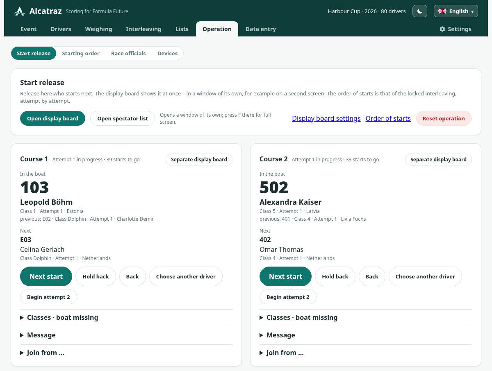
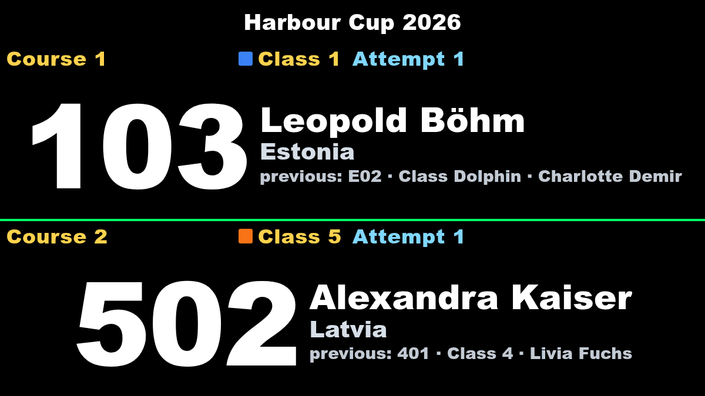
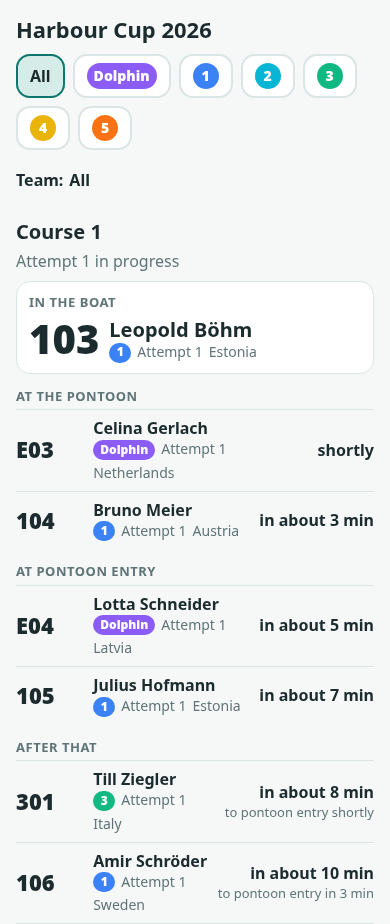
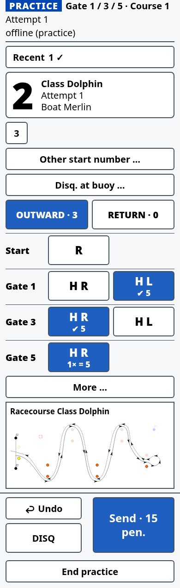
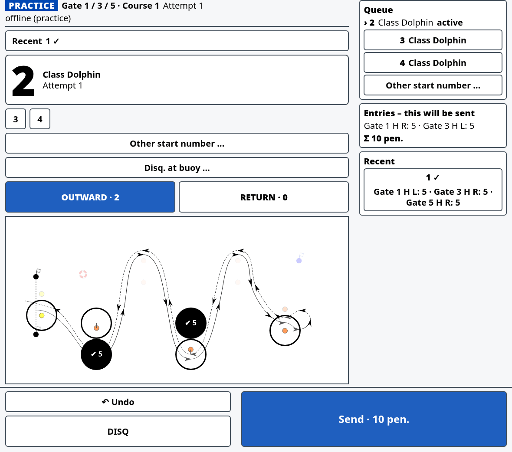

[Deutsch](../betrieb.md) · English

# Operation at the competition site

What scorers should know before and during a competition: working without internet, new versions, backup and
history, the start release with scoreboard and spectator list – and device operation, the only part that goes onto
the network (read links, start release from the phone, race officials' entry on phone and tablet).
Step by step: [Procedure on competition day](#procedure-on-competition-day); field test of the devices: [feldtest.md](feldtest.md).
What the app can do in terms of the sport: [funktionen.md](funktionen.md).
How offline storage and device operation are built: [technik.md](technik.md#offline-storage),
[security model](technik.md#device-operation-security-model).

## Contents

- [Without internet](#without-internet)
- [Before the competition (with network)](#before-the-competition-with-network)
- [New version](#new-version)
- [Keeping the data](#keeping-the-data)
- [Two stores against a hard interruption](#two-stores-against-a-hard-interruption)
- [History](#history)
- [Limits](#limits)
- [The single-file version](#the-single-file-version)
- [Start release, scoreboard and spectator list](#start-release-scoreboard-and-spectator-list)
- [Device operation](#device-operation): read links, [pairing](#start-release-from-the-phone-pairing),
  [keeping the screen awake](#keeping-the-screen-awake), [Reload all devices](#reload-all-devices),
  [quota](#quota-of-the-server)
- [Race officials' entry on phone and tablet](#race-officials-entry-on-phone-and-tablet)
- [Procedure on competition day](#procedure-on-competition-day)

## Without internet

At the competition site there is often no network.
Alcatraz loads nothing in operation; the data lives in the browser.
The only exception is [device operation](#device-operation) – and even that only once someone switches it on.
So that **reloading, a new tab and restarting the browser** also work without a network,
the Pages version sets up an offline storage for the program on the first visit (service worker).
After that all files – page, program, styling, images and the single-file version – are on the device.

**What works without a network:** everything on the operating computer – every view, printing, downloading and loading
a backup, also downloading the single-file version, the start release, the scoreboard and the spectator list in a second
window. Only the search for a new version and device operation need a network: scoreboard and spectator list on other
devices, the start release from the phone and the race officials' entry on phone and tablet.

## Before the competition (with network)

1. Open the page once on the scoring computer –
   in the browser and at the address that will be used on competition day.
2. Wait until the footer or “Settings → Without internet” reads **“Ready for offline use”**.
   If it reads “New version available”: press “Update” now, not only on competition day.
3. As a test, disconnect the network and reload the page.
4. Download a backup (“Settings → Files”) – and again and again during the competition.

If the connection breaks off during the first load, Alcatraz tries again after 5 and after 30 seconds.
If that does not help, it reads “No offline storage” – with the button “Try again”.
So “Preparing offline storage …” always means that loading really is still going on.

## New version

- It is never slipped in in the middle of a competition.
  A competition lasts two to four days, and the computer is restarted in between.
- The browser checks when the page is opened or reloaded (and on “Look for a new version”).
  It loads a new version completely in the background into a storage of its own.
- As long as **drivers** are entered, the running version stays –
  across reloading, new tabs, closing all windows and restarting the browser or the computer,
  also without a network.
- Once the new version is completely ready, the button **“Update”** appears in the header before “Settings”.
  The same button is under “Settings → Without internet”.
  That is also where it says which version is running and which is ready:
  the time of the build with seconds, so that two builds of the same minute can be told apart.
- “Update” first saves the state in the history (“before the update to …”), switches over and reloads this window.
  Other open windows do not reload by themselves but show a notice.
- If the state is **empty**, Alcatraz takes over a version that is ready by itself when opened.
  Empty means: no drivers (before creating any, after “Reset everything”; `standLeer` in `src/lib/eingaben.ts`).
- The data in the browser stays unchanged in every case.
- With device operation: after the update, [“Reload all devices”](#reload-all-devices).

## Keeping the data

As soon as drivers exist, Alcatraz asks the browser not to delete the data of this page on its own
(`navigator.storage.persist()`, at most once a day; by hand under “Without internet”).
Whether it has agreed is shown there.
The real protection remains the **backup file** –
the browser's promise does not protect against someone deleting the browser data either.

## Two stores against a hard interruption

The browser writes the `localStorage` to disk in batches and with a delay.
If the window is closed properly, nothing is lost.
In a hard interruption – crash, flat battery, power cut – the latest entries would be missing without further
protection, without the application noticing.
Measured in Chromium: everything from the last second, under load up to about a minute.

- That is why every change also goes into a **second store**, an IndexedDB of the same browser.
- There it is complete after a few milliseconds.
  Measured with 336 drivers with all entries: 5 ms on average, at most 26 ms; with non-stop typing at most 47 ms.
- On start Alcatraz compares both stores and takes the newer state.
  If it was the second one, the top reads **“Restored after an interruption … please check the values entered last”**
  with the time of the state.
- The test for it: type ten entries, then the eleventh, and kill the browser with `SIGKILL` 0, 50, 200 and 1000 ms
  afterwards. Without the second store all eleven were missing every time, with it none.
  What has been tested is killing the browser.
  In a power cut it also depends on the operating system having written;
  the second store explicitly demands that of the browser (“durability: strict”).

Typing is not slowed down by this:

- The second store gets the text that is built for the first one anyway, and writes in the background.
- Only one write runs at a time; if further changes come in meanwhile, only the latest one waits.
- If the page is hidden or left, that one goes out at once too.
- Several windows get along (one window takes over the state of the other).
  The second store is read only on start, never during operation.
- The whole state of the window that wrote last always applies.
  Working in several windows alternately is fine,
  but **do not enter data in two windows at the same moment**:
  if two windows type within a few milliseconds, the entry of one of them can be missing.
  In the test this could only be triggered with forced synchronisation; by hand only one window has the keyboard.

If there is no IndexedDB (private window of some browsers, very old browsers, blocked storage),
Alcatraz runs with the `localStorage` alone and says so under “Files” and “Without internet”.
In that case: after a crash, check the drivers entered last against the paper slips.
Both stores are in the same browser on the same device.
Only the **backup file** helps against a lost or broken device and against deleted browser data.

## History

- The second store keeps the latest states (“Settings → Files → History”).
  Each entry has a time and what changed:
  “Data entry Class 4, Attempt 2 · 17 changes”, “12 drivers imported”, “Setup changed”,
  “Repeat after breakdown – values discarded: 101, Class 1, Attempt 1”.
- Similar changes in short succession are one entry
  (up to a pause of two minutes, at most ten minutes long).
- Every state can be restored.
  The current one is not lost in the process; it then is in the history itself, so you can go forward again.
- **“Keep state”** saves the current state under a name (“before the test”).
  Kept states stay until you delete them; the others give way to newer ones (at most 100, at most 30 days old).
- A state with 336 drivers and all entries takes about 50 to 100 kB on disk in Chromium,
  so 100 states take about 5 to 10 MB.
- Logos are included in every state: together at most about 0.3 MB per state, so with 100 states up to about 30 MB
  more; usual logos considerably less.
- The history contains names and results.
  It is kept on this device only, is part of no backup and no template, and “Reset everything” deletes it too.
  If deleting in the second store fails as an exception, the next change or the next start catches up on it.

## Limits

The offline storage applies per browser and address.
In the private window of some browsers, without https or if the browser refuses it, it reads “No offline storage”.
The application then runs but cannot be reloaded without a network.
The development server (`npm run dev`) does not set one up.

## The single-file version

The single-file version (`alcatraz.html`) can be downloaded under “Without internet”,
or you build it with `npm run build:single`.
It runs by double-click from a USB stick, never needs a network and gets no new version
as long as nobody replaces the file.
It has its **own data store**: states move between the Pages version and the file –
and between two copies of the file in different places – only via a backup.
With device operation its links lead to the app on GitHub Pages (see [Device operation](#device-operation)).

## Start release, scoreboard and spectator list

Tab “Operation”. All of this runs on the operating computer, without a network and without device operation.
Every button in detail: [funktionen.md](funktionen.md#operation-start-release-and-scoreboard);
parallel slalom (UIM only): [parallelslalom.md](parallelslalom.md).

- **Prerequisite:** The interleaving is locked. Only then are race numbers and order fixed; before that the tab only
  shows the way to the interleaving.
- **Sub-tabs:** “Start release”, “Starting order”, “Race officials” (digital entry, [below](#race-officials-entry-on-phone-and-tablet))
  and “Devices” ([device operation](#device-operation)).
- **Start release:** one card per racecourse. “Begin attempt N” releases the starts of the attempt, “Next start”
  brings the next open start onto the scoreboard, “Back” takes it back. In addition “Hold back”, “Choose another
  driver” (search by race number or name, moving), “Repeat (breakdown) …” (below), “Classes · boat missing”, “Join
  from …” and “Message” (disruption, break, notice; with templates). “Reset operation” in the header deletes begun
  attempts, shown starts and messages; drivers, interleaving and entered values stay. There is a confirmation only
  before “Begin attempt” while starts are open, before “Reset operation”, before a repeat after a breakdown and, with
  race officials' entry, on a backlog (“Continue anyway?”); everything else can be taken back.
- **Repeat after a breakdown** (26.11.2026; since 27.11.2026 also from the start release phone and in the parallel
  slalom): if a boat breaks down after the start and the O.O.D. confirms the breakdown, the driver's attempt is
  repeated. “Repeat (breakdown) …” next to “Choose another driver” – at the operating computer and on the paired start
  release phone – shows the starts already shown in the attempts under way (the one shown last first; the first eight
  at once, the others via the search by race number); “Repeat …”, then “Discard values and repeat”. All values of
  this driver in this attempt are then gone on every sheet, including those from the race officials' devices. The
  start waits under “Repeat pending” and never goes by itself: put it in line with “As next” or “To the end of the
  attempt” or show it with “Show now” – at the operating computer, from the start release phone and in the starting
  order. On paper the race official strikes out the line and enters the repeat in a blank line; data entry shows ↻ at
  the race number. If the driver is to blame for the breakdown, there is no repeat: the race official enters “J” at
  the buoy (wrong racecourse). A withdrawn driver is greyed out in the choice (“withdrawn – no repeat”). A mistake?
  “No repeat after all” in the list “Repeat pending” (also on the phone) brings the discarded values back – only into
  fields that are empty by now – as long as the start has not been shown again. Scoreboard and spectator list show
  “Attempt 1 · Repeat”, without a reason. An open confirmation closes by itself if its start has meanwhile been
  repeated elsewhere, taken back or given an X. In English it is always called “Repeat”, never “Re-run” – that is the
  heat after a tie in the parallel slalom. Details: [funktionen.md](funktionen.md#start-release).
  - **In the parallel slalom** (UIM only) the choice shows the pairs shown in the heats under way (“E01 / E02 · Class
    Dolphin · Preliminary heat · Attempt 1”). The confirmation asks every time, without a preselection, which boats
    repeat: “Only E01 (Racecourse A)”, “Only E02 (Racecourse B)” or “Repeat both” – the button is the confirmation
    itself. A boat that does not repeat keeps its values and is shown as “–” in the repeat. This is not the re-run
    after a tie. Details: [parallelslalom.md](parallelslalom.md#repeat-after-a-breakdown).
- **Scoreboard:** “Open display board” opens it in a window of its own, for example on a second monitor at the pontoon.
  Key F or double-click switches full screen. With several racecourses each card also has “Separate display board”.
- **Spectator list:** “Open spectator list” shows per racecourse “In the boat”, “At the pontoon”, “At pontoon entry” and
  “After that” with “in about” and “to pontoon entry in”; filter by class and by team (origin). Narrow enough for a phone.
- **Starting order:** all open starts in their order with “in about” and “To pontoon entry”, estimated from the
  intervals between starts. Dragging moves a start, by the same rules as in the start release.
- **Settings:** The links “Display board settings” and “Order of starts” lead to “Settings →
  Display board” (header, logos, names, origin, language, font size) and “Settings → Order of starts in
  operation” (keep the interleaving when moving, starts at the pontoon and at pontoon entry, intervals between starts,
  backlog and auto mode of the race officials' entry).
- **Data protection:** Scoreboard, spectator list and start release read only race number, name, class and origin –
  never date of birth, weight, sex or entered values. The windows of scoreboard and spectator list never
  write.

## Device operation

Scoreboard and spectator list can also be shown on other devices – a screen at the pontoon, a tablet,
the spectators' phones. For this there are two **read links** with a QR code, without login and without pairing:
whoever has the link can read but change nothing. A **paired** phone or tablet can also operate the start release
([below](#start-release-from-the-phone-pairing)) or enter a race official list
([race officials' entry](#race-officials-entry-on-phone-and-tablet)).

**Nothing leaves by itself.** As long as nobody presses **“Switch on device operation”** under “Operation → Devices”,
Alcatraz connects to no server at all (there is a test of its own for this). Once switched on:

- **What goes via the server:** race number, name (according to the setting “Names” of the scoreboard, by default as
  on the posted results), origin and class of the drivers, the order of the starts with times, messages and the
  name of the event. All encrypted and signed by the operating computer.
- **With race officials' entry additionally:** the rows the race officials send. Their devices see per list only race
  number, class and boat (never names of drivers), the name of the race official from the assignment, in a query the
  value of exactly this cell – and at the pontoon the **extra weight** per start. From it, for a lighter driver, the
  body weight can be roughly worked back; the notice before switching on names this exception. Since 27.11.2026 the
  pontoon list also sees the **co-drivers** of the classes with name and extra weight (never their body weight, never
  names of drivers). The names come only from “Assignments”, never from the driver list and never with a start – if a
  co-driver is a driver too, they appear here as co-driver. Scoreboard, spectator list, start release and the other
  lists get none of this. The names are shown in full, as entered; the setting “Names” of the scoreboard does not
  apply to them – even with “no names” (for example at a youth event) they go encrypted via the server to the pontoon
  devices (still to be confirmed). The notice before switching on names this as well.
- **With start release from the phone additionally** (27.11.2026): a paired start release learns, for its courses,
  which drivers who have already started have withdrawn – only so that it offers them no repeat after a breakdown;
  the notice before switching on names this as well. For the choice “Repeat (breakdown) …” the start release and the
  display board link carry the starts already run in the attempts under way (without values, reasons or
  withdrawals), the spectator link does not – interpreted during implementation, still to be confirmed.
- **What never leaves:** date of birth, body weight, sex, logos, the backup – never the state of the event at all,
  only tailored views. Scoreboard and spectator list never show anything from the race officials' entry.
- **The server** is a third-party ntfy server (default `ntfy.adminforge.de`, run by volunteers, without any guarantee;
  can be changed under “Settings → Devices”, travels with template and backup). Its operator sees no contents, but
  does see times, sizes and IP addresses.

On the operating computer (tab “Operation”, sub-tab “Devices”):

- **Two links:** “Display board” (for a screen; the scoreboard as in the second window, without logos) and
  “Spectators” (the spectator list for the phone). Per link a QR code, “Copy link” and “Open” to try it out.
  If the operating computer runs as the single-file version from `file://`, the links lead to the app on GitHub Pages.
- **Fingerprint:** shown on the operating computer and on every device. The same means: the device really shows this
  operating computer – a link swapped on the way would show up here. That is why QR codes should be posted on site
  if possible.
- **“Renew spectator link”** (with confirmation) if a link has fallen into the wrong hands: the old one gets nothing
  any more, the scoreboard notices nothing.
- **Connection:** connected, disturbed (reconnecting), “too many requests” (the server slows down; it continues after
  a pause) or none. On the other sub-tabs it is shown at the top in the header.
- **Several windows:** Only one window of the operating computer talks to the server; the others show the same links
  and the connection, their buttons act through the leading window. If it closes, another one takes over.
- **The room stays open**, also across reloading and restarting, until **“End room”** (with confirmation). Then the
  devices get the message “room ended” and delete what they show; without a network this happens on the devices only
  after 36 hours. Another event in the browser only disconnects; the room applies again when it comes back.
- **A different server** in the settings only applies to a new room: end the room, switch on again, post new
  links.

On the device with a read link:

- It shows the scoreboard or the spectator list as soon as the operating computer sends something; before that
  “Waiting for the operating computer …”. After reloading, what was seen last is there at once, also without a network.
- Above the scoreboard the bar (connection, fingerprint, full screen, “Leave room”) appears with the mouse or
  a touch – and always when something is wrong. Key F or double-click switches full screen.
- The device calculates “for …” and “in about …” with the clock of the operating computer (the offset between the
  clocks is measured as well).
- Each device remembers the team filter of the spectator list by itself; none of it goes over the network.
- **Leave room** deletes everything the device has from the operating computer. What it showed expires anyway 36 hours
  after the last message.
- **Versions:** Operating computer and devices must have the same version. If the operating computer is older (for
  example an old file on the USB stick), the device reads “Update the operating computer”; if it is newer, the device
  fetches the new version by itself. Otherwise a device never reloads by itself.

### Start release from the phone (pairing)

A **paired** phone or tablet operates the start release – with the same buttons as on the operating computer
(“Next start”, “Begin attempt N”, Hold back, Message, Join …, since 27.11.2026 also “Repeat (breakdown) …” and “No
repeat after all”), but only for the racecourses the operating computer gives it. “Reset operation”, “Show on all
courses” (the message), settings and everything outside operation stay on the operating computer. Decisions are
always made and applied on the operating computer; the phone only sends requests.

On the operating computer (Operation → Devices, section “Pair a device: start release or race official list”):

- **Release for the next device:** tick the racecourses (under UIM also the parallel slalom). Nothing is
  preselected – the start release is a right like a race official list. A device can get both at the same time.
- **“Show QR code”** (the main way): the phone scans it from the screen and is paired at once, without typing
  anything. The code changes every 30 seconds (the previous one stays valid for 30 seconds, so a photo is hardly of
  use) and closes after at most 10 minutes.
- **“Other way: device code over the radio”** (collapsed): inside it “Issue device code” (6 characters, valid for
  5 minutes, for **one** device – for phones that cannot see the screen) and the **pairing link** with QR code and
  “Copy link”, which the phone needs beforehand; the code is read out over the radio. The pairing link alone only shows
  what is on the scoreboard – whoever scans it instead of the QR code is asked for a code; the phone then says where
  to find the QR code for pairing.
- **Paired devices:** per device the name (can be changed), the racecourses of its start release (ticks – take effect
  on the device at once), its race official lists, the kind of device, paired since and “last heard”. A device only
  reports when it operates something or restarts; so “last heard” does not say whether it is connected right now.
- **“Revoke”** (with confirmation): the device can no longer operate anything, but keeps showing who is in the boat and
  who comes next. Pairing again works with a new code.

On the phone (`#/koppeln/…`, afterwards `#/geraet`):

- After the QR code or the code, the start release of its own racecourses is shown, with large buttons for narrow
  screens. If the device also has a race official list, it is a tab of its own next to “Start release”. The pairing
  link disappears from the address; reload or open again later via `#/geraet`.
- After each press all buttons are locked (“Sending …”) until the operating computer confirms; after 10 seconds
  without confirmation it reads “No confirmation – check the connection”, and sending continues (at growing intervals,
  at most every 5 minutes – this spares the quota). A double press never operates twice. After reloading, the phone
  reports to the operating computer by itself (“Connecting to the operating computer …”); the buttons stay free
  meanwhile. If the operating computer refuses (another racecourse, revoked in the meantime) or someone was quicker,
  this is shown as a sentence.
- **“Repeat (breakdown) …”** (27.11.2026): the same choice and confirmation as at the operating computer
  ([above](#start-release-scoreboard-and-spectator-list)), confirmed with “Discard values and repeat”, in the
  parallel slalom with the choice of boats. Afterwards the start is under “Repeat pending” with “Show now”, “As next”,
  “To the end of the attempt” and “No repeat after all”. The history at the operating computer lists it like a repeat
  from there, without a device name. If the operating computer refuses, a sentence appears above the buttons:
  - “Refused: No repeat for this start: it is not (or no longer) among the starts run in the attempts or heats under
    way – please check the display.” – for example if the start has been taken back with “Back” in the meantime;
  - “Refused: The driver has withdrawn – no repeat. If the driver is to start after all, first take back the
    withdrawal at the operating computer.”;
  - “Refused: This device may not do that (another racecourse, or no longer released).”;
  - “Refused: Something has changed there in the meantime – please check the display.” – the message arrived late
    (dead spot), and the start has changed in the meantime, for example because the repeat was already triggered and
    shown again at the operating computer; nothing changes;
  - if someone was quicker (already triggered or already put in line): “Nothing changed – already done, or someone
    else was quicker. Please check the display.”
- Nobody answers a wrong or expired code: after 15 seconds “No answer” and the form again. A code that has already
  been used is refused. If a scanned QR code fails, scan it once more.
- Only one tab may send: if the pairing is open in a second tab, that tab reads “Opened in another tab” with
  “Continue here”.
- If a phone was switched off when it was revoked (also for longer than the 12 hours the server keeps messages), it
  learns of the revocation at its next start.
- **“Unpair device”** deletes pairing and keys on the phone. In the device list of the operating computer it stays
  until it is revoked there.
- If the operating computer fails, no replacement computer takes over the pairings (decision F4): new room, post the
  links again, pair the phones again.

Limits: Without internet at the pontoon all other devices stand still; the scoreboard in the second window always works.
A hotspot shares the [quota](#quota-of-the-server) of the server. Device operation has not yet been tested in the
field with real phones (iPhone, Android in the background) and the real server – for that there is the
checklist [feldtest.md](feldtest.md).
How it is built: [technik.md](technik.md#device-operation-security-model).

### Keeping the screen awake

Alcatraz asks the browser not to switch off the screen (Screen Wake Lock): always in the second window of the
scoreboard and the spectator list, on a device with a read link, start release or race official list as long as it is
connected (no longer after “room ended” or “Leave room”). When the page comes back from the background, it asks again.

Not every browser plays along: iPhones only from iOS 16.4, never under `http://` or `file://`, often not in power
saving mode. Then the device quietly shows **“The screen may turn off – keep the device plugged in and turn off
auto-lock”** (above the scoreboard only when the bar is visible); in the race official form a yellow band with the tip
“Lengthen the screen timeout on the phone”. Remedy: switch off the automatic lock in the system settings and connect the
device to the charging cable. Whether it works on real devices is checked by the [field test](feldtest.md).

### Reload all devices

**“Reload all devices”** (Operation → Devices, next to “End room”, with confirmation) sends all connected devices –
scoreboard, spectator phones, paired start releases and race official devices – the command to fetch the newest version
of the app or to reload. The display is gone for a few seconds; paired devices stay paired.

- Each command takes effect on a device only once (no reload loop), and only if it is at most 10 minutes old:
  a device that is connected again within 10 minutes or only then opens a link still reloads; one that was away
  longer does not – reload it by hand there if needed.
- Without a connection on the operating computer the button sends nothing (“No connection to the server – nothing
  sent”), not even later when the connection comes back – otherwise all devices would reload at a bad moment. Then
  press it again.
- **After an update** of the operating computer, Operation → Devices offers the button as a notice (“This operating
  computer is running a new version …”); “Not needed” hides it. Devices that are newer than the operating computer
  show “Update the operating computer” anyway; older ones fetch the new version by themselves at the next contact.

### Quota of the server

Public ntfy servers allow only a certain number of messages per day and internet connection (IP address) without an
account. Queried via `/v1/account` (November 2026): **ntfy.adminforge.de 17,280**, ntfy.sh 250. Alcatraz
knows these two limits; with another server it only counts and warns as soon as the server slows down.

- Operation → Devices shows **“Sent to the server today: n messages (m requests in total)”** – counted on the operating
  computer, per calendar day. The devices are not counted, but share the same IP address via a common hotspot.
- From 80 % or as soon as the server has slowed down today (“too many requests”), a warning with “Last slowed down
  at …” appears. Slowed down means: messages arrive late, it continues after a pause.
- **Rough estimate:** A competition day with 120 drivers and two attempts needs about 600 messages, with start release
  from the phone about 850 – far below 17,280 (adminforge), but too many for ntfy.sh. With race officials' entry, per
  row one message from the device and one view of the list back are added (several rows are combined), plus a
  sign of life per device after 60 seconds of silence during an attempt. The field test measures it.
- Saving: switch on device operation only when it is needed; end the room in the evening; read links only where
  they are needed – the scoreboard on the second monitor costs nothing.

## Race officials' entry on phone and tablet

The race officials enter their list on a paired phone or tablet – instead of the paper sheet or
alongside it. The rows go encrypted via the server to the operating computer and land there in data entry as if
typed in. This needs [device operation](#device-operation). Built from 21 to 24.11.2026 and tested against a simulated
server; the field test with real devices is still to come ([feldtest.md](feldtest.md#race-official-form-on-the-phone)).
Background and interpretations: [vorschlag-wkr-erfassung.md](../vorschlag-wkr-erfassung.md) (German), plans
[W1](../plan-wkr-w1.md) to [W5](../plan-wkr-w5.md) (German), `WKR_ANNAHMEN` in `src/wkr/annahmen.ts`.

### Principles

- A row from the device is taken over like typing in: if the cell is empty, it then holds the value from the device.
  If it already holds a different value, this becomes a **query** on the operating computer – never silently
  overwritten.
- Nothing is ever locked: the start release warns or asks, but it does not hold up any start. If a device fails,
  the operator switches the list to paper from a certain start (“Paper from start …”).
- After a radio gap the waiting rows go out in a bundle. Until then they are only on the device (36 hours);
  the origin mark ◆ is only on the operating computer, never in the backup.
- After a list has been closed for an attempt, corrections from the device become **proposals**.

### Assigning a list

- Operation → Devices → “Pair a device: start release or race official list”: under “Race official list for the next
  device” choose the list – per racecourse, in the parallel slalom per Racecourse A or B, the knot list under “At
  the table”. At the pontoon also “whole”, “leaving only” or “mooring only”. Then “Show QR code” or device code as for the
  [start release](#start-release-from-the-phone-pairing). Pairing gives exactly one list.
- From Operation → Race officials, “Pair device” on every list without a device leads straight there, with the list
  already chosen.
- With the first device, a list without any previous entry is set to entry “Device”.
- In the device list per device: change lists, “Add list” and “Remove list” (at most 4; recommended a
  phone with one, a tablet with two lists – more work, then as tabs), the part at the pontoon, the **form** (“Buttons”,
  “Picture” only for lists with buoys, “Table” only on a tablet or computer; “fixed” = the race official cannot switch)
  and the **kind of device** (Phone, Tablet, Computer – the device reports it by itself when pairing). If the race
  official changes their name on the device, a notice with “Use in the event” appears here.
- If there is no form for a list (fields no form knows, for example in an own setup), pairing shows
  “Form to follow – paper”; the device then shows only “paper”.
- **Printing:** Under “Lists” the race officials' sheets of a list with entry “Device” and its boxes on the
  checklist are left out; a notice above the stack names them. Lists on “Paper” or “both”, paused and
  signed-off lists and a pontoon list of which only one part has a device are printed. **“Print anyway (fallback to
  paper)”** prints all.

### At the operating computer

**Operation → Race officials** (the header of the sub-tabs except “Devices” shows “Officials: ! n” while queries are
open):

- **Matrix** lists × shown starts (the last 12, switchable to all of the attempt): ✓ entered, ½ one part entered
  (pontoon), ○ open, ○! overdue, ! query, V proposal, P from the paper sheet, ✕ did not start (X), – not applicable,
  » pontoon entry or leaving the pontoon: not shown yet, to be entered already, … mooring still to come. A tap on a cell
  shows the values with their origin. Per list the device with its connection: ● heard, ◐ quiet (from 90 s), ✕ gone
  (from 5 min), ○ resting (no attempt); plus the battery where the device reports it. The knot list is below under
  “At the table (no attempt)” with “n / m open”. Without device operation the matrix still shows what is missing when
  typing in from paper.
- **Control per list:** entry “Device”, “Paper” or “both”; “Pause”, “Sign off”, “Continue on device” (at the
  pontoon per part); **“Paper from start …”** – from there on the sheet is typed in, the device gets the notice;
  “Please check no.” sends the devices of the list a notice; closings with name and time, “Reopen” (with
  confirmation).
- **Incoming:** queries (“Take device value” or “Keep”, also for all cells of a row) and proposals
  (“Accept” or “Discard”). “Race official: leave as is” means: the race official sticks to their value; the
  operator has to decide.

**Data entry** (main tab): ◆ on values from the device; ▭ “Check paper” on rows or cells for which the sheet is
needed (row missing, in the backlog or switched to paper). Whoever overwrites a value from the device is asked
once (“Replace the value from the device?”).

### In the start release: bar, backlog, racecourse light, auto mode

- **Bar “Race officials’ entry”** per racecourse: per list a large sign by entry state – ✓ done, ⧗ waiting n
  (the race official has not yet sent n shown starts), ✕ device gone, ▭ paper; small behind it the connection
  (● heard, ◐ quiet, ○ resting), “n in the device” for rows on their way, ! query. A click leads to Operation → Race
  officials. Paused and signed-off lists do not count.
- **Backlog:** Only lists of the racecourse count, never pontoon or pontoon entry – their race officials work on their
  own, nobody ever waits for them (they continue to appear with ✓/⧗ in the bar). If a racecourse list has at least as
  many starts open as set (default 1), the backlog is shown above “Next” with a yellow border. With the default “ask
  before showing”, every showing asks **“Continue anyway?”** with list and race number (“Man-over-board has not sent
  604 yet.”); “only warn” and a higher number (for example for gate 5 with several boats on the water) under
  “Settings → Order of starts in operation”.
- **Racecourse light:** shown as soon as at least one racecourse list is entered digitally (gates, buoys, gate 5,
  man-over-board, racecourse observation, start/finish, time; not pontoon, pontoon entry, knots).
  1. “Next start” shows the driver; all racecourse officials see them, the light is **● green “Start clear”**. As long
     as it is green, this start does not count as open anywhere – if the driver does not set off, nothing asks.
  2. When they pass through the start/finish gate: tap **“Through the start gate”** (by mistake: “Not through after
     all”). The light also turns **● red** by itself as soon as a racecourse official sends something for them. It
     stays red until all digital racecourse lists have sent; next to it is shown which are still missing. The time list
     also holds it until its time (or “no time”) is there.
  3. **● clear “All racecourse officials done – next one can go”.** With “ask before showing”, “Next start” asks
     “Continue anyway?” when red; nothing is ever locked. Paper, paused and signed-off lists hold nothing up. An X
     (did not start) counts as through.
  4. The racecourse officials see a small dot “start clear” or “on the racecourse” on their driver card. Scoreboard
     and spectator list show no light.
- **Auto mode** (“Settings → Order of starts in operation”, default off): If every racecourse list is digital and has a
  device, the start release counts down 3 seconds on “clear” (“Hold” holds until the next start) and then shows
  the next one of the current attempt. Never by itself: begin a new attempt, show drivers to be made up or
  held back, with an open query or open proposal, with a message “Break” or “Disruption”, after
  “Back” or reloading. If a list lacks its device, it reads “Auto off: … without device or on paper”.
- **Start release phone:** the same bar and light, without values and without device names.

### On the device

The device never shows the name of a driver, only race number, class and boat. The only names are at the pontoon: the
co-drivers of the class from the assignments (below under “Pontoon”). The form speaks the language of the list like
the sheet (default: German under DM, the German championship rules; English under UIM).

- **Connecting:** In the first seconds it reads “connecting …”; if it takes longer, “Reconnect” (reloads the page,
  drafts and sent rows are kept).
- **Trial run:** After the list is received for the first time, the device shows the trial run with the start “P”
  once per room and list – step by step tap a code, “↩ Undo”, main button; on buoy lists also a touch, a disq. at
  a buoy and the return run. **Nothing is sent**. “Skip” always works, “More → Trial run” repeats it.
- **Buttons** (pontoon, gate 5, man-over-board, pontoon entry): one button per code; a tap counts +1, “↩ Undo” in the
  footer takes the last tap back (the arrow pointing left is a small drawing; on phones 360 to 412 px wide it stands
  above the word, on wider devices next to it). Codes that according to the rulebook do not apply in the class are
  greyed out but can be pressed. A code counts at most as often as it can occur in an attempt (3; gate 5 “Not passing
  the gate with the full length of the boat” 1); “2nd and 3rd attempt” counts up to 2, the third tap sets Disq. D
  (“next = Disq. D”, then “Disq. D set”). At the pontoon a device for the whole pontoon switches between “Leaving” and
  “Mooring”.
- **Disq.:** “DISQ” in the footer opens the letters (“PENALTY” leads back). The first tap marks (“tap
  again”), the second sets. X is among the disq. buttons only at pontoon leaving and at pontoon entry; it asks once
  more in large letters.
- **Sending:** main button “No penalty ✓”, with entries “Send · n pen.”. After that an overlay lies over the
  form – “sending …” or “sent – waiting for confirmation …”, then “✓ accepted” –, after that a flash (and
  vibration where available), and for 1 s the form accepts nothing (protection against a double tap). Without
  confirmation the overlay is gone after at most 3 s; after 10 s the header reads “No confirmation – check the
  connection”.
- **Recent:** your own rows with their stage (✓ accepted, ↑ on its way, ! query, ✗ rejected, V proposal); a
  tap opens the correction (“old → new”). “Undo” is available for 6 s after sending: if the row is still waiting,
  it comes back into the form, otherwise it opens the correction.
  A query is shown as a band (“Operator: start 23 has a different entry there …”) with “Correct” or “Leave it”.
- **Other start number …** chooses a start from the queue, from “after that” or “Recent”, for example when two boats
  are on the water at the same time.
- **Notices from the operator:** “Operator asks: check start 601” with “Open 601”; “Operator: the paper sheet
  applies from no. …”.
- **Repeat after a breakdown:** when a start is shown again after a breakdown, it comes onto the device like a new
  start – also onto a list that has already closed the attempt (the row then becomes a proposal at the operating
  computer). A row still sent for the aborted attempt is rejected by the operating computer: “This attempt was aborted
  after a breakdown – the start is repeated. The line was not taken over.”
  In the parallel slalom only the devices of the racecourse whose boat repeats get the attempt anew. On the other
  racecourse nothing changes: a late row is taken over there, and the start does not come there again – not even if
  the list was paused during the first attempt or only went digital later. The racecourse light then stays green until
  the repeating boat has passed through the start gate; the values of the other boat do not count for it, and the
  question when closing the list names only this boat as “on the course”.
- **Without a connection:** red band “No connection for n min – keep entering, n lines waiting”; after 5 minutes
  also “Gone for longer? Paper sheet from no. …”.
- **Closing the list:** After your own attempt the band “Attempt 1 is over – close the list?” appears with its
  purpose: signature for the attempt, replaces the signature on the sheet. If the attempt is still running, the device
  asks “Attempt 1 is still running (604 on the course) – close anyway?”. The check view shows “n sent”, “n open: …”,
  “n X: …” and all your own rows (a tap opens the correction). The name of the race official is prefilled from the
  assignment of the event and counts as the signature; with open starts tick “Rest on paper”. At the pontoon with a
  part, the device closes only its part.
- **More:** Remarks, “Pause (paper)” and “Continue digitally”, “Sign off” (the list leaves the device, the
  paper sheet applies), “Did not start · Disq. X” (below), Name, Display, Form, Language, Trial run. **Display:** “Like
  device” (default: light or dark like the system), Sun (black on white), Light, Dark; “Left-handed” mirrors the
  footer. **Language:** under DM only the interface texts change, under UIM also codes and titles. Everything is
  remembered on the device.

**Did not start · Disq. X:** under “More” for the shown start, with a large confirmation (“23 did not start?”), on
every list with a disq. field (gates, gate 5, man-over-board, parallel slalom, pontoon, pontoon entry; not time and
knots). X alone is entered into the disq. field of this list. On the operating computer it acts like every X: matrix ✕
on all lists, the start is dropped in this attempt and in the results, it drops out of the queue of all devices, the
racecourse light counts as through. If the disq. field already holds a different letter, it becomes a query. Whoever
made a mistake corrects it via “Recent”: the correction starts without X (“did start after all”); at pontoon leaving and
at pontoon entry, where X is among the disq. buttons, it is deselected there. If a driver has left out a gate, that is
not “did not start” but J at a buoy of the gate (disq. at the buoy).

**Pontoon:** Leaving runs ahead of the start release like pontoon entry – its queue already has the next free
starts (as many as “Starts at the pontoon”, at least one) before they are shown. Mooring runs behind: it gets
a start only when it is no longer “In the boat” – the next one has been shown or the attempt is complete. A device for
the whole pontoon never shows the same driver in leaving and in mooring at the same time. In the part “Leaving” the
**extra weight** is shown next to the race number (“Extra weight 4 kg”, “no extra weight” or “Extra weight: not
weighed”), read-only. It is not maintained at the pontoon: a weight added later in the weighing comes onto the
device by itself with the next view; on the paper list “Extra weights” a field for entering it by hand remains for a
driver who has not been weighed.

**Boat and co-drivers at the pontoon** (27.11.2026): In both parts, “Leaving” and “Mooring”, the boat of the class
(“Boat Merlin”) is shown next to the race number below class and attempt (in “Leaving” below the driver’s extra
weight), below that, in a line of its own across the full width of the card, “Co-driver Anna Muster” and slightly
smaller “Substitute Ben Muster” – from the assignments, only those entered there with a name. If a co-driver needs an
extra weight, it follows in brackets as on the paper list: “(+4 kg)” or “(not weighed)”. The brackets appear only in
“Leaving”, like the driver’s extra weight, because that is where the weight goes into the boat; in “Mooring” only the
names are shown. The card always keeps the same space free for the co-drivers, so the buttons below do not jump when
the next class has no co-driver; long names wrap and are never cut off. In a correction via “Recent” whose start is no
longer in the queue, boat, extra weight and brackets are missing; the names stay. For now the paper race officials’
sheets show no co-drivers.

### Forms for buoys, time, knots and experienced users

- **Buoys** (gate 1/3/5, gate 2/4/5, racecourse with start/finish, lists of the setups, under UIM parallel slalom): one
  row per stop, the two buoys of a gate side by side as on the sheet. One tap = one touch (5 penalty points), a
  second takes it away; the gate buoys of gate 5 count every touch (at most 9). Gate 1 on the return run has two
  rows (2nd pass = speed lap). If a class has more than seven rows, a switch “OUTWARD · n |
  RETURN · n” splits them; it never switches by itself. Order under “More → Display → Buoys” (form “Buttons”): “Return
  reversed” (default, every gate in the same place on both tabs), “Order of the run” or “All in one list”. At the
  first start of a new class in the attempt “Attention, class change! Class n” is shown for 2 s; below the buttons the
  racecourse drawing of the class.
- **Disq. at the buoy:** “Disq. at buoy …” and “DISQ” in the footer ask “Disq. – at which buoy?” (or “No buoy /
  whole racecourse”; “← Back” leads from the letters back to the question); a **long press** (0.8 s) on a buoy
  opens its letters straight away. Several are possible, then “Done”. The points stay, the cell then reads for example
  “5, J, D”.
- **Picture** (lists with buoys; the default on the tablet, selectable on the phone): the racecourse drawing with hit
  circles on the buoys, switch Outward / Return / “RETURN 2 · speed lap”, by hand only. Disq. via “Disq. at buoy …” (then
  tap the buoy in the picture) or a long press on a circle. “More → Display → Position of the drawing”: “Automatic”
  (as on the sheet, as far as space allows) or “Start/finish on the left”, “… at the top”, “… on the right”, “… at the
  bottom”, below it a sentence such as “Start/finish at the top, gate 5 at the bottom.” (parallel slalom: start on the
  left, at the top, on the right, at the bottom), remembered per device and list. Until 26.11.2026 the buttons were
  called “Pontoon at the bottom/on the left/at the top/on the right”; a position already chosen stays and shows the
  same picture under the new name (“Pontoon at the bottom” = “Start/finish on the left”).
- **Time** (timekeeping): a numeric keypad for the chosen time field; below it is shown how the operating computer reads
  the entry (“83.45” → “= 1 min 23.45 s”). After a complete time the keypad jumps to the next field. Only the
  first field is mandatory; “No time for …” with a reason (timing system failed, did not finish, other reason).
- **Knots at the table:** list without an attempt, once per event. Prefilled is the next open driver (“Next:
  9 (Class 2)”), another number can be typed in. Per knot ✓ or ✗, then “✓ All correct” or “✓ Rest
  correct”. A number already entered asks “correct it?”. Closing for the whole list.
- **Table** (only tablet or computer with keyboard): a row as on the sheet, Tab/Enter jumps on, Enter in the
  last cell sends. Errors are shown in red at the cell and block sending.

**Tablet:** In landscape the work area is on the left, queue, recent rows and entries in plain text on the right; in
portrait below. With several lists they are columns side by side (in landscape up to four, in portrait up to two), the
rest as tabs; for the whole pontoon, leaving and mooring as two columns if both fit. Under UIM a shared heat band
is shown above racecourse A and B when both have the same start next; the same driver for the 2nd attempt comes with
“23 · ATTEMPT 2” and a 1 s lock.

### Practice offline

“Practise offline” in the pairing form of the device or the address `#/uebung`
([open the practice](https://motorbootslalom.github.io/alcatraz/#/uebung)): choose rulebook (DM rules or UIM
Rule 960) and list – pontoon (whole, leaving only, mooring only), gate 5, man-over-board, pontoon entry, gate 1/3/5,
gate 2/4/5, racecourse with start/finish, under UIM parallel slalom racecourse A, knots (at the table), time
(timekeeping); also the form (“Picture” for buoy lists, on the tablet “Table” except for knots and time). Then the
same form with 20 made-up starts without names. No network, no operating computer;
only the display settings are stored.

- The next start comes 2–6 s after sending, now and then it is already there before; occasionally a
  query comes as in the real thing.
- Every class drives a made-up boat. At the pontoon there are made-up extra weights and made-up co-drivers, sometimes
  with, sometimes without a substitute, in “Leaving” with brackets such as “(+6 kg)” or “(not weighed)”.
- At the top is the explanation “How practice works”, below it, if shown, the yellow note “The screen may turn off.”,
  then the header “PRACTICE” with list, attempt and connection, “Recent” and the card with the race number. After
  sending only the explanation scrolls off the top; the note (until “Hide”) and the header stay. On the tablet with
  several lists side by side nothing scrolls. On competition day nothing ever scrolls, the order is the same there.
- “More → Bring a class forward” (at the very bottom) fetches a start of this class as the next one – for example to see
  class 7.
- “End practice” below the form or “More → Leave practice” leads back to the choice.
- Good for the briefing the day before.

## Procedure on competition day

For the person at the operating computer, step by step. Without device operation all points about phones, tablets and
server are dropped.

### Beforehand (the day before, with network)

1. Current version: open the operating computer, wait for “Ready for offline use”, install an “Update” that is ready
   now ([New version](#new-version)) – not on competition day.
2. Check the server: “Settings → Devices” (empty = default `ntfy.adminforge.de`). A different server only applies to
   a new room.
3. Trial run: switch on device operation, open one read link and pair one phone, release a few starts, look at the
   quota display, end the room. Better still, the [field test](feldtest.md) straight away.
4. Phones and tablets: charged, charging cable/power bank at hand, screen lock off, current browser (Chrome on Android,
   Safari from iOS 16.4). No private window – in it pairing and what was seen are lost on closing.
5. With digital race officials' entry: brief the race officials with the [practice](#practice-offline) (works
   without a network). Enter the names of the race officials in the assignment of the event – they reach the devices as
   the default.
6. Download a backup.

### Setting up

1. Start the operating computer, open Alcatraz, tab “Operation”. The interleaving must be locked.
2. Scoreboard: on the second monitor via “Open display board” (key F = full screen; works without a network) or on a
   screen of its own via the read link “Display board”.
3. Switch on device operation (Operation → Devices). Only now does anything go onto the network.
4. Print the spectator QR code or show it on a screen and post it **on site**; check the fingerprint on a phone
   against that of the operating computer.
5. Pair phones for the start release: tick racecourses, “Show QR code” and have it scanned – or
   “Issue device code” and read it out over the radio. Give each device a name in the list (“Pontoon A”).
6. With digital race officials' entry: pair one device with their list per race official
   ([Assigning a list](#assigning-a-list)); check kind and form in the device list; tap through the trial run on the
   device together straight away.
7. Only then print race officials' sheets and checklists: lists on “Device” are left out. Whoever wants paper as well
   sets the list to “both” under Operation → Race officials.

### During the competition

- Start release on the operating computer or from the phone; on the phone only press again once “Sending …” has
  disappeared (until then the buttons are locked).
- With digital race officials' entry: keep an eye on the bar “Race officials’ entry” and the racecourse light
  ([start release](#in-the-start-release-bar-backlog-racecourse-light-auto-mode)). When the driver passes through the
  start/finish gate, tap “Through the start gate”. “Continue anyway?” means: a racecourse official has not sent yet.
  ✕ or ! in the bar → Operation → Race officials (decide queries, if necessary “Paper from start …”). At the end of the
  attempt each race official closes their list via the band; closings are shown under Operation → Race officials.
- Boat broken down: if the O.O.D. confirms a breakdown, choose “Repeat (breakdown) …” at the start release – at the
  operating computer or on the start release phone – (in the parallel slalom also which boats repeat) and put the
  start in line as soon as the boat is ready again. Race officials on paper strike out the line and enter the repeat in
  a blank line; race officials' devices get the start anew by themselves. If the driver is to blame for the
  breakdown, there is no repeat – “J” (wrong racecourse) at the buoy
  ([repeat after a breakdown](#start-release-scoreboard-and-spectator-list)).
- Reading the connection: “connected” is good; “disturbed – reconnecting” and “too many requests – continues after a
  pause” mostly resolve themselves; “no connection” for longer than a few minutes → [Disruptions](#disruptions).
- Look at the quota now and then; on a warning operate more sparingly (see [quota](#quota-of-the-server)).
- Device lost or in the wrong hands: **“Revoke”** in the device list. Spectator link spread where it should not
  be: “Renew spectator link” and post it again.
- Reloading or restarting the operating computer does no harm: the room stays open, devices and phones reconnect.
  A second window on the operating computer is allowed; only one talks to the server.
- Update during the competition only in a break. Afterwards **“Reload all devices”**.
- Download a backup in between.

### Disruptions

- **No network:** Keep working on the operating computer – start release, data entry and lists need no network. The
  scoreboard on the second monitor keeps running. Devices show the state seen last with a disturbed connection and
  catch up as soon as the network is back. Start release phones cannot operate anything meanwhile; race official
  devices keep entering, their rows wait and go out in a bundle afterwards.
- **Race official device fails:** The start release asks “Continue anyway?” – continue. Under Operation → Race
  officials choose “Paper from start …”; the race official continues on the sheet, it is typed in in data entry. If the
  device comes back: “Continue on device”.
- **Server slows down** (“too many requests”): wait, it continues; messages arrive late. If it persists:
  start release on the operating computer, scoreboard on the second monitor.
- **Phone falls asleep** or was in the background: screen on, bring the page to the front – it reconnects and fetches
  the state. If that does not help, reload; the pairing stays. Against falling asleep: charging cable, screen lock off.
- **Device shows “Update the operating computer”:** The operating computer runs an older version (for example as a file
  from the USB stick) – update it there or run the device with the same version.
- **Operating computer fails:** replacement computer with the latest backup (otherwise “Join from …”), new room, post
  the links again, pair phones and tablets again.

### End

1. **“End room”** – the devices delete what they show, and the connection ends. Over several days the
   room can stay open overnight; without changes it costs little (one full state per link per hour).
2. Download a backup and keep it separately from the operating computer.
3. Note observations on device operation (interruptions, slowdowns, quota in the evening) – see
   [feldtest.md](feldtest.md#what-to-report-afterwards).
