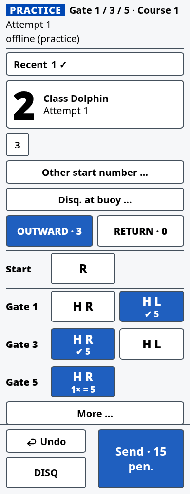
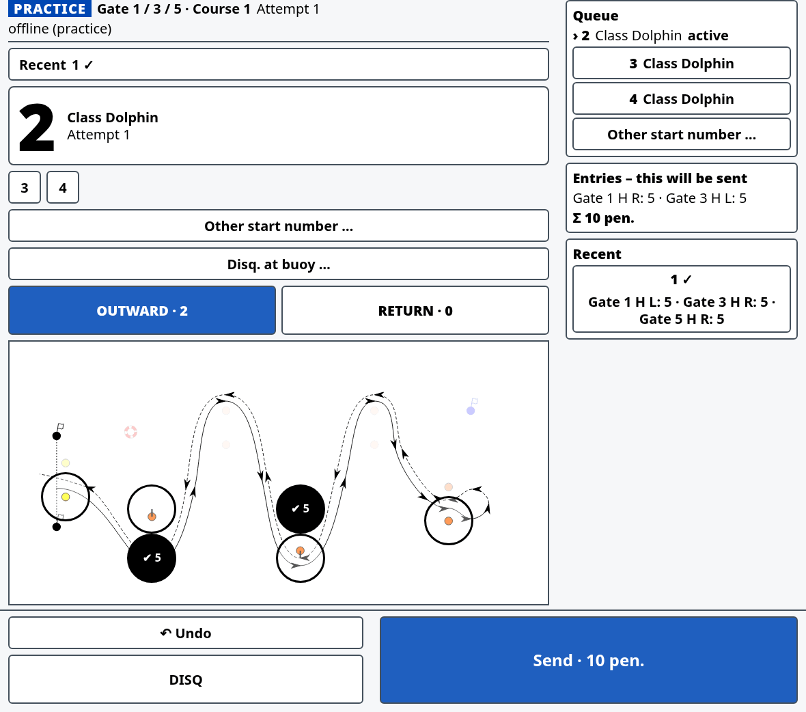

[Deutsch](../feldtest.md) · English

# Field test of device operation

Checklist for the first test with real devices and the real server: read links, start release from the phone
(stage E8 of the plan of 16.11.2026) and the race officials' entry on phone and tablet (W3 to W5). So far this has
mainly been tested against a simulated server and simulated browsers; a first trial with a real phone
(21.11.2026) has been incorporated into the race official form and the start release. The sizes of buttons and text
are only in the CSS.
Usage: [Device operation](betrieb.md#device-operation), [race officials' entry](betrieb.md#race-officials-entry-on-phone-and-tablet),
procedure: [Procedure on competition day](betrieb.md#procedure-on-competition-day).

Use sample data only (tab “Event” → “Sample data”), no real drivers.
Tick each point when the expected result occurs; otherwise note under “Observation” what happened
(device, time, text on the screen). Screenshots small and without real names.

## Setup

- Operating computer: Pages version, “Ready for offline use”, version (build time): ______
- Server: `ntfy.adminforge.de` (“Settings → Devices” empty = default)
- Network at the operating computer (Wi-Fi, hotspot of which phone?): ______
- For local tests in the Wi-Fi: `npm run dev:host` (http – without Wake Lock) or `npm run dev:https` (self-signed,
  confirm the certificate warning once on each device; [technik.md](technik.md#development)). The offline storage is
  only available via GitHub Pages.

| Device | Model, operating system | Browser, version | Network (Wi-Fi/mobile) | Role |
|---|---|---|---|---|
| A | Android | Chrome | | Scoreboard / start release / race official phone |
| B | iPhone | Safari | | Spectators / start release / race official phone |
| C | iPhone as home screen app (optional) | Safari | | Start release |
| D | Tablet (iPad or Android) | | | Race official tablet |

## Read links

- [ ] **Switch on device operation.** Expected: connection “connected” within a few seconds; two QR codes.
  Observation:
- [ ] **Scoreboard via QR** (device A). Expected: scoreboard instead of “Waiting for the operating computer …” within
  about 5 s, fingerprint the same as that of the operating computer. Observation:
- [ ] **Spectators via QR** (device B, via mobile data). Expected: spectator list, “in about” plausible (clock offset);
  team filter stays after reloading. Observation:
- [ ] **Release a start** on the operating computer. Expected: scoreboard and spectator list show the change within
  about 2 s. Delay measured: ______ s. Observation:

## Pairing

- [ ] **Via QR code** (device A; once also via mobile data with a slow first load). Expected: paired without
  typing, start release of the ticked racecourses; is the 30 s window of the QR code (plus 30 s grace) enough?
  Time from scanning to paired: ______ s. Observation:
- [ ] **Via device code over mobile data** (device B: open the pairing link, type in the code; the code is valid for
  5 min). Expected: paired; does the answer come before “No answer” (15 s)? Time until paired: ______ s. Observation:
- [ ] **iPhone: QR opens Safari instead of the home screen app** (device C). Expected: Safari opens;
  note how to get into the home screen app (copy the link?). Observation:
- [ ] **Kind of device** in the device list (Phone, Tablet, Computer). Expected: the device reports its kind
  correctly when pairing (tablet = Tablet). Wrongly detected: ______ Observation:

## Start release from the phone

- [ ] **Operating:** “Next start” on the phone. Expected: “Sending …”, then free; operating computer and scoreboard
  show the start. Time until confirmation: ______ s. Observation:
- [ ] **Double tap** (twice quickly, and on two phones at the same time). Expected: exactly one step; the second
  phone sees “Nothing changed – already done, or someone else was quicker” or nothing. Observation:
- [ ] **Hold back, message, putting back in line** from the phone. Expected: works as on the operating computer.
  Observation:
- [ ] **Trigger a repeat from the phone, also in a dead spot** (27.11.2026): on the phone “Repeat (breakdown) …” for a
  start already shown, “Repeat …”, “Discard values and repeat”. Expected: the same choice as at the operating computer
  (the one shown last at the top), “Sending …”, then the start is under “Repeat pending” on phone and operating
  computer, in the history “Repeat after breakdown – values discarded: …”; “No repeat after all” from the phone brings
  the values back. Then in a dead spot: put the phone into flight mode and confirm “Repeat (breakdown) …” there for
  another start; meanwhile repeat the same start at the operating computer, put it in line “As next” and show it;
  then reconnect the phone. Expected: the phone shows “Refused: Something has changed there in the meantime – please
  check the display.”, and the repeat stays (it is not aborted again, its values stay). Observation:
- [ ] **Own racecourses only:** remove the tick on the operating computer. Expected: the card disappears on the phone
  at once. Observation:

## Background and screen

- [ ] **Wake Lock** (set the screen lock to 30 s, leave the device lying, 2 min). Expected: the screen stays on;
  otherwise “The screen may turn off …” is shown in the bar, in the race official form as a yellow band at the top
  with the tip “Lengthen the screen timeout on the phone” (always under `npm run dev:host` – there is no Wake Lock via
  http). Android: ______ iPhone: ______ Home screen app: ______
- [ ] **Put the phone aside for 5 min** (screen off), meanwhile 3 starts on the operating computer. Expected after
  switching on: the current state within about 10 s, connection “connected”. Android: ______ iPhone: ______
- [ ] **Put the phone aside for 15 min**, once with another app in the foreground. Expected: as above; on the iPhone
  the WebSocket is closed in the background (plan, risk 7) – it must reconnect by itself on coming back. Android: ______
  iPhone: ______
- [ ] **Start release after putting it aside:** “Next start” at once. Expected: confirmation, no double start.
  Observation:

## Operating computer

- [ ] **Reload the operating computer** (F5). Expected: the room stays, devices keep displaying, after a few seconds
  “connected” again; phone start release and race official devices work afterwards. Observation:
- [ ] Open a **second operating window**, operate there, then close the first one. Expected: “Another window of this
  browser holds the connection”, buttons work; after closing, the second one takes over. Observation:
- [ ] **Operating window in the background:** minimise the window or bring another tab to the front, 10 min, meanwhile
  operate from the phone and enter on the race official device. Expected: confirmation arrives, scoreboard up to date
  (the browser throttles the heartbeat of the leadership, 2 s, and collecting in the background). Delay until
  confirmation: ______ s. Observation:
- [ ] **Operating computer as the single-file version** (`file://`), devices via Pages. Expected: read and pairing
  links point to Pages; same version → display; if the file is older than Pages → “Update the operating computer” on
  the device. In addition two windows under `file://`: expected as with the second operating window (storage,
  BroadcastChannel, Web Locks behave differently under `file://` depending on the browser). Browser: ______
  Observation:
- [ ] **Radio gap:** operating computer in flight mode for 1 min, operate 2 starts meanwhile; afterwards a phone in
  flight mode for 1 min and operate there. Expected: the operating computer keeps working, devices catch up; the phone
  sends after the radio gap, the start takes effect once. Observation:

## Management

- [ ] **Revoke** (device list). Expected: the phone can no longer operate anything, but keeps showing In the
  boat/Next; a race official device shows “Withdrawn” and its unsent drafts to copy onto the paper.
  Observation:
- [ ] **Reloading all devices after an update:** install an update on the operating computer (or just “Reload all
  devices”). Expected: notice “This operating computer is running a new version …”; after the button all connected
  devices reload once and display again, phones and tablets stay paired. Observation:
- [ ] **End room.** Expected: devices show “The operating computer has ended the room”. Observation:
- [ ] **Quota display after the test** (Operation → Devices, note it before ending). Messages: ______
  Requests: ______ Warning or “Last slowed down”? ______ Duration of the test, number of starts and of race official
  devices: ______
  Extrapolated to a competition day (120 drivers, 2 attempts) – expected according to the rough estimate about 600
  messages without, 850 with start release from the phone, more with race officials' entry
  ([quota](betrieb.md#quota-of-the-server)): ______

## Race officials' entry at the operating computer

Pair one list per device (gate 5, pontoon leaving only, pontoon entry, a buoy list), then run an attempt with sample
data.

- [ ] **Assign a list** (Operation → Devices → “Race official list for the next device”, also via “Pair device” in the
  matrix). Expected: the device shows the trial run, the matrix the device with ●. Observation:
- [ ] **Printing by mode** (Lists → Race officials' sheets and Checklists after pairing). Expected: lists on “Device”
  are missing, a notice names them; “both” is printed; “Print anyway (fallback to paper)” prints all. Observation:
- [ ] **One attempt twice** (one list on “both”, the race official also writes on the sheet; type the sheet in
  afterwards). Expected: equal values without a query; every difference as a query under Incoming; ◆ on the values
  from the device. Differences paper versus device: ______ Observation:
- [ ] **Racecourse light:** “Next start” → ● green; “Through the start gate” or the first row of a racecourse official
  → ● red with the missing lists; all sent → ● clear. Expected: pontoon and pontoon entry never hold anything up. Does
  “Through the start gate” fit into the procedure (who taps it)? Time from the last row to “clear”: ______ s.
  Observation:
- [ ] **Backlog:** a racecourse official does not send, “Next start”. Expected: “Continue anyway?” with list and
  race number, on the operating computer and on the start release phone; “Continue anyway” shows the start.
  Observation:
- [ ] **Auto mode** (“Settings → Order of starts in operation”; every racecourse list digital with a device). Expected:
  on “clear” a 3 s countdown with “Hold”, then the next one; never a new attempt, never with a query or break. Are
  3 s right? Observation:
- [ ] **Device fails** (race official device in flight mode, over 5 min). Expected: matrix ◐ from 90 s, ✕ from 5 min,
  bar ✕; “Paper from start …” → the device shows “Operator: the paper sheet applies from no. …”; “Continue on device”
  brings it back. Observation:
- [ ] **Please check no.** on the operating computer. Expected: the device shows “Operator asks: check start …” with
  “Open …”. Observation:
- [ ] **Repeat after a breakdown** (start release → “Repeat (breakdown) …” for a start the devices have already
  entered; afterwards a device sends one more correction for it). Expected: the values are gone on all sheets, the
  start is under “Repeat pending”; the correction is rejected (“This attempt was aborted after a breakdown …”). After
  “As next” and “Next start” it comes onto all devices like a new start; the scoreboard shows “Attempt 1 · Repeat”.
  Once “No repeat after all” instead: the values are back. Observation:
- [ ] **Repeat in the parallel slalom** (UIM; one device with the course sheet per racecourse; show a pair of the
  preliminary heat, both devices enter, then “Repeat (breakdown) …” → “Only E01 (Racecourse A)”; afterwards device B
  sends one more correction). Expected: the confirmation has no preselection, the focus is on “Cancel”; the values of
  E01 are gone, those of E02 stay, the correction from B is taken over. Under “Repeat pending” the pair is shown with
  “–” for E02. After “As next” and “Next start” only the device of racecourse A gets the attempt anew; the scoreboard
  shows “Preliminary heat · Attempt 1 · Repeat” with “–” on B, the racecourse light stays green until E01 has passed
  through the start gate; data entry shows ↻ only at E01. Observation:

## Race official form on the phone

Pair one list per phone (gate 5, pontoon leaving only, pontoon entry), tap through the trial run, then enter an attempt
with sample data.

- [ ] **Gloves** (thin work gloves and thick sailing gloves): hit codes, main button, Disq., “↩ Undo”,
  “Other start number …”, numeric keypad. Expected: every tap hits the intended button, no neighbour.
  Misses per 20 taps: thin ______ thick ______ Observation:
- [ ] **Sun** (midday sun, display brightness automatic and full; sunglasses, also polarised): displays
  “Like device” (default), Sun, Light and Dark. Expected: race number, main button and stage signs (✓ ↑ ! ✗ V) readable
  at arm's length, “PRACTICE” and the red band “No connection” recognisable at once. Best display: ______ Observation:
- [ ] **Double tap** (deliberately twice quickly on “No penalty ✓”, also on a code right after the change;
  drops on the display). Expected: exactly one row; overlay “sending …” → “✓ accepted”, then flash and
  1 s without input; no double value on the operating computer. Observation:
- [ ] **iPhone without vibration** (Safari does not know `navigator.vibrate`): Expected: the flash alone shows the
  change clearly enough, also in the sun. Is it too short (150 ms) or too pale? Observation:
- [ ] **Portrait, one hand**: the thumb reaches the main button and Disq. without changing grip; “Left-handed” (More →
  Display) mirrors the footer. Screen width of the device: ______ Observation:
- [ ] **Maximum per code**: tap “2nd and 3rd attempt” three times; gate 5 code 1 twice. Expected: the third tap
  sets Disq. D (“next = Disq. D”, then “Disq. D set”), “↩ Undo” takes D out again; code 1 stays at
  “at most 1×”. Does a bouncing glove tap trigger D too early? Observation:
- [ ] **Trial run** on first receiving the list; afterwards (reload) not again. Expected: nothing arrives on the
  operating computer. Observation:
- [ ] **Radio gap** (flight mode 2 min, keep entering): Expected: red band “No connection for …”, rows wait,
  after switching on they go out in a bundle; from 5 min “Gone for longer? Paper sheet from no. …”. Observation:
- [ ] **Close the list** at the end of the attempt via the band; once with an open start (“Rest on paper”), once while
  the attempt is still running. Expected: name prefilled from the assignment; “… is still running – close anyway?”; on
  the operating computer under Operation → Race officials the closing with the name; a later correction comes as a
  proposal. Observation:
- [ ] **Extra weight at the pontoon** (pontoon leaving, sample weights; one driver without a weight). Expected:
  “Extra weight … kg”, “no extra weight” or “Extra weight: not weighed” next to the race number, only in leaving; a
  weight added later in the weighing is shown on the device shortly afterwards. Readable at arm's length? Observation:
- [ ] **Practice** (“Practise offline” in the pairing form) in flight mode. Expected: the form works without a network;
  after sending only the explanation “How practice works” scrolls out of view, header “PRACTICE”, “Recent” and card
  stay (above them the note “The screen may turn off.”, until “Hide”); the next start comes after 2–6 s, now and then
  it is already there before; “More → Bring a class forward” (at the very bottom) fetches another class. Is the pace
  right? Is it suitable for the briefing? Observation:
- [ ] **Battery** after an attempt with the form open (Wake Lock): start ______ % end ______ % duration ______ min.

## Buoy form

Pair one buoy list per phone (gate 1/3/5, gate 2/4/5, racecourse; under UIM parallel slalom racecourse A), tap
through the trial run, enter an attempt with classes 4 to 7.

- [ ] **Buoy points**: every touch 5, gate 5 per touch; on the operating computer data entry holds exactly the value
  the race official would write on paper (“5”, gate 5 “15”). Expected: the sum in “Send · n pen.” = the sum of the row
  in the results. Observation:
- [ ] **Two boats on the racecourse** (gate 1/3/5: the earlier boat on the return run, the next one on the outward run):
  switch between the starts via “Other start number …”, the side per start stays remembered. Expected: no touch
  on the wrong start; is that enough at the water or does it need two starts side by side? Observation:
- [ ] **Sides by view** with `rechts`/`links` (Baden-Württemberg, Berlin, Möwe 2/4/5 – the two buoys are near
  and far, not left and right): Expected: the buttons are arranged like the sub-columns on the sheet. Would
  “top/bottom” be better? Observation:
- [ ] **Class 7 on a small phone** (≤ 700 px high, gloves): switch outward/return, ten rows; no text
  cut off, no neighbouring button hit. Is the limit of seven rows right? Observation:
- [ ] **Buoy order** (More → Display → “Buoys”, only with the form “Buttons”). Expected: default “Return reversed” –
  on RETURN finish, gate 1, gate 3, gate 5 in the same places as start, gate 1, gate 3, gate 5 on OUTWARD; “Order of the
  run”: return gate 5 … finish; “All in one list”: no switch. Remembered per list after reloading. Observation:
- [ ] **Gate 5 counter at 360 px**: tap the counter up to 9, also in English. Expected: “9× = 45” and “at most 9×” in
  two lines in the button, nothing over the edge, no horizontal scrolling. Observation:
- [ ] **Debounce**: tap a buoy switch with a glove. Expected: one tap sets it, a bouncing second one takes
  nothing away; tapping again deliberately after ½ s takes it away. Are 400 ms right? Observation:
- [ ] **Class change** (class 4 to 7): Expected: at the first start of a new class in the attempt, “Attention,
  class change! Class 7” for 2 s, no tap on the wrong row; below the buttons the drawing of the class. Observation:
- [ ] **Disq. at the buoy** (long press 0.8 s on a buoy, also with a glove; plus “Disq. at buoy …”). Expected:
  filling ring, then the letters of this buoy; several selectable, “Done”; the points stay (“5, J, D”). A short
  tap never counts as a long press, swiping cancels. Are 0.8 s right? Observation:
- [ ] **Did not start** (More → “Did not start · Disq. X” → confirmation “23 did not start?”): Expected: X in the
  disq. field of the list, matrix ✕ on all lists, the start drops out of the queue on the other devices, the
  racecourse light counts as through, results “did not start”; also at pontoon mooring and at pontoon entry. Reported
  by mistake → “Recent” → correction without X takes it out. Observation:

## Tablet

Pair a tablet (kind “Tablet” in the device list). Interpretations: `WKR_ANNAHMEN` in `src/wkr/annahmen.ts`
(PD, MW, BD, BL, KN, ZT, TB); plan [plan-wkr-w5.md](../plan-wkr-w5.md) (German).

- [ ] **Landscape** (tablet in landscape, 1024 × 768 and larger): Expected: work area on the left, column queue /
  recent / entries on the right, footer across the full width; with two lists (gate 1/3/5 + gate 2/4/5) two columns side
  by side, no text cut off, no horizontal scrolling. Portrait: side column below. Rotating during a start
  loses nothing; the on-screen keyboard (form “Table”, name) does not rebuild the layout. Observation:
- [ ] **Case** (protective case with stand, flip cover): Expected: edges of the buttons at the screen edge still
  hittable, the cover does not wake the device unintentionally (Wake Lock, “The screen may turn off”). Does spray on the
  case trigger taps? Observation:
- [ ] **Charging cable** (tablet on mains or power bank all day): Expected: the cable does not get in the way of
  landscape and stand; battery in the matrix on the operating computer plausible. How long does it last without a cable?
  Observation:
- [ ] **Two race officials at one tablet** (gate 1/3/5 and gate 2/4/5 side by side, or whole pontoon leaving + mooring):
  Expected: each column sends only its list, overlay and lock only in its own column, heat band across racecourse A + B
  (UIM). Do the two get in each other's way when tapping (arms, view)? Observation:
- [ ] **Picture** (tablet, buoy list): Expected: hit circles lie on the buoys of the drawing in the real browser (also
  rotated) and are large enough; circles that are too close are pushed apart and connected to the buoy. The switch
  Outward / Return / Return 2 only changes by hand – is switching hard at the water? “More → Display → Position of the
  drawing”: “Automatic” and “Start/finish on the left/at the top/on the right/at the bottom”; digits stay upright, the
  choice stays after reloading. Which position suits the race official's location? Observation:
- [ ] **Knots at the table** (knot list, one tablet at the table): Expected: “Next: 9 (Class …)” prefilled, another
  number can be typed in, per knot ✓ / ✗, large button “All correct” or “Rest correct” sends in one tap, a number
  already entered asks “correct it?”, “open n / m” matches the matrix “At the table” on the operating computer; closing
  the whole list with “Rest on paper”. Does the order of the suggestion (Drivers tab) fit the procedure at the table?
  Observation:
- [ ] **Timekeeping with timing system and stopwatch** (time list or Möwe/Berlin with time): Expected: type in the time
  read from the timing system (“83.45” → “1:23.45”), if the timing system fails the stopwatch time; “No time” with a
  reason only when no clock has a time; the reading “= 1 min 23.45 s” equal to that on the computer. After “83.45” the
  keypad jumps to the next time field (not in the last one); sending already works with the first time – further times
  are optional. The time list keeps the racecourse light on red until its row is there – does that hold up operation
  if the time is only read later? Observation:
- [ ] **Table for experienced users** (tablet with keyboard or computer, More → Display → form “Table”): Expected: focus
  in the first cell, Tab/Enter jump on, Enter in the last cell sends; on gate 5 “20 1 20” is then shown as
  “1, 2x20”, at a buoy “5” or “5J” as “5, J”; a typo (“3” at a buoy, code 99, “3x20” on gate 5) is shown in red at the
  cell and blocks. “Correct” on a sent row asks old → new. Greyed out on the phone. Faster than the buttons?
  Observation:

## iPhone only

- [ ] **CompressionStream** (from Safari 16.4). Expected: the read link displays; on older devices “This browser is
  too old for this”. iOS version: ______
- [ ] **Vibration missing** in the race official form (see “iPhone without vibration” above): only the flash – is it
  enough? Observation:
- [ ] **ITP** (Safari deletes the data of a site after 7 days without a visit): after the test close Safari, after
  a few days open `#/geraet`. Expected: pairing still there or cleanly “not paired” (then pair again).
  Observation:

## What to report afterwards

- The completed list, per device model, operating system and browser with version.
- Every point that did not go as expected: what was to be seen (text, screenshot without real names), time.
- Delays: start to scoreboard, phone press to confirmation, time until paired, last race official row to light “clear”.
- Whether Wake Lock and reconnecting after the background work on Android, iPhone and home screen app.
- Quota: messages and requests against duration, number of starts and of race official devices; whether the server
  slowed down. This allows checking the rough estimate (600–850 messages per competition day without race officials'
  entry) and deciding whether `ntfy.adminforge.de` is enough.
- What was unclear on the operating computer (texts, buttons, matrix, Incoming).
- Race official form: misses with gloves, readability in the sun, whether the double-tap protection is too long or too
  short (overlay “sending …” → “✓ accepted”: at least 0.6 s, then 0.8 s, without confirmation at most 3 s, after that
  1 s lock – `WKR_ANNAHMEN` N1, `uebertragenMinMs`/`uebernommenMs`/`uebertragenMaxMs`/`sperreMs`), flash without
  vibration on the iPhone, battery; texts with a large system font (nothing cut off), colours under
  system dark mode in all displays.
- One attempt twice: how many values paper and device had different, and who was right.
