[Deutsch](../funktionen.md) · English

# What Alcatraz can do

Everything Alcatraz can do today – by area, roughly in the order of a competition.
Why something is the way it is is recorded with a date in [entscheidungen.md](../entscheidungen.md) (German);
“decision of …” there and here means a decision of the user.

- Procedure on competition day, without internet, backup, history and how to use device operation:
  [betrieb.md](betrieb.md).
- Parallel slalom and individual competition under rule 960: [parallelslalom.md](parallelslalom.md).
- Structure and development: [technik.md](technik.md). What is still missing: [stand.md](stand.md).

## Contents

- [Rulebooks and terms](#rulebooks-and-terms)
- [Event and assignments](#event-and-assignments)
- [Drivers and race numbers](#drivers-and-race-numbers)
- [Origin and flags](#origin-and-flags)
- [Weighing](#weighing)
- [Interleaving](#interleaving)
- [Race officials' sheets](#race-officials-sheets)
- [Checklists and QR codes](#checklists-and-qr-codes)
- [Operation: start release and scoreboard](#operation-start-release-and-scoreboard)
- [Device operation](#device-operation)
- [Digital entry by the race officials](#digital-entry-by-the-race-officials)
- [Data entry](#data-entry)
- [Scoring and results](#scoring-and-results)
- [Team competition](#team-competition)
- [Further lists and printing](#further-lists-and-printing)
- [Locks and checks](#locks-and-checks)
- [Parallel slalom and individual competition (rule 960)](#parallel-slalom-and-individual-competition-rule-960)
- [Sample data](#sample-data)

## Rulebooks and terms

Alcatraz knows two rulebooks: the DM-Reglement 2026 (`dm-2026`, the rules of the German championship) and UIM rule 960
“Formula Future” (`uim-2026`).
Under the DM only manoeuvring is run, under UIM also the [parallel slalom](parallelslalom.md).
Each rulebook is a YAML file under `src/config/regelwerke/`: classes, average weights, co-driver, penalty and
disqualification codes, attempts and dropped attempts, dead-heat rule, team competition, checklists and the language
of the lists. The setups of the racecourses are under `src/config/aufbauten/`.

**Further rulebooks:** Associations and organisers from other countries are invited to send their rulebook so that it
can be included – most easily via the
[template for a new rulebook](https://github.com/Motorbootslalom/alcatraz/issues/new?template=regelwerk.yml) on
GitHub. Helpful are:

- the rulebook itself (PDF or link),
- the classes with their age limits (years of birth, birthdays),
- the penalty and disqualification codes with their points or seconds,
- the language the lists should be in.

**Terms according to the rulebooks:**

- In German the lists are called “Wertungslisten” (DM-Reglement C7).
- English follows the UIM Circuit Rulebook, rule 960: “driver”, “attempt”, “race number”, “race official”,
  “team manager”, “co-driver”, “extra weight”, “pontoon”, “results”, “ranking”, “dead heat”.
- Class E is called “Dolphin” everywhere under UIM (`klassenNamen` in the rulebook), “Klasse E” (class E) under the DM.
- Weights: “(statistisches) Durchschnittsgewicht” and “Ausgleichsgewicht” (DM-Reglement C3),
  in English “average weight” and “extra weight” (UIM 960 pt. 3.7).
- The co-driver is called “Co-Pilot” in the DM-Reglement, “co-driver” in the UIM rulebook.
- The terms of the parallel slalom are listed under [Dummies and terms](parallelslalom.md#dummies-and-terms).

**Language:** The user interface can be switched between German and English at any time.
The lists follow the rulebook, not the user interface (`listenSprache`: DM German, UIM English).
Only the race officials' sheets can be chosen per list and racecourse – German, English or bilingual –, and only where
the rulebook offers English. The choice is made in the race official assignment next to each name, because a group of
its own sits at each racecourse (`src/lib/listensprache.ts`, `AppState.wkrSprachen`).

## Event and assignments

The “Event” view takes name, year, date, number of attempts, type (championship or club championship),
origin (club, state, country or none), rulebook and setup.

- **Date** (24.11.2026): the first day of competition, optional. It is only needed for the warning about permission to
  start by birthday (see [Locks and checks](#locks-and-checks)); the years of birth are calculated with the year. If
  it lies in another year, a note at the field says so. It is kept in the backup, not in the template.
- **Assignments:** race official assignment, boats and co-drivers per class are in the block “Assignments”.
  The names of the race officials and co-drivers are kept only in the backup, never in the template;
  the boat of the class also in the template (`src/lib/besetzung.ts`).
- The **preview of the lists** (“What the lists look like”) is here and in the wizard, under UIM also with the lists
  of the parallel slalom per racecourse. It only displays the names of the assignment.
- Own setups are created under “Settings” (wizard and YAML exchange).
- At the end of the view is the [sample data](#sample-data).

## Drivers and race numbers

The “Drivers” tab keeps the drivers per class – by hand or via the exchange with Excel.
Race numbers are by class (E01, 101 …) or classic (consecutive).

<a href="../bilder/en/starter.png">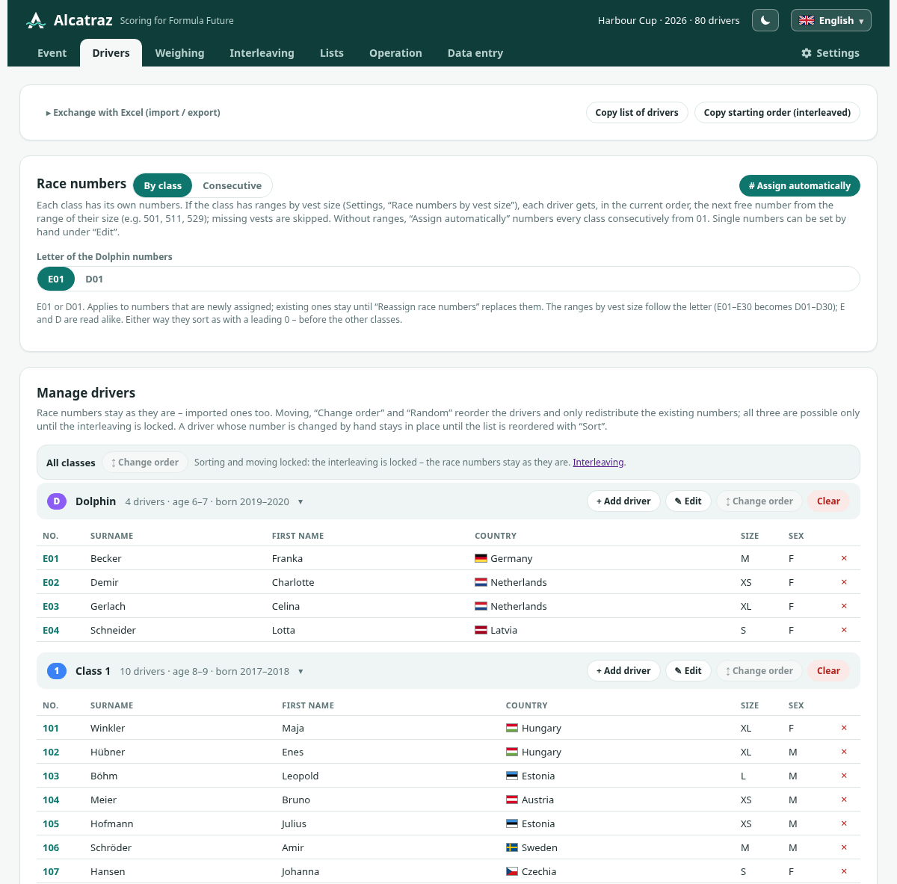</a>

**Exchange with Excel** (`src/components/ExcelPanel.vue`, `src/import/tsv.ts`, `src/import/starterMerge.ts`):

- **Replace list** recognises existing drivers by class and race number, then by class and name;
  they keep their ID and with it their weight and place in the interleaving.
  If the list comes without race numbers, a recognised driver keeps their previous number (16.11.2026).
- **Add to list** only adds new drivers and names those passed over separately (16.11.2026).
- **Copy list of drivers** writes the gender in the language of the user interface
  (M, W, D, k. A. or M, F, D, n/a); the import reads both spellings.
- “Assign automatically” numbers each class in its order when numbering by class,
  and in the starting order of the interleaving when numbering classic.

**Race numbers by vest size** (19.11.2026; Settings → “Race numbers by vest size”,
`src/domain/startnrBereiche.ts`): Race numbers by class are printed on vests in clothing sizes.
In each class a range of numbers belongs to one size group (S–M, L–XL, XXL; XS counts as S–M, XXXL as XXL).
Under the DM the race number list of the DMYV (the German motor yacht association) is the default (`startNrBereiche`
in `dm-2026.yaml`), under UIM there is none.
The event can set its own ranges per class and enter the numbers of missing vests (“512, 517, 623”);
both travel with backup and template.

- “Assign automatically” gives each driver, in the order of the tab, the next free number from the range of their
  size. If a class only has ranges of one group (DMYV: E to 3 only S–M), that range applies to everyone, even without
  a size. Missing vests are always skipped.
- If the range is full or the size is missing in a split class, the number stays empty; the tab names the driver
  under “Check by hand” (no automatic fallback, 20.11.2026).
- New drivers (by hand, “Move to class X”, Excel import, sample drivers) likewise get the first free number of their
  range.
- Moving (▲▼) works freely; the numbers move along. “Change order” and “Random” only reorder within a size group
  (20.11.2026).
- A number is only taken if it is written exactly the way the assignment writes it (“5012” in class 5 does not take
  512). Under “Race numbers” the tab names whose number does not match their size.

**Letter of class E** (since 24.11.2026 in both rulebooks): E (default) or D – under DM “Letter of class E”, under UIM
“Letter of the Dolphin numbers” (“Drivers → Race numbers”, in backup and template; applies to newly assigned numbers).
The ranges of numbers follow it: with D, E01–E30 becomes D01–D30. E and D are read the same;
after switching, E02 is therefore followed by D03, not D01 (`parseClassNumber`).

What is locked from when and what is checked – including year of birth and birthday – is described under
[Locks and checks](#locks-and-checks). Who counts for the team competition can be chosen
(see [Team competition](#team-competition)).

## Origin and flags

For the origin “State” and “Country” the following show the flag on request: Drivers tab, lists of drivers, pontoon
entry and weight lists, results and team competition – not the race officials' sheets.
Forms: written out or abbreviation, flag + abbreviation, flag + written out or flag only
(“Settings → Lists”; the team competition has the choice at the list).
It is decided in one place (`herkunftAnzeige` in `src/lib/origin.ts`).

- **Matching** (`src/domain/flaggen.ts`, `src/domain/staaten.ts`): The origin is free text on the driver.
  German states are recognised by abbreviations (BY, DE-BY), names and common spellings (NRW, BaWü, Thueringen),
  countries by ISO codes (DE, DEU), IOC codes (GER, NED, SUI) and German and English names.
  Conjunctions and “Saint”/“St.” do not count. Whatever is not recognised is shown as text; the “Drivers” tab names it.
- **Nations are international:** On an English list a recognised country appears in English, even if it was entered
  in German (“Litauen” → “Lithuania”); on a German list it appears as it was entered.
- **Country codes** (`laenderKuerzel` in the rulebook, `src/domain/kuerzel.ts`): In both rulebooks countries carry the
  IOC code (GER, SUI, NED, LAT) – according to rule 209 “POSTING OF THE RESULTS”, under the DM since 15.11.2026,
  because the association belongs to the German Olympic Sports Confederation. Every recognised country becomes this
  code (“Germany”, “Deutschland”, “DEU” → GER); former IOC codes (ROM, SIN, TRI) are recognised, today's are output.
  German states keep their abbreviations (BY, NW). The event's own abbreviations take precedence.
- **Spellings:** If drivers name the same state differently (“NRW” and “Nordrhein-Westfalen”), they carry the same
  flag and the same abbreviation. In the [team competition](#team-competition) and on the lists of drivers per origin
  they are **one** team; the list shows the most frequent spelling. “Baden” and “Württemberg” alone
  do not count as Baden-Württemberg.
- **Printing:** In print the flag never stands alone – with “flag only” the abbreviation is added (black-and-white
  printing). The flag does not change the page split.
- **Images:** vector images (SVG), embedded at build time, nothing is loaded at runtime; no emoji.
  Countries from [country-flag-icons](https://www.npmjs.com/package/country-flag-icons) (MIT licence,
  © 2020 @catamphetamine); German states each with the state flag that anyone may fly (Wikimedia Commons,
  public domain; [`src/flaggen/bundeslaender/LIESMICH.md`](../../src/flaggen/bundeslaender/LIESMICH.md)).
  The notices are also in the app under “Settings → Third-party components and licences”.

## Weighing

- **Weight lists** per origin for filling in at check-in. “Print weight lists” in Weighing opens them
  for the chosen origin; the address (`#/lists/weights/<origin>`, German `#/listen/gewicht/<Herkunft>`) can be passed
  on (16.11.2026).
- The weights are entered in the “Weighing” tab. The average weights per class are in the rulebook and
  can be changed under “Settings → Average weights”.
- **Steps** (24.11.2026): There is also “Extra weight in steps of” – 0.1 / 0.5 / 1 / 2 kg or a value of your
  own (0.1–10 kg; default 1 kg). The step is the smallest weight piece that is put into the boat at the pontoon.
  The extra weight is a multiple of it, rounded half up (with 2 kg: 2.9 → 2 kg, 3.0 → 4 kg; with 0.5 kg:
  1.2 → 1 kg, 1.25 → 1.5 kg). Anyone lighter by less than half a step needs none. Weighing, lists and
  pontoon device calculate the same way (`rundeAufStufe` in `src/domain/gewicht.ts`, `ausgleichVon` in
  `src/lib/ausgleich.ts`).
- **List “Extra weights”** for the pontoon: one sheet per class by race number with the extra weight and
  a box per attempt; in the head boat and co-driver from the assignments (`src/components/AusgleichListen.vue`).
  Empty means “none needed”, also when rounded to 0 kg (Weighing then shows “0 kg”). Anyone not weighed yet
  gets a field for adding it by hand (“not weighed”, “kg”).
- **On the pontoon device** (24.11.2026): With digital entry by the race officials, the device shows the same extra
  weight next to the race number in the part “Leaving” – “Extra weight 4 kg”, “no extra weight” or “Extra weight: not
  weighed”. Nothing is maintained at the pontoon; a weight added later in Weighing reaches the device by itself. Only
  the extra weight goes over the line, encrypted for the pontoon list, never the body weight
  ([decision](../entscheidungen.md#ausgleichsgewicht-am-steg-entscheidung-24112026) (German)).

### List of drivers per team (rule 960)

Rule 960, pt. 3.7 requires: Race number, Name and surname, Sex, Date of birth, Verified weight and ballast
required, Class, in the classes Dolphin and 1–3 the co-driver
(“Lists → Weight lists → per team”, `src/lib/teamListe.ts`).

- An **internal** list, in no results booklet. The date of birth follows the list option “Show the date of birth on
  lists of drivers”.
- “Ballast required” is the extra weight in the steps of the event; “–” means none needed.
- For this there is the optional driver field **Gender** with four values (15.11.2026, `src/domain/geschlecht.ts`):
  M, F, D, not specified; empty means “not recorded”. Under rule 960 the Drivers tab has a column for it.
  Import column “Sex”/“Gender”/“Geschlecht” (m, male, männlich; f, w, female, weiblich; d, divers; na, n/a,
  keine Angabe). On the list it appears in English: M, F, D, n/a.
- The gender is kept in backup and driver data, never in the template; scoring does not know it.

## Interleaving

The interleaving sets the starting order and with it race numbers and all lists.

<a href="../bilder/en/verzahnung.png">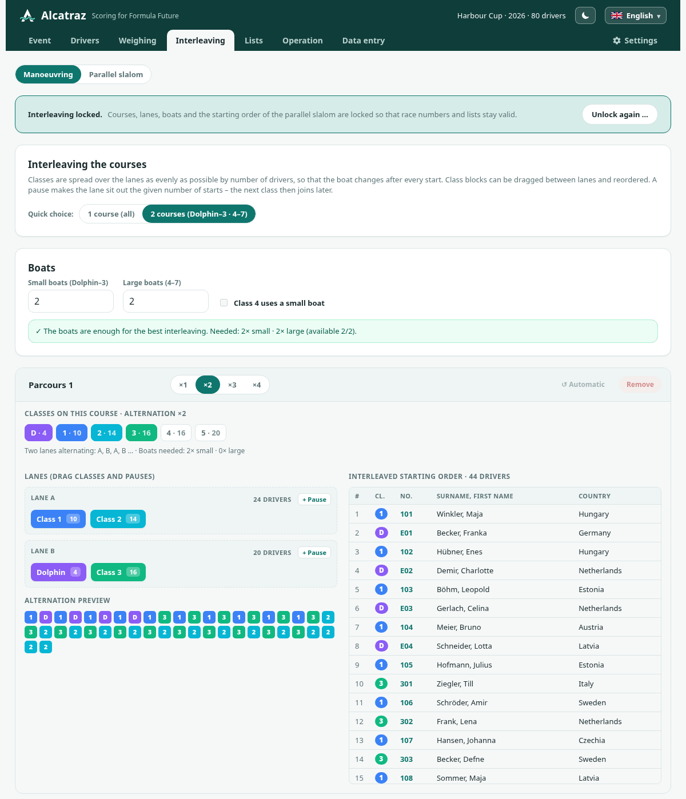</a>

- The classes are distributed by number of drivers as evenly as possible onto the lanes of a racecourse,
  so that the boat changes after every start.
- Quick selection for one or two racecourses. Class blocks can be dragged between the lanes;
  a pause lets a lane sit out a few starts.
- The boats needed are checked against the small and large boats available.
- “Lock interleaving” locks racecourses, lanes and boats so that race numbers and lists remain valid.
- Under UIM the starting order of the parallel slalom with the heats after it is also here – per class or with
  “All classes on” for all at once ([Starting order](parallelslalom.md#starting-order-of-the-preliminary-heat),
  [Heats after the preliminary heat](parallelslalom.md#heats-after-the-preliminary-heat)). Once the lists of a heat
  have been printed, its order stays until “Release print lock” (20.11.2026).

## Race officials' sheets

The race officials' sheets (German “WKR-Bögen”) are under “Lists” (`src/lib/wkrListen.ts`,
`src/components/WkrListen.vue`).

<a href="../bilder/en/wkr-bogen.png">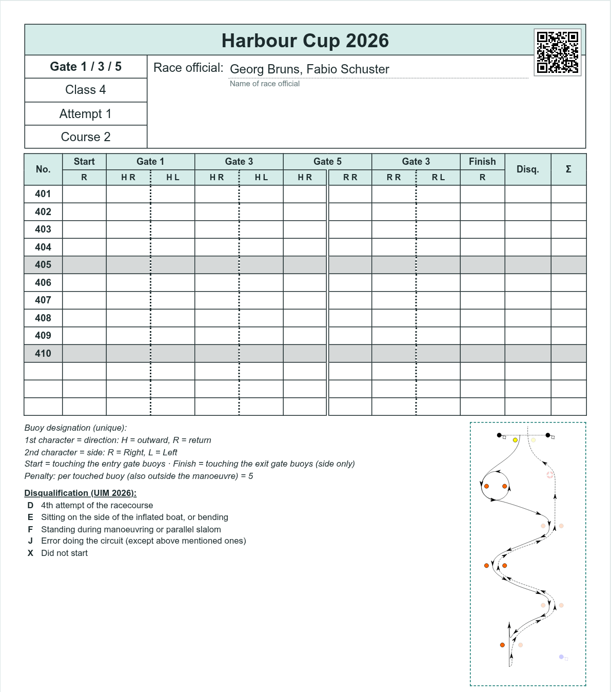</a>

- One sheet per racecourse, class, attempt and list; the race numbers in the starting order of the interleaving.
- Blank rows for late entries; optionally the description on the back.
- The course drawing is on the sheets, dimmed according to the position. In the parallel slalom only the course sheet
  (Fahrweg) of each racecourse carries the single lane, to the right of the legend (23.11.2026,
  [parallelslalom.md](parallelslalom.md#race-officials-sheets-of-the-preliminary-heat)).
- The sheets are only printed after the interleaving has been locked (see [Locks](#locks-and-checks)).
- **Print order** (21.11.2026): per racecourse position by position, within that the starting order (1st attempt in
  the order of the classes, then the 2nd …) – the stack only needs to be split at the positions (`WKR_DRUCKFOLGE`).
  Parallel slalom: per racecourse position by position, within that the heats. Checklists stay per class and attempt.
- Lists that are only entered on a device (Operation → Race officials, mode “Device”) are not printed, not even on
  the checklist; a note above the stack offers “Print anyway”. Paused and signed-off lists and a pontoon of which
  only one part is on devices are printed (`src/wkr/druck.ts`).

**Shared sheets at the club championship:** Several classes are on one sheet; lists with a course drawing
stay per class. With “Save paper” all classes of a list are on one sheet, without course drawing, the
blank rows once per page instead of per class.

- “Classes on shared sheets” (24.11.2026, `wkrGemeinsamFolge`): **separate** (default) – one block per class with
  the class as heading – or **by the interleaving** – all drivers mixed in starting order, the class in a narrow
  column next to the race number, the blank rows at the end of every page with an empty class cell.
  The head names the classes of the page; checklists, QR codes and data entry follow the same order of rows.
- Columns that a class does not have are heavily hatched in its rows, like the row of a dummy in the
  parallel slalom. Scoring is per class in both cases.

**Lists of the event** (`src/lib/listen.ts`): the lists of the setup.

- Optionally “Gate 5 also monitors the racecourse”: one list instead of two. Disq., remark, tick and
  race official name then move over (`src/state/tor5.ts`).
- In addition, extra lists outside the setup: knots, pontoon entry, variants without start/finish. They are printed,
  assigned, entered, scored and counted on the checklist like those of the setup.
- Both rulebooks provide the knots list in every manoeuvring setup (`vorgabeListen`); it can be deselected.

**List options** under “Settings”:

- Drivers per page fixed instead of automatic, and “Split from”. Shared sheets are always split automatically.
- Club championship: “Save paper”, “Classes on shared sheets” and “Blank rows per page”.
- Names of the buoy sides: R/L, Land/Sea, Quay/Harbour, arrows, Inner/Outer. The results stay with R/L.
- The language of the sheets: see [Rulebooks and terms](#rulebooks-and-terms).

## Checklists and QR codes

**Checklists** (German “Laufzettel”) are a list type of their own (`src/lib/laufzettel.ts`,
`src/components/LaufzettelListen.vue`).

<a href="../bilder/en/laufzettel.png">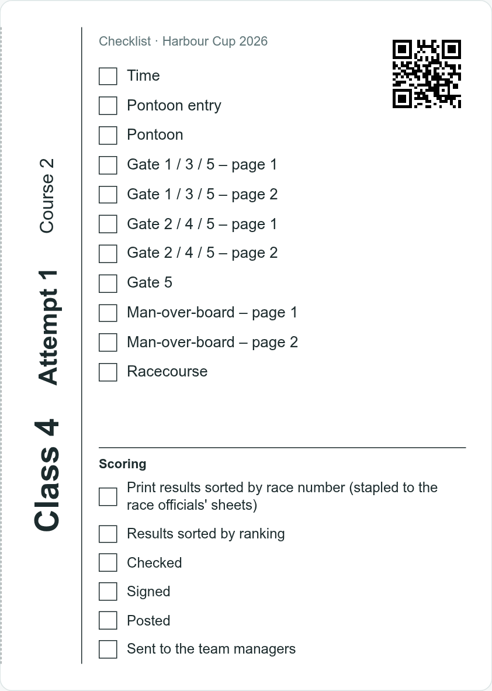</a>

- One checklist per stack of sheets: racecourse, class and attempt (shared sheets: racecourse and attempt).
- An A4 landscape sheet to be folded to A5, with a box per printed page – measured on the same sheets
  that are printed. The layout can be chosen: one row per page or one row per list.
- The knots (a list without attempt) are in the stack of the last attempt. Its checklist has steps of its own:
  no posting, but review by the team managers and the overall result (`schritteLetzterLauf`).
- The steps depend on the rulebook (`laufzettel`; default in `src/config/einstellungen.yaml`).
  UIM: posting within one hour, signed by the O.O.D. (pt. 5.2).

**QR codes** are on every printed page of every sheet and on every checklist (`src/lib/qr.ts`).

- Format `ALC1.<Veranstaltung>.<Regelwerk>.<Aufbau>.<Parcours>.<Klassen>.<Lauf>[.<Liste>.S<Seite>]`
  (event, rulebook, setup, racecourse, classes, attempt, list, page), embedded as a vector (`qrcode-generator`).
- A handheld scanner or the field “Scan sheet” jumps in data entry to the sheet and into its first cell.
- The code of a checklist shows all lists of its stack one below the other, with a jump bar.
  By hand: “all, one below the other” in the choice of list.
- Sheets of another event, another rulebook or setup are rejected with a reason.
- A scan leaves no trace in the field in which the cursor happened to be (`src/lib/scanner.ts`).

## Operation: start release and scoreboard

On competition day the operating computer releases who starts next; a **scoreboard** shows it in a
second window, for example on a monitor at the pontoon. In addition there is a **starting order** with estimated
waiting times and a **spectator list**. Tab “Operation” with the sub-tabs Start release, Starting order, Devices and
Race officials (`src/views/BetriebView.vue`, logic in `src/betrieb/`). None of this needs a network; it only reaches
other devices with [device operation](#device-operation).
Step by step: [Procedure on competition day](betrieb.md#procedure-on-competition-day).
Neither the DM-Reglement nor rule 960 governs the procedure at the pontoon; what has been interpreted is in
`BETRIEB_ANNAHMEN` (`src/betrieb/annahmen.ts`).

<table>
<tr>
<td valign="top" width="300"><a href="../bilder/en/start-freigabe.png">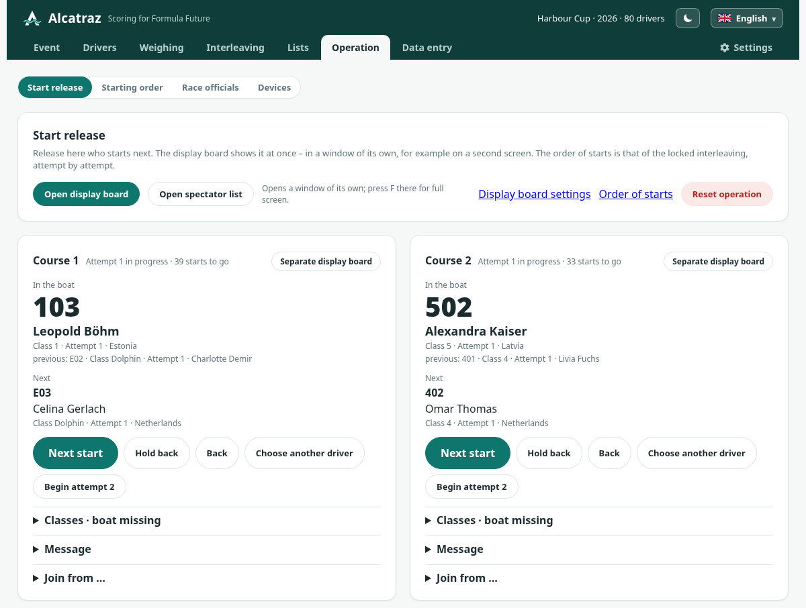</a>
 Start release at the operating computer</td>
<td valign="top" width="300"><a href="../bilder/en/anzeigetafel.png">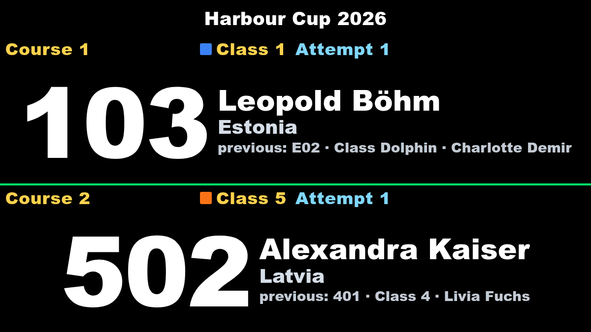</a>
 Scoreboard in the second window</td>
<td valign="top" width="120"><a href="../bilder/en/zuschauer.png">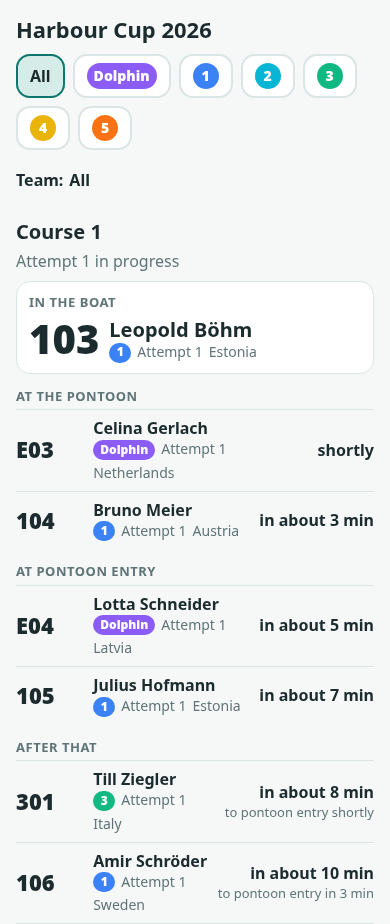</a>
 Spectator list</td>
</tr>
</table>

**Principles:**

- **The prerequisite** is the locked interleaving; before that the tab only shows the way there. If it is unlocked in
  the middle of the day, showing, “Begin attempt” and everything that rearranges the order are on hold; Back,
  messages and reset keep working.
- **The order of starts** is never stored, but derived attempt by attempt from the interleaving – the same as
  on the race officials' sheets (`src/betrieb/folge.ts`). What is stored is what was shown and begun, and after the
  first rearrangement a snapshot of the order (`src/betrieb/schritte.ts`). Operation never changes interleaving or
  sheets. With “Attempts run consecutively” (UIM) each driver runs their attempts one after the other.
- **Release goes by attempt, not by position:** A start of an attempt that has not begun yet waits – even
  if it already stands in the middle of the current one; showing a start specifically always works.
- **X:** A start with X (“did not start”) in a Disq. cell of the attempt is dropped; without X it is back.
  Operation itself never sets an X and never writes values.
- **A confirmation question** only comes before “Begin attempt” while starts are open, before “Reset operation” and,
  with digital entry by the race officials, on a backlog before showing; everything else can be taken back.

### Start release

One card per racecourse (`src/components/betrieb/StartFreigabe.vue`):

- **“Begin attempt N”** releases the starts of the attempt. Open starts of the current attempt stay released and
  come first.
- **“Next start”** brings the next open start onto the scoreboard, **“Back”** takes it back.
  A double click only switches once. At the end of an attempt the scoreboard keeps showing the last driver.
- **Hold back:** The next driver is briefly prevented and is listed under “Held back”; from there “As next”,
  “To the end of the attempt” or “Show now”.
- **To be made up:** Starts that were overtaken without having had their turn (late entry, removed X, missed
  attempt). They never come by themselves; they are shown or put back in line.
- **Choose another driver** (`BetriebsFolge.vue`): the next twelve open starts or the whole order, plus a
  search by race number or name across everything still to be shown – later attempts too. “Show” brings the start
  onto the scoreboard at once; the previous next driver stays the next one.
- **Move** (menu per start): ahead of the next one, to the end of the attempt, before or after another attempt – never
  ahead of what has already run. With “Keep the interleaving when moving” (on by default) the start gets the next
  place of its lane within the attempt. What the operator has rearranged this way stays; attempts not rearranged keep
  following the interleaving.
- **Classes · boat missing** (`KlassenAussetzen.vue`): the classes in the order in which they come up, with the
  number of their open starts. “Boat missing” puts the starts of a class greyed out at the end of the attempt; with
  “Bring other classes forward” (on by default) the next class of the same lane moves up (`E2E21212121216163` →
  `E6E61111113`), otherwise only the gaps close. “Boat is back” interleaves the rest of the attempt with it again.
  “Bring forward” makes a class the next one, only within its lane.
- If only held-back, to-be-made-up or “boat missing” starts are left, the attempt **stalls**; the card says so.
- **Join from …** attempt and optionally class, if start release only joins in the middle of the competition:
  whatever lies before counts as run (without display), “Continue with” names the next start.
- If the driver in the boat is deleted (before the first value), the scoreboard shows “ready”.
- **Message** per racecourse or on all: disruption and break appear on the scoreboard instead of the driver, a note
  below them. **Templates** (welcome, thanks, break, disruption; `src/betrieb/meldungen.ts`) are taken into the text
  field and adapted; their text is in the language of the scoreboard.
- “Reset operation” (with confirmation) clears what was begun and shown and the messages; drivers, interleaving and
  values remain.
- With [digital entry by the race officials](#digital-entry-by-the-race-officials) the card also shows the state of
  each list and the [racecourse traffic light](#racecourse-traffic-light-and-auto-mode).

### Scoreboard

“Open display board” opens a window of its own (`#/anzeige`, English `#/display`; per racecourse
`#/anzeige/<parcours>`; `src/AnzeigeApp.vue`). The F key or a double click switches to full screen; the mouse pointer
disappears after a short rest.

- Per racecourse: name of the racecourse, class (with class colour) and attempt, the race number large, name, origin
  and on request the start before. White on black, whatever colour scheme the operator uses.
- Two racecourses are shown one above the other, on very wide screens side by side. Names that are too long get
  smaller instead of being cut off (`src/lib/fit.ts`).
- The window only reads and never writes; it follows the operating window at once and keeps the screen awake.
- Language as the lists (DM German, UIM English: “Course”, “Attempt”, “Class Dolphin”), can be changed.
- What it shows comes from a narrow view (`src/betrieb/sicht.ts`): race number, name, class and origin of the
  drivers currently appearing – never date of birth, weight, gender or entered values.

### Starting order and intervals between starts

**Starting order** (sub-tab “Starting order”, `src/components/betrieb/StartListe.vue`): per racecourse the start in
the boat with “for m:ss” and the whole order of open starts by attempt, with two times:

- **“in about”** – roughly when the start is due: the rest of the start in the boat, then per start the interval
  between starts of its class;
- **“To pontoon entry”** – when the driver must be at pontoon entry: as soon as they belong to the next “at the
  pontoon” + “at pontoon entry” starts (default 2 + 2).
- Attempts that have not begun yet and “boat missing” stay without a figure. During a break or disruption on the
  scoreboard there is no figure, only a sentence saying why.
- Rearranging by dragging a start onto another or via “Move …” – the same rules as at the
  start release. Calculated with the clock of the screen; nothing is stored.

**Intervals between starts** (`src/betrieb/prognose.ts`): What is measured is the interval between two displays of a
racecourse, attributed to the class of the previous start. Not counted are intervals under 30 s and over 300 s,
across an attempt boundary, across a start done without display and for a start that has since received an X. From
three measurements on the mean of the class applies, before that the event's own value, otherwise the default
(`startabstaende` in `src/config/einstellungen.yaml`, rounded means of the DM 2025). “Adopt measured values as
defaults” turns the means into own values that travel with the template to the next event.

### Spectator list

“Open spectator list”: a window of its own (`#/zuschauer`, English `#/spectators`; per racecourse
`#/zuschauer/<parcours>`; `src/ZuschauerApp.vue`), narrow enough for a phone.

- Per racecourse “In the boat”, “At the pontoon”, “At pontoon entry”, “After that” (with “in about” and “to pontoon
  entry in”), finally “Boat missing”. Attempts that have not begun yet are not on it. During a break or disruption the
  message is at the top.
- Filters by class and – since the field test on 21.11.2026 – by team (club, state association or nation, as the
  event has it, several selectable). The filters only hide and stay in the viewer's browser; none of it goes over the
  network.
- It reads an even narrower view than the scoreboard (`sichtZuschauer`): without held-back starts, starts to be
  made up and starts of later attempts. It reaches the spectators' phones via the spectator link of
  [device operation](#device-operation).

### Parallel slalom in operation

Only under UIM ([details](parallelslalom.md#operation-start-release-and-scoreboard)): an area of its own after
the racecourses. Its steps are the locked heats (preliminary heat, re-run, semi-finals, small final, final);
each is released individually with “Begin …” (24.11.2026), its starts are the pairs of the plan. The scoreboard
shows racecourse A and B as they lie seen from the spectators (setting). Classes sitting out and moving do not exist
there, holding back takes the whole pair, there are no waiting times. A board of its own is opened with
“Separate display board” (`#/anzeige/parallel`).

### Settings and storage

- **“Settings → Display board”:** header, logos left and right (those of the lists), which racecourses the
  shared board shows, previous start, name of the racecourse, names (as on the posted results, full, shortened, none),
  origin, language, font size (70–130 %); under UIM the position of racecourse A and B.
- **“Settings → Order of starts in operation”:** “Keep the interleaving when moving”, starts “at the pontoon” and
  “at pontoon entry” (0–10 each), intervals between starts per class (default, own value 30–600 s, measured, what
  applies) and the settings of [digital entry by the race officials](#digital-entry-by-the-race-officials) (backlog,
  auto mode).
- The settings travel with the template, except the header. Operation itself is kept in the backup, not in
  the template; restoring a state from the history and “Delete all entered values” leave it as it is.
- Under `file://` (single-file version) the operating window itself nudges the windows it opened, where the
  browser does not carry the message between windows (`src/lib/anzeigeFenster.ts`).

## Device operation

Scoreboard, spectator list, start release and race official lists on other devices – screens at the pontoon,
tablets, phones –, via a third-party ntfy server on the internet (sub-tab “Operation → Devices”, `src/geraete/`).
How to use it, limits, quota and disruptions: [betrieb.md](betrieb.md#device-operation);
security model: [technik.md](technik.md#device-operation-security-model). It has not yet been tested in the field
with real phones and the real server ([feldtest.md](feldtest.md)).

- **Only “Switch on device operation” connects** – until then nothing leaves the browser (test
  `src/main.geraete.test.ts`). Then, encrypted and signed, the following go via the server: race number, name
  (according to the setting “Names” of the scoreboard), origin and class, the order of starts with times, messages,
  the name of the event; for the race official lists their starts with race number and class (without names), at
  the pontoon the extra weight. Never leaving the operating computer: date of birth, body weight, gender, entered
  values (except, for a query, the value of that one cell to the devices of the list), logos or the data of the
  event. The race official devices send their rows encrypted to the operating computer.
- **Server:** default `ntfy.adminforge.de`, can be changed under “Settings → Devices”. Its operator sees no
  contents, but times, sizes and IP addresses.
- **Two read links** with QR code: “Display board” and “Spectators” (`#/sehen/<paket>`). No login, no
  pairing; the device shows the same scoreboard (without logos) or spectator list as at the operating computer.
  Fingerprint for comparing, “Renew spectator link”, “End room”.
- **Pairing** (E7): scan the QR code from the screen (main way) or pairing link plus device code over the radio. A
  device is paired for the **start release** of certain racecourses or for a **race official list** (see
  [Digital entry by the race officials](#digital-entry-by-the-race-officials)). In the device list: name, kind of
  device (phone, tablet, computer), racecourses, lists, “Revoke”.
- **Start release on the phone** (`#/geraet`): the same buttons as at the operating computer, only for its own
  racecourses, without “Reset operation”. After every press the buttons are locked until the operating computer
  confirms; the decision is always made there (allowlist `src/geraete/aufgaben.ts`).
- In addition: keeping the screen awake on every connected device, “Reload all devices” after an update and a
  display of how many messages went to the server today.

## Digital entry by the race officials

The race officials enter their list on their own phone or tablet instead of on the sheet (stages W1–W5, built
21–24.11.2026; [proposal](../vorschlag-wkr-erfassung.md) (German), plans [W1](../plan-wkr-w1.md) to
[W5](../plan-wkr-w5.md) (German)).
It requires [device operation](#device-operation), has so far only been tested against a simulated server and is still
**without a field test** ([feldtest.md](feldtest.md)). Paper remains the fallback at any time: each list can be paused
or switched to paper from a given start. How to use it step by step:
[Race officials' entry on phone and tablet](betrieb.md#race-officials-entry-on-phone-and-tablet). The interpretations
are recorded with a date in `WKR_ANNAHMEN` (`src/wkr/annahmen.ts`), open questions under
[Offen](../entscheidungen.md#offen) (German).

<table>
<tr>
<td valign="top" width="160"><a href="../bilder/en/wkr-handy.png">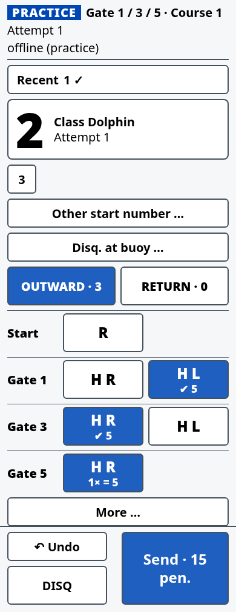</a>
 Form “Buttons” on the phone</td>
<td valign="top" width="360"><a href="../bilder/en/wkr-pad-bild.png">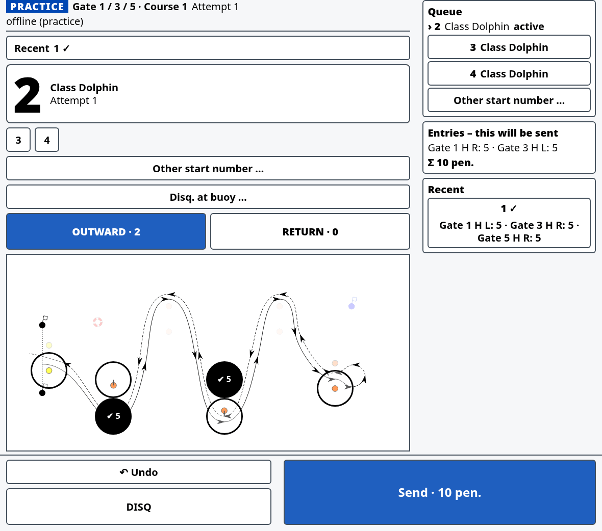</a>
 Form “Picture” on the tablet with course drawing</td>
</tr>
</table>

### How a row arrives

- When pairing, a device gets a list (phone: one recommended, tablet two, at most four); at the pontoon optionally
  whole, leaving only or mooring only. This makes the list “digital”.
- The device only sees the **view of its list** (`src/wkr/sicht.ts`): shown starts with race number and class,
  never names, plus the form per class and notes from the operating computer. Pontoon entry and leaving the pontoon
  see the next starts in advance; mooring only comes once the boat is back.
- A row that has been sent goes via data entry into the values – exactly as when typing in from paper: empty cell →
  taken over; if something else is already there, it becomes a **query** at the operating computer, never silently
  overwritten.
- Without a connection the device keeps entering; waiting rows are sent later in a bundle. They are kept only on the
  device (36 hours). A device with a list reports during an attempt with a sign of life (battery, waiting rows).
- **Closing the list:** After the attempt a band appears: “… is over – close the list?”. The check view shows
  what was sent, what is open and X; with the name of the race official – prefilled from the race official
  assignment – closing replaces the signature on the sheet. Open starts go with “Rest on paper”. If the attempt is
  still running, the device asks. After that, corrections only go as a proposal.

### At the operating computer

- **Operation → Race officials** (`src/components/betrieb/WkrMatrix.vue`): a matrix of lists × shown starts – ✓
  entered, ½ one pontoon part, ○ open, ○! overdue, ! query, V proposal, P paper, ✕ did not start,
  “✓ no time” – and per list the device with a traffic light (heard, quiet, gone). Per list: entry by device, paper or
  both; pause, sign off, “Continue on device”; **“Paper from start …”**; “Please check no.” to the devices;
  view and release closings. “Pair device” on a list without a device leads directly to pairing.
- Below that the **Incoming** area: queries (take the device's value or keep the existing one) and proposals
  (accept or discard).
- **At the table (no attempt):** a block of its own for the knots list (“Knots: n / m open”).
- **Data entry:** ◆ on values from the device, “Check paper” on rows and cells for which the sheet is needed;
  whoever overwrites a device value is asked once (see [Data entry](#data-entry)).
- **Start release:** a row with the state of each list – ✓ done, ⧗ waiting n, ✕ device gone, ▭ paper, the
  connection in small print. From how many open starts of a racecourse list a warning appears, and whether to ask
  before showing (“Continue anyway?”) or only to warn, is set under “Settings → Order of starts in operation”
  (default: from one, ask). Nothing is ever blocked. A paired start release phone sees the same row, without values
  and device names.
- The **race official name** comes from the assignment; if a device changes it under “More → Name”, the operating
  computer shows the difference and can take it over.

### Racecourse traffic light and auto mode

The start release goes only by the **racecourse** (user 21.11.2026): pontoon and pontoon entry work autonomously and
never hold things up. As soon as a racecourse list is entered digitally – gates, buoys, gate 5, man overboard,
course supervision, start/finish, since 22.11.2026 also time –, there is a traffic light per racecourse
(`src/wkr/ampel.ts`; procedure in [betrieb.md](betrieb.md#procedure-on-competition-day)):

1. After “Next start” it is **green** (“Start clear”).
2. It turns **red** with “Through the start gate” or by itself as soon as a racecourse race official sends something
   for the start; next to it is shown which lists are still missing. “Not through after all” takes the button back.
3. Once all digital racecourse lists have sent: **clear**. “Next start” while red asks “Continue anyway?”.
4. **Auto mode** (setting, off by default): If every racecourse list has a device, the start release counts down
   3 seconds when “clear” (“Hold”) and shows the next one. Never by itself: a new attempt, starts to be made up,
   held-back starts, with an open query, during a break or disruption.

The racecourse race officials see a dot “start clear” or “on the racecourse” in the driver card; scoreboard and
spectator list show no traffic light.

### Forms

To choose from are “Buttons”, “Picture” and “Table”. The operating computer can set one per list (device list),
optionally “fixed”; otherwise the race official switches under “More → Display”. Without a setting “Buttons” applies,
on the tablet for lists with buoys “Picture” (`src/wkr/maskenWahl.ts`). “Buttons” looks different depending on the list
(codes, buoys, time, checklist). All forms produce the same cell values as typing in from paper (`src/wkr/maske.ts`).

- **Codes** (pontoon, pontoon entry, gate 5, man overboard): one button per penalty code of the list, the race number
  large, never a name. Main button “No penalty ✓”, with entries “Send · n pen.”; “↶ Undo” takes back the
  last tap. Disq. separately via DISQ: the first tap marks, the second sets. The Disq. buttons only offer X at
  leaving the pontoon and at pontoon entry, with a confirmation question. Codes that do not apply in the class
  according to the rulebook are greyed out but can be pressed (DM: 4 and 23 from class 3; 2, 5, 10 and 16 from
  class 4).
- **Maximum per code** (24.11.2026; `max`/`danach` per code in the rulebook): “2nd and 3rd attempt of the element”
  counts at most twice; the third tap sets Disq. **D** (“4th attempt of an element”) – the button says beforehand
  “next = Disq. D”. On these buttons a tap less than 0.4 s after the previous one does not count (debounce). Gate 5
  code 1 (“not entered with the full length”) only works once. Every other code counts at most three times per
  attempt; at the maximum the button says so (“at most 3×”) – interpreted, still to be confirmed.
- **Buoys** (gate lists such as gate 1/3/5 and gate 2/4/5, racecourse with start/finish, parallel slalom): one row per
  stop, the two buoys of a gate side by side as on the sheet. One tap = one touch (5 points), the second
  removes it; the gate buoys of gate 5 count up to 9. If a class has more than seven rows, a switch
  “OUTWARD | RETURN” divides them, which never changes by itself. Order under “More → Display”: “Return reversed”
  (default), “Order of the run” or “All in one list”. DISQ first asks for the buoy (“No buoy / whole racecourse” for
  the Disq. field); a long press (0.8 s) on a buoy opens its Disq. choice directly, several letters, then “Done”.
  A cell can thus carry points and letters (“5, J, D”). A gate left out is a J on one of its buoys.
- **Picture** (only lists with buoys): the course drawing of the class, tapping is done on the buoys themselves –
  hit circles at least 15 mm, pushed apart if too close. Switch OUTWARD, RETURN and RETURN 2 (speed lap),
  by hand only. A long press on a buoy opens the Disq. choice of that buoy. **Position of the drawing** (24.11.2026,
  “More → Display”): “Automatic” (as on the sheet, as far as space allows), “Pontoon at the bottom/on the left/at the
  top/on the right”, in the parallel slalom “Start on the left/at the top/on the right/at the bottom”; the lettering
  stays upright, remembered per device and list. The parallel slalom shows the single lane without pontoon, the same
  for racecourse A and B. If a buoy is missing in a drawing, the device shows the buttons.
- **Time** (timing lists): the time fields with a numeric keypad for the active field; below it is shown how the
  operating computer reads the input (“83.45” = 83.45 s). Only the first time field is mandatory; after a complete
  time the keypad jumps to the next one. “No time for …” with a reason: timing system failed, did not finish, other
  reason – at the operating computer “✓ no time”, in data entry “Check paper”. Lists with buoys and time show the
  buoy form with time fields.
- **Knot checklist at the table** (knots, list without attempt): the device knows all drivers of the classes with the
  list, without start release. Type the race number on the keypad or take the suggestion “Next: …” (the next
  open one after the one last worked on); per knot ✓ or ✗ (✗ = 5), “✓ All correct” or “✓ Rest correct”,
  send. A number already entered asks “correct it?”.
- **Table** (for experienced users, only tablet or computer with keyboard): one row per start with the columns of the
  sheet, Tab and Enter to the next cell, Enter in the last one sends. It is read as when typing in from paper; errors
  appear at the cell (“Not a penalty code of this sheet”, “Too often …”). Correction in the table with “old → new”,
  Esc cancels.

For the few lists without a form, assigning shows “Form to follow – paper”.

### On the device

- **After sending**, “sending …” appears briefly with the confirmation, then the next race number; for one
  second the form accepts nothing (protection against double taps). The bar “Recent” opens sent rows for
  correction; “Other start number …” jumps to another start.
- **Did not start** (24.11.2026, replaces “Did not come past”): “More → Did not start · Disq. X” with a large
  confirmation question “23 did not start?” enters X alone into the Disq. field – on every list with a Disq. field
  (gates, gate 5, man overboard, parallel slalom, pontoon, pontoon entry). At the operating computer it acts like any
  X: the start is dropped in this attempt, on all lists and in scoring. Whoever made a mistake corrects it via
  “Recent”; the correction starts without X.
- **More:** remarks, pause (paper), sign off, “Did not start · Disq. X”, name, display (“Like device” as
  default, Sun, Light, Dark; left-handed; plus buoy order, position of the drawing and form), language (that of the
  list, switchable; under UIM codes and titles change too), trial run.
- **Trial run:** After first receiving a list, the device shows a trial run once per room, list and form with the
  start “P” – nothing is sent; “Skip” always works, “More → Trial run” repeats it.
- **Tablet** (`src/wkr/anordnung.ts`): in landscape up to four lists side by side, in portrait up to two; the whole
  pontoon as leaving and mooring side by side. A side column shows queue and entries in plain text. In the parallel
  slalom a band with the heat and a clear change at the next attempt.
- **Two tabs** of the same pairing: only the one opened last sends, the older one offers “Continue here”.

### Practice

“Practise offline” in the pairing form or the address `#/uebung` (`src/components/wkr/WkrUebung.vue`):
choose rulebook (DM-Reglement or UIM rule 960), list and form, then the same form with made-up starts 1–20
without names. No network, no operating computer, no store; only the display settings are saved.

- The next start comes 2–6 seconds after sending, occasionally also earlier; now and then a query comes as in
  earnest. At the pontoon there are made-up extra weights.
- After sending, the page scrolls until the explanation and the header “PRACTICE” have gone off the top and the race
  number is at the edge (24.11.2026).
- “Bring a class forward” (at the very bottom under “More”, at the table above “End practice”) fetches the next start
  from another class – to practise a class change.
- Good for the briefing the day before; the practice needs neither an event nor pairing.

## Data entry

Data entry is a tab of its own (`src/views/ErfassungView.vue`, `src/lib/eingaben.ts`, `src/lib/erfassung.ts`).

<a href="../bilder/en/erfassung.png">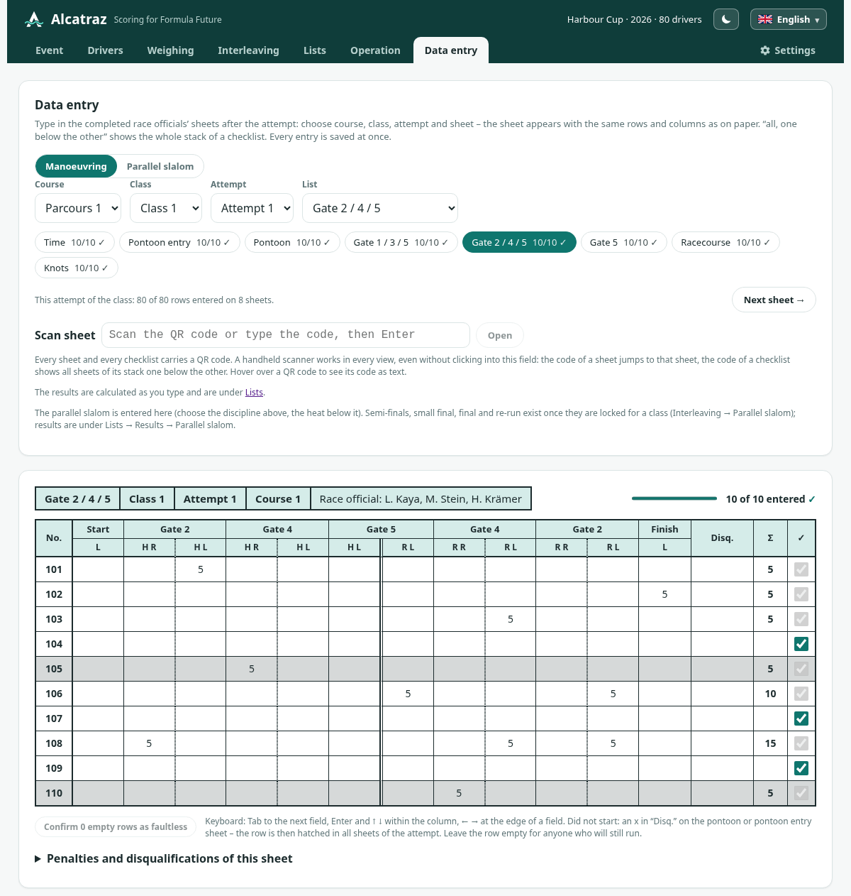</a>

- The completed sheets are typed in after the attempt; the same sheet as on paper appears as an
  input table, in the same order of rows.
- Keyboard: Tab to the next field, Enter and ↑ ↓ within the column.
- Times can be typed in short form: “83.45” is seconds, “1.2345” or “1:23.45” is 1:23.45 (point or comma).
  Before the separator, values from 20 on mean seconds, below that minutes: “15.30” is 15:30.00 (`src/lib/time.ts`).
- Progress per sheet and notes on implausible entries – since 24.11.2026 also when a code appears more often than
  it can occur in an attempt (“Code 6 is entered more than 2× … Disq. D?”). Nothing is set by this; what is on
  the paper stays.
- A QR code leads directly to the sheet or stack of sheets (see [QR codes](#checklists-and-qr-codes)).
- With [digital entry by the race officials](#digital-entry-by-the-race-officials): ◆ on values from the device (with
  list, device and time), “Check paper” on rows and cells for which the sheet is needed, and a question before a value
  from the device is overwritten. Open queries are decided under Operation → Race officials.

## Scoring and results

<a href="../bilder/en/wertungsliste.png">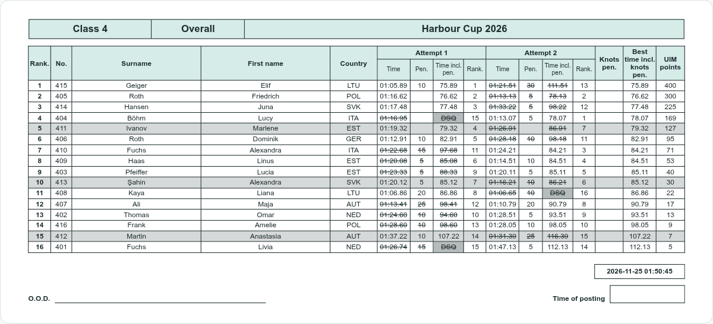</a>

- Scoring is calculated by pure functions (`src/lib/ergebnis.ts`, `scoring.ts`, `time.ts`, `codes.ts`, `disq.ts`).
- Results exist per class, attempt and overall under “Lists”, printed in the order of the sheets:
  racecourse, then class by starting order.
- A field below the table shows on every page when the list last changed
  (`src/lib/listenStand.ts`); there is no print time in the page margin.
- For each list both orders (race number, then ranking) can be output in one print.

**Equal points:** The dead-heat rule of the rulebook decides (`stichentscheid`).
DM: the fastest scored attempt. UIM according to rule 960 pt. 5.2.6: the sum of both attempts.
Only then is a ranking shared. A ranking decided this way carries an asterisk; the rule is stated below the table.

**Anyone who has not run yet** stands without a time in 1st place.
An X (did not start) in a Disq. field of the attempt – at the pontoon, at pontoon entry or from the device – appears
as “Did not start” on the list and counts like a disqualification. In the interim standings of the overall list it is
at the end until the dropped attempt absorbs that attempt.

**Attempts and dropped attempts:**

- If the rulebook provides a number of attempts (`wertungslaeufe`), choosing the rulebook sets it at once:
  UIM 2 attempts and 1 dropped attempt (two attempts, the better one counts), DM 3 attempts and “by rule”.
  Under DM “by rule” also drops one with only two attempts (Reglement C6).
- Deviating by hand remains possible; the user interface then points this out (under DM only a preset, no note).
- Values already entered for an attempt that no longer exists afterwards stay in the data. A note names them where the
  setting is changed, under “Details” per driver with attempt, list and field (`src/components/EingabenHinweis.vue`).

### Posting according to UIM (rule 960, pt. 5.2)

What a rulebook requires for posting is in its YAML file (`aushang`, so far only `uim-2026.yaml`).

- Below every results list (per attempt, overall list, individual competition, team competition) there is a
  signature line “O.O.D.” and an empty field “Time of posting” – “All results must be signed by the O.O.D. and
  must show the time of posting.” The printed time stamp next to it remains the last change.
- The overall list of manoeuvring has the column “UIM points” (pt. 5.2.1, table pt. 5.1) as soon as the class is
  complete; a shared ranking gives both the full points, disqualified drivers have 0.
- According to pt. 5.2.1 it has no column “Result”: Attempts, “Knots pen.”, “Best time incl. knots pen.”, “UIM points”
  (15.11.2026). The overall list of the DM keeps “Ergebnis” (result).
- Nowhere does the number of a stage appear (“stage 2”), only the name of the discipline.
- As long as only one discipline has been run, the sheet of the UIM team competition says what it is based on
  (“Manoeuvring only – nothing has been recorded for Parallel slalom yet.”).

### Attempts run consecutively (UIM)

“Settings → Scoring”, according to pt. 4.3.2 “2 attempts, run consecutively”. Under UIM an option, not preselected
(15.11.2026): Some countries only moor at the pontoon and run again at once, others run the attempts as separate runs.
The switch only appears under rulebooks that know it (`versucheNacheinander`).

**On:** Each driver appears on the manoeuvring lists twice, directly one after the other.

- 1st and 2nd attempt are on **one** class sheet, with the column “Attempt” after the race number and a
  dividing line below each driver; pages are only split between drivers.
- **Pontoon entry** (15.11.2026): the driver only passes there once – one row per driver, without “Attempt”
  (`einmalJeStarter`). What is entered there applies to every attempt; so an X from pontoon entry counts in both.
  If a later attempt already holds something else, the row points this out.
- One sheet per list instead of one per attempt, all in the same stack, plus **one** checklist per class.
  The QR code names the stack; data entry shows the same sheet and writes each row under its attempt.
- Nothing is posted between the attempts.

**Off:** separate sheets and checklists per attempt; those before the last attempt with the steps for posting.

## Team competition

The team competition is calculated per origin – club, state or country – from the rankings in the overall list of
each class; a list type of its own under “Lists” (`src/lib/pokal.ts`, `src/components/PokalListen.vue`).

**Three variants** that can be switched on at the same time:

- Places 1–3: 10, 7, 5 points.
- Places 1–6: 6 to 1 points; this is how the DM 2026 workbook calculates.
- UIM points: places 1–20 according to rule 960 pt. 5.1; per origin the five best count, scored from five drivers on.

Points, number of best and minimum number can be changed under “Settings → Team competition”
(defaults `pokalPunkte` in `src/config/einstellungen.yaml` and `pokal` in the rulebook).

**Tie** (`pokal.stichentscheid`): DM (C6) the number of 1st places, then of 2nd and 3rd; UIM (pt. 5.2.6) the
points of the 1st places, then of the 2nd … Only then do they share the ranking; the ranking carries an asterisk.

**Who counts:**

- Disqualified drivers, open ones and drivers without origin get no points.
- Spellings that only differ in upper/lower case or spaces count as the same; for
  state and country also every recognised spelling (see [Origin and flags](#origin-and-flags)).
- Optionally only selected drivers count (column with boxes in the “Drivers” tab). Whoever is not selected keeps
  their ranking but gets no points. The selection is kept in backup and driver data.

**Interim standings:** As long as not every class has its final result, the list is marked as interim standings.
A class then counts with its overall list as it currently stands; open ones get nothing.

**Printing:** one document per variant – places landscape, UIM portrait – with the time stamp of the most recent
overall list of all classes (`wertungZeit` in `src/lib/listenStand.ts`); it never runs backwards.

Under rule 960 with parallel slalom: see [UIM team competition](parallelslalom.md#uim-team-competition).

<a href="../bilder/en/mannschaftswertung.png">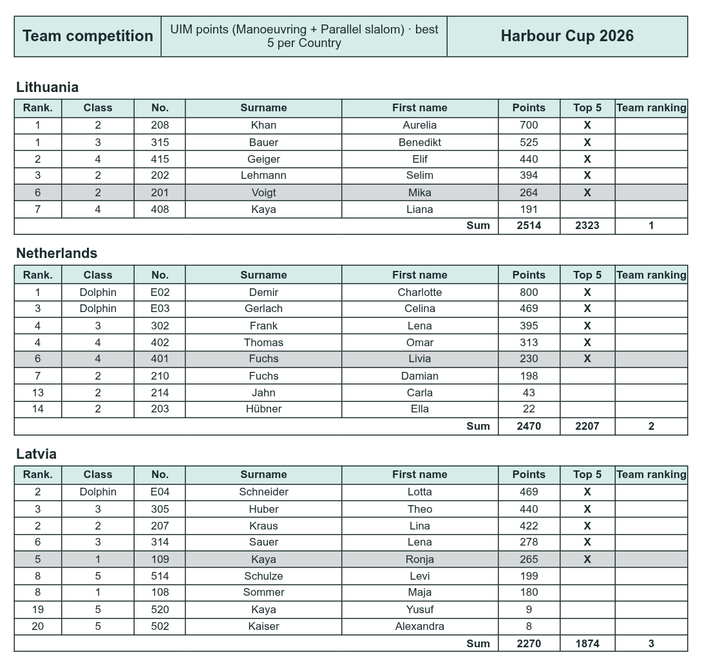</a>

## Further lists and printing

### Lists of drivers and pontoon entry list

The lists of drivers are a tab with the selection “Type” (`src/lib/starterlisten.ts`):
interleaved (on request with the drivers of one origin highlighted for the team managers), per origin by
race number, by class and under rule 960 “Parallel slalom”
([Starting order per racecourse](parallelslalom.md#starting-order-per-racecourse)). The pontoon entry list is a list
type of its own.

### Code notice

A list type of its own: all penalty and disqualification codes of the rulebook with their source on one A4 sheet
(`src/components/CodesAushang.vue`).

### Results booklet

The results booklet (German “Druckdatei”) is the last tab under “Lists” (`src/lib/druckdatei.ts`): the file that goes
to the participating groups after the competition.

- Contents: the interleaved list of drivers per racecourse, the team competitions switched on (UIM points before
  places), the explanation of the penalty points and disqualifications, then per class the attempts and the overall
  list by ranking.
- Everything in one print: “Save as PDF” gives one file; portrait and landscape alternate, each document counts
  its own pages. Parts, scope and classes can be deselected.
- Two versions: “External” like the posted results (names shortened or left out, never a date of birth); “Internal”
  with full names and, if switched on, the date of birth on the list of drivers.
- As long as not every class has its final result, a note names the missing attempts.
- **According to rule 960** (15.11.2026): team competition, legend of the codes, individual competition, then per
  discipline with values its lists – before manoeuvring the interleaved list of drivers, before each heat of the
  parallel slalom its starting order. The results booklet of the DM keeps the order of the template.
  The list according to pt. 3.7 is in no results booklet.

### Logos

Settings → “Logos on the lists” (`src/components/LogosPanel.vue`, 16.11.2026): two places, “Left logo” and
“Right logo”, empty at first. Without a logo every list looks as before.

- They appear next to the header of every page of the lists, on the race officials' sheets in the title bar before
  the QR code, on the checklists as a strip above the title and on the scoreboard next to the header.
- Height 8–30 mm (default 15 mm), on the race officials' sheets at most 12 mm; taller logos cost rows, the lists are
  split anew.
- Upload: PNG, JPEG, WebP, GIF or SVG up to 20 MB; the image is reduced in the browser (at most about 100 kB per
  logo), metadata is dropped. Below 200 dpi the setting points this out.
- Backup and template carry the logos; they never go via device operation.

### Double-sided printing

For list types with several documents in one print, “print double-sided” starts each document on a new
sheet; after an odd number of pages an empty page follows that is not counted (`src/lib/doppelseitig.ts`).

### Colours

On screen, lists and sheets follow the colour scheme (also dark); printed they are black on white with a grey
row every five rows. Their colours come only from `--blatt-*` in `src/styles/blatt.css`; logos print in their own
colours.

## Locks and checks

Each applies both in the user interface and in the reducer. The items with a date are decisions of 15.11.2026 unless
stated otherwise.

- **Field of drivers:** As soon as the first value is entered, drivers can neither be imported nor added or
  removed (`starterfeldFest`). Changing details, loading a backup and resetting still work.
  Whoever no longer runs is instead **entered as did not start**: an X in the Disq. field at the pontoon in every
  attempt without values, under UIM also in the locked heats of the parallel slalom (`src/lib/abmeldung.ts`);
  ↺ takes back the withdrawal.
- **Rulebook:** As soon as results are entered it can no longer be changed until all values are deleted;
  a template does not change it then either.
- **Class of a driver:** fixed as soon as the interleaving or the starting order of the parallel slalom is locked.
  There is no free choice of class; only if a changed date of birth belongs to another class does the user interface
  suggest “Move to class X”.
- **Order of the drivers:** “Change order” turns the column headers Surname, First name, Origin, Size, Gender
  and Date of birth into buttons – per class and for all at once. Three steps per header (21.11.2026): ascending (↑),
  descending (↓), marker off (↕); equal values keep their order, entries without a value go last. “Random”
  shuffles anew every time. The existing race numbers are only redistributed (`src/lib/reihenfolge.ts`).
  Locked as soon as the interleaving is locked, as is ▲▼; race numbers by hand stay free.
- **Printing race officials' sheets:** only once the interleaving is locked; before that a note leads to the
  interleaving, and Ctrl+P only puts that note on paper. The lists of the parallel slalom depend on their locked heats.
- **Year of birth and class:** A year of birth that does not belong to the class is rejected – when pasting from
  Excel, when loading driver data, when adding and when changing the date of birth
  (`src/import/klassenPruefung.ts`).
  If it belongs to another class, a suggestion appears below: “Add in class X”, “Move to class X”,
  in the Excel import per row “Import into class X” and “Fix all” (16.11.2026). If the year of birth fits no
  class, the message names the years of birth that start at all. Without a date of birth the driver stands out as
  “missing”.
- **Permission to start by birthday** (24.11.2026, DM only, Reglement C8: class E from the 6th, class 7 up to the 27th
  birthday; `geburtstagsGrenzen` in the rulebook): only a warning that can be ignored.
  In the header of the class a yellow badge (“2 birthdays to check”), expanded one sentence per driver (“turns 6 only
  on 2026-09-06 – in class E permitted to start from age 6”) and “!” at the date of birth. It is measured against the
  date of the event; without a date the list names the borderline years of birth to check. Interpreted and still to be
  confirmed: no longer on the 27th birthday itself; the first day of competition counts; 29 February becomes 1 March
  in years without it.
- **Date fields:** never the browser's date picker (depending on the system it showed mm/dd/yyyy), but a text field:
  German DD.MM.YYYY, English YYYY-MM-DD (`src/components/DatumFeld.vue`). Also recognised are 2019-12-01, 1.12.2019
  and 01/12/2019 (slash: day first); a date that does not exist is reported. Stored as YYYY-MM-DD.
  The Excel import reads the same spellings, plus a year alone and Excel serial numbers.
- **Race numbers with letters:** E01 and D01 sort everywhere before 101, 201 … (`vergleicheStartNr` – the one
  place for lists, scoring, interleaving and the pairs of the parallel slalom).
- **DM, disqualification S “Bremsen mit der Hand beim Anlegen” (braking with the hand when mooring)** – only on the
  pontoon list (Reglement C5 d).
- **“X”** (did not start) is in every rulebook; “O” is never assigned.

## Parallel slalom and individual competition (rule 960)

Under rule 960 the parallel slalom, the individual competition across both stages and the UIM team competition are
added. Everything about it is on a page of its own: [parallelslalom.md](parallelslalom.md).

- Starting order of the preliminary heat with racecourse A and B, dummies for an odd number, heats after it
  (semi-finals, small final, final) and re-run; scoring only interprets where rule 960 is silent
  (`PARALLEL_ANNAHMEN`, confirmed 24.11.2026).
- **Individual competition:** per class and discipline time, ranking and UIM points, plus the sum. With an equal sum
  the time decides according to pt. 5.2.6 – since 24.11.2026 in the parallel slalom the two attempts of the last heat
  run, with an equal time additionally those of the heat before
  ([Individual competition](parallelslalom.md#individual-competition)).

<a href="../bilder/en/parallel-results.png">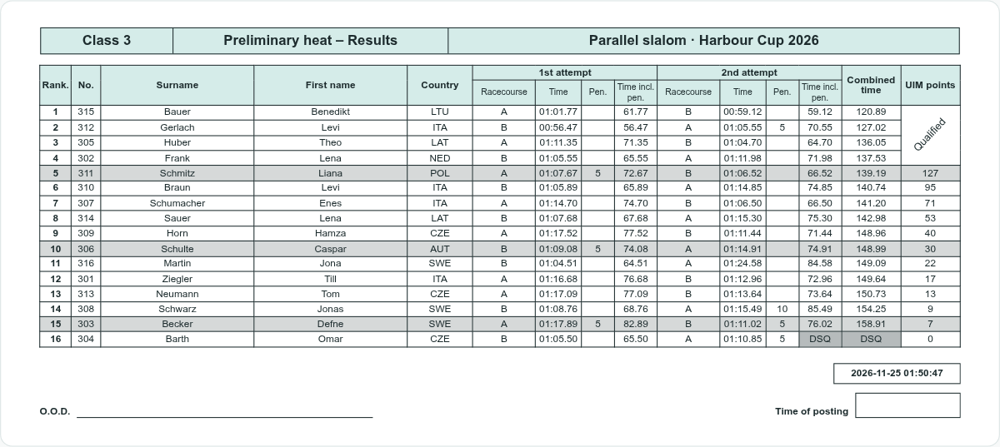</a>

## Sample data

The sample data is at the end of “Event” (`src/components/BeispieldatenPanel.vue`), collapsed as long as it
is not being worked with. All names are made up.

**Sample field of drivers:**

- A **total number** as a suggestion according to the type of event (21.11.2026, `BEISPIEL_STARTERZAHL` in
  `src/domain/generate.ts`): club championship 10–20, championship with clubs or without origin 45–75, by
  states or countries 100–160. “New suggestion” draws again.
- The number per class is a field of its own (0–999); next to it the sum. Numbers set by hand stay with a
  new total; “Reset” forgets them, “New suggestion” replaces everything. Distribution follows fixed shares
  (`BEISPIEL_KLASSEN_ANTEILE`: E 4 %, 1 9 %, 2 13 %, 3 15 %, 4 15 %, 5 18 %, 6 11 %, 7 15 % – from three lists of
  drivers 2025/2026, without data from them); under UIM the same shares on E to 5.
- The origin follows the event, **independently of the rulebook** (15.11.2026): clubs, states, countries
  (English names, IOC codes) or none; the club championship gets none. “Origins” limits their number –
  for checking the team competition.
- Sample drivers only get a gender under a rulebook with parallel slalom (for the list according to pt. 3.7).

**Sample values:** a selection – manoeuvring up to attempt n or a heat of the parallel slalom (only selectable once
its starting order is locked).

- “Insert sample values” only fills what is selected, in the heats after the preliminary heat only empty attempts.
- “Delete values of the selection” only deletes its values; withdrawn drivers get their X back. “Delete all entered
  values” remains.
- Withdrawn drivers get no sample values. The values follow rounded key figures per class, without individual results.

**Sample assignments, weights, boats and co-drivers** each have a button of their own (`src/lib/beispieldaten.ts`,
deterministic via `saat`; since 21.11.2026 only here):

- The assignments fill every printed list of the race official assignment per racecourse with two to three made-up
  people, at most 40 characters, so that the entry fits on one line in the head of the sheet.
- The weights lie around the average weight of the class; 40 % are at least half a step lighter, so that
  extra weights arise.
- Each class gets a made-up boat name (`src/data/boote.ts`), co-drivers only where the rulebook provides them.
- If something is already there, the app asks before replacing it. Each button gets an entry of its own in the
  history.
