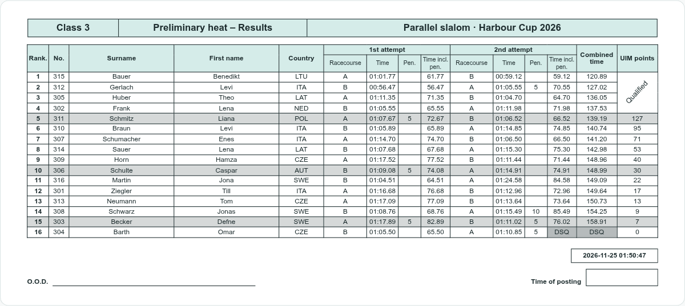

[Deutsch](../parallelslalom.md) · English

# Parallel slalom and individual competition (rule 960)

What Alcatraz can do under UIM rule 960 “Formula Future” for the parallel slalom and for scoring across both stages.
Manoeuvring and everything shared is described in [funktionen.md](funktionen.md).
Why something is the way it is is recorded with a date in [entscheidungen.md](../entscheidungen.md) (German).
“Decision of …” here always means a decision of the user.

## Contents

- [Overview](#overview)
- [Starting order of the preliminary heat](#starting-order-of-the-preliminary-heat)
- [Race officials' sheets of the preliminary heat](#race-officials-sheets-of-the-preliminary-heat)
- [Data entry in the parallel slalom](#data-entry-in-the-parallel-slalom)
- [Race officials](#race-officials)
- [Starting order per racecourse](#starting-order-per-racecourse)
- [Scoring of the preliminary heat](#scoring-of-the-preliminary-heat)
- [Heats after the preliminary heat](#heats-after-the-preliminary-heat)
  - [Assumptions](#assumptions)
- [Withdrawals](#withdrawals)
- [Operation: start release and scoreboard](#operation-start-release-and-scoreboard)
  - [Repeat after a breakdown](#repeat-after-a-breakdown)
  - [Race official data entry on the device](#race-official-data-entry-on-the-device)
- [Dummies and terms](#dummies-and-terms)
- [Individual competition](#individual-competition)
  - [Do not score a discipline](#do-not-score-a-discipline)
  - [UIM team competition](#uim-team-competition)
  - [Tie-break determinations](#tie-break-determinations)

## Overview

Alcatraz calculates the starting order of the preliminary heat
(`src/planung/parallel.ts`, `src/planung/parallelRunden.ts`, view “Interleaving → Parallel slalom”).
In addition, per class, semi-finals, small final, final and re-run up to the overall results of the stage.
Each heat is self-contained (since 21.11.2026 the small final and the final are separate as well): its own plan,
race officials' sheets, checklists, starting order, data entry, results and its own item in operation, which is
begun on its own.
From these come the individual competition across both stages and the UIM team competition from the points of both
stages (see [Individual competition](#individual-competition)).
Where rule 960 is silent, Alcatraz interprets in one place (`PARALLEL_ANNAHMEN`); the user confirmed all of these
assumptions on 24.11.2026 (see [Assumptions](#assumptions)).
The parallel slalom exists only under a rulebook with the discipline `parallel` (rule 960), i.e. up to class 5.
The former state `parallelInternational` (national parallel slalom) has been dropped; old backups still load.

## Starting order of the preliminary heat

- **Pairs by class** (pt. 4.4 “Two drivers from the same class shall start at the same time”):
  The default is strict class separation
  (`parallelStreng`, switch in the view) with one dummy for each class with an odd number of drivers.
  Switched off, the remaining driver races the first driver of the next class in the same boat.
  There is then a dummy only if a type of boat has an odd number of drivers.
  The former pairing by type of boat only (Dolphin against class 3) no longer exists.
  Dummy, types of boat and blocks are not in the rulebook – they are organisation.
- **Order:** The classes stay together.
  “Classes in the order of their lowest race number” orders the classes of a type of boat by their lowest
  number instead of the fixed order.
  It is meant for classic numbers; with numbers per class, Dolphin would come after classes 1 to 3 because of the “E”.
  Blocks (small and large pair alternating) and the swap in the 2nd attempt remain.
  The earlier start of a pair is the 1st attempt.
- **Locked plan:**
  - Freezing: “Lock interleaving” freezes the preliminary heat
    (`parallelPlaene.pre`: per start the driver IDs on A and B, attempt, block, type of boat
    – no names, no race numbers).
    After that it is not recalculated.
  - Notices: The view reports late entries, removed drivers and class changes instead of slotting them in.
    A dummy takes the place of a removed driver.
    If both drivers of a pair are missing, the start is shown as “cancelled” in its position.
  - Late entries: They are included by unlocking and locking again.
    An older state with locked interleaving gets its plan when it is loaded.
  - Backup and template: The plan is in the backup, not in the template (it depends on the drivers);
    `parallelStreng` travels in both.
    If, when a template is applied, the local locked plan stays
    (locked here, and the template brings the lock along),
    the three switches it was calculated with stay as well
    (`parallelStreng`, `class4Small`, `parallelOrderByStartNr`) – as in the reducer, which locks them while the
    lock is set.
- **Classic race numbers** with the order “Parallel slalom” follow the same plan as the view
  (`vorlaufPlan`), so with locked interleaving the locked one.
  Assigning again then changes no number.
  Anyone entered after locking gets the next number after all the others.
  The number of a removed driver stays free as a gap; nobody moves up.

## Race officials' sheets of the preliminary heat

`src/lib/parallelBogen.ts`, “Lists → Race officials' sheets → Parallel slalom”.

- Six sheets per heat: for each of racecourses A and B time, pontoon and course from the setup `parallel`
  (`aufbauFuer` in `src/config/catalog.ts`; nothing about it is stored in the state, there is exactly one).
- The rows are the starts of the **locked** plan in its order, across all classes.
  At the front are the columns Start, No., Class, Attempt.
  Row n is the same start on all six sheets.
- Without a locked plan there is no sheet, only the notice.
- Assumptions (organisation, not rule 960): no blank rows;
  a dummy and a cancelled start appear as a hatched row without entries;
  there is a line at the end of each block.
- The pontoon sheet has no “Remark” column here (`ohneSpalten` on the setup, `config/aufbauten/parallel.yaml`).
  The course sheet has a Σ column after “Disq.” like the course sheets of manoeuvring with buoys.
- `config/validate.ts` checks that the columns of the parallel sheets do not depend on the class (`PARALLEL_KLASSEN`).
- **Drawing of the lane** (23.11.2026 after R9-05 to R9-07: “… on the lists and on the device only one of the two
  racecourses and without the pontoon”; `PARALLEL_BOGEN_BILD` in `src/lib/parallelBogen.ts`): The course sheet carries
  the one lane from `src/assets/parcours/Parallel.svg` – the same drawing as the “Picture” form on the device, the same
  for A and B, nothing dimmed; which racecourse it is, is stated in the header. Below it, in the footer, the
  attribution (CC BY-NC-SA 4.0), on screen below the sheets the same with links. Interpreted during implementation,
  confirmed 24.11.2026 (R10-04 to R10-07):
  - only the course sheet (the sheet with buoy columns, `parallelListeMitBild`) – just as in manoeuvring only sheets
    with buoys, MOB or course have a picture; time and pontoon stay without;
  - at the front **to the right of the legend** (the disqualifications), at most as high as the legend, in a frame
    100 mm wide (`.bogen--bild-streifen` in `src/styles/bogen.css`). In one language that space is free anyway; the
    rows per page, the page numbers and the boxes of the checklists stay the same (measured in the browser: footer
    40.2 mm with and without the drawing, German and English, 31 rows per page); the drawing is 94 × 22 mm
    (buoys 1.7 mm, digits about 4.5 pt – tight). Below the legend at full width it cost about eight rows per
    page. In two languages the legend is 144 mm wide: so that the drawing stays legible (before, next to it only
    45 × 11 mm, buoys 0.8 mm – review finding 23.11.2026), the legend wraps at about 91 mm; the drawing is then
    98 × 23 mm, and the sheet holds 24 instead of 26 rows per page;
  - the attribution in the footer is in the language of the sheet (bilingual “German / English” per part), not in
    the language of the interface;
  - with the description on the back it is placed there below the legend at full width (like the pictures of the
    class sheets on the back).

**English column headings:**

- Pontoon sheet according to rule 960 (pt. 4.1 “leaving the starting pontoon”, 4.1.1 “Mooring”):
  “Leaving: codes / pen.” and “Mooring: codes / pen.” – also on the pontoon sheet of manoeuvring.
- On the English results likewise abbreviated after the rulebook: “Leav.” and “Moor.” instead of “Dep.” and “Moor”
  (decision of 15.11.2026: the language of the rulebook takes precedence).
- The other English column headings have been checked against rule 960:
  - “Rank.” (5.2.1/5.2.2 “ranking”), “Time”, “Pen.” (“penalties”),
  - “Time incl. pen.” (“times including penalties”) – now also per attempt on the overall list
    and on the results of a heat instead of “Total”,
  - “Knots” (“knots test penalties”), “Combined time” (5.2.2 “combined times”, 5.2.6 “best combined times”),
  - “UIM points”, “UIM combined points” (5.2.3), “Fin.” (“finishing line”), “MOB” (“man-over-board”),
  - “DSQ” (rulebook, general part: “DSQ – Disqualified”).

**Pages:** A page ends only at the end of a block (`gruppenSeiten` in `src/lib/paging.ts`; a block is 4 or 2 starts).

- **Each sheet is divided on its own, onto as few pages as possible** (decision of 15.11.2026).
  The time sheet holds more starts than pontoon and course.
  So page n does not carry the same starts everywhere; the column “Start” tells what belongs together.
- **Balancing pages** (decision of the evening of 15.11.2026): The starts are spread evenly over this number of
  pages – so 24 + 24 + 22 instead of 32 + 32 + 6.
  First the smallest upper limit per page that keeps the number of pages.
  Then the blocks are distributed so that the shortest page is as long as possible (`gruppenVerteilen`).
  40 starts at 12 per page thus give 12 + 12 + 8 + 8, not 12 + 12 + 12 + 4.
  With equally good distributions the front pages are the fuller ones.
  Checklist boxes and QR page numbers follow automatically because the number of pages stays the same.
- “Drivers per page” and “Split from” count as an upper limit, rounded down to block ends (`gruppenKapazitaet`).
- Measured (Chromium, A4 portrait, description on the front): time 32–34 starts per page, pontoon 24, course 28–30;
  bilingual time 32, pontoon 16–18, course 24–26 (with the drawing since 23.11.2026 two rows fewer, see above).
- List option “every second row grey” (`parallelZebra`): **on by default** (decision of 15.11.2026),
  can be switched off, in backup and template.
  The row of a dummy stays hatched and stands out from it with stronger hatching and an italic “Dummy”.

**QR code:** format `ALC2` with heat and racecourse
(`ALC2.<Kennung>.<Regelwerk>.<Aufbau>.<Runde>.<A|B>[.<Liste>.S<Seite>]`, `src/lib/qr.ts`).
The checklist names its racecourse and opens only its sheets.
`ALC1` remains for manoeuvring and is still read.

**Checklists** per heat instead of per class and attempt, **always separate per racecourse** (decision of the evening
of 15.11.2026).

- One checklist A and one checklist B, each with the boxes of its three sheets.
- **One box per printed page:** each sheet has its own number of pages
  (`components/ParallelMessung.vue` measures per sheet).
- Each checklist has its own QR code, which opens only these three sheets in data entry
  (`rundenZettel` in `src/lib/parallelBogen.ts`, `src/components/ParallelLaufzettel.vue`).
- It serves to collect the right pages and keep them together.
- The scoring steps (results sorted, checked, signed, posted, sent to the team managers) are only on checklist A
  – the heat is scored once.
  Checklist B says in the same place where they are: “Scoring: see the checklist for racecourse A” (16.11.2026).
- If the boxes do not fit even when set tightly, the checklist says so; nothing is combined into page ranges.

## Data entry in the parallel slalom

- Under a rulebook with parallel slalom the discipline can be chosen;
  in the parallel slalom you choose racecourse and sheet.
- If a racecourse is selected above, nothing of the other one appears below – neither in the tabs nor under
  “all, one below the other” (decision of 15.11.2026).
  The checklist of a racecourse opens only its three sheets.
- Start and finish each have two cells “L” and “R”. In the header of the data entry table the last
  sub-column also carries its vertical line, e.g. “R” under “Finish” before “Disq.” – as on the printed sheet
  (`styles/erfassung.css`).
- Values are stored per driver ID and attempt under the run key `parallel:pre/1` or `/2`
  (`src/lib/parallelSchluessel.ts`).
  The racecourse is not part of the key; it follows from the plan (the earlier start is the 1st attempt).
- The row of a dummy has no fields and is skipped.
- These values do not count as “hidden” as long as plan, attempt and field belong to a sheet.
- After a [repeat after a breakdown](#repeat-after-a-breakdown) (27.11.2026) the race number carries ↻ – only in the
  row of the boat that repeats.

**Plan and values:**

- As soon as values are entered for the preliminary heat, its plan stays locked, even with unlocked interleaving.
  The switches of the plan (strict, class 4 small, order) are then locked (`vorlaufGebunden`),
  also against a template without the lock.
- It is released **only via “Delete all entered values”** (decision of 15.11.2026).
  If the interleaving is open at that point, the plan is dropped in the same step (`reducer` in `src/state/reducer.ts`),
  and the next lock calculates afresh.
- Clearing the last single field does not release it – otherwise anyone correcting a typo would lose the plan the
  sheets were printed from. Reloading leaves it in place as well.
- In the history an entry in the preliminary heat is called “Parallel slalom Preliminary heat, 1st attempt” instead of
  “Attempt 1” (`runde` in `src/lib/verlauf.ts`).

## Race officials

The assignment of race officials has a second table for the parallel slalom with racecourse A and B (time, pontoon,
course).
The names are stored in `einteilung` under the fixed IDs `racecourse-a`/`racecourse-b` –
in the backup, not in the template.
The language of the sheet (German, English, bilingual) is next to each name.
It applies per racecourse and sheet, separately from manoeuvring (decision of 15.11.2026).

## Starting order per racecourse

Decision of 15.11.2026.
Under “Lists → Lists of drivers” there is, under rule 960, the type “Parallel slalom”.
For each locked heat (selection “Heat”) either the joint starting order (A and B side by side,
as in the results booklet) or a separate one per racecourse to post at that racecourse.
Selection “Racecourse”: “A and B side by side”, “racecourse A only”, “racecourse B only”, “a separate list per
racecourse”.

- The list of a racecourse has the columns Start, Attempt, Class, No., Surname, First name, Origin.
- The start numbers are those of the joint list and of the race officials' sheets.
- A dummy and a cancelled start are hatched rows
  (`racecourse` in `components/ParallelStartlisten.vue`;
  `StarterWahl.runde`/`racecourse` in `src/lib/starterlisten.ts`).
- It is not part of the results booklet.
- Both forms (including the joint one in the results booklet) alternate white and grey like the race officials'
  sheets. The same setting `parallelZebra` applies, counted over the whole list.
  A row without a driver counts but stays white; the cell of the dummy is hatched.
- The pages are not balanced: a block (4 or 2 starts) stays on one page.
  A last page with 2 or 4 rows is fine (decision of 15.11.2026;
  shown in the test with measured row heights, `src/views/ParallelListen.test.ts`).

## Scoring of the preliminary heat

**Scoring per discipline:** Tie-break and scoring attempts are set in the rulebook in general
(`stichentscheid`, `wertungslaeufe` – they apply to manoeuvring).
Where a discipline differs, they are under `wertungJeDisziplin.<disziplin>` (`wertungDer` in `src/lib/ergebnis.ts`).
There `uim-2026.yaml` names, for `parallel`, two attempts with none dropped and the tie-break `besterLauf`
(rule 960, pt. 4.4 and 5.2.6, quoted verbatim in the YAML).
For this, `klassenErgebnis` optionally takes a scoring unit
(`WertungsEinheit`: discipline, run key, sheets, attempts).
Without it, it calculates as before: the scoring of manoeuvring under DM and UIM is unchanged
(regression test in `src/lib/parallelErgebnis.test.ts`).

**Results of the preliminary heat** (`src/lib/parallelErgebnis.ts`, “Lists → Results → Parallel slalom”), according to
pt. 5.2.2:

- The sum of both attempts including penalty seconds counts.
  With an equal sum the better single attempt decides (pt. 5.2.6), otherwise the place is shared.
- A disqualified attempt (including X “Did not start”) disqualifies the driver from the whole parallel slalom
  (pt. 5.2.2 “disqualified from the whole stage”).
- Scored is whoever is in the locked plan; the racecourse per attempt comes from the plan.
- Assumptions (marked in the code):
  - As in manoeuvring, drivers still open are shown at place 1 without a result.
    Both attempts count from the start; there is no interim standing after the 1st attempt.
  - Disqualified drivers share the last place without points.
  - “Qualified” (the best four, pt. 4.4) and points appear only once the class is complete.
  - From place 5, the UIM points of the place in the preliminary heat are shown.
- Consecutive rows with “Qualified” are ONE cell in the column “UIM points”; “Qualified” is set diagonally in it
  (decision of 15.11.2026).
  In the semi-finals the same applies to “Final 1–2” and “Small final”; “Re-run” stays per row.
  Angle and size fit the text into the cell.
  It stays white even if a grey row lies within it, and no page break splits it
  (`gebunden` in `src/lib/seiten.ts` and `components/ListenDokument.vue`).

**Dead heat at the limit 4/5** that the tie-break does not separate either (decisions of 15.11.2026):

- Those concerned carry “Re-run”, and the **whole class stays without “Qualified”** until the re-run has been run.
  Even those clearly ahead have no remark until then.
- Those behind already have their **UIM points before the re-run**.
- The re-run only decides the order of the tied drivers.
  Anyone disqualified in it gets the rear place of the group (e.g. place 5) with its points,
  not the last place (`disqInWiederholungDesVorlaufs: 'heat'` in `PARALLEL_ANNAHMEN`).
  The places behind then no longer change.
  In the overall results of the stage that driver is then shown as “Disq.” without a time (after the re-run only its
  time counts).
- The view warns clearly, and `entschieden` is false – advancing depends on it
  (pt. 5.2.6 “must re-run both attempts”; see [Heats after the preliminary heat](#heats-after-the-preliminary-heat)).

**Results lists of the preliminary heat:**

- Per class the list of attempts (`components/ergebnis/ParallelAttemptsBlatt.vue`):
  two tables on one page with the penalty seconds at every point of the course.
  **Without a column “Place”** – the sum of both attempts counts.
  Nevertheless sorted “by place”: best time first, disqualified drivers at the end, in both views.
- In addition the results (`ErgebnisGesamtBlatt.vue` with `runde`): per attempt racecourse, Time, Pen.,
  “Time incl. pen.”, then “Combined time” and “UIM points”.
- The “View of the attempts” (“by attempt” / “by racecourse”) divides the list of attempts into “1st/2nd attempt”
  with the column racecourse, or into “Racecourse A/B” with the column attempt.
  Remembered like the version (`lib/merken.ts`), without changing a value or time stamp.
- Time stamp of the last change (`listenStand` under `parallel:pre/<klasse>/<attempt>` and `…/gesamt`).
  Both lists carry the most recent one of the class in the heat.
- Footer with O.O.D. and “Time of posting”, own page division and “print double-sided”
  as with the other results lists.
- The results booklet has the part “Results parallel slalom” for them, after those of manoeuvring.

## Heats after the preliminary heat

`src/lib/parallelStage.ts`, `src/components/ParallelRunden.vue`.
The view “Interleaving → Parallel slalom” shows them below the plan of the preliminary heat, outside the lock of the
interleaving.

- For each class the view shows where it stands.
  It offers the next heat for locking as soon as the heat before is completely entered
  (actions `PARALLEL_RUNDE_FESTSCHREIBEN` / `PARALLEL_RUNDE_LOESEN`; who races is calculated by the reducer).
- **“All classes on”** (19.11.2026): a button above the classes, as soon as at least two are that far.
  It locks the next heat in one step for all classes for which semi-finals or finals are due –
  after the semi-finals the small final and the final together (interpretation of 21.11.2026, confirmed on 24.11.2026:
  `PARALLEL_ANNAHMEN.finalsZusammen`; a class then appears twice in the action, classes are counted)
  (action `PARALLEL_RUNDEN_ALLE_FESTSCHREIBEN`, one history entry; the same check as per class:
  `alleWeiter` in `src/lib/parallelStage.ts`). Left where they are – and listed in the notice below it: classes whose
  heat is not yet complete, classes with a dead heat at the limit (the re-run is locked per class) and classes with an
  outdated plan. The button is there from two classes on; for one class its own button is enough (user, 20.11.2026:
  “No, not really”).
- The plan of a heat (`parallelPlaene.semi`, `.small`, `.final`, `rerun-<runde>-<n>`) collects the starts of all
  classes. Each start carries its `klasse`; which places a final is about is given by the heat (until 21.11.2026 both
  were in one plan `final` with the field `finale`; migrate() splits such states into `small` and `final` and moves the
  values along, `teileAlteFinals` in `src/state/migrate.ts`; an old `final` already begun in operation becomes
  `runde:small`, `runde:final` remains only if a start of the final had already been shown).
- **Small final and final** (21.11.2026, user: “Small and big final are separate, like preliminary heat and
  semi-finals. These are 4 self-contained lists/scorings.”): After the semi-finals both are due, each per class
  with its own button and to be locked in any order. Both can be deleted; the semi-finals only once neither of the
  two is locked any more. Without a small final (semi-finals with a dummy or only 2 ranked drivers, see
  [Assumptions](#assumptions)) the heat is dropped for the class. The small final is run first (decision of
  15.11.2026); in operation each of the two heats is begun on its own
  (see [Operation](#operation-start-release-and-scoreboard)).
  What an unfinished class is waiting for (notices of the results booklet, individual and team competition) is
  named, among the finals, by the first one not finished – the small final as long as it has not been run, even if the
  final can already be locked (`offeneRunde`; interpreted during implementation 21.11.2026, confirmed 26.11.2026).
  The notice “… it continues only once every driver has run both attempts or is disqualified” below the class appears
  only as long as there is nothing to lock; that the heat is being entered is shown in its row anyway
  (“being entered”).
- **Interleaved like the preliminary heat** (19.11.2026, “It is always large boat/small boat alternating”):
  a block is small 1st attempt, large 1st attempt, small 2nd attempt, large 2nd attempt; once a type of boat is used
  up, each remaining pair runs its two attempts as a block of 2. The classes are placed per type of boat in their
  order of the preliminary heat, within the class the pairs in their order
  (`verzahne` in `src/planung/parallel.ts`, `verzahneRunde` in `src/planung/parallelRunden.ts`).
  The re-run is interleaved this way as well (“the normal interleaving”, user 20.11.2026); it is still locked per
  class, because it is needed only rarely and for few drivers.
  Locking or deleting a single class reorders the heat as long as nothing is entered in it, it has not been begun in
  operation and its sheets are not printed; after that a class is only added at the end, so that nothing printed moves
  (`PARALLEL_ANNAHMEN.rundenVerzahnen`, confirmed 24.11.2026). The X a withdrawn driver gets when the heat is locked
  does not count as entered here. If locking (per class or “All classes on”) would move the starts of other classes
  of the heat, the view asks first: sheets and checklists already printed would no longer match
  (`rundenNeuGeordnet` in `src/state/reducer/parallel.ts`, like the confirmation when deleting).
- **Printed heats** (20.11.2026, “Yes, definitely. But you have to be able to release it again if an error is noticed
  later and it has to be printed again”): If race officials' sheets, checklists or starting orders of a heat after the
  preliminary heat are printed under “Lists” (button or Ctrl+P, `beforeprint` in `src/views/ListsView.vue`), the action
  `PARALLEL_RUNDEN_GEDRUCKT` records the heat with the time of the first print (`AppState.parallelGedruckt`; in the
  backup, not in the template, like the plans). Results lists do not count, the starting orders of the heats in the
  results booklet (rule 960) do. The view shows “lists printed”
  at the heat; the order stays, a class locked later goes to the end without confirmation. “Release print lock …”
  (after confirmation, action `PARALLEL_DRUCK_LOESEN`, its own history entry) lifts this; entered values and a heat
  begun in operation continue to bind. Without a plan of the heat (deleted, “Delete values”) the record is dropped.
- Thus every heat has the same lists as the preliminary heat:
  race officials' sheets, checklists and QR code per heat, the heat selection in data entry,
  sample values (heat under “What to fill”; after the preliminary heat “Insert sample values” fills only the attempts
  for which nothing has been entered yet), results lists (attempts, results) with their own time stamp.

**Semi-finals** (pt. 4.4): the best four.
Pairs “according to the personal number”: by race number, the lower one on racecourse A.
All four are ranked together by the sum of both attempts.

**Small final and final** (two heats, 21.11.2026): 3rd and 4th for places 3 and 4 (small final, run first), 1st and
2nd for places 1 and 2 (final). Scoring is per pair; a dead heat stands
(pt. 5.2.6 “dead-heat result”).

**Re-run** (pt. 5.2.6):

- In case of a dead heat at a limit (preliminary heat 4/5, semi-finals 2/3) those concerned re-run both attempts.
  After that only the re-run counts for their order; it allocates the shared places.
- The re-run drivers stay on the places they were tied for –
  however fast or slow their re-run is (proven by a test, `src/lib/parallelStage.test.ts`).
  This also applies to anyone disqualified in it (rear place of the group).
- If they are still equal, the next re-run follows.
- In the semi-finals, as long as a re-run is pending, the list does not say for anybody which final he/she runs.
- If the re-run has decided places, each of them carries an asterisk (decision of 15.11.2026):
  in the results of the heat and in the overall results of the stage (there with the sum of the re-run).
  The footnote says so according to pt. 5.2.6 (“Ranking decided by the re-run …”).
- The symbol is the same as for the tie-break; if both are on one page, the footnote names both
  (`durchWiederholung` in `src/lib/parallelErgebnis.ts`, `stageDurchWiederholung` in `src/lib/parallelStage.ts`).
  The list of the re-run itself has none.

**Locking and deleting:** by hand, per class or with “All classes on”.
The button is named after the heat, e.g. “Delete Semi-finals …”, not “release” (decision of 15.11.2026: it deletes
the values).

- If a protest changes the result before, the plan stays as printed and counts as outdated (warning).
  After a protest in the semi-finals the warning names the small final first, because it is run first
  (interpreted during implementation 21.11.2026, confirmed 26.11.2026); after deleting it, the final.
- As long as a plan of the class is outdated, the class has no overall result of the stage and no individual
  competition. Results lists and results booklet name the class with the heat
  (“starting order no longer matches the results before: delete and lock again”).
- Only the last heat of the class is deleted (or one that is no longer needed), after confirmation.
  The confirmation states how many entered values (times, faults, disqualifications, “entered” ticks)
  of how many drivers will be lost (`rundenWerteZahl` in `src/lib/parallelStage.ts`).
  The way back is only via the history (“Parallel slalom: Semi-finals deleted (Class 1)”).
- “Delete all entered values” takes the heats after the preliminary heat along.
  If the plan of the preliminary heat is dropped with open interleaving, the plans and values of the heats after it
  go with it.

**Overall results of the stage** (`stageErgebnis`, sheet `components/ergebnis/ParallelStageBlatt.vue`, “Overall
results”):

- Places 1 and 2 from the final, 3 and 4 from the small final, from place 5 on from the preliminary heat.
  In addition the sum from the heat that determined the place, and the UIM points (pt. 5.1).
- There is no column with this heat (decision of 15.11.2026).
  The place says it: below place 4 everything is from the preliminary heat.
- It is produced only once the class has run all its heats.
  Until then a notice names the heat it is waiting for.
  So does the unfinished notice of the results booklet, as soon as anything is entered for the parallel slalom.
- In the results booklet, overall results and heats can be deselected individually.

### Assumptions

On cases that rule 960 does not cover. The user confirmed all of them on 24.11.2026 (“Yes, yes, yes, yes, yes”).
They are marked in the code and can be changed in one place (`PARALLEL_ANNAHMEN` in `src/lib/parallelErgebnis.ts`):

- **Few ranked drivers** (`halbfinaleAb`, `finaleAb`): 3 ranked drivers in the preliminary heat → semi-finals with a
  dummy; the third holds place 3, there is no small final for the class. 2 ranked drivers → straight to the final;
  1 ranked driver → place 1 from the preliminary heat.
- **Disqualification in the semi-finals, small final or final** (`disqImHeatBehaeltPunkte`; pt. 5.2.2 “ranked last
  in the relevant heat”): place 4 of the four, or the rear place of the pair; the points of that place remain.
  Two disqualified drivers share it.
- **Disqualification in a re-run** (of the preliminary heat `disqInWiederholungDesVorlaufs: 'heat'`, of the
  semi-finals likewise): rear place of the group with its points (for the preliminary heat decision of 15.11.2026).
  If all drivers of the group are disqualified, they share this place; the app does not resolve that case
  specially, the O.O.D. decides on site (decision of 15.11.2026).
- **Interleaving of the heats after the preliminary heat** (`rundenVerzahnen`): small and large alternating as in the
  preliminary heat; reordering happens only as long as nothing is entered, begun or printed (see
  [Heats after the preliminary heat](#heats-after-the-preliminary-heat)).
- **Both finals at once with “All classes on”** (`finalsZusammen`): after the semi-finals the small final and the
  final in one step; the buttons per class stay separate.

## Withdrawals

Anyone entered as “did not start” after the competition has begun gets the X in the parallel slalom too
(`src/lib/abmeldung.ts`).

- It is entered in every attempt of every locked heat in which the driver is in the plan and for which nothing has
  been entered yet.
- If a heat is locked only afterwards, the X comes then – only for the class being locked.
- An X removed by hand (the driver starts after all) does not come back.
- “Delete values of the selection” sets the X of withdrawn drivers again in the deleted attempts and heats;
  they stay withdrawn.
- Sample values leave out withdrawn drivers.
- The X of a withdrawal does not make a discipline one that has been “run”
  (`disziplinGefahren` in `src/lib/disziplinen.ts` skips rows of withdrawn drivers that contain only the X).
  If only manoeuvring is run and someone is withdrawn afterwards, the individual competition stays.
- An X from the race official's device (“More → Did not start · Disq. X”, 24.11.2026) is not a withdrawal: it stands
  only in this attempt and acts there like any X (see
  [Race official data entry on the device](#race-official-data-entry-on-the-device)).
- A withdrawn boat gets no [repeat after a breakdown](#repeat-after-a-breakdown): in the confirmation its button and
  “Repeat both” are greyed out. If a repeating boat is only withdrawn while the repeat is waiting, the X goes into the
  emptied attempt: if only this boat was repeating, the repeat is dropped; if both were, the other one runs alone (the
  side is shown as “–”).

## Operation: start release and scoreboard

Stage E4 of the plan for taking over the scoreboard (16.11.2026); the general part is described in
[funktionen.md](funktionen.md#operation-start-release-and-scoreboard), device operation in
[betrieb.md](betrieb.md#device-operation). Under DM the area does not exist.
The interpretations are listed with their dates in `BETRIEB_ANNAHMEN` (`src/betrieb/annahmen.ts`). The user confirmed
the outline of the plan on 16.11.2026; what was added during implementation and review of E4 is still to be confirmed,
unless it is noted here as confirmed.

- **Area “Parallel slalom”** (`parallel`; on a German scoreboard “Parallel-Slalom”) after the courses,
  as soon as anyone races in a class up to 5 or a heat is locked (`src/betrieb/folge.ts`).
- **The items are the locked heats**, in the order in which they are run: preliminary heat, its re-runs,
  semi-finals, their re-runs, small final, final. A heat without a locked plan is not in the programme. A re-run
  that is locked only after the semi-finals slots in before them and waits as a heat not yet begun
  (“Begin Preliminary heat – Re-run”).
- **Each heat is begun on its own** – confirmed on 24.11.2026: “In the parallel slalom the individual stages are to
  be released one by one with begin.” (`BETRIEB_ANNAHMEN.parallelRundenAlsPunkte`). Nothing follows on by itself,
  not even the final after the small final: since 21.11.2026 the small final is an item of its own (`runde:small`)
  before the final (`runde:final`); after it, “Begin Final” is pressed. The scoreboard shows “Small final ·
  Attempt 1” or “Final · Attempt 1” (view version 6).
- Operation is possible as soon as a heat is locked – regardless of the lock of the interleaving (still to be
  confirmed; the answer of 24.11.2026 concerns only beginning).
- **The heats run per class on their own** (semi-finals, finals and re-runs are locked per class;
  `parallelRundenFuerSich`, still to be confirmed): a start is “to be made up” only if a start of the same heat
  behind it has already been shown. A re-run that is locked while the semi-finals are running thus comes up after
  “Begin … – Re-run”; the semi-finals of a class that are locked only during the finals of another class are
  released immediately. Heats are run in their order, but a pair in the boat first runs its other attempt. As the
  current heat, scoreboard and spectator list name the heat of the next start.
- **Starts are the pairs of the plan**, in its order – the same as on the race officials' sheets.
  A start is identified by heat, attempt and the stored IDs on A and B (`parallelPlaene[runde].starts`),
  never by the resolved pairs: if a driver is deleted, a start already shown stays the same and does not reappear
  as open (review point K8).
  Since 19.11.2026 semi-finals, finals and re-runs are interleaved as well (small/large alternating); start release,
  scoreboard and spectator list take over this order without a rule of their own. A pair shown specifically takes its
  other attempt along only if it directly follows in the plan (block of 2 of one type of boat); otherwise the other
  type of boat runs in between, and the order of the plan stays (`planPartner` in `src/betrieb/schritte.ts`).
- **Empty side:** If a side has a dummy, a deleted driver or an X “did not start” in this attempt, the scoreboard
  shows it empty (“–”); the opponent races – this is how semi-finals run with a withdrawn side. The start is dropped
  only when nobody races on either side (both deleted, both X, dummy against X).
  The public view does not say why a side is empty; the spectator list (public link) names, even in its internal
  IDs, only who races.
- **Scoreboard:** racecourse A and B, per side race number, name and origin; above them class,
  heat and attempt (“Class Dolphin”, “Preliminary heat · Attempt 2”), optionally the previous pair.
  **Where A and B are placed is adjustable** (Settings → Display board, only under UIM; decision of 16.11.2026):
  “Racecourse A left, B right” (default), “Racecourse B left, A right”, “Racecourse A top, B bottom”, “Racecourse B
  top, A bottom” – depending on where the scoreboard stands, the way the racecourses lie as seen by the spectators.
  Side by side a vertical line separates them, one below the other a horizontal one; each side keeps its heading
  “Racecourse A/B”, only the position changes. One below the other, number and details of each side stand side by
  side if the scoreboard is wide enough (landscape), and one below the other in portrait; what does not fit becomes
  smaller together. “previous” names the two numbers in the order of the sides on the scoreboard. The position is
  part of the public view (also for remote scoreboards), not of the spectator list; start release, starting order and
  spectator list keep A before B (`BETRIEB_ANNAHMEN.parallelAnordnungNurTafel`, interpreted during implementation,
  still to be confirmed). English after the rulebook, German as a setting (“Vorlauf · 2. Versuch”, “Parcours A”).
  The joint scoreboard takes in the parallel slalom by itself only once a heat has begun; “Separate display board”
  opens `#/anzeige/parallel`.
- **Start release:** “Begin Preliminary heat” (or the next heat), “Next start”, “Back”, message,
  “Choose another driver” (the search finds a pair by either number), “Join from …” heat and class.
  Holding back takes the whole pair – its open attempts of the heat –; queuing and showing specifically bring the
  waiting attempts of the pair along in their order, showing specifically also the one directly following in the plan
  (see above); “As next” and starts shown specifically go after the last start shown of their heat, “To the end of
  the heat” to the end of their heat, never into a later one. Suspending or bringing forward classes and moving starts
  do not exist here: the plan sets the order (pairs, blocks alternating the types of boat, swap for the 2nd attempt);
  the card says so instead of “Classes · boat missing”. “Repeat (breakdown) …” has existed here too since 27.11.2026,
  with the choice of which boats repeat ([below](#repeat-after-a-breakdown)); this is not the re-run after a tie.
- **Starting order and spectator list:** per row or card one pair with racecourse A and B; “at the pontoon” and
  “at pontoon entry” as in manoeuvring, but **without estimated waiting time**: pair starts are not measured – their
  rhythm (two boats at once, short racecourse, swap for the 2nd attempt) would distort the intervals of the classes
  for manoeuvring, and there is no default of its own. Nothing is dragged in the starting order. The team filter of
  the spectator list shows a pair if one side matches (confirmed 21.11.2026, `BETRIEB_ANNAHMEN.zuschauerTeamFilter`).
- Operation changes neither the plans nor the values of the heats; only the repeat after a breakdown (below) discards
  values, explicitly and after a confirmation question.

### Repeat after a breakdown

Since 27.11.2026 also in the parallel slalom (user, R13-02: “Technical breakdowns can happen here too.”); until then
it only existed in manoeuvring. It is **not the re-run**: the re-run is a heat of its own after a tie (pt. 5.2.6,
[Heats after the preliminary heat](#heats-after-the-preliminary-heat)); the repeat after a breakdown runs an attempt
of the same heat once more after the O.O.D. has confirmed a technical breakdown. In English it is therefore always
called “Repeat”, never “Re-run”. The general part – “Repeat pending”, “No repeat after all”, paper, history – is
described in [funktionen.md](funktionen.md#start-release), how to operate it in
[betrieb.md](betrieb.md#start-release-scoreboard-and-spectator-list). The interpretations are kept with dates in
`BETRIEB_ANNAHMEN` (WHP1–WHP6); interpreted during implementation, still to be confirmed – above all whether there
should be a default for which boats repeat.

- **Triggering:** “Repeat (breakdown) …” at the start release of the parallel slalom, at the operating computer or on
  the paired start release phone. The list shows the pairs already shown in the heats under way, the one shown last
  first, each row for example “E01 / E02 · Class Dolphin · Preliminary heat · Attempt 1” with “Repeat …”. Above it:
  “Pairs shown in the heats under way, the one shown last first. The O.O.D. decides on the repeat and which boats
  repeat; if a driver is to blame, the race official enters “J” at the buoy (wrong racecourse) – then no repeat for
  that driver.”
- **Confirmation:** “Repeat after breakdown: E01 / E02, Preliminary heat · Attempt 1?” – “Which boats repeat
  Preliminary heat · Attempt 1? Only the values of the chosen boats in this attempt are discarded – on every sheet of
  both racecourses, including those from the race officials’ devices; a boat that does not repeat keeps its values. …”
  The buttons are “Only E01 (Racecourse A)”, “Only E02 (Racecourse B)”, “Repeat both” and “Cancel”. None is
  preselected, the focus is on “Cancel”; the chosen button is the confirmation itself, there is no separate button
  “Discard values and repeat” here. If only one boat ran (empty side “–”) or only one boat repeated before, there is
  just one button: “Repeat E01 (Racecourse A)”.
- **Withdrawn:** if a boat has withdrawn, its button and “Repeat both” are greyed out; above them it reads “E02
  (Racecourse B): withdrawn – no repeat”. The row in the list is only greyed out entirely if all boats of the pair
  have withdrawn.
- **Afterwards:** the aborted pair stays in the boat with both boats, marked “breakdown – to be repeated”; “Back” is
  locked. Under “Repeat pending” the pair is listed with “… · Preliminary heat · Attempt 1 · repeat”; a boat that does
  not repeat is shown there as “–”. There are “As next”, “To the end of the heat”, “Show now” and “No repeat after
  all” (brings the values back, only into fields that are empty by now) – at the operating computer and on the start
  release phone.
- **The 2nd attempt:** putting in line and “Show now” take the 2nd attempt of the same pair along if, after the
  preliminary heat, it stands directly behind in the plan and has not been shown yet (the 1st attempt is the earlier
  start, pt. 4.4; in the preliminary heat the types of boat alternate in between, there the plan stays). If “Next
  start” is tapped before the repeat is put in line, the 2nd attempt comes and the repeat keeps waiting – whoever wants
  to repeat first puts it in line “As next”. “Hold back” does not take a waiting repeat along. If nothing is released
  in a heat any more, the card says for example: “No start released – 1 start is waiting (held back, repeat pending or
  to be made up). The heat is not complete.”
- **If a repeating boat no longer runs** (withdrawn afterwards or X): the pair disappears from “Repeat pending” and
  from the choice, and there is no “No repeat after all” for it any more; the other boat keeps its attempt. If both
  boats repeated and one of them has an X by now, “No repeat after all” only brings back the values of the other one.
- **Scoreboard and spectator list:** “Preliminary heat · Attempt 1 · Repeat”, on a German board “Vorlauf · 1. Versuch
  · Wiederholung”. If only one boat repeats, they show only this one; the other side is shown as “–”, without a
  reason.
- **Race officials' devices:** only the device of the sheet of the racecourse whose boat repeats gets the attempt as a
  new start once it is shown again. If it still sends a late row for the aborted attempt, the row is refused: “This
  attempt was aborted after a breakdown – the start is repeated. The line was not taken over.” On the other
  racecourse nothing changes: a late row is taken over, and the start never comes there again – not even if the sheet
  was paused during the first attempt or only went digital later. The racecourse light stays green until the
  repeating boat has passed through the start gate; the values of the other boat that remained do not count for it,
  and the question when closing the list names only this boat as “on the course”.
- **Data entry on screen:** ↻ at the race number only in the row of the boat that repeats.
- **History** (“Settings → Files → History”): “Repeat after breakdown – values discarded: E01, Class Dolphin,
  Parallel slalom Preliminary heat, 1st attempt”, after “Repeat both” with “E01 / E02”. It names only the boats that
  really repeat; “No repeat after all” names the boats from before.
- **Unchanged** are the pairing and the plans; a printed heat (“lists printed”) does not prevent the repeat. The
  repeated attempt is stored in the same cells and scored like any other. The re-run after a tie stays untouched.

### Race official data entry on the device

The race officials can also enter data on their own device in the parallel slalom. How to use it is described in
[betrieb.md](betrieb.md#race-officials-entry-on-phone-and-tablet), interpretations with dates in `WKR_ANNAHMEN`
(`src/wkr/annahmen.ts`).

- Per racecourse there are the three sheets time, pontoon and course as on paper; they are assigned under
  “Parallel slalom · Racecourse A” or “B” (the area is named as on the scoreboard).
- The course has the buoy form: one row per stop in driving order, buoy 5 (turn) with the outward run; each buoy is a
  “Touched” switch (confirmed 21.11.2026).
- If the same race number comes back with its other attempt, “23 · ATTEMPT 2” appears inverted above the card
  (German list “23 · VERSUCH 2”), and the form briefly accepts nothing. If racecourse A and B are side by side on the
  tablet, a joint heat banner appears above them as long as both have the same next start (both confirmed
  22.11.2026).
- Racecourse light: the pair is one start, an empty side does not count (confirmed 22.11.2026); time and course of
  A and B count as racecourse sheets. “Paper from” names the race number of its own side.
- Repeat after a breakdown (27.11.2026): only the sheets of the racecourse whose boat repeats get the attempt anew;
  afterwards the light counts only for this boat (see [Repeat after a breakdown](#repeat-after-a-breakdown)).
- “More → Did not start · Disq. X” (24.11.2026) exists on course and pontoon; the time sheet has no Disq. field
  (there: “no time”). The X acts like any X: the scoreboard shows the side empty, and the attempt counts as a
  disqualification – in the preliminary heat for the whole parallel slalom, afterwards rear place (see
  [Assumptions](#assumptions)). It is not a withdrawal (see [Withdrawals](#withdrawals)).
- Printing by mode: “Lists” prints the sheets of a list that is entered only on the device (mode “Device”) only with
  “Print anyway (fallback to paper)”, in the parallel slalom per sheet and racecourse; a heat then counts as printed
  only if something of it was printed (confirmed 22.11.2026).
- Practice (`#/uebung`, [open the practice](https://motorbootslalom.github.io/alcatraz/#/uebung)): the parallel slalom
  exists there only under UIM – racecourse A as a form with ordinary practice starts, without pair and change of
  attempt (confirmed 21.11.2026).
- **“Picture” form** (one lane since 23.11.2026, confirmed 24.11.2026, R10-01 to R10-04; `WKR_ANNAHMEN` BD8–BD10):
  The course of each racecourse shows the drawing of the Parcours repo in the output “one lane without pontoon”
  (`dist/parallel/alcatraz_Parcours`, via `npm run parcours:sync` as `src/assets/parcours/Parallel.svg`,
  attribution CC BY-NC-SA 4.0 like the class drawings): one lane with driving lines, without pontoon, logos, title and
  dimensions. Racecourse A and B show **the same** lane with the same hit circles, without letters in the picture –
  the drawing is schematic, the pontoon and the position of the lanes relative to each other change from venue to
  venue (user 23.11.2026: “For the entry it does not really matter”); which racecourse is meant is given by the
  heading of the list.
  Buoy n on the outward and return run is the same buoy, start and finish the same gate (seiteA = lower buoy in the
  picture); which run is meant is given by the toggle (it switches only by hand). The IDs are assigned by the Parcours
  repo (`A_Boje1` … `A_Boje5`, `A_StartZiel_oben`/`_unten`); the sync only checks them and aborts if one is missing or
  duplicated, or if the second lane or the pontoon is included after all. If the file is missing, the device shows a
  schema (the same for A and B).
  Under “More → Display” the “Position of the drawing” can be chosen; because the drawing has no pontoon, the four
  rotations are called “Start on the left”, “Start at the top”, “Start on the right”, “Start at the bottom”, preceded by
  “Automatic” (24.11.2026; “Automatic” and the choice per device and list confirmed 26.11.2026, the class drawings
  have since been named after start/finish instead of the pontoon); the schema does not
  rotate. The course sheet on paper carries the
  same lane (see [Race officials' sheets of the preliminary heat](#race-officials-sheets-of-the-preliminary-heat)).

## Dummies and terms

- The dummies per type of boat are a count.
- In English the individual starts are called “starts”; in the rulebook “heat” is the round (German “Runde”)
  (pt. 5.2.2 “preliminary heat / semi-finals / finals”).
- The heats are called “Preliminary heat”, “Semi-finals”, “Small final”, “Final”, “Re-run”
  (“Small final” instead of the rulebook wording “compete for the 3rd and 4th place”, decision of 15.11.2026).
  Since 21.11.2026 the small final is a heat of its own; the former addition “(3rd and 4th place)” is dropped because
  the heat says it (interpreted during implementation, confirmed 26.11.2026). The heat names are kept twice: i18n
  `parallel.round.*` (via `rundenName`) and `bogenTexte().runde` in `src/config/sprache.ts` – keep both the same.
- German: Vorlauf, Halbfinale, Kleines Finale, Finale, Wiederholung.
- Do not confuse: the heat “Re-run” (German “Wiederholung”) follows a tie. The
  [repeat after a breakdown](#repeat-after-a-breakdown) repeats an attempt after a technical breakdown and is called
  “Repeat” in English (“Repeat (breakdown) …”, “Repeat pending”, on the board “Preliminary heat · Attempt 1 · Repeat”),
  never “Re-run” – under UIM both can appear on the same board. In German both are “Wiederholung”; the repeat after a
  breakdown is “Wiederholung nach Ausfall”.

## Individual competition

**Individual competition** (German “Einzelwertung”, rule 960, pt. 5.1, 5.2.3).
Implementation: `src/lib/einzelwertung.ts`, `src/lib/disziplinen.ts`,
sheet `components/ergebnis/EinzelwertungBlatt.vue`, view “Lists → Results → Individual competition” and part
“Individual competition” of the results booklet.

- At the very front the place in the individual competition, as on all results lists (decision of the evening of
  15.11.2026).
- Then per class and discipline three columns from its overall results: time, place, UIM points.
  Manoeuvring: the scored time of the overall list, i.e. the better attempt with penalties and knots.
  Parallel slalom: the sum of both attempts in the heat that determined the place, so from place 5 on in the
  preliminary heat.
- After them the sum of the points and, only for drivers tied on points, the “Combined time”
  (decision of 15.11.2026; no column “Heat”).
- With time stamp (the most recent one of the class from both disciplines), signature line “O.O.D.”
  and field “Time of posting”.

**Which discipline counts** (decisions of 15.11.2026):

- There is no choice: a discipline counts as soon as its first value is entered.
  Without values it is missing from individual competition, team competition and results booklet.
- This applies in both directions (also parallel slalom only, without manoeuvring).
  Nowhere is an order of the disciplines assumed.
- If only one has been run, the individual competition is formed from it alone (its three columns and the sum;
  the other one has no columns).
- The list is produced as soon as every discipline that counts for the class is finished.
- The UIM points of manoeuvring exist only once the **knots** have been entered as well
  (pt. 5.2.1 “best times including knots test penalties”; `klasseFertig` in `src/lib/pokal.ts`).
  One value or the “entered” tick on the knots list is enough for this; under DM nothing changes.
- Anyone disqualified in a discipline has 0 points there.
- With an equal sum of points, time decides according to pt. 5.2.6:
  “the sum of his/her better manoeuvring attempt (including penalties) and both his/her parallel slalom attempts” –
  in the parallel slalom from the last heat the driver ran, with an equal time also from the second-to-last
  (see [Tie-break determinations](#tie-break-determinations)).
  For drivers tied on points it is shown in the column “Combined time”; anyone who has no time for it (disqualified)
  has a dash there. If the time is also equal and each of these tied drivers has a second-to-last heat, its sum is
  shown in brackets after it – even if it separates nothing (the column is then wider, the row stays on one line);
  “(–)” means: disqualified in the second-to-last heat.
  An asterisk at the place indicates the tie-break.

### Do not score a discipline

`AppState.nichtWerten`, action `SET_NICHT_WERTEN`, `components/NichtWertenWahl.vue` below the individual competition.

- If a discipline is abandoned in a class, it does not count for this class.
- Whether it is then also dropped for classes that finished is decided by the O.O.D. on site.
  For this there is the switch per discipline and class, with the shortcut “All classes”.
- Rule 960 does not cover this. It only says in pt. 5.1: “Drivers must complete the relevant stage and cross the
  finishing line in order to be classified for the stage.”
  In the code and in the interface it is marked as a decision of the O.O.D.
- Individual and team competition follow the switch
  (also the scorings by places, if manoeuvring is dropped).
- It is named by: the sheet of the individual competition (“Parallel slalom not scored – decision of the O.O.D.”),
  the sheet of the UIM team competition, the sheets of the scorings by places (if manoeuvring is dropped)
  and the view.
  Likewise the lists of the discipline itself: the overall list of manoeuvring or the results of each heat
  and the overall results of the parallel slalom of the class concerned (same footnote).
- On these lists **the column “UIM points” is dropped for the class** (decision of 15.11.2026);
  times and places remain.
- Anyone who goes on is still shown: in the results of the preliminary heat and of the semi-finals the column
  “UIM points” stays in the same form – the block “Qualified” (or “Re-run”), in the semi-finals the blocks of the
  finals. The other cells are empty; the footnote explains it (decision of 15.11.2026, instead of a column “Remark”).
  In the finals and re-runs the column does not exist
  (`ParallelErgebnisStapel.vue`, `ErgebnisStapel.vue`, `ParallelStageBlatt.vue`).
- The table stays as wide as the page (names get the space); the page division does not change.
  Measured in the browser: 45 drivers in one class, 31/14 or 32/13 rows with and without the column.
- Switching counts as a change of these lists (`listenInhalte` in `src/lib/listenStand.ts`):
  they get the time, and with them individual and team competition.
  The lists of the attempts keep theirs: they carry the most recent time of their attempts (`laeufeZeit`),
  and the switch changes nothing about those.
- The switch belongs to the results: in the backup, not in template or driver data.
  “Delete values” resets it.

### UIM team competition

Pt. 5.1, 5.2.4.

- As soon as the parallel slalom is run (or a discipline is not scored),
  the points of the individual competition count per driver:
  the added points of the disciplines that count for the driver's class.
  With equal points at the limit of the best, the one with the better place counts.
- The place on the sheet is that of the individual competition, the time stamp the most recent one across both
  disciplines.
- Until every class has finished its disciplines it is an interim standing
  (the footer names per class the open attempts or the open heat).
- For teams tied on points, according to pt. 5.2.6 the sum of the points of the “1st places” decides,
  then of the “2nd places” etc. (`mitPlatz` in `src/lib/pokal.ts`, with test).
- With manoeuvring only and under DM it is calculated unchanged from the overall list of manoeuvring;
  under rule 960 only once the knots are entered.
  The scorings by places (1–3, 1–6) always read manoeuvring only.

### Tie-break determinations

Decisions of the user on what pt. 5.2.6 leaves open;
changeable in one place: `EINZEL_FESTLEGUNGEN` in `src/lib/einzelwertung.ts`.

- The better attempt of manoeuvring counts **with** the penalties of the knots (15.11.2026).
  Evidence (explained to the user on 24.11.2026, derived from the rule, not confirmed separately): pt. 4.3
  “Manoeuvring consists of: Tying knots (point 4.3.1); Driving on the manoeuvring racecourse (point 4.3.2)” and
  pt. 5.2.1 “best times including knots test penalties” – the knots belong to manoeuvring, not to the
  parallel slalom.
- In addition, in the parallel slalom, the decision of the user of 24.11.2026
  (`stichParallelRunde: 'letzteDannVorletzte'`; before that the two attempts of the preliminary heat): “in each case
  the last heat run, and if that is not enough, additionally the second-to-last heat as well”.
  - First step: per driver tied on points the sum of both attempts of **his/her** last heat run –
    final, small final, semi-finals or preliminary heat, depending on how far the driver got.
    A re-run replaces the times of the repeated heat (pt. 5.2.6 “After running again only the time of the
    re-run will be taken into account.”); it is not a heat of its own.
  - Second step: if this time is also equal, the sum of the driver's second-to-last heat run decides
    (added on, it changes the order in exactly the same way, which is why only it is compared and shown in brackets
    on the list).
- Anyone who lacks a time for the tie-break because he/she is disqualified (in manoeuvring or in the heat of the
  parallel slalom that counts) is placed **behind** those tied on points who have a time (15.11.2026).
  A disqualification is a ranking, and thus the last place among those tied on points.
  Several such drivers share this rear place.
- Interpreted during implementation (24.11.2026, confirmed by the user 26.11.2026; `gefahreneRunden` and
  `einzelwertung` in `src/lib/einzelwertung.ts`):
  - A heat in which the driver did not start any attempt – no time or disqualification in any attempt other than
    X “Did not start” (X in both, or X in one and the other empty) – does not count as run; then the heat before
    counts. A dummy as opponent changes nothing.
  - An X next to an attempt that was run, and any disqualification, leave the heat counted as run, but without a
    time; there is no falling back to the heat before.
  - Consequence: anyone who does not compete in the last heat keeps the time of the heat before and is thus placed
    ahead of a driver tied on points who was disqualified in his/her last heat.
  - The second step applies to the whole group of those tied on points and time or to none: if one of them has only
    run the preliminary heat (no second-to-last heat), the group shares the place (“dead-heat result”).
    Those tied on points without a time get no second step.
  - The sum of the second-to-last heat is shown in brackets after the “Combined time”.
- The footer of the list states the rule on every page with drivers tied on points; with only one discipline only
  its time.
