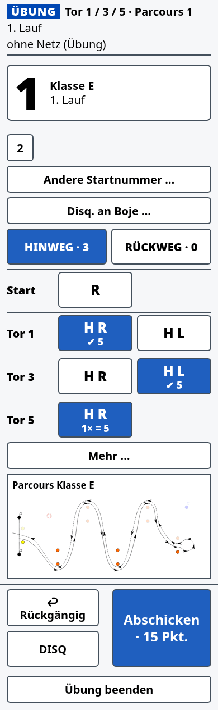
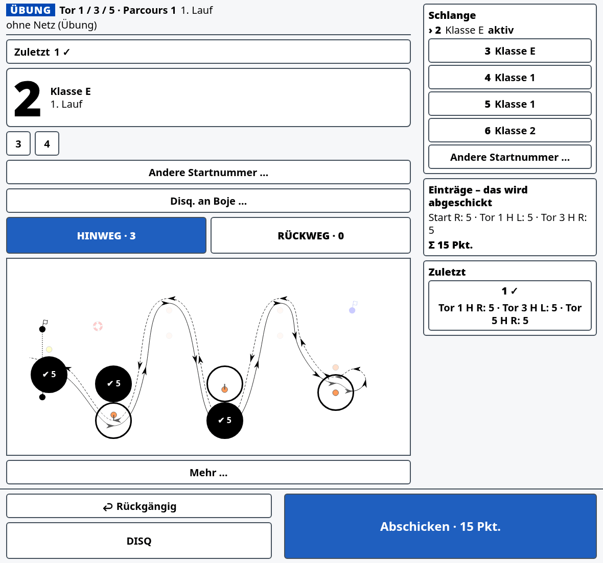

Deutsch · [English](en/feldtest.md)

# Feldtest Gerätebetrieb

Checkliste für den ersten Test mit echten Geräten und dem echten Server: Lese-Links, Start-Freigabe vom Handy
(Etappe E8 des Plans vom 16.11.2026) und die WKR-Erfassung auf Handy und Pad (W3 bis W5). Bisher ist das vor allem
gegen einen nachgebauten Server und nachgebaute Browser geprüft; ein erster Versuch mit einem echten Handy
(21.11.2026) ist in die WKR-Maske und die Start-Freigabe eingeflossen. Die Größen von Knöpfen und Schrift stehen nur
im CSS.
Bedienung: [Gerätebetrieb](betrieb.md#gerätebetrieb), [WKR-Erfassung](betrieb.md#wkr-erfassung-auf-handy-und-pad),
Ablauf: [Ablauf am Wettkampftag](betrieb.md#ablauf-am-wettkampftag).

Nur Beispieldaten verwenden (Reiter „Veranstaltung“ → „Beispieldaten“), keine echten Starter.
Je Punkt abhaken, wenn das erwartete Ergebnis eintritt; sonst unter „Beobachtung“ notieren, was geschah
(Gerät, Uhrzeit, Text auf dem Bildschirm). Bildschirmfotos klein und ohne echte Namen.

## Aufbau

- Bedienrechner: Pages-Fassung, „Offline bereit“, Fassung (Build-Zeit): ______
- Server: `ntfy.adminforge.de` („Einstellungen → Geräte“ leer = Vorgabe)
- Netz am Bedienrechner (WLAN, Hotspot welches Handys?): ______
- Für lokale Tests im WLAN: `npm run dev:host` (http – ohne Wake Lock) oder `npm run dev:https` (selbst signiert, die
  Zertifikatswarnung auf jedem Gerät einmal bestätigen; [technik.md](technik.md#entwickeln)). Den Offline-Speicher gibt
  es nur über GitHub Pages.

| Gerät | Modell, Betriebssystem | Browser, Fassung | Netz (WLAN/Mobilfunk) | Rolle |
|---|---|---|---|---|
| A | Android | Chrome | | Anzeigetafel / Start-Freigabe / WKR-Handy |
| B | iPhone | Safari | | Zuschauer / Start-Freigabe / WKR-Handy |
| C | iPhone als Home-Bildschirm-App (optional) | Safari | | Start-Freigabe |
| D | Tablet (iPad oder Android) | | | WKR-Pad |

## Lese-Links

- [ ] **Gerätebetrieb einschalten.** Erwartet: Verbindung „verbunden“ binnen weniger Sekunden; zwei QR-Codes.
  Beobachtung:
- [ ] **Anzeigetafel per QR** (Gerät A). Erwartet: Tafel statt „Warte auf den Bedienrechner …“ binnen etwa 5 s,
  Fingerabdruck gleich dem des Bedienrechners. Beobachtung:
- [ ] **Zuschauer per QR** (Gerät B, über Mobilfunk). Erwartet: Zuschauerliste, „ca. in“ plausibel (Uhrversatz);
  Team-Filter bleibt nach dem Neuladen. Beobachtung:
- [ ] **Start freigeben** am Bedienrechner. Erwartet: Tafel und Zuschauerliste zeigen den Wechsel binnen etwa 2 s.
  Verzögerung gemessen: ______ s. Beobachtung:

## Koppeln

- [ ] **Per QR-Code** (Gerät A; einmal auch über Mobilfunk mit langsamem ersten Laden). Erwartet: gekoppelt ohne
  Tippen, Start-Freigabe der angekreuzten Parcours; reicht das 30-s-Fenster des QR-Codes (plus 30 s Gnade)?
  Zeit vom Scannen bis gekoppelt: ______ s. Beobachtung:
- [ ] **Per Geräte-Code über Mobilfunk** (Gerät B: Koppel-Link öffnen, Code eintippen; der Code gilt 5 min). Erwartet:
  gekoppelt; kommt die Antwort vor „Keine Antwort“ (15 s)? Zeit bis gekoppelt: ______ s. Beobachtung:
- [ ] **iPhone: QR öffnet Safari statt der Home-Bildschirm-App** (Gerät C). Erwartet: Safari öffnet sich;
  festhalten, wie man in die Home-App kommt (Link kopieren?). Beobachtung:
- [ ] **Art des Geräts** in der Geräteliste (Handy, Pad, Rechner). Erwartet: Das Gerät meldet seine Art beim Koppeln
  richtig (Tablet = Pad). Falsch erkannt: ______ Beobachtung:

## Start-Freigabe vom Handy

- [ ] **Schalten:** „Nächster Start“ auf dem Handy. Erwartet: „Wird gesendet …“, dann frei; Bedienrechner und Tafel
  zeigen den Start. Dauer bis zur Bestätigung: ______ s. Beobachtung:
- [ ] **Doppelt tippen** (schnell zweimal, und auf zwei Handys gleichzeitig). Erwartet: genau ein Schritt; das zweite
  Handy sieht „Nichts geändert – schon geschehen oder jemand anderes war schneller“ oder nichts. Beobachtung:
- [ ] **Zurückstellen, Meldung, Einreihen** vom Handy. Erwartet: wirkt wie am Bedienrechner. Beobachtung:
- [ ] **Nur eigene Parcours:** Häkchen am Bedienrechner wegnehmen. Erwartet: Karte verschwindet auf dem Handy sofort.
  Beobachtung:

## Hintergrund und Bildschirm

- [ ] **Wake Lock** (Bildschirmsperre auf 30 s stellen, Gerät liegen lassen, 2 min). Erwartet: Bildschirm bleibt an;
  sonst steht „Bildschirm kann ausgehen …“ in der Leiste, in der WKR-Maske als gelbes Band oben mit dem Tipp
  „Display-Zeit am Handy verlängern“ (unter `npm run dev:host` immer – über http gibt es keine Wake Lock).
  Android: ______ iPhone: ______ Home-App: ______
- [ ] **Handy 5 min weglegen** (Bildschirm aus), währenddessen 3 Starts am Bedienrechner. Erwartet nach dem Einschalten:
  binnen etwa 10 s der aktuelle Stand, Verbindung „verbunden“. Android: ______ iPhone: ______
- [ ] **Handy 15 min weglegen**, dazu einmal eine andere App im Vordergrund. Erwartet: wie oben; auf dem iPhone ist der
  WebSocket im Hintergrund zu (Plan, Risiko 7) – es muss beim Zurückkommen selbst neu verbinden. Android: ______
  iPhone: ______
- [ ] **Start-Freigabe nach dem Weglegen:** sofort „Nächster Start“. Erwartet: Bestätigung, kein doppelter Start.
  Beobachtung:

## Bedienrechner

- [ ] **Bedienrechner neu laden** (F5). Erwartet: Raum bleibt, Geräte zeigen weiter an, nach wenigen Sekunden wieder
  „verbunden“; Handy-Freigabe und WKR-Geräte gehen danach. Beobachtung:
- [ ] **Zweites Bedienfenster** öffnen, dort schalten, dann das erste schließen. Erwartet: „Die Verbindung hält ein
  anderes Fenster“, Knöpfe wirken; nach dem Schließen übernimmt das zweite. Beobachtung:
- [ ] **Bedienfenster im Hintergrund:** Fenster minimieren bzw. einen anderen Tab nach vorn holen, 10 min, dabei vom
  Handy schalten und am WKR-Gerät erfassen. Erwartet: Quittung kommt, Tafel aktuell (der Browser drosselt den
  Herzschlag der Führung, 2 s, und das Sammeln im Hintergrund). Verzögerung bis zur Quittung: ______ s. Beobachtung:
- [ ] **Bedienrechner als Ein-Datei-Fassung** (`file://`), Geräte über Pages. Erwartet: Lese- und Koppel-Links zeigen
  auf Pages; gleiche Fassung → Anzeige; ist die Datei älter als Pages → auf dem Gerät „Bedienrechner aktualisieren“.
  Dazu zwei Fenster unter `file://`: Erwartet wie beim zweiten Bedienfenster (storage, BroadcastChannel, Web Locks
  verhalten sich unter `file://` je Browser anders). Browser: ______ Beobachtung:
- [ ] **Funkloch:** Bedienrechner 1 min in den Flugmodus, dabei 2 Starts schalten; danach ein Handy 1 min in den
  Flugmodus und dort schalten. Erwartet: Bedienrechner arbeitet weiter, Geräte holen nach; das Handy sendet nach dem
  Funkloch, der Start wirkt einmal. Beobachtung:

## Verwaltung

- [ ] **Entziehen** (Geräteliste). Erwartet: Das Handy kann nicht mehr schalten, zeigt aber weiter Im Boot/Als
  Nächstes; ein WKR-Gerät zeigt „Entzogen“ und seine nicht abgeschickten Entwürfe zum Übertragen aufs Papier.
  Beobachtung:
- [ ] **Neu laden aller Geräte nach Update:** am Bedienrechner ein Update einspielen (oder nur „Alle Geräte neu laden“).
  Erwartet: Hinweis „Dieser Bedienrechner läuft mit einer neuen Fassung …“; nach dem Knopf laden alle verbundenen Geräte
  einmal neu und zeigen wieder an, Handys und Pads bleiben gekoppelt. Beobachtung:
- [ ] **Raum beenden.** Erwartet: Geräte zeigen „Der Bedienrechner hat den Raum beendet“. Beobachtung:
- [ ] **Kontingent-Anzeige nach dem Test** (Betrieb → Geräte, vor dem Beenden notieren). Nachrichten: ______
  Anfragen: ______ Warnung oder „Zuletzt gebremst“? ______ Dauer des Tests, Zahl der Starts und der WKR-Geräte: ______
  Hochgerechnet auf einen Wettkampftag (120 Starter, 2 Läufe) – erwartet laut Überschlag etwa 600 Nachrichten ohne,
  850 mit Start-Freigabe vom Handy, mehr mit WKR-Erfassung ([Kontingent](betrieb.md#kontingent-des-servers)): ______

## WKR-Erfassung am Bedienrechner

Je Gerät eine Liste koppeln (Tor 5, Steg nur Ablegen, Vorsteg, eine Bojen-Liste), dann einen Lauf mit Beispieldaten
fahren.

- [ ] **Liste zuweisen** (Betrieb → Geräte → „WKR-Liste für das nächste Gerät“, auch über „Gerät koppeln“ in der
  Matrix). Erwartet: Das Gerät zeigt die Probe, die Matrix das Gerät mit ●. Beobachtung:
- [ ] **Druck nach Modus** (Listen → WKR-Bögen und Laufzettel nach dem Koppeln). Erwartet: Listen auf „Gerät“ fehlen,
  ein Hinweis nennt sie; „beides“ wird gedruckt; „Trotzdem drucken (Rückfall auf Papier)“ druckt alle. Beobachtung:
- [ ] **Ein Lauf doppelt** (eine Liste auf „beides“, der WKR schreibt auch auf den Bogen; den Bogen danach abtippen).
  Erwartet: gleiche Werte ohne Rückfrage; jede Abweichung als Rückfrage im Eingang; ◆ an den Werten vom Gerät.
  Abweichungen Papier gegen Gerät: ______ Beobachtung:
- [ ] **Parcours-Ampel:** „Nächster Start“ → ● grün; „Durchs Start-Tor“ oder die erste Zeile eines Parcours-WKR → ● rot
  mit den fehlenden Listen; alle abgeschickt → ● frei. Erwartet: Steg und Vorsteg halten nie auf. Taugt „Durchs
  Start-Tor“ im Ablauf (wer tippt es)? Zeit von der letzten Zeile bis „frei“: ______ s. Beobachtung:
- [ ] **Rückstand:** Ein Parcours-WKR schickt nicht ab, „Nächster Start“. Erwartet: „Trotzdem weiter?“ mit Liste und
  Startnummer, am Bedienrechner und auf dem Freigabe-Handy; „Trotzdem weiter“ zeigt den Start. Beobachtung:
- [ ] **Auto-Modus** („Einstellungen → Startfolge im Betrieb“; jede Parcours-Liste digital mit Gerät). Erwartet: bei
  „frei“ 3 s Countdown mit „Anhalten“, dann der Nächste; nie ein neuer Lauf, nie bei Rückfrage oder Pause. Passen
  3 s? Beobachtung:
- [ ] **Gerät fällt aus** (WKR-Gerät in den Flugmodus, über 5 min). Erwartet: Matrix ◐ ab 90 s, ✕ ab 5 min, Leiste ✕;
  „Papier ab Start …“ → das Gerät zeigt „Bedienrechner: Ab Nr. … gilt der Papierbogen“; „Weiter digital“ holt es
  zurück. Beobachtung:
- [ ] **Bitte Nr. prüfen** am Bedienrechner. Erwartet: Das Gerät zeigt „Bediener bittet: Start … prüfen“ mit „… öffnen“.
  Beobachtung:
- [ ] **Wiederholung nach Ausfall** (Start-Freigabe → „Wiederholung (Ausfall) …“ für einen Start, den die Geräte schon
  erfasst haben; ein Gerät schickt danach noch eine Korrektur dazu). Erwartet: Die Werte sind auf allen Listen weg, der
  Start steht unter „Wiederholung offen“; die Korrektur wird abgelehnt („Dieser Versuch wurde nach einem Ausfall
  abgebrochen …“). Nach „Als Nächster“ und „Nächster Start“ kommt er auf allen Geräten wie ein neuer Start; die
  Anzeigetafel zeigt „1. Lauf · Wiederholung“. Einmal stattdessen „Doch keine Wiederholung“: Die Werte sind zurück.
  Beobachtung:

## WKR-Maske auf dem Handy

Je Handy eine Liste koppeln (Tor 5, Steg nur Ablegen, Vorsteg), Probe durchtippen, dann einen Lauf mit Beispieldaten
erfassen.

- [ ] **Handschuhe** (dünne Arbeits- und dicke Segelhandschuhe): Codes, Hauptknopf, Disq., „↩ Rückgängig“,
  „Andere Startnummer …“, Ziffernfeld treffen. Erwartet: Jeder Tipp trifft den gemeinten Knopf, kein Nachbar.
  Fehlgriffe auf 20 Tipps: dünn ______ dick ______ Beobachtung:
- [ ] **Sonne** (Mittagssonne, Display-Helligkeit automatisch und voll; Sonnenbrille, auch polarisiert): Ansichten
  „Wie Gerät“ (Vorgabe), Sonne, Hell und Dunkel. Erwartet: Startnummer, Hauptknopf und Stufenzeichen (✓ ↑ ! ✗ V) aus
  Armlänge lesbar, „ÜBUNG“ und das rote Band „Keine Verbindung“ sofort erkennbar. Beste Ansicht: ______ Beobachtung:
- [ ] **Doppeltipp** (absichtlich zweimal schnell auf „Fehlerfrei ✓“, auch auf einen Code direkt nach dem Wechsel;
  Tropfen auf dem Display). Erwartet: genau eine Zeile; Overlay „wird übertragen …“ → „✓ übernommen“, dann Blitz und
  1 s ohne Eingabe; am Bedienrechner kein doppelter Wert. Beobachtung:
- [ ] **iPhone ohne Vibration** (Safari kennt `navigator.vibrate` nicht): Erwartet: Der Blitz allein zeigt den Wechsel
  deutlich genug, auch in der Sonne. Ist er zu kurz (150 ms) oder zu blass? Beobachtung:
- [ ] **Hochkant, eine Hand**: Der Daumen erreicht Hauptknopf und Disq. ohne Umgreifen; „Linkshand“ (Mehr → Ansicht)
  spiegelt den Fuß. Bildschirmbreite des Geräts: ______ Beobachtung:
- [ ] **Höchstzahl je Code**: „2. und 3. Versuch“ dreimal tippen; Tor 5 Code 1 zweimal. Erwartet: Der dritte Tipp
  setzt Disq. D („nächster = Disq. D“, dann „Disq. D gesetzt“), „↩ Rückgängig“ nimmt D wieder heraus; Code 1 bleibt bei
  „höchstens 1ד. Löst ein prellender Handschuh-Tipp zu früh D aus? Beobachtung:
- [ ] **Probe** beim ersten Empfang der Liste; danach (neu laden) nicht noch einmal. Erwartet: Am Bedienrechner kommt
  nichts an. Beobachtung:
- [ ] **Funkloch** (Flugmodus 2 min, weiter erfassen): Erwartet: rotes Band „Keine Verbindung seit …“, Zeilen warten,
  nach dem Einschalten gehen sie gebündelt hinaus; ab 5 min „Länger weg? Papierbogen ab Nr. …“. Beobachtung:
- [ ] **Liste abschließen** am Laufende über das Band; einmal mit offenem Start („Rest auf Papier“), einmal während
  der Lauf noch läuft. Erwartet: Name aus der Einteilung vorbelegt; „… läuft noch – trotzdem abschließen?“; am
  Bedienrechner unter Betrieb → WKR der Abschluss mit Namen; spätere Korrektur kommt als Vorschlag. Beobachtung:
- [ ] **Ausgleichsgewicht am Steg** (Steg-Ablegen, Beispielgewichte; einen Starter ohne Gewicht). Erwartet: „AG … kg“,
  „kein AG“ bzw. „AG: Gewicht fehlt“ neben der Startnummer, nur im Ablegen; ein in der Verwiegung nachgetragenes
  Gewicht steht kurz darauf auf dem Gerät. Lesbar aus Armlänge? Beobachtung:
- [ ] **Übung** („Üben ohne Verbindung“ im Koppel-Formular) im Flugmodus. Erwartet: Maske arbeitet ohne Netz; nach
  dem Abschicken rollt nur die Erklärung „So läuft die Übung“ aus dem Bild, Kopf „ÜBUNG“, „Zuletzt“ und Karte bleiben
  stehen (darüber der Hinweis „Bildschirm kann ausgehen“, bis „Ausblenden“); der nächste Start kommt nach 2–6 s, hin
  und wieder steht er schon vorher da; „Mehr → Klasse vorziehen“ (ganz unten) holt eine andere Klasse. Passt das
  Tempo? Taugt sie für die Einweisung? Beobachtung:
- [ ] **Akku** nach einem Lauf mit Maske offen (Wake Lock): Anfang ______ % Ende ______ % Dauer ______ min.

## Bojen-Maske

Je Handy eine Bojen-Liste koppeln (Tor 1/3/5, Tor 2/4/5, Parcours; unter UIM Parallelslalom Racecourse A), Probe
durchtippen, einen Lauf mit Klassen 4 bis 7 erfassen.

- [ ] **Bojen-Punkte**: Jede Berührung 5, Tor 5 je Berührung; am Bedienrechner steht in der Erfassung genau der Wert,
  den der WKR auf Papier schriebe („5“, Tor 5 „15“). Erwartet: Summe in „Abschicken · n Pkt.“ = Summe der Zeile in der
  Wertung. Beobachtung:
- [ ] **Zwei Boote im Parcours** (Tor 1/3/5: das ältere Boot auf dem Rückweg, das nächste auf dem Hinweg): über
  „Andere Startnummer …“ zwischen den Starts wechseln, die Seite je Start bleibt gemerkt. Erwartet: keine Berührung
  beim falschen Start; reicht das am Wasser oder braucht es zwei Starts nebeneinander? Beobachtung:
- [ ] **Seiten nach Blick** bei `rechts`/`links` (Baden-Württemberg, Berlin, Möwe 2/4/5 – die zwei Bojen liegen nah
  und fern, nicht links und rechts): Erwartet: Die Knöpfe stehen wie die Unterspalten auf dem Bogen. Wäre „oben/unten“
  besser? Beobachtung:
- [ ] **Klasse 7 auf kleinem Handy** (≤ 700 px hoch, Handschuhe): Umschalter Hinweg/Rückweg, zehn Zeilen; kein Text
  abgeschnitten, kein Nachbarknopf getroffen. Grenze sieben Zeilen passend? Beobachtung:
- [ ] **Bojen-Folge** (Mehr → Ansicht → „Bojen“, nur bei der Maske „Knöpfe“). Erwartet: Vorgabe „Rückweg gedreht“ –
  auf RÜCKWEG Ziel, Tor 1, Tor 3, Tor 5 an denselben Stellen wie Start, Tor 1, Tor 3, Tor 5 auf HINWEG; „Fahrtfolge“:
  Rückweg Tor 5 … Ziel; „Alles untereinander“: kein Umschalter. Gemerkt je Liste nach Neuladen. Beobachtung:
- [ ] **Tor-5-Zähler bei 360 px**: Zähler bis 9 tippen, auch englisch. Erwartet: „9× = 45“ und „höchstens 9ד in zwei
  Zeilen im Knopf, nichts über den Rand, kein waagerechtes Scrollen. Beobachtung:
- [ ] **Prellschutz**: Bojen-Schalter mit Handschuh antippen. Erwartet: Ein Tipp setzt, ein prellender zweiter nimmt
  nichts weg; bewusst nach ½ s erneut tippen nimmt weg. 400 ms passend? Beobachtung:
- [ ] **Klassenwechsel** (Klasse 4 nach 7): Erwartet: beim ersten Start einer neuen Klasse im Lauf 2 s „Achtung,
  Klassenwechsel! Klasse 7“, kein Tipp auf die falsche Zeile; unter den Knöpfen die Zeichnung der Klasse. Beobachtung:
- [ ] **Disq. an der Boje** (langer Druck 0,8 s auf eine Boje, auch mit Handschuh; dazu „Disq. an Boje …“). Erwartet:
  Füllring, dann die Buchstaben dieser Boje; mehrere wählbar, „Fertig“; die Punkte bleiben („5, J, D“). Ein kurzer
  Tipp zählt nie als langer Druck, Wischen bricht ab. Passen 0,8 s? Beobachtung:
- [ ] **Nicht gestartet** (Mehr → „Nicht gestartet · Disq. X“ → Rückfrage „23 nicht gestartet?“): Erwartet: X im
  Disq.-Feld der Liste, Matrix ✕ auf allen Listen, der Start fällt bei den anderen Geräten aus der Schlange, die
  Parcours-Ampel gilt als durch, Wertung „nicht gestartet“; auch im Steg-Anlegen und am Vorsteg. Versehentlich
  gemeldet → „Zuletzt“ → Korrektur ohne X nimmt es heraus. Beobachtung:

## Pad

Ein Tablet als Pad koppeln (Art in der Geräteliste „Pad“). Auslegungen: `WKR_ANNAHMEN` in `src/wkr/annahmen.ts`
(PD, MW, BD, BL, KN, ZT, TB); Plan [plan-wkr-w5.md](plan-wkr-w5.md).

- [ ] **Querformat** (Pad quer, 1024 × 768 und größer): Erwartet: Arbeitsfläche links, Spalte Schlange / Zuletzt /
  Einträge rechts, Fuß über die volle Breite; mit zwei Listen (Tor 1/3/5 + Tor 2/4/5) zwei Spalten nebeneinander,
  kein Text abgeschnitten, kein waagerechtes Scrollen. Hochformat: Seitenspalte unten. Drehen während eines Starts
  verliert nichts; die Bildschirmtastatur (Maske „Tabelle“, Name) baut die Anordnung nicht um. Beobachtung:
- [ ] **Hülle** (Schutzhülle mit Ständer, Klappdeckel): Erwartet: Ränder der Knöpfe am Bildschirmrand noch treffbar,
  der Deckel weckt nicht ungewollt (Wake Lock, „Bildschirm kann ausgehen“). Spritzwasser auf der Hülle löst keine
  Tipps aus? Beobachtung:
- [ ] **Ladekabel** (Pad den ganzen Tag am Netz bzw. an der Powerbank): Erwartet: Kabel stört Querformat und Ständer
  nicht; Akku in der Matrix am Bedienrechner plausibel. Wie lange hält es ohne Kabel? Beobachtung:
- [ ] **Zwei WKR an einem Pad** (Tor 1/3/5 und Tor 2/4/5 nebeneinander, oder ganzer Steg Ablegen + Anlegen): Erwartet:
  Jede Spalte schickt nur ihre Liste, Overlay und Sperre nur in der eigenen Spalte, Rundenband über Racecourse A + B
  (UIM). Stören sich die beiden beim Tippen (Arme, Blick)? Beobachtung:
- [ ] **Bild** (Pad, Bojen-Liste): Erwartet: Trefferkreise liegen im echten Browser auf den Bojen der Zeichnung (auch
  gedreht) und sind groß genug; zu nahe Kreise sind auseinandergeschoben und mit der Boje verbunden. Der Umschalter
  Hinweg / Rückweg / Rück 2 wechselt nur von Hand – fällt das Umschalten am Wasser schwer? „Mehr → Ansicht → Lage der
  Zeichnung“: „Automatisch“ und „Start/Ziel links/oben/rechts/unten“; Ziffern bleiben aufrecht, die Wahl bleibt nach dem
  Neuladen. Welche Lage passt zum Standort des WKR? Beobachtung:
- [ ] **Knoten am Tisch** (Knoten-Liste, ein Pad am Tisch): Erwartet: „Nächster: 9 (Klasse …)“ vorbelegt, andere
  Nummer eintippbar, je Knoten ✓ / ✗, großer Knopf „Alle richtig“ bzw. „Rest richtig“ schickt in einem Tipp, eine schon
  erfasste Nummer fragt „korrigieren?“, „offen n / m“ stimmt mit der Matrix „Am Tisch“ am Bedienrechner; Abschluss der
  ganzen Liste mit „Rest auf Papier“. Passt die Folge des Vorschlags (Starter-Reiter) zum Ablauf am Tisch?
  Beobachtung:
- [ ] **Zeitnahme mit Anlage und Stoppuhr** (Zeit-Liste bzw. Möwe/Berlin mit Zeit): Erwartet: Zeit der Anlage
  abgelesen eintippen („83,45“ → „1:23,45“), bei Ausfall der Anlage die Stoppuhr-Zeit; „Keine Zeit“ mit Grund nur,
  wenn keine Uhr eine Zeit hat; die Deutung „= 1 min 23,45 s“ gleich der am Rechner. Nach „83,45“ springt der Block
  ins nächste Zeitfeld (nicht im letzten); abschicken geht schon mit der ersten Zeit – weitere Zeiten sind optional.
  Die Zeit-Liste hält die Parcours-Ampel auf rot, bis ihre Zeile da ist – hält das den Betrieb auf, wenn die Zeit erst
  später abgelesen wird? Beobachtung:
- [ ] **Tabelle für Geübte** (Pad mit Tastatur bzw. Rechner, Mehr → Ansicht → Maske „Tabelle“): Erwartet: Fokus in der
  ersten Zelle, Tab/Enter springen weiter, Enter in der letzten Zelle schickt ab; auf Tor 5 steht „20 1 20“ danach als
  „1, 2x20“, an einer Boje „5“ bzw. „5J“ als „5, J“; ein Tippfehler („3“ an einer Boje, Code 99, „3x20“ auf Tor 5)
  steht rot an der Zelle und sperrt. „Korrigieren“ an einer gesendeten Zeile fragt alt → neu. Auf dem Handy
  ausgegraut. Schneller als die Knöpfe? Beobachtung:

## Nur iPhone

- [ ] **CompressionStream** (ab Safari 16.4). Erwartet: Lese-Link zeigt an; auf älteren Geräten „Dieser Browser ist zu
  alt dafür“. iOS-Fassung: ______
- [ ] **Vibration fehlt** bei der WKR-Maske (siehe oben „iPhone ohne Vibration“): nur der Blitz – reicht er?
  Beobachtung:
- [ ] **ITP** (Safari löscht Daten einer Seite nach 7 Tagen ohne Besuch): nach dem Test Safari schließen, nach
  einigen Tagen `#/geraet` öffnen. Erwartet: Kopplung noch da oder sauber „nicht gekoppelt“ (dann neu koppeln).
  Beobachtung:

## Was danach zu melden ist

- Die ausgefüllte Liste, je Gerät Modell, Betriebssystem und Browser mit Fassung.
- Jeder Punkt, der nicht wie erwartet lief: was zu sehen war (Text, Bildschirmfoto ohne echte Namen), Uhrzeit.
- Verzögerungen: Start bis Tafel, Handy-Druck bis Bestätigung, Zeit bis gekoppelt, letzte WKR-Zeile bis Ampel „frei“.
- Ob Wake Lock und das Wiederverbinden nach dem Hintergrund auf Android, iPhone und Home-App wirken.
- Kontingent: Nachrichten und Anfragen gegen Dauer, Zahl der Starts und der WKR-Geräte; ob der Server gebremst hat.
  Damit lässt sich der Überschlag (600–850 Nachrichten je Wettkampftag ohne WKR-Erfassung) prüfen und entscheiden, ob
  `ntfy.adminforge.de` reicht.
- Was am Bedienrechner unklar war (Texte, Knöpfe, Matrix, Eingang).
- WKR-Maske: Fehlgriffe mit Handschuhen, Lesbarkeit in der Sonne, ob der Doppeltipp-Schutz zu lang oder zu kurz ist
  (Overlay „wird übertragen …“ → „✓ übernommen“: mindestens 0,6 s, dann 0,8 s, ohne Quittung höchstens 3 s, danach
  1 s Sperre – `WKR_ANNAHMEN` N1, `uebertragenMinMs`/`uebernommenMs`/`uebertragenMaxMs`/`sperreMs`), Blitz ohne
  Vibration auf dem iPhone, Akku; Texte bei großer Systemschrift (nichts abgeschnitten), Farben unter
  System-Dunkelmodus in allen Ansichten.
- Ein Lauf doppelt: wie viele Werte Papier und Gerät verschieden hatten, und wer recht hatte.
