Deutsch · [English](en/funktionen.md)

# Was Alcatraz kann

Alles, was Alcatraz heute kann – nach Bereichen, ungefähr in der Reihenfolge eines Wettkampfs.
Warum etwas so ist, steht mit Datum in [entscheidungen.md](entscheidungen.md);
„Entscheidung vom …“ meint dort und hier eine Entscheidung des Nutzers.

- Ablauf am Wettkampftag, ohne Internet, Sicherung, Verlauf und Bedienung des Gerätebetriebs: [betrieb.md](betrieb.md).
- Parallelslalom und Einzelwertung nach Regel 960: [parallelslalom.md](parallelslalom.md).
- Aufbau und Entwickeln: [technik.md](technik.md). Was noch fehlt: [stand.md](stand.md).

## Inhalt

- [Regelwerke und Begriffe](#regelwerke-und-begriffe)
- [Veranstaltung und Besetzung](#veranstaltung-und-besetzung)
- [Starter und Startnummern](#starter-und-startnummern)
- [Herkunft und Flaggen](#herkunft-und-flaggen)
- [Verwiegung](#verwiegung)
- [Verzahnung](#verzahnung)
- [Wettkampfrichter-Listen](#wettkampfrichter-listen)
- [Laufzettel und QR-Codes](#laufzettel-und-qr-codes)
- [Betrieb: Start-Freigabe und Anzeigetafel](#betrieb-start-freigabe-und-anzeigetafel)
- [Gerätebetrieb](#gerätebetrieb)
- [Digitale WKR-Erfassung](#digitale-wkr-erfassung)
- [Erfassung](#erfassung)
- [Wertung und Wertungslisten](#wertung-und-wertungslisten)
- [Mannschaftswertung](#mannschaftswertung)
- [Weitere Listen und Druck](#weitere-listen-und-druck)
- [Sperren und Prüfungen](#sperren-und-prüfungen)
- [Parallelslalom und Einzelwertung (Regel 960)](#parallelslalom-und-einzelwertung-regel-960)
- [Beispieldaten](#beispieldaten)

## Regelwerke und Begriffe

Alcatraz kennt zwei Regelwerke: das DM-Reglement 2026 (`dm-2026`) und UIM Regel 960 „Formula Future“ (`uim-2026`).
Unter der DM wird nur das Manövrieren gefahren, unter UIM auch der [Parallelslalom](parallelslalom.md).
Jedes Regelwerk ist eine YAML-Datei unter `src/config/regelwerke/`: Klassen, Durchschnittsgewichte, Co-Pilot,
Fehler- und Disqualifikations-Codes, Läufe und Streichläufe, Stichentscheid, Mannschaftswertung, Laufzettel und
Sprache der Listen. Die Aufbauten der Parcours stehen unter `src/config/aufbauten/`.

**Weitere Regelwerke:** Verbände und Veranstalter aus anderen Ländern sind eingeladen, ihr Regelwerk (Rulebook) zu
schicken, damit es aufgenommen wird – am einfachsten über die
[Vorlage für ein neues Regelwerk](https://github.com/Motorbootslalom/alcatraz/issues/new?template=regelwerk.yml) auf
GitHub. Hilfreich sind:

- das Regelwerk selbst (PDF oder Link),
- die Klassen mit ihren Altersgrenzen (Jahrgänge, Geburtstage),
- die Fehler- und Disqualifikations-Codes mit ihren Punkten bzw. Sekunden,
- die Sprache, in der die Listen stehen sollen.

**Begriffe nach den Regelbüchern:**

- Deutsch heißen die Listen „Wertungslisten“ (DM-Reglement C7).
- Englisch folgt dem UIM Circuit Rulebook, Regel 960: „driver“, „attempt“, „race number“, „race official“,
  „team manager“, „co-driver“, „extra weight“, „pontoon“, „results“, „ranking“, „dead heat“.
- Die Klasse E heißt unter UIM überall „Dolphin“ (`klassenNamen` im Regelwerk), unter DM „Klasse E“.
- Gewichte: „(statistisches) Durchschnittsgewicht“ und „Ausgleichsgewicht“ (DM-Reglement C3),
  englisch „average weight“ und „extra weight“ (UIM 960 Pkt. 3.7).
- Der Co-Pilot heißt im DM-Reglement „Co-Pilot“, im UIM-Regelbuch „co-driver“.
- Die Wörter des Parallelslaloms stehen unter [Dummys und Wörter](parallelslalom.md#dummys-und-wörter).

**Sprache:** Die Oberfläche lässt sich jederzeit zwischen Deutsch und Englisch umschalten.
Die Listen folgen dem Regelwerk, nicht der Oberfläche (`listenSprache`: DM deutsch, UIM englisch).
Nur die Wettkampfrichter-Bögen lassen sich je Liste und Parcours wählen – deutsch, englisch oder zweisprachig –, und
nur, wo das Regelwerk Englisch anbietet. Gewählt wird in der WKR-Einteilung neben jedem Namen, weil auf jedem Parcours
eine eigene Gruppe sitzt (`src/lib/listensprache.ts`, `AppState.wkrSprachen`).

## Veranstaltung und Besetzung

Die Ansicht „Veranstaltung“ nimmt Name, Jahr, Datum, Zahl der Läufe, Art (Meisterschaft oder Clubmeisterschaft),
Herkunft (Verein, Bundesland, Land oder ohne), Regelwerk und Aufbau auf.

- **Datum** (24.11.2026): der erste Wettkampftag, freiwillig. Gebraucht wird es nur für die Warnung zur
  Starterlaubnis nach Geburtstag – mit Datum auf den Tag genau, in zwei Stufen (siehe
  [Sperren und Prüfungen](#sperren-und-prüfungen)); die Jahrgänge rechnen mit dem Jahr. Liegt es in einem anderen
  Jahr, sagt das ein Hinweis am Feld. Es steht in der Sicherung, nicht in der Vorlage.
- **Besetzung:** WKR-Einteilung, Boote und Co-Piloten je Klasse stehen im Block „Besetzung“.
  Die Namen der Wettkampfrichter und Namen und Gewichte der Co-Piloten stehen nur in der Sicherung, nie in der Vorlage;
  das Boot der Klasse auch in der Vorlage (`src/lib/besetzung.ts`). Zu den Co-Piloten siehe
  [Co-Piloten und ihr Ausgleichsgewicht](#co-piloten-und-ihr-ausgleichsgewicht).
- Die **Beispielansicht der Listen** steht hier und im Assistenten, unter UIM auch mit den Listen des
  Parallelslaloms je Racecourse. Sie zeigt die Namen der Einteilung nur an.
- Eigene Aufbauten entstehen unter „Einstellungen“ (Assistent und YAML-Austausch).
- Am Ende der Ansicht stehen die [Beispieldaten](#beispieldaten).

## Starter und Startnummern

Der Reiter „Starter“ führt die Starter je Klasse – von Hand oder über den Austausch mit Excel.
Startnummern gibt es klassenbasiert (E01, 101 …) oder klassisch (fortlaufend).

<a href="bilder/de/starter.png">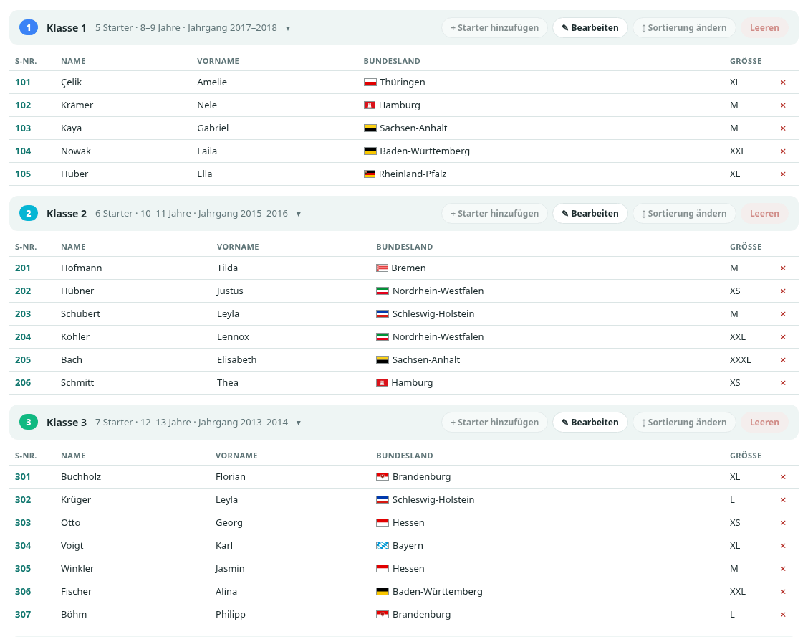</a>

**Austausch mit Excel** (`src/components/ExcelPanel.vue`, `src/import/tsv.ts`, `src/import/starterMerge.ts`):

- **Liste ersetzen** erkennt bisherige Starter an Klasse und Startnummer, dann an Klasse und Name wieder;
  sie behalten ihre ID und damit Gewicht und Platz in der Verzahnung.
  Kommt die Liste ohne Startnummern, behält ein Wiedererkannter seine bisherige Nummer (16.11.2026).
- **Ergänzen** fügt nur neue Starter hinzu und nennt die übergangenen eigens (16.11.2026).
- **Starterliste kopieren** schreibt das Geschlecht in der Sprache der Oberfläche
  (M, W, D, k. A. bzw. M, F, D, n/a); der Import liest beide Schreibweisen.
- „Automatisch vergeben“ nummeriert klassenbasiert jede Klasse in ihrer Reihenfolge,
  klassisch in der Startreihenfolge der Verzahnung.

**Startnummern nach Westengröße** (19.11.2026; Einstellungen → „Startnummern nach Westengröße“,
`src/domain/startnrBereiche.ts`): Klassenbasierte Nummern stehen auf Westen in Konfektionsgrößen.
Je Klasse gehört ein Nummernbereich zu einer Größengruppe (S–M, L–XL, XXL; XS zählt zu S–M, XXXL zu XXL).
Unter der DM ist die DMYV-Startnummernliste die Vorgabe (`startNrBereiche` in `dm-2026.yaml`), unter UIM gibt es keine.
Die Veranstaltung kann je Klasse eigene Bereiche setzen und Nummern fehlender Westen eintragen („512, 517, 623“);
beides reist mit Sicherung und Vorlage.

- „Automatisch vergeben“ gibt jedem Starter in der Folge des Reiters die nächste freie Nummer aus dem Bereich seiner
  Größe. Hat eine Klasse nur Bereiche einer Gruppe (DMYV: E bis 3 nur S–M), gilt er für alle, auch ohne Größe.
  Fehlende Westen werden immer übersprungen.
- Ist der Bereich voll oder fehlt die Größe in einer aufgeteilten Klasse, bleibt die Nummer leer; der Reiter nennt
  den Starter unter „Von Hand prüfen“ (kein automatisches Ausweichen, 20.11.2026).
- Neue Starter (von Hand, „In Klasse X verschieben“, Excel-Import, Beispielstarter) bekommen ebenso die erste freie
  Nummer ihres Bereichs.
- Verschieben (▲▼) wirkt frei; die Nummern wandern mit. „Sortierung ändern“ und „Zufall“ ordnen nur innerhalb einer
  Größengruppe (20.11.2026).
- Belegt ist eine Nummer nur, wenn sie genau so geschrieben ist, wie die Vergabe sie schreibt („5012“ in Klasse 5
  belegt nicht die 512). Unter „Startnummern“ nennt der Reiter, wessen Nummer nicht zu seiner Größe passt.

**Buchstabe der Klasse E** (seit 24.11.2026 in beiden Regelwerken): E (Vorgabe) oder D – unter DM „Buchstabe der
Klasse E“, unter UIM „Buchstabe der Dolphin-Nummern“ („Starter → Startnummern“, in Sicherung und Vorlage; gilt für neu
vergebene Nummern). Die Nummernbereiche folgen ihm: Mit D wird aus E01–E30 D01–D30. Gelesen werden E und D gleich;
nach dem Umstellen folgt auf E02 also D03, nicht D01 (`parseClassNumber`).

Was ab wann gesperrt ist und was geprüft wird – auch Jahrgang und Geburtstag –, steht unter
[Sperren und Prüfungen](#sperren-und-prüfungen). Wer für die Mannschaftswertung zählt, lässt sich wählen
(siehe [Mannschaftswertung](#mannschaftswertung)).

## Herkunft und Flaggen

Für die Herkunft „Bundesland“ und „Land“ zeigen auf Wunsch die Flagge: Starter-Reiter, Starter-, Vorsteg- und
Gewichtslisten, Wertungslisten und Mannschaftswertung – nicht die Wettkampfrichter-Listen.
Formen: ausgeschrieben bzw. Kürzel, Flagge + Kürzel, Flagge + ausgeschrieben oder nur Flagge
(„Einstellungen → Listen“; die Mannschaftswertung hat die Wahl bei der Liste).
Entschieden wird an einer Stelle (`herkunftAnzeige` in `src/lib/origin.ts`).

- **Zuordnung** (`src/domain/flaggen.ts`, `src/domain/staaten.ts`): Die Herkunft ist freier Text am Starter.
  Bundesländer werden an Kürzeln (BY, DE-BY), Namen und gängigen Schreibweisen (NRW, BaWü, Thueringen) erkannt,
  Staaten an ISO-Codes (DE, DEU), IOC-Kürzeln (GER, NED, SUI) und deutschen und englischen Namen.
  Bindewörter und „Saint“/„St.“ zählen nicht. Was nicht erkannt wird, steht als Text da; der Reiter „Starter“ nennt es.
- **Nationen sind international:** Auf einer englischen Liste steht ein erkannter Staat englisch, auch wenn er deutsch
  eingetragen ist („Litauen“ → „Lithuania“); auf einer deutschen Liste steht er, wie er eingetragen ist.
- **Kürzel der Länder** (`laenderKuerzel` im Regelwerk, `src/domain/kuerzel.ts`): In beiden Regelwerken tragen
  Staaten das Kürzel des IOC (GER, SUI, NED, LAT) – nach Regel 209 „POSTING OF THE RESULTS“, unter der DM seit dem
  15.11.2026, weil der Verband zum Olympischen Sportbund gehört. Jeder erkannte Staat wird zu diesem Kürzel
  („Germany“, „Deutschland“, „DEU“ → GER); frühere IOC-Kürzel (ROM, SIN, TRI) werden erkannt, ausgegeben die heutigen.
  Bundesländer behalten ihre Kürzel (BY, NW). Eigene Kürzel der Veranstaltung gehen vor.
- **Schreibweisen:** Nennen Starter dasselbe Land verschieden („NRW“ und „Nordrhein-Westfalen“), tragen sie dieselbe
  Flagge und dasselbe Kürzel. In der [Mannschaftswertung](#mannschaftswertung) und auf den Starterlisten je Herkunft
  sind sie **eine** Mannschaft; auf der Liste steht die häufigste Schreibweise. „Baden“ und „Württemberg“ allein
  gelten nicht als Baden-Württemberg.
- **Druck:** Gedruckt steht die Flagge nie allein – bei „nur Flagge“ kommt das Kürzel dazu (Schwarz-Weiß-Druck).
  Die Flagge ändert die Seitenteilung nicht.
- **Bilder:** Vektorbilder (SVG), beim Bauen eingebettet, nichts wird zur Laufzeit geladen; keine Emoji.
  Staaten aus [country-flag-icons](https://www.npmjs.com/package/country-flag-icons) (MIT-Lizenz,
  © 2020 @catamphetamine); Bundesländer je Land die Landesflagge, die jedermann führen darf (Wikimedia Commons,
  gemeinfrei; [`src/flaggen/bundeslaender/LIESMICH.md`](../src/flaggen/bundeslaender/LIESMICH.md)).
  Die Vermerke stehen auch in der App unter „Einstellungen → Fremde Bestandteile und Lizenzen“.

## Verwiegung

- **Gewichtslisten** je Herkunft zum Eintragen beim Check-in. „Gewichtslisten drucken“ in der Verwiegung öffnet sie
  für die gewählte Herkunft; die Adresse (`#/listen/gewicht/<Herkunft>`) lässt sich weitergeben (16.11.2026).
- Die Gewichte werden im Reiter „Verwiegung“ erfasst. Die Durchschnittsgewichte je Klasse stehen im Regelwerk und
  lassen sich unter „Einstellungen → Durchschnittsgewichte“ ändern.
- **Abstufung** (24.11.2026): Dort steht auch „Ausgleichsgewicht in Stufen von“ – 0,1 / 0,5 / 1 / 2 kg oder ein
  eigener Wert (0,1–10 kg; Vorgabe 1 kg). Die Stufe ist das kleinste Gewichtsstück, das am Steg ins Boot gelegt wird.
  Das Ausgleichsgewicht ist ein Vielfaches davon, kaufmännisch gerundet (bei 2 kg: 2,9 → 2 kg, 3,0 → 4 kg; bei 0,5 kg:
  1,2 → 1 kg, 1,25 → 1,5 kg). Wer weniger als eine halbe Stufe leichter ist, braucht keines. Verwiegung, Listen und
  Steg-Gerät rechnen gleich (`rundeAufStufe` in `src/domain/gewicht.ts`, `ausgleichVon` in `src/lib/ausgleich.ts`).
- **Liste „Ausgleichsgewichte“** für den Steg: je Klasse ein Blatt nach Startnummer mit dem Ausgleichsgewicht und
  einem Kästchen je Lauf; im Kopf Boot, Co-Pilot und – wenn eingetragen – darunter klein „Ersatz-Co-Pilot“ mit Namen,
  aus der Besetzung (`src/components/AusgleichListen.vue`). Braucht ein Co-Pilot ein Ausgleichsgewicht, steht es in
  Klammern hinter dem Namen („Vor2 Nach2 (+3,5 kg)“), fehlt sein Gewicht, „(nicht gewogen)“; nie das Körpergewicht.
  Leer heißt „keines nötig“, auch auf 0 kg gerundet (die Verwiegung zeigt dann „0 kg“). Wer noch nicht gewogen ist,
  bekommt ein Feld zum Nachtragen von Hand („nicht gewogen“, „kg“).
- **Am Steg-Gerät** (24.11.2026): Mit digitaler WKR-Erfassung zeigt das Gerät im Teil „Ablegen“ neben der
  Startnummer dasselbe Ausgleichsgewicht – „AG 4 kg“, „kein AG“ oder „AG: Gewicht fehlt“. Am Steg wird nichts
  gepflegt; ein in der Verwiegung nachgetragenes Gewicht kommt von selbst aufs Gerät. Über die Leitung geht nur das
  Ausgleichsgewicht, verschlüsselt für die Steg-Liste, nie das Körpergewicht
  ([Entscheidung](entscheidungen.md#ausgleichsgewicht-am-steg-entscheidung-24112026)).

### Co-Piloten und ihr Ausgleichsgewicht

Fahren in einer Klasse wechselnde Co-Piloten, soll das Gesamtgewicht in jedem Lauf gleich bleiben (26.11.2026;
`src/lib/besetzung.ts`, `src/lib/ausgleich.ts`). Die Fahrer rechnen davon unberührt weiter: Durchschnittsgewicht minus
Körpergewicht.

- **Eintragen:** „Veranstaltung → Besetzung“, Tabelle „Boote und Co-Piloten“ mit den Spalten Klasse, Boot, Co-Pilot,
  Gewicht, Ersatz-Co-Pilot, Gewicht. Das Gewicht ist freiwillig und wird gelesen wie in der Verwiegung (Komma oder
  Punkt, „kg“ darf dabei stehen, gespeichert auf 0,1 kg); Unlesbares entfernt das Gewicht, der Name bleibt. Enter
  springt erst durch alle Boote, dann durch alle Co-Piloten, ihre Gewichte, die Ersatz-Co-Piloten und deren Gewichte.
- **Unter dem Gewicht** steht klein, was daraus folgt: „+4 kg Ausgleich“ beim leichteren Co-Piloten, „Gewicht fehlt“,
  wenn andere seiner Gruppe gewogen sind, er aber nicht, „zählt erst mit Namen“ bei einem Gewicht ohne Namen; beim
  schwersten nichts. Unter der Tabelle nennt ein Satz die geltende Wahl, mit dem Verweis „Ändern: Einstellungen →
  Durchschnittsgewichte“.
- **Wahl** unter „Einstellungen → Durchschnittsgewichte“ (Sprungziel `#/einstellungen?durchschnittsgewichte`), unter
  „Ausgleichsgewicht in Stufen von“: „Ausgleichsgewicht der Co-Piloten“ **je Klasse** – gegen den schwersten Co-Piloten
  der Klasse (Vorgabe) – oder **über alle Co-Piloten** – gegen den schwersten Co-Piloten der Klassen, in denen Starter
  stehen; solange noch kein Starter eingetragen ist, gegen alle Klassen der Besetzung. Wer leichter ist, bekommt den
  Unterschied, gerundet in derselben Stufe wie die Fahrer und getrennt vom Ausgleichsgewicht des Fahrers. Die Wahl
  reist mit Sicherung und Vorlage.
- **Wer zählt:** nur ein Co-Pilot mit Namen und Gewicht. Wird der Name eines Ersatz-Co-Piloten gelöscht (er fällt
  weg), bleibt sein Gewicht im Feld, macht aber keinen Ballast mehr für den anderen, und auf den Listen steht kein
  leeres Feld „Ersatz-Co-Pilot“. Tippt man den Namen wieder ein, zählt das Gewicht wieder. Beim eingeteilten Co-Piloten
  bleibt seine Zeile auf den Listen zum Eintragen von Hand leer stehen.
- **Auf den Listen:** die „Ausgleichsgewichte“ für den Steg (oben) und die
  [Liste nach Regel 960 Pkt. 3.7](#liste-der-fahrer-je-team-regel-960) zeigen beide Co-Piloten untereinander, das
  Ausgleichsgewicht in Klammern hinter dem Namen, nie das Körpergewicht. WKR-Bögen, Anzeigetafel, Zuschauerliste,
  Start-Freigabe und Geräte zeigen keine Co-Piloten.
- **Datenschutz:** Namen und Gewichte der Co-Piloten stehen nur in der Sicherung, nie in der Vorlage. Der Verlauf hat
  den Eintrag „Gewicht eines Co-Piloten erfasst“. Ältere Stände und Sicherungen werden übernommen: Der bisherige
  Co-Pilot wird der eingeteilte, ohne Ersatz und ohne Gewicht.

### Liste der Fahrer je Team (Regel 960)

Regel 960, Pkt. 3.7 verlangt: Race number, Name and surname, Sex, Date of birth, Verified weight and ballast
required, Class, in den Klassen Dolphin und 1–3 der Co-driver
(„Listen → Gewichtslisten → je Mannschaft“, `src/lib/teamListe.ts`).

- Eine **interne** Liste, in keiner Druckdatei. Das Geburtsdatum folgt der Listen-Option „Geburtsdatum auf den
  Starterlisten zeigen“.
- „Ballast required“ ist das Ausgleichsgewicht in der Abstufung der Veranstaltung; „–“ heißt keines nötig.
- In der Spalte „Co-driver“ stehen der eingeteilte Co-Pilot und darunter, klein eingeleitet mit „Substitute
  co-driver:“, der Ersatz, je mit Ausgleichsgewicht in Klammern („Vor2 Nach2 (+3.5 kg)“). Eine lange Zeile wird
  kleiner, der eingeteilte Co-Pilot bleibt normal groß (26.11.2026).
- Dafür gibt es das freiwillige Starterfeld **Geschlecht** mit vier Werten (15.11.2026, `src/domain/geschlecht.ts`):
  M, F, D, keine Angabe; leer heißt „nicht erfasst“. Unter Regel 960 hat der Starter-Reiter eine Spalte dafür.
  Import-Spalte „Sex“/„Gender“/„Geschlecht“ (m, male, männlich; f, w, female, weiblich; d, divers; na, n/a,
  keine Angabe). Auf der Liste steht es englisch: M, F, D, n/a.
- Das Geschlecht steht in Sicherung und Teilnehmerdaten, nie in der Vorlage; die Wertung kennt es nicht.

## Verzahnung

Die Verzahnung legt die Startreihenfolge fest und damit Startnummern und alle Listen.

<a href="bilder/de/verzahnung.png">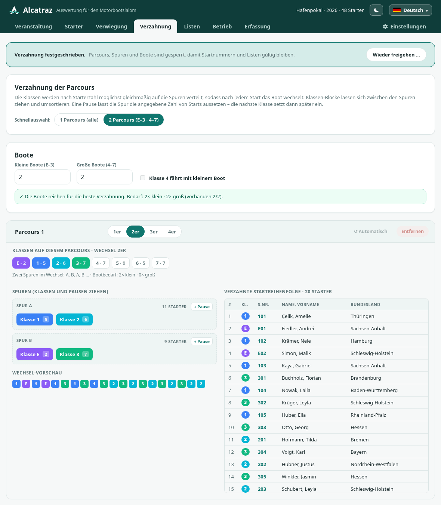</a>

- Die Klassen werden nach Starterzahl möglichst gleichmäßig auf die Spuren eines Parcours verteilt,
  sodass nach jedem Start das Boot wechselt.
- Schnellauswahl für einen oder zwei Parcours. Klassen-Blöcke lassen sich zwischen den Spuren ziehen;
  eine Pause lässt eine Spur einige Starts aussetzen.
- Der Bootbedarf wird gegen die vorhandenen kleinen und großen Boote geprüft.
- „Verzahnung festschreiben“ sperrt Parcours, Spuren und Boote, damit Startnummern und Listen gültig bleiben.
- Unter UIM steht hier auch der Startplan des Parallelslaloms mit den Runden danach – je Klasse oder mit „Alle Klassen
  weiter“ für alle zugleich ([Startplan](parallelslalom.md#startplan-des-vorlaufs),
  [Runden nach dem Vorlauf](parallelslalom.md#runden-nach-dem-vorlauf)). Sind die Listen einer Runde gedruckt, bleibt
  ihre Folge, bis „Druck lösen“ (20.11.2026).

## Wettkampfrichter-Listen

Die Wettkampfrichter-Listen (WKR-Bögen) stehen unter „Listen“ (`src/lib/wkrListen.ts`, `src/components/WkrListen.vue`).

<a href="bilder/de/wkr-bogen.png">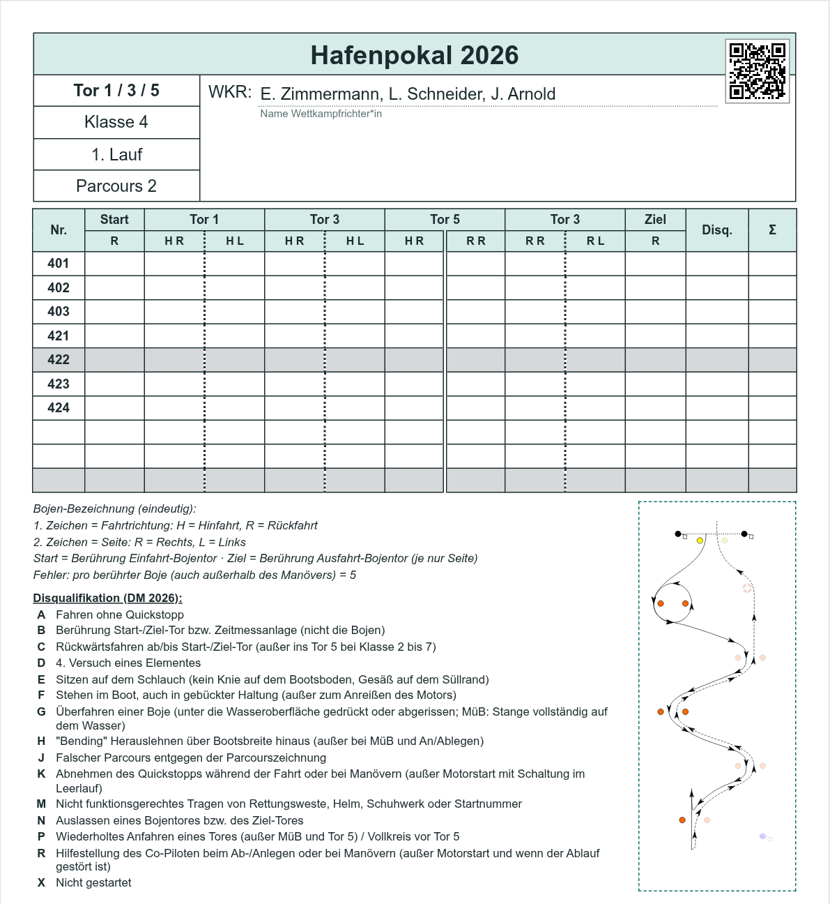</a>

- Je Parcours, Klasse, Lauf und Liste ein Bogen; die Startnummern in der Startreihenfolge der Verzahnung.
- Leerzeilen für Nachmeldungen; wahlweise die Beschreibung auf der Rückseite.
- Die Parcours-Zeichnung steht auf den Bögen, abgeblendet je Position. Im Parallelslalom trägt nur der
  Fahrweg-Bogen jedes Racecourse die eine Bahn, rechts neben der Legende (23.11.2026,
  [parallelslalom.md](parallelslalom.md#wkr-listen-des-vorlaufs)).
- Gedruckt werden die Bögen erst nach dem Festschreiben der Verzahnung (siehe [Sperren](#sperren-und-prüfungen)).
- **Druckfolge** (21.11.2026): je Parcours Position für Position, darin die Startfolge (1. Lauf in der Reihenfolge der
  Klassen, dann der 2. …) – der Stapel wird nur an den Positionen getrennt (`WKR_DRUCKFOLGE`).
  Parallelslalom: je Racecourse Position für Position, darin die Runden. Laufzettel bleiben je Klasse und Lauf (mit
  gemeinsamen Bögen meist je Parcours und Lauf, siehe [Laufzettel](#laufzettel-und-qr-codes)).
- Listen, die nur am Gerät erfasst werden (Betrieb → WKR, Modus „Gerät“), werden nicht gedruckt, auch nicht auf dem
  Laufzettel; ein Hinweis über dem Stapel bietet „Trotzdem drucken“. Pausierte und abgemeldete Listen und ein Steg, von
  dem nur ein Teil auf Geräten ist, werden gedruckt (`src/wkr/druck.ts`).

**Gemeinsame Bögen:** Klassen, deren Bogen gleich aufgebaut ist (gleiche Spalten, gleiches Parcoursbild), stehen
zusammen auf einem Blatt; Listen, deren Zeichnung sich je Klasse unterscheidet, bleiben je Klasse. Mit „Papier
sparen“ stehen alle Klassen einer Liste auf einem Bogen, ohne Parcoursbild, die Leerzeilen einmal je Seite unter
„Nachmeldungen“ statt je Klasse. Gewertet wird in jedem Fall je Klasse.

- **Clubmeisterschaft:** immer gemeinsame Bögen; „Papier sparen“ ist dort vorgewählt.
- **Meisterschaft (DM und UIM)** seit 26.11.2026 auf Wunsch: „Einstellungen → Wettkampfrichter-Listen“, Haken
  „Gemeinsame Bögen: Klassen mit gleich aufgebautem Bogen zusammen auf ein Blatt“ (Vorgabe aus; sonst hat jede Klasse
  ihre eigenen Bögen). Erst mit dem Haken erscheinen darunter „Papier sparen: alle Klassen einer Liste auf einem
  Bogen, ohne Parcoursbild“ (hier Vorgabe aus; ohne Parcoursbild hat der Wettkampfrichter nur die Beschreibung, und
  fahren die Klassen verschiedene Kurse, fehlt ihm die Zeichnung seiner Klasse) und „Klassen auf gemeinsamen Bögen“.
  Die Bögen sehen dann aus wie bei der Clubmeisterschaft: im Kopf etwa „Klassen 4, 7“, der QR-Code nennt alle Klassen
  des Bogens. Ein Hinweis über den Bögen unter „Listen“ sagt, dass sie gemeinsam sind. Auch die Beispielansicht
  (Veranstaltung → WKR-Einteilung) zeigt den gemeinsamen Bogen. Die Einstellung reist mit Sicherung und Vorlage und
  bleibt erhalten, wer zur Clubmeisterschaft und zurück wechselt. Unverändert bleiben WKR-Geräte (Listen je Parcours
  und Liste), Parallelslalom, Wertungslisten, Mannschaftswertung und Druckdatei.
- „Klassen auf gemeinsamen Bögen“ (24.11.2026, `wkrGemeinsamFolge`): **getrennt** (Vorgabe) – je Klasse ein Block mit
  der Klasse als Überschrift – oder **nach der Verzahnung** – alle Starter in der Startfolge gemischt, die Klasse in
  einer schmalen Spalte hinter der Startnummer, die Leerzeilen am Ende jeder Seite mit leerer Klassenzelle.
  Der Kopf nennt die Klassen der Seite; Laufzettel, QR-Codes und Erfassung folgen derselben Zeilenfolge.
- Spalten, die eine Klasse nicht hat, sind in ihren Zeilen kräftig schraffiert, wie die Zeile eines Dummys im
  Parallelslalom. Gewertet wird in beiden Fällen je Klasse.

**Listen der Veranstaltung** (`src/lib/listen.ts`): die Listen des Aufbaus.

- Wahlweise „Tor 5 übernimmt die Parcoursüberwachung“: eine Liste statt zweier. Disq., Bemerkung, Haken und
  WKR-Name ziehen dann um (`src/state/tor5.ts`).
- Dazu zusätzliche Listen außerhalb des Aufbaus: Knoten, Vorsteg, Varianten ohne Start/Ziel. Sie werden gedruckt,
  eingeteilt, erfasst, gewertet und auf dem Laufzettel gezählt wie die des Aufbaus.
- Die Knoten-Liste sehen beide Regelwerke in jedem Aufbau des Manövrierens vor (`vorgabeListen`); sie ist abwählbar.

**Listenoptionen** unter „Einstellungen“:

- Starter je Seite fest statt automatisch, und „Teilen ab“. Gemeinsame Bögen mehrerer Klassen teilen sich immer
  automatisch; der Hinweis darunter sagt das bei der Clubmeisterschaft und bei eingeschalteten gemeinsamen Bögen.
- Clubmeisterschaft: „Papier sparen“ und „Klassen auf gemeinsamen Bögen“; Meisterschaft: dazu vorher der Haken
  „Gemeinsame Bögen …“. „Leerzeilen je Seite“ erscheint, sobald „Papier sparen“ an ist oder die Klassen nach der
  Verzahnung stehen; sonst bleiben es Leerzeilen je Klasse (bei der Meisterschaft 3).
- Bezeichnung der Bojen-Seiten: R/L, Land/See, Kai/Hafen, Pfeile, Innen/Außen. Die Wertungslisten bleiben bei R/L.
- Die Sprache der Bögen: siehe [Regelwerke und Begriffe](#regelwerke-und-begriffe).

## Laufzettel und QR-Codes

**Laufzettel** (Checklisten) sind eine eigene Listenart (`src/lib/laufzettel.ts`, `src/components/LaufzettelListen.vue`).

<a href="bilder/de/laufzettel.png">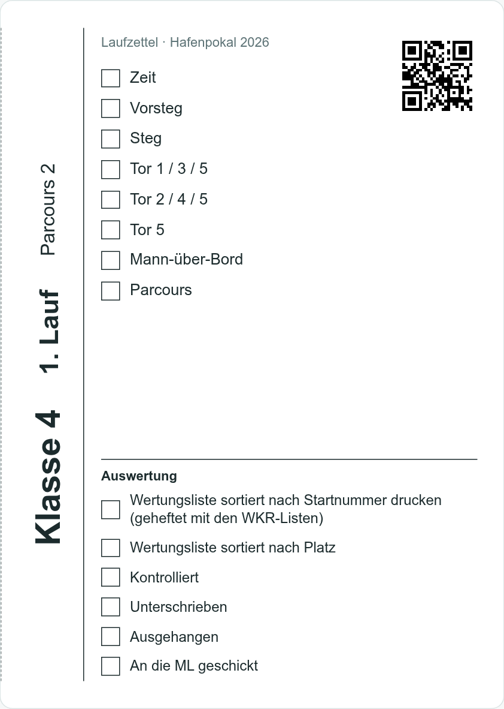</a>

- Je Blattstapel ein Zettel: Parcours, Klasse und Lauf. Teilen sich Klassen Bögen (Clubmeisterschaft, auf Wunsch
  auch eine Meisterschaft), gilt ein Zettel für alle diese Klassen, meist je Parcours und Lauf; Bögen einzelner Klassen
  darauf (Listen mit eigener Zeichnung) nennen ihre Klasse in der Zeile („Kl. 4“).
- Ein A4-Querblatt zum Falten auf A5, mit einem Kästchen je gedruckter Seite – gemessen an denselben Bögen,
  die gedruckt werden. Die Form ist wählbar: eine Zeile je Seite oder eine Zeile je Liste.
- Die Knoten (eine Liste ohne Lauf) liegen im Stapel des letzten Laufs. Dessen Zettel hat eigene Schritte:
  kein Aushang, sondern Einsicht der Mannschaftsleiter und das Gesamtergebnis (`schritteLetzterLauf`).
- Die Schritte hängen am Regelwerk (`laufzettel`; Vorgabe in `src/config/einstellungen.yaml`).
  UIM: Aushang binnen einer Stunde, vom O.O.D. unterschrieben (Pkt. 5.2).

**QR-Codes** stehen auf jeder Druckseite jedes Bogens und auf jedem Laufzettel (`src/lib/qr.ts`).

- Format `ALC1.<Veranstaltung>.<Regelwerk>.<Aufbau>.<Parcours>.<Klassen>.<Lauf>[.<Liste>.S<Seite>]`,
  als Vektor eingebettet (`qrcode-generator`).
- Ein Handscanner oder das Feld „Blatt scannen“ springt in der Erfassung zum Bogen und in dessen erste Zelle.
  Sind die Bögen seit dem Druck anders zusammengefasst (gemeinsame Bögen ein- oder ausgeschaltet), zeigt der Scan
  eines alten Bogens den Bogen, auf dem die Klasse jetzt steht (bei mehreren Klassen die erste), und sagt das dazu;
  die Eingaben hängen am Starter und landen richtig.
- Der Code eines Laufzettels zeigt alle Listen seines Stapels untereinander, mit einer Sprungleiste.
  Von Hand: „alle untereinander“ in der Auswahl der Liste.
- Blätter einer anderen Veranstaltung, eines anderen Regelwerks oder Aufbaus werden mit Begründung abgewiesen.
- Ein Scan hinterlässt keine Spur in dem Feld, in dem der Cursor gerade stand (`src/lib/scanner.ts`).

## Betrieb: Start-Freigabe und Anzeigetafel

Am Wettkampftag gibt der Bedienrechner frei, wer als Nächstes startet; eine **Anzeigetafel** zeigt es in einem
zweiten Fenster, etwa auf einem Monitor am Steg. Dazu kommen eine **Startliste** mit geschätzten Wartezeiten und eine
**Zuschauerliste**. Reiter „Betrieb“ mit den Unterreitern Start-Freigabe, Startliste, Geräte und WKR
(`src/views/BetriebView.vue`, Logik in `src/betrieb/`). Nichts davon braucht ein Netz; auf andere Geräte kommt es erst
mit dem [Gerätebetrieb](#gerätebetrieb).
Schritt für Schritt: [Ablauf am Wettkampftag](betrieb.md#ablauf-am-wettkampftag).
Weder DM-Reglement noch Regel 960 regeln den Ablauf am Steg; was ausgelegt wurde, steht in `BETRIEB_ANNAHMEN`
(`src/betrieb/annahmen.ts`).

<table>
<tr>
<td valign="top" width="300"><a href="bilder/de/start-freigabe.png">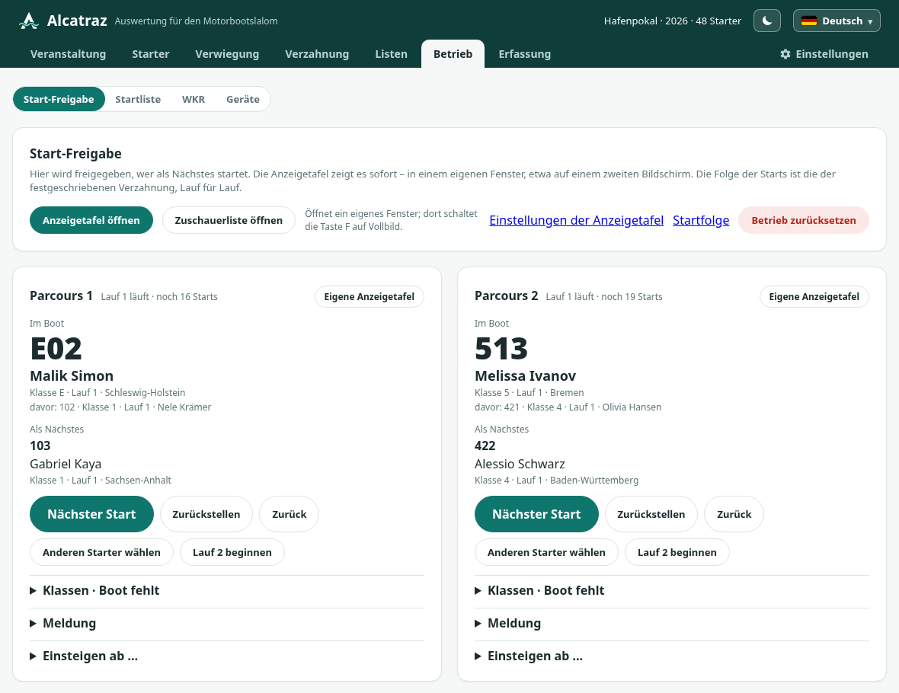</a>
 Start-Freigabe am Bedienrechner</td>
<td valign="top" width="300"><a href="bilder/de/anzeigetafel.png">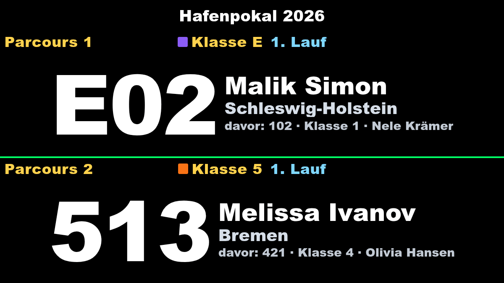</a>
 Anzeigetafel im zweiten Fenster</td>
<td valign="top" width="120"><a href="bilder/de/zuschauer.png">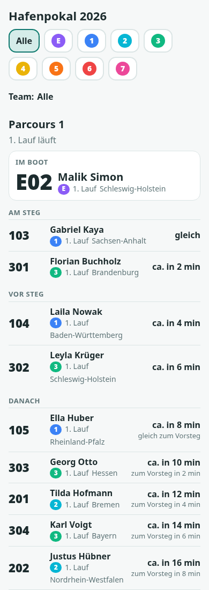</a>
 Zuschauerliste</td>
</tr>
</table>

**Grundsätze:**

- **Voraussetzung** ist die festgeschriebene Verzahnung; vorher zeigt der Reiter nur den Weg dorthin. Wird sie mitten
  am Tag gelöst, ruhen Zeigen, „Lauf beginnen“ und alles, was die Folge umstellt; Zurück, Meldungen und Zurücksetzen
  gehen weiter.
- **Die Folge der Starts** wird nie gespeichert, sondern Lauf für Lauf aus der Verzahnung abgeleitet – dieselbe wie
  auf den WKR-Bögen (`src/betrieb/folge.ts`). Gespeichert wird, was gezeigt und begonnen wurde, und nach dem ersten
  Umstellen ein Schnappschuss der Folge (`src/betrieb/schritte.ts`). Verzahnung und Bögen ändert der Betrieb nie.
  Mit „Versuche direkt nacheinander“ (UIM) fährt jeder Starter seine Versuche hintereinander.
- **Freigegeben wird nach Lauf, nicht nach Stelle:** Ein Start eines Laufs, der noch nicht begonnen hat, wartet – auch
  wenn er schon mitten im laufenden steht; gezielt zeigen geht immer.
- **X:** Ein Start mit X („nicht gestartet“) in einer Disq.-Zelle des Laufs entfällt; ohne X ist er wieder da.
  Der Betrieb selbst setzt nie ein X und schreibt nie Werte; nur die Wiederholung nach Ausfall (unten) verwirft
  Werte, ausdrücklich und mit Rückfrage.
- **Rückfrage** gibt es nur vor „Lauf beginnen“, solange Starts offen sind, vor „Betrieb zurücksetzen“, vor einer
  Wiederholung nach Ausfall und mit digitaler WKR-Erfassung bei Rückstand vor dem Zeigen; alles andere lässt sich
  zurücknehmen.

### Start-Freigabe

Je Parcours eine Karte (`src/components/betrieb/StartFreigabe.vue`):

- **„Lauf N beginnen“** gibt die Starts des Laufs frei. Offene Starts des laufenden Laufs bleiben freigegeben und
  kommen vorher dran.
- **„Nächster Start“** bringt den nächsten offenen Start auf die Anzeigetafel, **„Zurück“** nimmt ihn zurück.
  Ein Doppelklick schaltet nur einmal. Am Ende eines Laufs bleibt die Anzeigetafel auf dem letzten Starter stehen.
- **Zurückstellen:** Der Nächste ist kurz verhindert und steht unter „Zurückgestellt“; von dort „Als Nächster“,
  „Ans Ende des Laufs“ oder „Jetzt zeigen“.
- **Nachzuholen:** Starts, die überholt wurden, ohne dran gewesen zu sein (Nachmeldung, entferntes X, verpasster Lauf).
  Sie kommen nie von selbst; sie werden gezeigt oder eingereiht.
- **Anderen Starter wählen** (`BetriebsFolge.vue`): die nächsten zwölf offenen Starts oder die ganze Folge, dazu eine
  Suche nach Startnummer oder Name über alles noch zu Zeigende – auch spätere Läufe. „Zeigen“ holt den Start sofort
  auf die Anzeigetafel; der bisherige Nächste bleibt der Nächste.
- **Wiederholung (Ausfall) …** (26.11.2026, nur am Bedienrechner, nicht im Parallelslalom; `AusfallWahl.vue`,
  `BETRIEB_ANNAHMEN` WH1–WH10): Bei einem bestätigten Ausfall wird der Lauf des Starters wiederholt. Die Wahl zeigt die
  schon gezeigten Starts der laufenden Läufe, der zuletzt gezeigte zuerst, mit Suche nach Startnummer; Starts
  abgemeldeter Starter stehen ausgegraut („abgemeldet – keine Wiederholung“). Liegt der Ausfall am Starter, trägt der
  WKR an der Boje „J“ ein (falscher Parcours) – dann gibt es keine Wiederholung. „Wiederholen …“ fragt
  „Wiederholung nach Ausfall: 102, Lauf 1?“; „Werte verwerfen und wiederholen“ leert alle Werte dieses Starters in
  diesem Lauf auf jeder Liste, auch die von den WKR-Geräten samt ihren offenen Rückfragen. Mit „Versuche direkt
  nacheinander“ (UIM) bleibt die Zeile am Vorsteg stehen; die Rückfrage sagt das.
- **Wiederholung offen:** Dort steht der Start danach; er fährt nie von selbst. Die Wettkampfleitung reiht ihn mit
  „Als Nächster“ oder „Ans Ende des Laufs“ ein oder zeigt ihn mit „Jetzt zeigen“ – auch vom gekoppelten Freigabe-Handy
  und in der Startliste. Bis dahin steht der abgebrochene Versuch unter „Im Boot“ mit „Ausfall – wird wiederholt“;
  „Zurück“ ist gesperrt, eine Parcours-Ampel und den Auto-Modus gibt es für ihn nicht.
- **Doch keine Wiederholung** (nur am Bedienrechner, in der Liste „Wiederholung offen“, solange der Start nicht wieder
  gezeigt ist): Der abgebrochene Versuch gilt wieder, und seine verworfenen Werte kommen zurück – auf allen Listen,
  samt Haken „erfasst“ und „keine Zeit“, aber nur in Felder, die inzwischen leer sind; was seit dem Ausfall
  eingetragen wurde, bleibt. Rückfragen, Vorschläge und Papier-Vermerke von damals kommen nicht zurück. Nach zwei
  Ausfällen desselben Starts gilt danach der zuletzt abgebrochene Versuch. Die WKR-Geräte behandeln den Start danach
  wie vorher (erledigt; Korrekturen aus „Zuletzt“ werden wieder übernommen).
- Im Verlauf („Einstellungen → Dateien → Verlauf“) stehen eigene Einträge, etwa „Wiederholung nach Ausfall – Werte
  verworfen: 101, Klasse 1, 1. Lauf“ und „Doch keine Wiederholung – Werte zurückgeholt: …“. Die verworfenen Werte
  stehen in der Sicherung, solange der Abbruch im Betrieb steht; „Betrieb zurücksetzen“, das Löschen des Laufs und das
  Entfernen des Starters räumen sie weg.
- **Verschieben** (Menü je Start): vor den Nächsten, ans Ende des Laufs, vor oder nach einem anderen Lauf – nie vor
  schon Gefahrenes. Mit „Verzahnung beim Verschieben halten“ (Vorgabe an) bekommt der Start im Lauf den nächsten Platz
  seiner Spur. Was die Bedienung so umgestellt hat, bleibt; nicht umgestellte Läufe folgen weiter der Verzahnung.
- **Klassen · Boot fehlt** (`KlassenAussetzen.vue`): die Klassen in der Folge, in der sie drankommen, mit der Zahl
  ihrer offenen Starts. „Boot fehlt“ stellt die Starts einer Klasse grau ans Ende des Laufs; mit „Andere Klassen
  vorziehen“ (Vorgabe an) rückt die nächste Klasse derselben Spur nach (`E2E21212121216163` → `E6E61111113`), sonst
  schließen sich nur die Lücken. „Boot ist zurück“ verzahnt den Rest des Laufs wieder mit ihr. „Vorziehen“ macht eine
  Klasse zur nächsten, nur innerhalb ihrer Spur.
- Sind nur noch zurückgestellte, zu wiederholende, nachzuholende oder „Boot fehlt“-Starts übrig, **stockt** der Lauf;
  die Karte sagt es.
- **Einsteigen ab …** Lauf und wahlweise Klasse, wenn die Start-Freigabe erst mitten im Wettkampf dazukommt: Was davor
  liegt, gilt als gefahren (ohne Anzeige), „Weiter mit“ nennt den nächsten Start.
- Wird der Starter im Boot gelöscht (vor dem ersten Wert), zeigt die Anzeigetafel „bereit“.
- **Meldung** je Parcours oder auf allen: Störung und Pause stehen statt des Starters auf der Anzeigetafel, ein Hinweis
  darunter. **Vorlagen** (Begrüßung, Dank, Pause, Störung; `src/betrieb/meldungen.ts`) übernimmt man ins Textfeld und
  passt sie an; ihr Text steht in der Sprache der Anzeigetafel.
- „Betrieb zurücksetzen“ (mit Rückfrage) löscht Begonnenes, Gezeigtes und Meldungen; Starter, Verzahnung und Werte
  bleiben.
- Mit [digitaler WKR-Erfassung](#digitale-wkr-erfassung) zeigt die Karte zusätzlich den Stand jeder Liste und die
  [Parcours-Ampel](#parcours-ampel-und-auto-modus).

### Anzeigetafel

„Anzeigetafel öffnen“ öffnet ein eigenes Fenster (`#/anzeige`, englisch `#/display`; je Parcours
`#/anzeige/<parcours>`; `src/AnzeigeApp.vue`). Taste F oder Doppelklick schaltet Vollbild; der Mauszeiger
verschwindet nach kurzer Ruhe.

- Je Parcours: Name des Parcours, Klasse (mit Klassenfarbe) und Lauf, groß die Startnummer, Name, Herkunft und auf
  Wunsch der Start davor. Weiß auf Schwarz, gleich welches Farbschema die Bedienung hat.
- Zwei Parcours stehen untereinander, auf sehr breiten Bildschirmen nebeneinander. Zu lange Namen werden kleiner statt
  abgeschnitten (`src/lib/fit.ts`).
- Ein wiederholter Start nach Ausfall steht als „1. Lauf · Wiederholung“ da (englisch „Attempt 1 · Repeat“), ohne
  Grund; ebenso in der Zuschauerliste.
- Das Fenster liest nur und schreibt nie; es folgt dem Bedienfenster sofort und hält den Bildschirm wach.
- Sprache wie die Listen (DM deutsch, UIM englisch: „Course“, „Attempt“, „Class Dolphin“), umstellbar.
- Was sie zeigt, kommt aus einer schmalen Sicht (`src/betrieb/sicht.ts`): Startnummer, Name, Klasse und Herkunft der
  Starter, die gerade vorkommen – nie Geburtsdatum, Gewicht, Geschlecht oder erfasste Werte.

### Startliste und Startabstände

**Startliste** (Unterreiter „Startliste“, `src/components/betrieb/StartListe.vue`): je Parcours der Start im Boot mit
„seit m:ss“ und die ganze Folge der offenen Starts nach Lauf, mit zwei Zeiten:

- **„ca. in“** – wann der Start ungefähr dran ist: der Rest des Starts im Boot, dann je Start der Startabstand seiner
  Klasse;
- **„Zum Vorsteg“** – wann der Starter am Vorsteg sein muss: sobald er zu den nächsten „am Steg“ + „vor Steg“ Starts
  gehört (Vorgabe 2 + 2).
- Ohne Zahl bleiben Läufe, die noch nicht begonnen haben, und „Boot fehlt“. Während einer Pause oder Störung auf der
  Anzeigetafel steht keine Zahl da, nur ein Satz, warum.
- Umstellen durch Ziehen eines Starts auf einen anderen oder über „Verschieben …“ – dieselben Regeln wie an der
  Start-Freigabe. Gerechnet wird mit der Uhr des Bildschirms; gespeichert wird nichts.

**Startabstände** (`src/betrieb/prognose.ts`): Gemessen wird der Abstand zweier Anzeigen eines Parcours, zugeschlagen
der Klasse des vorigen Starts. Nicht gezählt werden Abstände unter 30 s und über 300 s, über eine Laufgrenze, über
einen ohne Anzeige erledigten Start und bei einem Start, der inzwischen ein X hat. Ab drei Messungen gilt das Mittel
der Klasse, vorher der eigene Wert der Veranstaltung, sonst die Vorgabe (`startabstaende` in
`src/config/einstellungen.yaml`, gerundete Mittel der DM 2025). „Messwerte als Vorgabe übernehmen“ macht die Mittel
zu eigenen Werten, die mit der Vorlage zur nächsten Veranstaltung reisen.

### Zuschauerliste

„Zuschauerliste öffnen“: eigenes Fenster (`#/zuschauer`, englisch `#/spectators`; je Parcours `#/zuschauer/<parcours>`;
`src/ZuschauerApp.vue`), schmal genug fürs Handy.

- Je Parcours „Im Boot“, „Am Steg“, „Vor Steg“, „Danach“ (mit „ca. in“ und „zum Vorsteg in“), zuletzt „Boot fehlt“.
  Läufe, die noch nicht begonnen haben, stehen nicht darin. Bei Pause oder Störung steht die Meldung oben.
- Filter nach Klasse und – seit dem Feldtest 21.11.2026 – nach Team (Verein, Landesverband oder Nation wie die
  Veranstaltung, mehrere wählbar). Die Filter blenden nur aus und bleiben im Browser des Betrachters; nichts davon geht
  übers Netz.
- Sie liest eine noch schmalere Sicht als die Anzeigetafel (`sichtZuschauer`): ohne Zurückgestellte, Nachzuholende und
  Starts späterer Läufe. Aufs Handy der Zuschauer kommt sie über den Zuschauer-Link des [Gerätebetriebs](#gerätebetrieb).

### Parallelslalom im Betrieb

Nur unter UIM ([Einzelheiten](parallelslalom.md#betrieb-start-freigabe-und-anzeigetafel)): ein eigener Bereich hinter
den Parcours. Seine Punkte sind die festgeschriebenen Runden (Vorlauf, Re-run, Halbfinale, Kleines Finale, Finale);
jede wird mit „… beginnen“ einzeln freigegeben (24.11.2026), seine Starts sind die Paare des Plans. Die Anzeigetafel
zeigt Racecourse A und B so, wie sie vom Publikum aus liegen (Einstellung). Klassen aussetzen und Verschieben gibt es
dort nicht, Zurückstellen nimmt das ganze Paar, Wartezeiten gibt es keine. Eine eigene Tafel öffnet
„Eigene Anzeigetafel“ (`#/anzeige/parallel`).

### Einstellungen und Speicher

- **„Einstellungen → Anzeigetafel“:** Kopfzeile, Logos links und rechts (die der Listen), welche Parcours die
  gemeinsame Tafel zeigt, Start davor, Name des Parcours, Namen (wie der Aushang, voll, gekürzt, ohne), Herkunft,
  Sprache, Schriftgröße (70–130 %); unter UIM die Lage von Racecourse A und B.
- **„Einstellungen → Startfolge im Betrieb“:** „Verzahnung beim Verschieben halten“, Starts „am Steg“ und „vor Steg“
  (je 0–10), Startabstände je Klasse (Vorgabe, eigener Wert 30–600 s, gemessen, was gilt) und die Einstellungen der
  [digitalen WKR-Erfassung](#digitale-wkr-erfassung) (Rückstand, Auto-Modus).
- Die Einstellungen reisen mit der Vorlage, außer der Kopfzeile. Der Betrieb selbst steht in der Sicherung, nicht in
  der Vorlage; „Verlauf wiederherstellen“ und „Alle erfassten Werte löschen“ lassen ihn stehen.
- Unter `file://` (Ein-Datei-Fassung) stößt das Bedienfenster die von ihm geöffneten Fenster selbst an, wo der
  Browser die Nachricht zwischen Fenstern nicht trägt (`src/lib/anzeigeFenster.ts`).

## Gerätebetrieb

Anzeigetafel, Zuschauerliste, Start-Freigabe und WKR-Listen auf anderen Geräten – Bildschirmen am Steg, Tablets,
Handys –, über einen fremden ntfy-Server im Internet (Unterreiter „Betrieb → Geräte“, `src/geraete/`).
Bedienung, Grenzen, Kontingent und Störungen: [betrieb.md](betrieb.md#gerätebetrieb);
Sicherheitsmodell: [technik.md](technik.md#gerätebetrieb-sicherheitsmodell). Mit echten Handys und dem echten Server
ist er noch nicht im Feld geprüft ([feldtest.md](feldtest.md)).

- **Erst „Gerätebetrieb einschalten“ verbindet** – bis dahin verlässt nichts den Browser (Test
  `src/main.geraete.test.ts`). Über den Server gehen dann, verschlüsselt und signiert: Startnummer, Name (nach der
  Einstellung „Namen“ der Anzeigetafel), Herkunft und Klasse, die Folge der Starts mit Zeitpunkten, Meldungen, der
  Name der Veranstaltung; für die WKR-Listen deren Starts mit Startnummer und Klasse (ohne Namen), am Steg das
  Ausgleichsgewicht. Vom Bedienrechner gehen nie hinaus: Geburtsdatum, Körpergewicht, Geschlecht, erfasste Werte
  (außer bei einer Rückfrage der Wert dieser einen Zelle an die Geräte der Liste), Logos oder der Stand der
  Veranstaltung. Die WKR-Geräte schicken ihre Zeilen verschlüsselt an den Bedienrechner.
- **Server:** Vorgabe `ntfy.adminforge.de`, änderbar unter „Einstellungen → Geräte“. Sein Betreiber sieht keine
  Inhalte, wohl aber Zeitpunkte, Größen und IP-Adressen.
- **Zwei Lese-Links** mit QR-Code: „Anzeigetafel“ und „Zuschauer“ (`#/sehen/<paket>`). Keine Anmeldung, keine
  Kopplung; das Gerät zeigt dieselbe Anzeigetafel (ohne Logos) bzw. Zuschauerliste wie am Bedienrechner.
  Fingerabdruck zum Vergleichen, „Zuschauer-Link erneuern“, „Raum beenden“.
- **Koppeln** (E7): QR-Code vom Bildschirm scannen (Hauptweg) oder Koppel-Link plus Geräte-Code über Funk. Gekoppelt
  wird für die **Start-Freigabe** bestimmter Parcours oder für eine **WKR-Liste** (siehe
  [Digitale WKR-Erfassung](#digitale-wkr-erfassung)). In der Geräteliste: Name, Art des Geräts (Handy, Pad, Rechner),
  Parcours, Listen, „Entziehen“.
- **Start-Freigabe auf dem Handy** (`#/geraet`): dieselben Knöpfe wie am Bedienrechner, nur für die eigenen Parcours,
  ohne „Betrieb zurücksetzen“. Nach jedem Druck sind die Knöpfe gesperrt, bis der Bedienrechner bestätigt; entschieden
  wird immer dort (Positivliste `src/geraete/aufgaben.ts`).
- Dazu: Bildschirm wach halten auf jedem verbundenen Gerät, „Alle Geräte neu laden“ nach einem Update und eine
  Anzeige, wie viele Nachrichten heute an den Server gingen.

## Digitale WKR-Erfassung

Die Wettkampfrichter erfassen ihre Liste am eigenen Handy oder Pad statt auf dem Bogen (Etappen W1–W5, gebaut
21.–24.11.2026; [Vorschlag](vorschlag-wkr-erfassung.md), Pläne [W1](plan-wkr-w1.md) bis [W5](plan-wkr-w5.md)).
Sie setzt den [Gerätebetrieb](#gerätebetrieb) voraus, ist bisher nur gegen einen nachgebauten Server geprüft und noch
**ohne Feldtest** ([feldtest.md](feldtest.md)). Papier bleibt jederzeit der Rückfall: Jede Liste lässt sich pausieren
oder ab einem Start aufs Papier stellen. Bedienung Schritt für Schritt:
[WKR-Erfassung auf Handy und Pad](betrieb.md#wkr-erfassung-auf-handy-und-pad). Die Auslegungen stehen mit Datum in
`WKR_ANNAHMEN` (`src/wkr/annahmen.ts`), offene Fragen unter [Offen](entscheidungen.md#offen).

<table>
<tr>
<td valign="top" width="160"><a href="bilder/de/wkr-handy.png">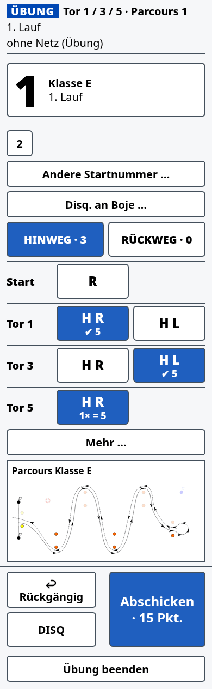</a>
 Maske „Knöpfe“ auf dem Handy</td>
<td valign="top" width="360"><a href="bilder/de/wkr-pad-bild.png">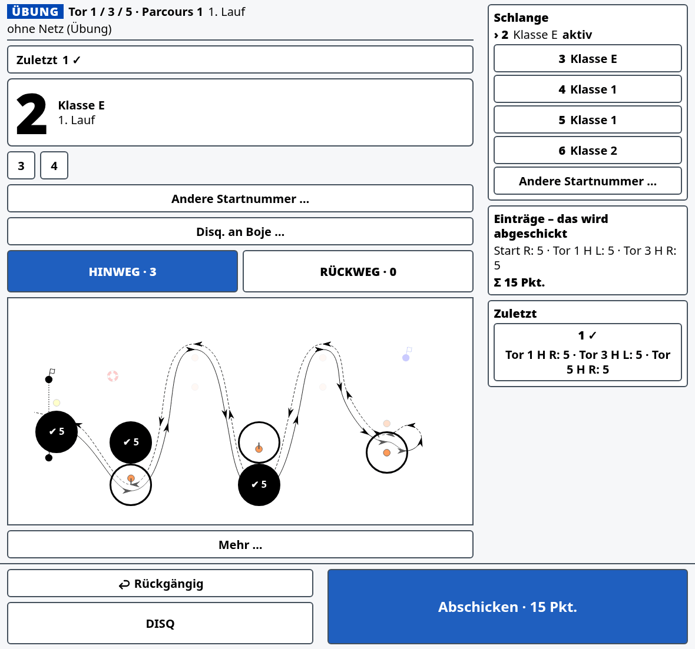</a>
 Maske „Bild“ auf dem Pad mit Parcours-Zeichnung</td>
</tr>
</table>

### Wie eine Zeile ankommt

- Ein Gerät bekommt beim Koppeln eine Liste (Handy empfohlen eine, Pad zwei, höchstens vier); am Steg wahlweise ganz,
  nur Ablegen oder nur Anlegen. Damit ist die Liste „digital“.
- Das Gerät sieht nur die **Sicht seiner Liste** (`src/wkr/sicht.ts`): gezeigte Starts mit Startnummer und Klasse,
  nie Namen, dazu die Maske je Klasse und Hinweise des Bedienrechners. Vorsteg und Steg-Ablegen sehen die nächsten
  Starts schon vorab; das Anlegen kommt erst, wenn das Boot zurück ist.
- Eine abgeschickte Zeile geht über die Erfassung in die Werte – genau wie beim Abtippen: leere Zelle → übernommen;
  steht dort schon etwas anderes, wird es eine **Rückfrage** am Bedienrechner, nie still überschrieben.
- Ohne Verbindung erfasst das Gerät weiter; wartende Zeilen gehen später gebündelt. Sie liegen nur auf dem Gerät
  (36 Stunden). Ein Gerät mit Liste meldet sich während eines Laufs mit einem Lebenszeichen (Akku, wartende Zeilen).
- **Liste abschließen:** Nach dem Lauf erscheint ein Band „… ist vorbei – Liste abschließen?“. Die Prüfansicht zeigt
  Abgeschicktes, Offenes und X; mit dem Namen des Wettkampfrichters – vorbelegt aus der WKR-Einteilung – ersetzt der
  Abschluss die Unterschrift auf dem Bogen. Offene Starts gehen mit „Rest auf Papier“. Läuft der Lauf noch, fragt das
  Gerät nach. Danach gehen Korrekturen nur noch als Vorschlag.
- **Wiederholung nach Ausfall** (26.11.2026, siehe [Start-Freigabe](#start-freigabe)): Wird der Start wieder gezeigt,
  bekommen die Geräte ihn wie einen neuen Start. Eine Zeile, die ein Gerät noch zum abgebrochenen Versuch schickt, wird
  abgelehnt; das Gerät zeigt „Dieser Versuch wurde nach einem Ausfall abgebrochen – der Start wird wiederholt. Die Zeile
  ist nicht übernommen.“ Hat eine Liste den Lauf schon abgeschlossen, bekommt ihr Gerät die Wiederholung trotzdem; die
  Zeile kommt im Eingang als Vorschlag an („Die Liste ist für diesen Lauf abgeschlossen.“) und wird mit einem Klick
  übernommen, der Abschluss bleibt stehen. Ausnahme „Versuche direkt nacheinander“: Die Zeile am Vorsteg bleibt, das
  Gerät dort kann sie weiter korrigieren, und eine verspätete Zeile wird übernommen.

### Am Bedienrechner

- **Betrieb → WKR** (`src/components/betrieb/WkrMatrix.vue`): eine Matrix Listen × gezeigte Starts – ✓ erfasst,
  ½ ein Steg-Teil, ○ offen, ○! überfällig, ! Rückfrage, V Vorschlag, P Papier, ✕ nicht gestartet,
  „✓ keine Zeit“ – und je Liste das Gerät mit Ampel (gehört, still, weg). Je Liste: Erfassung Gerät, Papier oder
  beides; Pausieren, Abmelden, „Weiter digital“; **„Papier ab Start …“**; „Bitte Nr. prüfen“ an die Geräte;
  Abschlüsse ansehen und lösen. „Gerät koppeln“ an einer Liste ohne Gerät führt direkt zum Koppeln. Eine
  Wiederholung nach Ausfall steht in der Matrix als offen und zählt im Rückstand, auch auf einer Liste mit
  abgeschlossenem Lauf; „Papier ab Start …“ ab der Wiederholung stellt nur sie und spätere Starts auf Papier, nicht
  die Starts zwischen Ausfall und Wiederholung.
- Darunter der **Eingang**: Rückfragen (Wert des Geräts übernehmen oder behalten) und Vorschläge (übernehmen oder
  verwerfen).
- **Am Tisch (ohne Lauf):** ein eigener Block für die Knoten-Liste („Knoten: n / m offen“).
- **Erfassung:** ◆ an Werten vom Gerät, „Papier ansehen“ an Zeilen und Zellen, für die der Bogen gebraucht wird;
  wer einen Gerätewert überschreibt, wird einmal gefragt (siehe [Erfassung](#erfassung)).
- **Start-Freigabe:** eine Zeile mit dem Stand jeder Liste – ✓ fertig, ⧗ wartet n, ✕ Gerät weg, ▭ Papier, klein die
  Verbindung. Ab wie vielen offenen Starts einer Parcours-Liste gewarnt wird und ob vor dem Zeigen nachgefragt wird
  („Trotzdem weiter?“) oder nur gewarnt, steht unter „Einstellungen → Startfolge im Betrieb“ (Vorgabe: ab einem,
  nachfragen). Gesperrt wird nie. Ein gekoppeltes Freigabe-Handy sieht dieselbe Zeile, ohne Werte und Gerätenamen.
- Der **WKR-Name** kommt aus der Einteilung; ändert ein Gerät ihn unter „Mehr → Name“, zeigt der Bedienrechner die
  Abweichung und kann sie übernehmen.

### Parcours-Ampel und Auto-Modus

Die Start-Freigabe richtet sich nur nach dem **Parcours** (Nutzer 21.11.2026): Steg und Vorsteg arbeiten autark und
halten nie auf. Sobald eine Parcours-Liste digital erfasst wird – Tore, Bojen, Tor 5, Mann-über-Bord,
Parcoursüberwachung, Start/Ziel, seit 22.11.2026 auch Zeit –, steht je Parcours eine Ampel
(`src/wkr/ampel.ts`; Ablauf in [betrieb.md](betrieb.md#ablauf-am-wettkampftag)):

1. Nach „Nächster Start“ ist sie **grün** („Start frei“).
2. **Rot** wird sie mit „Durchs Start-Tor“ oder von selbst, sobald ein Parcours-WKR für den Start etwas abschickt;
   daneben steht, welche Listen noch fehlen. „Doch nicht durch“ nimmt den Knopf zurück.
3. Haben alle digitalen Parcours-Listen abgeschickt: **frei**. „Nächster Start“ bei Rot fragt „Trotzdem weiter?“.
4. **Auto-Modus** (Einstellung, Vorgabe aus): Hat jede Parcours-Liste ein Gerät, zählt die Start-Freigabe bei „frei“
   3 Sekunden herunter („Anhalten“) und zeigt den Nächsten. Nie von selbst: einen neuen Lauf, Nachzuholende,
   Zurückgestellte, bei offener Rückfrage, bei Pause oder Störung.

Die Parcours-WKR sehen in der Starterkarte einen Punkt „Start frei“ bzw. „im Parcours“; Anzeigetafel und
Zuschauerliste zeigen keine Ampel.

### Masken

Zur Wahl stehen „Knöpfe“, „Bild“ und „Tabelle“. Der Bedienrechner kann je Liste eine vorgeben (Geräteliste),
wahlweise „fest“; sonst wechselt der Wettkampfrichter unter „Mehr → Ansicht“. Ohne Vorgabe gilt „Knöpfe“, auf dem Pad
bei Listen mit Bojen „Bild“ (`src/wkr/maskenWahl.ts`). „Knöpfe“ sieht je nach Liste anders aus (Codes, Bojen, Zeit,
Prüfliste). Alle Masken erzeugen dieselben Zellwerte wie das Abtippen (`src/wkr/maske.ts`).

- **Codes** (Steg, Vorsteg, Tor 5, Mann-über-Bord): je Fehlercode der Liste ein Knopf, die Startnummer groß, nie ein
  Name. Hauptknopf „Fehlerfrei ✓“, mit Einträgen „Abschicken · n Pkt.“; „↩ Rückgängig“ im Fuß (der Pfeil nach links als
  kleine Zeichnung, auf schmalen Handys über dem Wort) nimmt den letzten Tipp zurück. Disq. getrennt über DISQ: der
  erste Tipp merkt vor, der zweite setzt. X bieten die Disq.-Knöpfe nur am Steg-Ablegen und am Vorsteg an, mit
  Rückfrage. Codes, die laut Regelwerk in der Klasse nicht gelten, sind ausgegraut, aber drückbar (DM: 4 und 23 ab
  Klasse 3; 2, 5, 10 und 16 ab Klasse 4).
- **Höchstzahl je Code** (24.11.2026; `max`/`danach` je Code im Regelwerk): „2. und 3. Versuch des Elementes“ zählt
  höchstens zweimal; der dritte Tipp setzt Disq. **D** („4. Versuch eines Elementes“) – der Knopf sagt vorher „nächster
  = Disq. D“. Auf diesen Knöpfen zählt ein Tipp weniger als 0,4 s nach dem vorigen nicht (Prellschutz). Tor 5 Code 1
  („nicht mit gesamter Länge eingefahren“) geht nur einmal. Jeder andere Code zählt höchstens dreimal je Lauf, auch
  Stegberührungen und „Durchreißen der Schaltung“ (bestätigt 26.11.2026); am Höchstwert sagt es der Knopf
  („höchstens 3ד).
- **Bojen** (Tor-Listen wie Tor 1/3/5 und Tor 2/4/5, Parcours mit Start/Ziel, Parallelslalom): je Halt eine Zeile,
  die beiden Bojen eines Tores nebeneinander wie auf dem Bogen. Ein Tipp = eine Berührung (5 Punkte), der zweite
  nimmt sie weg; die Torbojen von Tor 5 zählen bis 9. Hat eine Klasse mehr als sieben Zeilen, teilt ein Umschalter
  „HINWEG | RÜCKWEG“, der nie von selbst wechselt. Reihenfolge unter „Mehr → Ansicht“: „Rückweg gedreht“ (Vorgabe),
  „Fahrtfolge“ oder „Alles untereinander“. DISQ fragt erst nach der Boje („Keine Boje / ganzer Parcours“ für das
  Disq.-Feld); langes Drücken (0,8 s) auf eine Boje öffnet gleich ihre Disq.-Wahl, mehrere Buchstaben, dann „Fertig“.
  Eine Zelle kann so Punkte und Buchstaben tragen („5, J, D“). Ein ausgelassenes Tor ist ein J an einer seiner Bojen.
- **Bild** (nur Listen mit Bojen): die Parcours-Zeichnung der Klasse, getippt wird auf die Bojen selbst –
  Trefferkreise mindestens 15 mm, zu nahe auseinandergeschoben. Umschalter HINWEG, RÜCKWEG und RÜCK 2 (Speedrunde),
  nur von Hand. Langes Drücken auf eine Boje öffnet die Disq.-Wahl dieser Boje. **Lage der Zeichnung** (24.11.2026,
  „Mehr → Ansicht“): „Automatisch“ (wie auf dem Bogen, soweit der Platz reicht), „Start/Ziel links/oben/rechts/unten“
  (seit 26.11.2026; vorher „Steg unten/links/oben/rechts“ – eine gewählte Lage bleibt und zeigt dasselbe Bild, nur
  unter dem neuen Namen), darunter ein Satz wie „Start/Ziel oben, Tor 5 unten.“; im Parallelslalom „Start
  links/oben/rechts/unten“; die Schrift bleibt aufrecht, gemerkt je Gerät und Liste. Der
  Parallelslalom zeigt die eine Bahn ohne Steg, für Racecourse A und B dieselbe. Fehlt in einer Zeichnung eine Boje,
  zeigt das Gerät die Knöpfe.
- **Zeit** (Listen der Zeitnahme): die Zeitfelder mit einem Ziffernblock für das aktive Feld; darunter steht, wie der
  Bedienrechner die Eingabe liest („83,45“ = 83,45 s). Pflicht ist nur das erste Zeitfeld; nach einer vollständigen
  Zeit springt der Block ins nächste. „Keine Zeit für …“ mit Grund: Zeitanlage ausgefallen, nicht im Ziel, anderer
  Grund – am Bedienrechner „✓ keine Zeit“, in der Erfassung „Papier ansehen“. Listen mit Bojen und Zeit zeigen die
  Bojen-Maske mit Zeitfeldern.
- **Prüfliste am Tisch** (Knoten, Liste ohne Lauf): Das Gerät kennt alle Starter der Klassen mit der Liste, ohne
  Start-Freigabe. Startnummer über den Ziffernblock eintippen oder den Vorschlag „Nächster: …“ nehmen (der nächste
  offene nach dem zuletzt bearbeiteten); je Knoten ✓ oder ✗ (✗ = 5), „✓ Alle richtig“ bzw. „✓ Rest richtig“,
  abschicken. Eine schon erfasste Nummer fragt „korrigieren?“.
- **Tabelle** (für Geübte, nur Pad oder Rechner mit Tastatur): eine Zeile je Start mit den Spalten des Bogens, Tab und
  Enter zur nächsten Zelle, Enter in der letzten schickt ab. Gelesen wird wie beim Abtippen; Fehler stehen an der Zelle
  („Kein Fehlercode dieser Liste“, „Zu oft …“). Korrektur in der Tabelle mit „alt → neu“, Esc bricht ab.

Für die wenigen Listen ohne Maske steht beim Zuweisen „Maske folgt – Papier“.

### Auf dem Gerät

- **Nach dem Abschicken** steht kurz „wird übertragen …“ mit der Bestätigung, dann die nächste Startnummer; eine
  Sekunde lang nimmt die Maske nichts an (Schutz gegen Doppeltipp). Die Leiste „Zuletzt“ öffnet abgeschickte Zeilen zur
  Korrektur; „Andere Startnummer …“ springt zu einem anderen Start.
- **Nicht gestartet** (24.11.2026, ersetzt „Nicht vorbeigekommen“): „Mehr → Nicht gestartet · Disq. X“ mit großer
  Rückfrage „23 nicht gestartet?“ trägt X allein ins Disq.-Feld – auf jeder Liste mit Disq.-Feld (Tore, Tor 5, MüB,
  Parallelslalom, Steg, Vorsteg). Am Bedienrechner wirkt es wie jedes X: Der Start entfällt in diesem Lauf, auf allen
  Listen und in der Wertung. Wer sich geirrt hat, korrigiert über „Zuletzt“; die Korrektur beginnt ohne X.
- **Mehr:** Bemerkung, Pausieren (Papier), Abmelden, „Nicht gestartet · Disq. X“, Name, Ansicht („Wie Gerät“ als
  Vorgabe, Sonne, Hell, Dunkel; Linkshand; dazu Bojen-Reihenfolge, Lage der Zeichnung und Maske), Sprache (die der
  Liste, umschaltbar; unter UIM wechseln auch Codes und Titel), Probe.
- **Probe:** Nach dem ersten Empfang einer Liste zeigt das Gerät einmal je Raum, Liste und Maske eine Probe mit dem
  Start „P“ – nichts wird gesendet; „Überspringen“ geht immer, „Mehr → Probe“ wiederholt sie.
- **Pad** (`src/wkr/anordnung.ts`): Quer bis vier Listen nebeneinander, hochkant bis zwei; der ganze Steg als Ablegen
  und Anlegen nebeneinander. Eine Seitenspalte zeigt Schlange und Einträge im Klartext. Im Parallelslalom ein Band mit
  der Runde und ein deutlicher Wechsel beim nächsten Attempt.
- **Zwei Tabs** derselben Kopplung: Es sendet nur der zuletzt geöffnete, der ältere bietet „Hier weitermachen“.

### Übung

„Üben ohne Verbindung“ im Koppel-Formular oder die Adresse `#/uebung` (`src/components/wkr/WkrUebung.vue`):
Regelwerk (DM-Reglement oder UIM Regel 960), Liste und Maske wählen, dann dieselbe Maske mit erfundenen Starts 1–20
ohne Namen. Kein Netz, kein Bedienrechner, kein Store; gespeichert wird nur die Ansicht.

- Der nächste Start kommt 2–6 Sekunden nach dem Abschicken, gelegentlich auch vorher; hin und wieder kommt eine
  Rückfrage wie im Ernst. Am Steg stehen erfundene Ausgleichsgewichte.
- Nach dem Abschicken – auch nach Enter in der Tabelle, „Nicht gestartet“ und am Tisch „Alle richtig“ – rollt nur die
  Erklärung „So läuft die Übung“ oben aus dem Bild (seit 26.11.2026; vorher rollte auch der Kopf mit). Stehen bleiben
  der gelbe Hinweis „Bildschirm kann ausgehen“ (er steht unter der Erklärung, bis er mit „Ausblenden“ weggetippt ist),
  darunter der Kopf mit „ÜBUNG“, Liste, Lauf und Verbindung, darunter „Zuletzt“ und die Karte mit der Startnummer. Auf
  dem Pad mit mehreren Listen nebeneinander rollt nichts; mit einer Liste bleiben die Listen-Reiter und der Anfang
  der Seitenspalte zu sehen. In der echten Erfassung rollt nie etwas von selbst.
- „Klasse vorziehen“ (ganz unten unter „Mehr“, am Tisch über „Übung beenden“) holt den nächsten Start aus einer
  anderen Klasse – zum Üben eines Klassenwechsels.
- Gut für die Einweisung am Vortag; die Übung braucht weder Veranstaltung noch Kopplung.

## Erfassung

Die Erfassung ist ein eigener Reiter (`src/views/ErfassungView.vue`, `src/lib/eingaben.ts`, `src/lib/erfassung.ts`).

<a href="bilder/de/erfassung.png">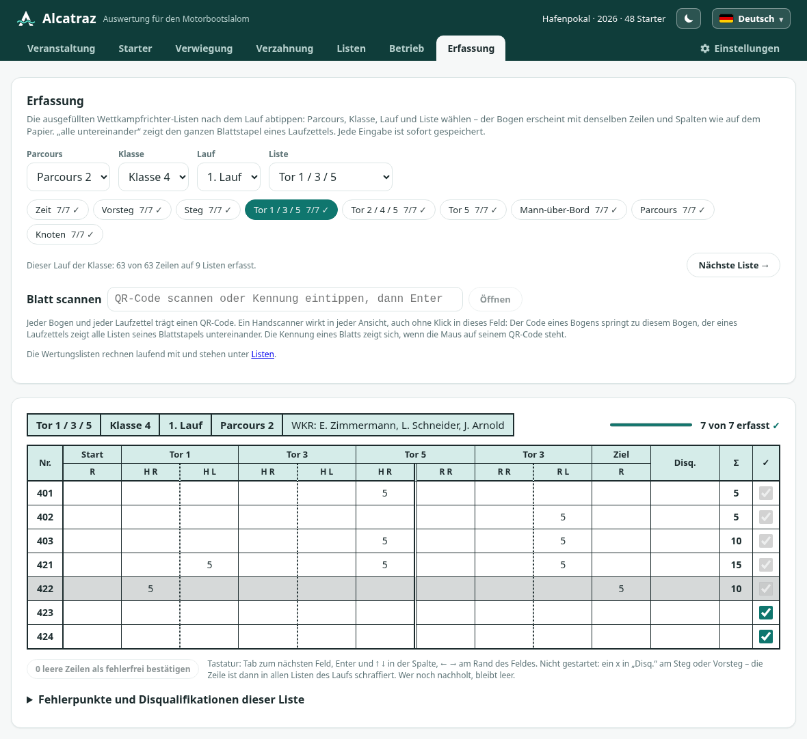</a>

- Die ausgefüllten Bögen werden nach dem Lauf abgetippt; derselbe Bogen wie auf dem Papier erscheint als
  Eingabetabelle, in derselben Zeilenfolge.
- Tastatur: Tab zum nächsten Feld, Enter und ↑ ↓ in der Spalte.
- Zeiten lassen sich kurz tippen: „83,45“ sind Sekunden, „1,2345“ oder „1:23,45“ ist 1:23,45 (Punkt oder Komma).
  Vor dem Trenner sind ab 20 Sekunden gemeint, darunter Minuten: „15,30“ ist 15:30,00 (`src/lib/time.ts`).
- Fortschritt je Bogen und Hinweise auf unplausible Eingaben – seit 24.11.2026 auch, wenn ein Code öfter steht, als
  er in einem Lauf vorkommen kann („Code 6 steht öfter als 2× … Disq. D?“). Gesetzt wird dabei nichts; es bleibt,
  was auf dem Papier steht.
- Ein QR-Code führt direkt zum Bogen bzw. Blattstapel (siehe [QR-Codes](#laufzettel-und-qr-codes)).
- Mit [gemeinsamen Bögen](#wettkampfrichter-listen) zeigt die Wahl einer Klasse den gemeinsamen Bogen, auf dem sie
  steht; „alle untereinander“ und der Scan eines Laufzettels bringen den Stapel des Parcours. Die Werte hängen am
  Starter, gewertet wird je Klasse.
- **Wiederholung nach Ausfall** (26.11.2026): An der Startnummer steht ↻ mit dem Hinweis „Wiederholung nach Ausfall –
  Werte der Wiederholung eintragen“. Auf Papier hat der Wettkampfrichter die Zeile gestrichen und die Wiederholung in
  eine Leerzeile eingetragen; die gestrichene Zeile gilt nicht. Am Vorsteg mit „Versuche direkt nacheinander“ gibt es
  kein ↻ (dort ist nichts gestrichen).
- Mit [digitaler WKR-Erfassung](#digitale-wkr-erfassung): ◆ an Werten vom Gerät (mit Liste, Gerät und Zeit),
  „Papier ansehen“ an Zeilen und Zellen, für die der Bogen gebraucht wird, und eine Nachfrage, bevor ein Wert vom Gerät
  überschrieben wird. Offene Rückfragen werden unter Betrieb → WKR entschieden.

## Wertung und Wertungslisten

<a href="bilder/de/wertungsliste.png">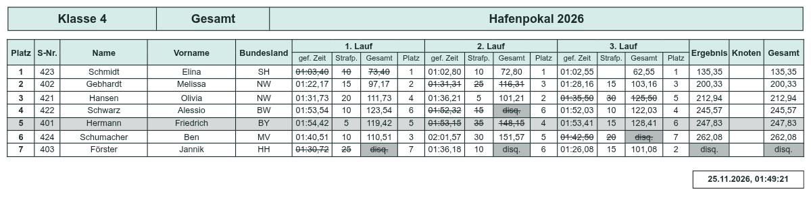</a>

- Die Wertung rechnen reine Funktionen (`src/lib/ergebnis.ts`, `scoring.ts`, `time.ts`, `codes.ts`, `disq.ts`).
- Wertungslisten gibt es je Klasse, Lauf und gesamt unter „Listen“, gedruckt in der Reihenfolge der Bögen:
  Parcours, dann Klasse nach Startreihenfolge.
- In einem Feld unter der Tabelle steht auf jeder Seite, wann sich die Liste zuletzt geändert hat
  (`src/lib/listenStand.ts`); einen Druckzeitpunkt im Seitenrand gibt es nicht.
- Je Liste lassen sich beide Reihenfolgen (Startnummer, dann Platz) in einem Druck ausgeben.

**Gleiche Punkte:** Es entscheidet der Stichentscheid des Regelwerks (`stichentscheid`).
DM: der schnellste gewertete Lauf. UIM nach Regel 960 Pkt. 5.2.6: die Summe beider Versuche.
Erst danach wird ein Platz geteilt. Ein so vergebener Platz trägt ein Sternchen; unter der Tabelle steht die Regel.

**Wer noch nicht gefahren ist,** steht ohne Zeit auf Platz 1.
Ein X (nicht gestartet) in einem Disq.-Feld des Laufs – am Steg, am Vorsteg oder vom Gerät – steht als „Nicht
gestartet“ auf der Liste und zählt wie eine Disqualifikation. Im Zwischenstand der Gesamtliste steht es hinten, bis
der Streichlauf den Lauf aufnimmt.

**Läufe und Streichläufe:**

- Sieht das Regelwerk eine Zahl von Läufen vor (`wertungslaeufe`), stellt die Wahl des Regelwerks sie gleich ein:
  UIM 2 Läufe und 1 Streichlauf (zwei Versuche, der bessere zählt), DM 3 Läufe und „nach Regel“.
  Unter DM streicht „nach Regel“ auch bei nur zwei Läufen einen (Reglement C6).
- Von Hand abweichen bleibt möglich; dann weist die Oberfläche darauf hin (unter DM nur Voreinstellung, kein Hinweis).
- Schon erfasste Werte eines Laufs, den es danach nicht mehr gibt, bleiben im Stand. Ein Hinweis nennt sie dort, wo man
  umstellt, unter „Einzelheiten“ je Starter mit Lauf, Liste und Feld (`src/components/EingabenHinweis.vue`).

### Aushang nach UIM (Regel 960, Pkt. 5.2)

Was ein Regelwerk für den Aushang verlangt, steht in seiner YAML-Datei (`aushang`, bisher nur `uim-2026.yaml`).

- Unter jeder Wertungsliste (je Versuch, Gesamtliste, Einzelwertung, Mannschaftswertung) stehen eine
  Unterschriftszeile „O.O.D.“ und ein leeres Feld „Time of posting“ – „All results must be signed by the O.O.D. and
  must show the time of posting.“ Der gedruckte Zeitstempel daneben bleibt die letzte Änderung.
- Die Gesamtliste des Manövrierens hat die Spalte „UIM points“ (Pkt. 5.2.1, Tabelle Pkt. 5.1), sobald die Klasse
  vollständig ist; ein geteilter Platz gibt beiden die vollen Punkte, Disqualifizierte haben 0.
- Sie hat nach Pkt. 5.2.1 keine Spalte „Result“: Attempts, „Knots pen.“, „Best time incl. knots pen.“, „UIM points“
  (15.11.2026). Die Gesamtliste der DM behält „Ergebnis“.
- Nirgends steht die Nummer einer Stage („stage 2“), nur der Name der Disziplin.
- Solange erst eine Disziplin gefahren ist, sagt das Blatt der UIM-Mannschaftswertung, worauf es beruht
  („Manoeuvring only – nothing has been recorded for Parallel slalom yet.“).

### Versuche direkt nacheinander (UIM)

„Einstellungen → Wertung“, nach Pkt. 4.3.2 „2 attempts, run consecutively“. Unter UIM eine Option, nicht vorgewählt
(15.11.2026): Manche Länder legen am Steg nur an und fahren gleich noch einmal, andere fahren die Versuche wie Läufe.
Der Schalter steht nur unter Regelwerken, die ihn kennen (`versucheNacheinander`).

**An:** Jeder Starter steht auf den Listen des Manövrierens zweimal direkt nacheinander.

- 1. und 2. Versuch stehen auf **einem** Klassenzettel, mit der Spalte „Attempt“ hinter der Startnummer und einer
  Trennlinie unter jedem Starter; geteilt wird nur zwischen Startern.
- **Vorsteg** (15.11.2026): Dort kommt der Starter nur einmal vorbei – eine Zeile je Starter, ohne „Attempt“
  (`einmalJeStarter`). Was dort steht, gilt für jeden Versuch; so zählt ein X vom Vorsteg in beiden.
  Steht in einem späteren Versuch schon etwas anderes, weist die Zeile darauf hin.
- Je Liste ein Bogen statt einer je Versuch, alle im selben Stapel, dazu **ein** Laufzettel je Klasse.
  Der QR-Code nennt den Stapel; die Erfassung zeigt denselben Bogen und schreibt jede Zeile unter ihren Versuch.
- Zwischen den Versuchen wird nichts ausgehängt.

**Aus:** je Versuch eigene Bögen und Laufzettel; vor dem letzten Versuch mit den Schritten für den Aushang.

## Mannschaftswertung

Die Mannschaftswertung rechnet je Herkunft – Verein, Bundesland oder Land – aus den Plätzen der Gesamtliste jeder
Klasse; eine eigene Listenart unter „Listen“ (`src/lib/pokal.ts`, `src/components/PokalListen.vue`).

**Drei Varianten,** die sich gleichzeitig einschalten lassen:

- Plätze 1–3: 10, 7, 5 Punkte.
- Plätze 1–6: 6 bis 1 Punkte; so rechnet die Mappe der DM 2026.
- UIM-Punkte: Plätze 1–20 nach Regel 960 Pkt. 5.1; je Herkunft zählen die fünf Besten, gewertet ab fünf Startern.

Punkte, Zahl der Besten und Mindestzahl sind unter „Einstellungen → Mannschaftswertung“ änderbar
(Vorgaben `pokalPunkte` in `src/config/einstellungen.yaml` und `pokal` im Regelwerk).

**Gleichstand** (`pokal.stichentscheid`): DM (C6) die Zahl der 1. Plätze, dann der 2. und 3.; UIM (Pkt. 5.2.6) die
Punkte der 1. Plätze, dann der 2. … Erst danach teilen sie sich den Platz; der Platz trägt ein Sternchen.

**Wer zählt:**

- Disqualifizierte, Offene und Starter ohne Herkunft bekommen keine Punkte.
- Schreibweisen, die sich nur in Groß-/Kleinschreibung oder Leerzeichen unterscheiden, gelten als dieselbe; bei
  Bundesland und Land auch jede erkannte Schreibweise (siehe [Herkunft und Flaggen](#herkunft-und-flaggen)).
- Wahlweise zählen nur ausgewählte Starter (Spalte mit Kästchen im Reiter „Starter“). Wer nicht gewählt ist, behält
  seinen Platz, bekommt aber keine Punkte. Die Auswahl steht in Sicherung und Teilnehmerdaten.

**Zwischenstand:** Solange nicht jede Klasse ihr Endergebnis hat, ist die Liste als Zwischenstand gekennzeichnet.
Eine Klasse zählt dann mit ihrer Gesamtliste, wie sie gerade steht; Offene bekommen nichts.

**Druck:** je Variante ein Dokument – Plätze quer, UIM hoch – mit dem Zeitstempel der jüngsten Gesamtliste aller
Klassen (`wertungZeit` in `src/lib/listenStand.ts`); er läuft nie rückwärts.

Unter Regel 960 mit Parallelslalom: siehe [Mannschaftswertung UIM](parallelslalom.md#mannschaftswertung-uim).

<a href="bilder/de/mannschaftswertung.png">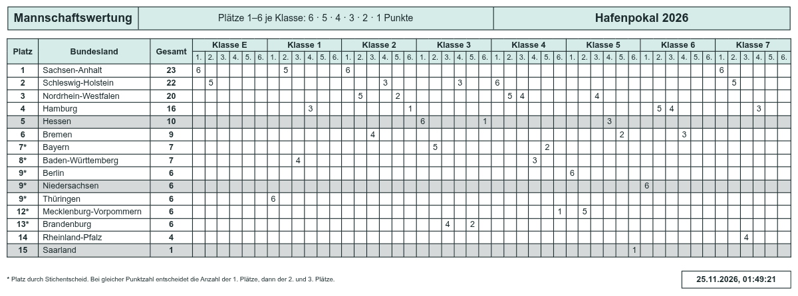</a>

## Weitere Listen und Druck

### Starterlisten und Vorsteg-Liste

Die Starterlisten sind ein Reiter mit der Auswahl „Art“ (`src/lib/starterlisten.ts`):
verzahnt (auf Wunsch mit hervorgehobenen Startern einer Herkunft für die Mannschaftsleiter), je Herkunft nach
Startnummer, nach Klasse und unter Regel 960 „Parallel-Slalom“
([Startliste je Racecourse](parallelslalom.md#startliste-je-racecourse)). Die Vorsteg-Liste ist eine eigene Listenart.

### Aushang der Codes

Eine eigene Listenart: alle Fehler- und Disqualifikations-Codes des Regelwerks mit Quelle auf einem A4-Blatt
(`src/components/CodesAushang.vue`).

### Druckdatei

Die Druckdatei ist der letzte Reiter unter „Listen“ (`src/lib/druckdatei.ts`): die Datei, die nach dem Wettkampf an
die teilnehmenden Gruppen geht.

- Inhalt: die verzahnte Starterliste je Parcours, die eingeschalteten Mannschaftswertungen (UIM-Punkte vor Plätzen),
  die Erklärung der Fehlerpunkte und Disqualifikationen, dann je Klasse die Läufe und die Gesamtliste nach Platz.
- Alles in einem Druck: „Als PDF speichern“ ergibt eine Datei; Hoch- und Querformat wechseln, jedes Dokument zählt
  seine Seiten selbst. Teile, Umfang und Klassen sind abwählbar.
- Zwei Fassungen: „Extern“ wie der Aushang (Namen gekürzt oder weggelassen, nie ein Geburtsdatum); „Intern“ mit vollen
  Namen und, wenn eingeschaltet, dem Geburtsdatum auf der Starterliste.
- Solange nicht jede Klasse ihr Endergebnis hat, nennt ein Hinweis die fehlenden Läufe.
- **Nach Regel 960** (15.11.2026): Mannschaftswertung, Legende der Codes, Einzelwertung, dann je Disziplin mit Werten
  deren Listen – vor dem Manövrieren die verzahnte Starterliste, vor jeder Runde des Parallelslaloms deren Startliste.
  Die Druckdatei der DM bleibt in der Ordnung der Vorlage. Die Liste nach Pkt. 3.7 steht in keiner Druckdatei.

### Logos

Einstellungen → „Logos auf den Listen“ (`src/components/LogosPanel.vue`, 16.11.2026): zwei Plätze, „Logo links“ und
„Logo rechts“, anfangs leer. Ohne Logo sieht jede Liste aus wie vorher.

- Sie stehen neben dem Kopf jeder Seite der Listen, auf den WKR-Bögen in der Titelleiste vor dem QR-Code, auf den
  Laufzetteln als Streifen über dem Titel und auf der Anzeigetafel neben der Kopfzeile.
- Höhe 8–30 mm (Vorgabe 15 mm), auf den WKR-Bögen höchstens 12 mm; höhere Logos kosten Zeilen, die Listen teilen neu.
- Hochladen: PNG, JPEG, WebP, GIF oder SVG bis 20 MB; das Bild wird im Browser verkleinert (höchstens rund 100 kB je
  Logo), Metadaten fallen weg. Unter 200 dpi weist die Einstellung darauf hin.
- Sicherung und Vorlage tragen die Logos; über den Gerätebetrieb gehen sie nie.

### Doppelseitig drucken

Bei Listenarten mit mehreren Dokumenten in einem Druck schaltet „doppelseitig drucken“ jedes Dokument auf ein neues
Blatt; nach ungerader Seitenzahl folgt eine leere Seite, die nicht mitzählt (`src/lib/doppelseitig.ts`).

### Farben

Am Bildschirm folgen Listen und Bögen dem Farbschema (auch dunkel); gedruckt sind sie schwarz auf weiß mit grauer
Fünfer-Zeile. Ihre Farben kommen nur aus `--blatt-*` in `src/styles/blatt.css`; Logos drucken in ihren eigenen Farben.

## Sperren und Prüfungen

Jeweils in Oberfläche und Reducer. Die Punkte mit Datum sind Entscheidungen vom 15.11.2026, wo nichts anderes steht.

- **Starterfeld:** Sobald der erste Wert erfasst ist, lassen sich Starter weder importieren noch hinzufügen oder
  entfernen (`starterfeldFest`). Angaben ändern, eine Sicherung laden und Zurücksetzen gehen weiter.
  Wer nicht mehr fährt, wird stattdessen **als nicht gestartet eingetragen**: ein X im Disq.-Feld am Steg in jedem
  Lauf ohne Werte, unter UIM auch in den festgeschriebenen Runden des Parallelslaloms (`src/lib/abmeldung.ts`);
  ↺ nimmt die Abmeldung zurück.
- **Regelwerk:** Sobald Ergebnisse erfasst sind, lässt es sich nicht mehr wechseln, bis alle Werte gelöscht sind;
  auch eine Vorlage wechselt es dann nicht.
- **Klasse eines Starters:** fest, sobald die Verzahnung bzw. der Startplan des Parallelslaloms festgeschrieben ist.
  Eine freie Wahl der Klasse gibt es nicht; nur wenn ein geändertes Geburtsdatum in eine andere Klasse gehört, schlägt
  die Oberfläche „In Klasse X verschieben“ vor.
- **Reihenfolge der Starter:** „Sortierung ändern“ macht die Spaltenköpfe Name, Vorname, Herkunft, Größe, Geschlecht
  und Geburtsdatum zu Knöpfen – je Klasse und für alle zugleich. Drei Stufen je Kopf (21.11.2026): aufsteigend (↑),
  absteigend (↓), Markierung weg (↕); gleiche Werte behalten ihre Reihenfolge, ohne Angabe steht hinten. „Zufall“
  mischt jedes Mal neu. Die vorhandenen Startnummern werden nur neu verteilt (`src/lib/reihenfolge.ts`).
  Gesperrt, sobald die Verzahnung festgeschrieben ist, ebenso ▲▼; Startnummern von Hand bleiben frei.
- **WKR-Listen drucken:** erst, wenn die Verzahnung festgeschrieben ist; vorher führt ein Hinweis zur Verzahnung, und
  Strg+P bringt nur diesen aufs Papier. Die Listen des Parallelslaloms hängen an ihren festgeschriebenen Runden.
- **Jahrgang und Klasse:** Ein Geburtsjahr, das nicht in die Klasse gehört, wird abgewiesen – beim Einfügen aus Excel,
  beim Einspielen von Teilnehmerdaten, beim Hinzufügen und beim Ändern des Geburtsdatums
  (`src/import/klassenPruefung.ts`).
  Gehört es in eine andere Klasse, steht ein Vorschlag darunter: „In Klasse X anlegen“, „In Klasse X verschieben“,
  beim Excel-Import je Zeile „In Klasse X übernehmen“ und „Alle beheben“ (16.11.2026). Passt der Jahrgang in keine
  Klasse, nennt die Meldung die Jahrgänge, die überhaupt starten. Ohne Geburtsdatum fällt der Starter als „fehlt“ auf.
- **Starterlaubnis nach Geburtstag** (24.11.2026, zwei Stufen seit 26.11.2026; nur DM, Reglement C8: Klasse E ab dem
  6., Klasse 7 bis zum 27. Geburtstag; `geburtstagsGrenzen` im Regelwerk, Tage in `GEBURTSTAG_FENSTER`,
  `src/import/klassenPruefung.ts`): Warnung und Hinweis im Reiter „Starter“, die man übergehen kann – gesperrt,
  verschoben oder abgefragt wird nichts, es gibt nichts zu bestätigen. UIM kennt keine Geburtstagsgrenzen.
  Gemessen wird am Datum der Veranstaltung (erster Wettkampftag); geht sie über mehrere Tage, zählt der Tag, an dem
  der Starter startet.
  - **Deutliche Warnung (rot):** Der 6. bzw. 27. Geburtstag liegt höchstens 2 Tage vor oder nach dem ersten
    Wettkampftag, oder der Starter ist an dem Tag klar zu jung oder zu alt. Im Kopf der Klasse die rote Marke
    „2 Geburtstage: Warnung“ (auch zugeklappt), offen ein roter Kasten „Achtung, Starterlaubnis nach Geburtstag –
    bitte prüfen, gesperrt ist nichts:“ mit einem Satz je Starter, etwa (erster Wettkampftag 05.09.2026): „Vor1 Nach1
    wird am 04.09.2026 6 Jahre alt (1 Tag vor dem ersten Wettkampftag) – darf in Klasse E erst ab diesem Tag
    starten.“ bzw. „… wird am 06.09.2026
    27 Jahre alt (1 Tag nach dem ersten Wettkampftag) – darf in Klasse 7 nur bis zum 05.09.2026 starten.“ (der letzte
    Tag ist der vor dem 27. Geburtstag). Darf er am ersten Wettkampftag schon nicht starten, sagt der Satz das dazu:
    „… (1 Tag nach dem ersten Wettkampftag) – darf in Klasse E erst ab diesem Tag starten, am ersten Wettkampftag also
    noch nicht.“ bzw. „… (am ersten Wettkampftag) – darf in Klasse 7 nur bis zum 04.09.2026 starten, am ersten
    Wettkampftag also schon nicht mehr.“ Klar außerhalb: „6. Geburtstag erst am … – Starterlaubnis in Klasse E ab dem
    6. Geburtstag.“
  - **Hinweis (gelb):** Der Starter darf am ersten Wettkampftag starten, aber der Geburtstag liegt 3 bis 14 Tage davor
    (Klasse E) bzw. danach (Klasse 7). Gelbe Marke „1 Geburtstag prüfen“ und ein gelber Kasten „Starterlaubnis nach
    Geburtstag – nur ein Hinweis, nichts ist gesperrt:“, etwa „Geburtstag nahe am Wettkampftag: Vor1 Nach1 wird am
    27.08.2026 6 Jahre alt (9 Tage vor dem ersten Wettkampftag) – Starterlaubnis in Klasse E ab dem 6. Geburtstag,
    bitte prüfen.“
  - Jeder Starter zählt im Kopf nur einmal, in seiner stärkeren Stufe. Das „!“ am Geburtsdatum ist rot bzw. gelb, die
    Zelle hat links einen roten bzw. gelben Rand. Auf dem Handy brechen Name, Starterzahl und Marken im Klassenkopf um.
    Ein Satz unter den Kästen nennt den Tag und beide Spannen.
  - **Ohne Datum** zählt nur das Jahr: Die Grenz-Jahrgänge stehen gelb da, mit dem Tag des Geburtstags („vor dem
    Wettkampftag?“); wer nach dem Jahr sicher außerhalb liegt, steht rot da. Der Satz darunter sagt, dass die Prüfung
    mit Datum auf den Tag genau rechnet und dann nur noch nennt, wer an dem Tag zu jung oder zu alt ist oder bis 14 Tage
    davor oder danach Geburtstag hat.
  - Bestätigt 26.11.2026: am 27. Geburtstag selbst nicht mehr; ohne Datum die ganzen Grenz-Jahrgänge. Ausgelegt und
    noch zu bestätigen: Der 29.02. wird in Jahren ohne ihn zum 01.03.; „weniger als 2 Tage“ schließt den 2. Tag ein;
    Klasse E mit dem 6. Geburtstag 3 bis 14 Tage nach dem ersten Wettkampftag ist „zu jung“ (rot), kein Hinweis.
- **Datumsfelder:** nie die Datumswahl des Browsers (sie zeigte je nach System mm/dd/yyyy), sondern ein Textfeld:
  deutsch TT.MM.JJJJ, englisch JJJJ-MM-TT (`src/components/DatumFeld.vue`). Erkannt werden auch 2019-12-01, 1.12.2019
  und 01/12/2019 (Schrägstrich: Tag zuerst); ein Datum, das es nicht gibt, wird gemeldet. Gespeichert wird JJJJ-MM-TT.
  Der Excel-Import liest dieselben Schreibweisen, dazu ein Jahr allein und Excel-Seriennummern.
- **Startnummern mit Buchstaben:** E01 und D01 sortieren überall vor 101, 201 … (`vergleicheStartNr` – die eine
  Stelle für Listen, Wertung, Verzahnung und die Paare des Parallelslaloms).
- **DM, Disqualifikation S „Bremsen mit der Hand beim Anlegen“** – nur auf der Steg-Liste (Reglement C5 d).
- **„X“** (nicht gestartet) steht in jedem Regelwerk; „O“ wird nie vergeben.

## Parallelslalom und Einzelwertung (Regel 960)

Unter Regel 960 kommen der Parallelslalom, die Einzelwertung über beide Stages und die Mannschaftswertung UIM dazu.
Alles dazu steht auf einer eigenen Seite: [parallelslalom.md](parallelslalom.md).

- Startplan des Vorlaufs mit Racecourse A und B, Dummys bei ungerader Zahl, Runden danach (Halbfinale, Kleines Finale,
  Finale) und Re-run; die Wertung legt nur aus, wo Regel 960 schweigt (`PARALLEL_ANNAHMEN`, bestätigt 24.11.2026).
- **Einzelwertung:** je Klasse und Disziplin Zeit, Platz und UIM points, dazu die Summe. Bei gleicher Summe entscheidet
  nach Pkt. 5.2.6 die Zeit – seit 24.11.2026 im Parallelslalom die beiden Attempts der letzten gefahrenen Runde, bei
  gleicher Zeit dazu die der vorletzten ([Einzelwertung](parallelslalom.md#einzelwertung)).

<a href="bilder/de/parallel-results.png">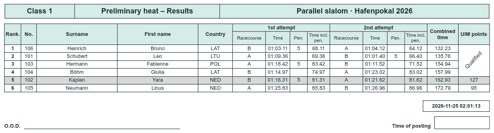</a>

## Beispieldaten

Die Beispieldaten stehen am Ende von „Veranstaltung“ (`src/components/BeispieldatenPanel.vue`), zugeklappt, solange
nicht mit ihnen gearbeitet wird. Alle Namen sind erfunden.

**Beispiel-Starterfeld:**

- Eine **Gesamtzahl** als Vorschlag nach der Art der Veranstaltung (21.11.2026, `BEISPIEL_STARTERZAHL` in
  `src/domain/generate.ts`): Clubmeisterschaft 10–20, Meisterschaft mit Vereinen oder ohne Herkunft 45–75, nach
  Bundesländern oder Ländern 100–160. „Vorschlag neu“ zieht neu.
- Die Zahl je Klasse ist ein eigenes Feld (0–999); daneben die Summe. Von Hand gesetzte Zahlen bleiben bei einer
  neuen Gesamtzahl; „Zurücksetzen“ vergisst sie, „Vorschlag neu“ ersetzt alles. Verteilt wird nach festen Anteilen
  (`BEISPIEL_KLASSEN_ANTEILE`: E 4 %, 1 9 %, 2 13 %, 3 15 %, 4 15 %, 5 18 %, 6 11 %, 7 15 % – aus drei Starterlisten
  2025/2026, ohne Daten daraus); unter UIM dieselben Anteile auf E bis 5.
- Die Herkunft folgt der Veranstaltung, **unabhängig vom Regelwerk** (15.11.2026): Vereine, Bundesländer, Länder
  (englische Namen, Kürzel nach IOC) oder ohne; die Clubmeisterschaft bekommt keine. „Herkünfte“ begrenzt ihre Zahl –
  zum Prüfen der Mannschaftswertung.
- Ein Geschlecht bekommen Beispielstarter nur unter einem Regelwerk mit Parallelslalom (für die Liste nach Pkt. 3.7).

**Beispielwerte:** eine Auswahl – das Manövrieren bis Lauf n oder eine Runde des Parallelslaloms (erst wählbar, wenn
ihr Startplan festgeschrieben ist).

- „Beispielwerte einfügen“ füllt nur das Gewählte, in den Runden nach dem Vorlauf nur leere Attempts.
- „Werte des Gewählten löschen“ löscht nur dessen Werte; Abgemeldete bekommen ihr X zurück. „Alle erfassten Werte
  löschen“ bleibt.
- Abgemeldete bekommen keine Beispielwerte. Die Werte folgen gerundeten Kennzahlen je Klasse, ohne einzelne Ergebnisse.

**Beispiel-Besetzung, -Gewichte, -Boote und -Co-Piloten** haben je einen eigenen Knopf (`src/lib/beispieldaten.ts`,
deterministisch über `saat`; seit 21.11.2026 nur hier):

- Die Besetzung füllt jede gedruckte Liste der WKR-Einteilung je Parcours mit zwei bis drei erfundenen Personen,
  höchstens 40 Zeichen, damit der Eintrag im Bogenkopf auf eine Zeile passt.
- Die Gewichte liegen um das Durchschnittsgewicht der Klasse; 40 % sind mindestens eine halbe Stufe leichter, damit
  Ausgleichsgewichte entstehen.
- Jede Klasse bekommt einen erfundenen Bootsnamen (`src/data/boote.ts`). „Beispiel-Co-Piloten“ trägt je Klasse, in
  der das Regelwerk einen Co-Piloten vorsieht, einen erfundenen Co-Piloten und einen Ersatz ein, beide mit erfundenem
  Gewicht von 55–95 kg – so steht auf den Listen ein Ausgleichsgewicht. Die Rückfrage vor dem Ersetzen lautet „…
  Durch erfundene Namen und Gewichte ersetzen?“.
- Steht schon etwas da, fragt die App vor dem Ersetzen. Jeder Knopf bekommt einen eigenen Eintrag im Verlauf.
