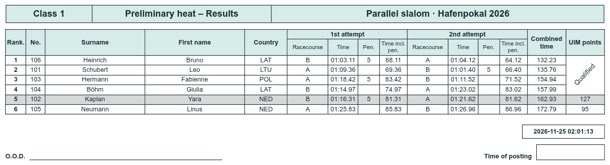

Deutsch · [English](en/parallelslalom.md)

# Parallelslalom und Einzelwertung (Regel 960)

Was Alcatraz unter UIM Regel 960 „Formula Future“ für den Parallelslalom und die Wertung über beide Stages kann.
Das Manövrieren und alles Gemeinsame steht in [funktionen.md](funktionen.md).
Warum etwas so ist, steht mit Datum in [entscheidungen.md](entscheidungen.md).
„Entscheidung vom …“ meint hier immer eine Entscheidung des Nutzers.

## Inhalt

- [Überblick](#überblick)
- [Startplan des Vorlaufs](#startplan-des-vorlaufs)
- [WKR-Listen des Vorlaufs](#wkr-listen-des-vorlaufs)
- [Erfassung im Parallelslalom](#erfassung-im-parallelslalom)
- [race officials](#race-officials)
- [Startliste je Racecourse](#startliste-je-racecourse)
- [Wertung des Vorlaufs](#wertung-des-vorlaufs)
- [Runden nach dem Vorlauf](#runden-nach-dem-vorlauf)
  - [Annahmen](#annahmen)
- [Abmelden](#abmelden)
- [Betrieb: Start-Freigabe und Anzeigetafel](#betrieb-start-freigabe-und-anzeigetafel)
  - [Wiederholung nach Ausfall](#wiederholung-nach-ausfall)
  - [WKR-Erfassung am Gerät](#wkr-erfassung-am-gerät)
- [Dummys und Wörter](#dummys-und-wörter)
- [Einzelwertung](#einzelwertung)
  - [Disziplin nicht werten](#disziplin-nicht-werten)
  - [Mannschaftswertung UIM](#mannschaftswertung-uim)
  - [Festlegungen zum Stichentscheid](#festlegungen-zum-stichentscheid)

## Überblick

Alcatraz rechnet den Startplan des Vorlaufs
(`src/planung/parallel.ts`, `src/planung/parallelRunden.ts`, Ansicht „Verzahnung → Parallel-Slalom“).
Dazu je Klasse Halbfinale, Kleines Finale, Finale und Wiederholung (Re-run) bis zum Gesamtergebnis der Stage.
Jede Runde ist in sich geschlossen (seit 21.11.2026 auch Kleines Finale und Finale getrennt): eigener Plan,
WKR-Listen, Laufzettel, Startliste, Erfassung, Wertungslisten und ein eigener Punkt im Betrieb, der für sich
begonnen wird.
Daraus entstehen die Einzelwertung über beide Stages und die Mannschaftswertung UIM aus den Punkten beider Stages
(siehe [Einzelwertung](#einzelwertung)).
Wo Regel 960 schweigt, legt Alcatraz an einer Stelle aus (`PARALLEL_ANNAHMEN`); der Nutzer hat diese Annahmen am
24.11.2026 alle bestätigt (siehe [Annahmen](#annahmen)).
Den Parallelslalom gibt es nur unter einem Regelwerk mit der Disziplin `parallel` (Regel 960), also bis Klasse 5.
Der frühere Zustand `parallelInternational` (nationaler Parallelslalom) ist entfallen; alte Sicherungen laden weiter.

## Startplan des Vorlaufs

- **Paare nach Klassen** (Pkt. 4.4 „Two drivers from the same class shall start at the same time“):
  Vorgabe ist die strenge Klassentrennung
  (`parallelStreng`, Schalter in der Ansicht) mit einem Dummy je ungerader Klasse.
  Ausgeschaltet fährt der Übrige gegen den ersten der nächsten Klasse im gleichen Boot.
  Einen Dummy gibt es dann nur bei ungerader Starterzahl eines Bootstyps.
  Die frühere Paarung nur nach Bootstyp (Dolphin gegen Klasse 3) gibt es nicht mehr.
  Dummy, Bootstypen und Blöcke stehen nicht im Regelbuch – sie sind Organisation.
- **Reihenfolge:** Die Klassen bleiben zusammen.
  „Klassen in der Reihenfolge ihrer kleinsten Startnummer“ ordnet die Klassen eines Bootstyps nach ihrer kleinsten
  Nummer statt in der festen Folge.
  Gedacht ist das für klassische Nummern; bei Nummern je Klasse stünde Dolphin wegen des „E“ hinter den Klassen 1 bis 3.
  Blöcke (kleines und großes Paar im Wechsel) und der Tausch im 2. Versuch sind geblieben.
  Der frühere Start eines Paares ist der 1. Versuch (Attempt).
- **Festgeschriebener Plan:**
  - Einfrieren: „Verzahnung festschreiben“ friert den Vorlauf ein
    (`parallelPlaene.pre`: je Start die Starter-IDs auf A und B, Attempt, Block, Bootstyp
    – keine Namen, keine Startnummern).
    Danach wird er nicht neu gerechnet.
  - Meldungen: Die Ansicht meldet Nachgemeldete, entfernte Starter und Klassenwechsel, statt sie einzureihen.
    An der Stelle eines entfernten Starters steht ein Dummy.
    Fehlen beide eines Paares, steht der Start als „entfällt“ an seiner Position.
  - Nachzügler: Aufgenommen werden sie durch Freigeben und erneutes Festschreiben.
    Ein älterer Stand mit festgeschriebener Verzahnung bekommt seinen Plan beim Laden.
  - Sicherung und Vorlage: Der Plan steht in der Sicherung, nicht in der Vorlage (er hängt an den Startern);
    `parallelStreng` reist in beiden mit.
    Bleibt beim Anwenden einer Vorlage der hiesige feste Plan stehen
    (hier festgeschrieben, und die Vorlage bringt die Sperre mit),
    bleiben auch die drei Schalter, nach denen er gerechnet wurde
    (`parallelStreng`, `class4Small`, `parallelOrderByStartNr`) – wie im Reducer, der sie bei gesetzter Sperre sperrt.
- **Klassische Startnummern** mit der Reihenfolge „Parallel-Slalom“ folgen demselben Plan wie die Anzeige
  (`vorlaufPlan`), bei festgeschriebener Verzahnung also dem festen.
  Erneutes Vergeben ändert dann keine Nummer.
  Wer nach dem Festschreiben gemeldet wurde, bekommt die nächste Nummer hinter allen anderen.
  Die Nummer eines entfernten Starters bleibt als Lücke frei; niemand rückt auf.

## WKR-Listen des Vorlaufs

`src/lib/parallelBogen.ts`, „Listen → Wettkampfrichter-Listen → Parallel-Slalom“.

- Je Runde sechs Listen: je Racecourse A und B Zeit, Steg und Fahrweg aus dem Aufbau `parallel`
  (`aufbauFuer` in `src/config/catalog.ts`; im Stand steht dafür nichts, es gibt genau einen).
- Die Zeilen sind die Starts des **festgeschriebenen** Plans in seiner Reihenfolge, über alle Klassen.
  Vorn stehen die Spalten Start, Nr., Klasse, Attempt.
  Zeile n ist auf allen sechs Listen derselbe Start.
- Ohne festgeschriebenen Plan gibt es keine Liste, nur den Hinweis.
- Annahmen (Organisation, nicht Regel 960): keine Leerzeilen;
  ein Dummy und ein entfallener Start stehen als schraffierte Zeile ohne Eingabe;
  am Ende eines Blocks steht eine Linie.
- Die Steg-Liste hat hier keine Spalte „Bemerkung“ (`ohneSpalten` am Aufbau, `config/aufbauten/parallel.yaml`).
  Die Fahrweg-Liste hat eine Σ-Spalte hinter „Disq.“ wie die Fahrweg-Listen des Manövrierens mit Bojen.
- `config/validate.ts` prüft, dass die Spalten der Parallel-Listen nicht von der Klasse abhängen (`PARALLEL_KLASSEN`).
- **Zeichnung der Bahn** (23.11.2026 nach R9-05 bis R9-07: „… auf den Listen und auf dem Gerät nur einer der zwei
  Parcours und ohne Steg“; `PARALLEL_BOGEN_BILD` in `src/lib/parallelBogen.ts`): Der Fahrweg-Bogen trägt die eine
  Bahn aus `src/assets/parcours/Parallel.svg` – dieselbe Zeichnung wie die Maske „Bild“ des Geräts, für A und B
  gleich, nichts gedimmt; welcher Racecourse, steht im Kopf. Darunter im Fuß die Namensnennung (CC BY-NC-SA 4.0),
  am Bildschirm unter den Bögen dieselbe mit Links. Beim Bau ausgelegt, bestätigt 24.11.2026 (R10-04 bis R10-07):
  - nur der Fahrweg-Bogen (die Liste mit Bojen-Spalten, `parallelListeMitBild`) – wie im Manövrieren nur Listen mit
    Bojen, MüB oder Parcours ein Bild haben; Zeit und Steg bleiben ohne;
  - vorn **rechts neben der Legende** (den Disqualifikationen), höchstens so hoch wie sie, in einem 100 mm breiten
    Rahmen (`.bogen--bild-streifen` in `src/styles/bogen.css`). Einsprachig ist der Platz dort ohnehin frei, die
    Zeilen je Blatt, die Seitenzahlen und die Kästchen der Laufzettel bleiben gleich (im Browser gemessen: Fuß
    40,2 mm mit und ohne Zeichnung, deutsch und englisch, 31 Zeilen je Blatt); die Zeichnung ist 94 × 22 mm groß
    (Bojen 1,7 mm, Ziffern rund 4,5 pt – knapp). Unter der Legende in voller Breite kostete sie rund acht Zeilen je
    Blatt. Zweisprachig ist die Legende 144 mm breit: Damit die Zeichnung lesbar bleibt (vorher daneben nur
    45 × 11 mm, Bojen 0,8 mm – Prüfbefund 23.11.2026), bricht die Legende auf rund 91 mm um; die Zeichnung ist dann
    98 × 23 mm, der Bogen fasst 24 statt 26 Zeilen je Blatt;
  - die Namensnennung im Fuß steht in der Sprache des Bogens (zweisprachig je Teil „deutsch / englisch“), nicht in
    der Sprache der Oberfläche;
  - mit „Beschreibung auf der Rückseite“ steht sie dort unter der Legende in voller Breite (wie die Bilder der
    Klassen-Bögen auf der Rückseite).

**Englische Spaltenköpfe:**

- Steg-Liste nach Regel 960 (Pkt. 4.1 „leaving the starting pontoon“, 4.1.1 „Mooring“):
  „Leaving: codes / pen.“ und „Mooring: codes / pen.“ – auch auf der Steg-Liste des Manövrierens.
- Auf den englischen Wertungslisten ebenso nach dem Rulebook gekürzt: „Leav.“ und „Moor.“ statt „Dep.“ und „Moor“
  (Entscheidung vom 15.11.2026: Die Sprache des Rulebooks hat Vorrang).
- Die übrigen englischen Spaltenköpfe sind gegen Regel 960 geprüft:
  - „Rank.“ (5.2.1/5.2.2 „ranking“), „Time“, „Pen.“ („penalties“),
  - „Time incl. pen.“ („times including penalties“) – jetzt auch je Attempt auf der Gesamtliste
    und dem Result einer Runde statt „Total“,
  - „Knots“ („knots test penalties“), „Combined time“ (5.2.2 „combined times“, 5.2.6 „best combined times“),
  - „UIM points“, „UIM combined points“ (5.2.3), „Fin.“ („finishing line“), „MOB“ („man-over-board“),
  - „DSQ“ (Rulebook, allgemeiner Teil: „DSQ – Disqualified“).

**Seiten:** Eine Seite endet nur am Blockende (`gruppenSeiten` in `src/lib/paging.ts`; ein Block sind 4 bzw. 2 Starts).

- **Jede Liste teilt für sich, mit so wenigen Seiten wie möglich** (Entscheidung vom 15.11.2026).
  Die Zeit-Liste fasst mehr Starts als Steg und Fahrweg.
  Seite n trägt also nicht überall dieselben Starts; was zusammengehört, sagt die Spalte „Start“.
- **Seiten ausgleichen** (Entscheidung vom 15.11.2026 abends): Auf diese Seitenzahl werden die Starts gleichmäßig
  verteilt – statt 32 + 32 + 6 also 24 + 24 + 22.
  Erst die kleinste Obergrenze je Seite, mit der es bei der Seitenzahl bleibt.
  Dann die Blöcke so verteilt, dass die kürzeste Seite so lang wie möglich ist (`gruppenVerteilen`).
  40 Starts bei 12 je Seite also 12 + 12 + 8 + 8, nicht 12 + 12 + 12 + 4.
  Bei gleich guten Verteilungen sind die vorderen Seiten die volleren.
  Laufzettel-Kästchen und QR-Seitennummern folgen von selbst, weil die Zahl der Seiten gleich bleibt.
- „Starter je Seite“ und „Teilen ab“ gelten als Obergrenze, abgerundet auf Blockenden (`gruppenKapazitaet`).
- Gemessen (Chromium, A4 hoch, Beschreibung vorn): Zeit 32–34 Starts je Seite, Steg 24, Fahrweg 28–30;
  zweisprachig Zeit 32, Steg 16–18, Fahrweg 24–26 (mit der Zeichnung seit 23.11.2026 zwei Zeilen weniger, s. o.).
- Listen-Option „jede zweite Zeile grau“ (`parallelZebra`): **Vorgabe an** (Entscheidung vom 15.11.2026),
  abschaltbar, in Sicherung und Vorlage.
  Die Zeile eines Dummys bleibt schraffiert und hebt sich mit kräftigerer Schraffur und kursivem „Dummy“ davon ab.

**QR-Code:** Format `ALC2` mit Runde und Racecourse
(`ALC2.<Kennung>.<Regelwerk>.<Aufbau>.<Runde>.<A|B>[.<Liste>.S<Seite>]`, `src/lib/qr.ts`).
Der Laufzettel nennt seinen Racecourse und öffnet nur dessen Listen.
`ALC1` bleibt für das Manövrieren und wird weiter gelesen.

**Laufzettel** je Runde statt je Klasse und Lauf, **immer getrennt je Racecourse** (Entscheidung vom 15.11.2026 abends).

- Ein Zettel A und ein Zettel B, jeder mit den Kästchen seiner drei Listen.
- **Ein Kästchen je gedrucktem Blatt:** Jede Liste hat ihre eigene Seitenzahl
  (`components/ParallelMessung.vue` misst je Liste).
- Jeder Zettel hat einen eigenen QR-Code, der in der Erfassung nur diese drei Listen öffnet
  (`rundenZettel` in `src/lib/parallelBogen.ts`, `src/components/ParallelLaufzettel.vue`).
- Er dient dazu, die richtigen Blätter einzusammeln und zusammenzuhalten.
- Die Schritte der Auswertung (Ergebnisse sortiert, geprüft, unterschrieben, ausgehängt, an die Mannschaftsleiter
  geschickt) stehen nur auf Zettel A – die Runde wird einmal ausgewertet.
  Zettel B sagt an derselben Stelle, wo sie stehen: „Auswertung: siehe Laufzettel Parcours A“ (16.11.2026).
- Passen die Kästchen auch dicht gesetzt nicht, sagt es der Zettel; nichts wird zu Seitenbereichen zusammengefasst.

## Erfassung im Parallelslalom

- Unter einem Regelwerk mit Parallelslalom steht die Disziplin zur Wahl;
  im Parallelslalom wählt man Racecourse und Liste.
- Ist oben ein Racecourse gewählt, erscheint unten nichts vom anderen – weder in den Reitern noch unter
  „alle untereinander“ (Entscheidung vom 15.11.2026).
  Der Laufzettel eines Racecourse öffnet nur dessen drei Listen.
- Start und Ziel haben je zwei Zellen „L“ und „R“. Im Kopf der Erfassungstabelle trägt auch die letzte
  Unter-Spalte ihre senkrechte Linie, z. B. „R“ unter „Ziel“ vor „Disq.“ – wie auf dem gedruckten Bogen
  (`styles/erfassung.css`).
- Gespeichert wird je Starter-ID und Attempt unter dem Lauf-Schlüssel `parallel:pre/1` bzw. `/2`
  (`src/lib/parallelSchluessel.ts`).
  Der Racecourse steht nicht im Schlüssel; er folgt aus dem Plan (der frühere Start ist der 1. Attempt).
- Die Zeile eines Dummys hat keine Felder und wird übersprungen.
- Diese Werte gelten nicht als „verborgen“, solange Plan, Attempt und Feld zu einer Liste gehören.
- Nach einer [Wiederholung nach Ausfall](#wiederholung-nach-ausfall) (27.11.2026) steht ↻ an der Nummer – nur in der
  Zeile des Boots, das wiederholt.

**Plan und Werte:**

- Sobald zum Vorlauf Werte erfasst sind, bleibt sein Plan festgeschrieben, auch bei freigegebener Verzahnung.
  Die Schalter des Plans (streng, Klasse 4 klein, Reihenfolge) sind dann gesperrt (`vorlaufGebunden`),
  auch gegenüber einer Vorlage ohne Sperre.
- Gelöst wird das **nur über „Alle erfassten Werte löschen“** (Entscheidung vom 15.11.2026).
  Ist die Verzahnung dann offen, entfällt der Plan im selben Schritt (`reducer` in `src/state/reducer.ts`),
  und das nächste Festschreiben rechnet neu.
- Das Leeren des letzten einzelnen Felds löst ihn nicht – wer einen Tippfehler berichtigt, verlöre sonst den Plan,
  nach dem gedruckt ist. Auch ein Neuladen lässt ihn stehen.
- Im Verlauf heißt eine Eingabe im Vorlauf „Parallel-Slalom Vorlauf, 1. Versuch“ statt „1. Lauf“
  (`runde` in `src/lib/verlauf.ts`).

## race officials

Die WKR-Einteilung hat für den Parallelslalom eine zweite Tabelle mit Racecourse A und B (Zeit, Steg, Fahrweg).
Die Namen stehen in `einteilung` unter den festen Kennungen `racecourse-a`/`racecourse-b` –
in der Sicherung, nicht in der Vorlage.
Die Sprache des Bogens (deutsch, englisch, zweisprachig) steht neben jedem Namen.
Sie gilt je Racecourse und Liste, getrennt vom Manövrieren (Entscheidung vom 15.11.2026).

## Startliste je Racecourse

Entscheidung vom 15.11.2026.
Unter „Listen → Starterlisten“ gibt es unter Regel 960 die Art „Parallel-Slalom“.
Je festgeschriebener Runde (Auswahl „Runde“) entweder die gemeinsame Startliste (A und B nebeneinander,
wie in der Druckdatei) oder je Racecourse eine eigene zum Aushang am jeweiligen Parcours.
Auswahl „Parcours“: „A und B nebeneinander“, „nur Parcours A“, „nur Parcours B“, „je Parcours eine eigene Liste“.

- Die Liste eines Racecourse hat die Spalten Start, Attempt, Klasse, Nr., Name, Vorname, Herkunft.
- Die Start-Nummern sind die der gemeinsamen Liste und der Listen der race officials.
- Ein Dummy und ein entfallener Start sind schraffierte Zeilen
  (`racecourse` in `components/ParallelStartlisten.vue`;
  `StarterWahl.runde`/`racecourse` in `src/lib/starterlisten.ts`).
- Sie steht nicht in der Druckdatei.
- Beide Formen (auch die gemeinsame in der Druckdatei) sind abwechselnd weiß und grau wie die Listen der race officials.
  Es gilt dieselbe Einstellung `parallelZebra`, über die ganze Liste gezählt.
  Eine Zeile ohne Starter zählt mit, bleibt aber weiß; die Zelle des Dummys ist schraffiert.
- Die Seiten werden nicht ausgeglichen: Ein Block (4 bzw. 2 Starts) bleibt auf einer Seite.
  Eine letzte Seite mit 2 oder 4 Zeilen ist in Ordnung (Entscheidung vom 15.11.2026;
  im Test mit gemessenen Zeilenhöhen belegt, `src/views/ParallelListen.test.ts`).

## Wertung des Vorlaufs

**Wertung je Disziplin:** Stichentscheid und Wertungsläufe stehen im Regelwerk allgemein
(`stichentscheid`, `wertungslaeufe` – gelten für das Manövrieren).
Wo eine Disziplin abweicht, stehen sie unter `wertungJeDisziplin.<disziplin>` (`wertungDer` in `src/lib/ergebnis.ts`).
`uim-2026.yaml` nennt dort für `parallel` zwei Läufe ohne Streichlauf und den Stichentscheid `besterLauf`
(Regel 960, Pkt. 4.4 und 5.2.6, im YAML wörtlich zitiert).
`klassenErgebnis` nimmt dafür wahlweise eine Wertungseinheit
(`WertungsEinheit`: Disziplin, Lauf-Schlüssel, Listen, Läufe).
Ohne sie rechnet es wie bisher: Die Wertung des Manövrierens unter DM und UIM ist unverändert
(Regressionstest in `src/lib/parallelErgebnis.test.ts`).

**Ergebnis des Vorlaufs** (`src/lib/parallelErgebnis.ts`, „Listen → Wertungslisten → Parallel-Slalom“), nach Pkt. 5.2.2:

- Es zählt die Summe beider Attempts mit Strafsekunden.
  Bei gleicher Summe entscheidet der bessere Einzelversuch (Pkt. 5.2.6), sonst ist der Platz geteilt.
- Ein disqualifizierter Attempt (auch X „Nicht gestartet“) disqualifiziert für den ganzen Parallelslalom
  (Pkt. 5.2.2 „disqualified from the whole stage“).
- Gewertet wird, wer im festgeschriebenen Plan steht; der Racecourse je Attempt kommt aus dem Plan.
- Annahmen (im Code gekennzeichnet):
  - Offene stehen wie im Manövrieren ohne Ergebnis auf Platz 1.
    Beide Attempts zählen von Anfang an; einen Zwischenstand nach dem 1. Attempt gibt es nicht.
  - Disqualifizierte teilen den letzten Platz ohne Punkte.
  - „Qualified“ (die besten vier, Pkt. 4.4) und Punkte erscheinen erst, wenn die Klasse vollständig ist.
  - Ab Platz 5 stehen die UIM points des Platzes im Vorlauf.
- Aufeinanderfolgende Zeilen mit „Qualified“ sind in der Spalte „UIM points“ EINE Zelle; „Qualified“ steht schräg darin
  (Entscheidung vom 15.11.2026).
  Im Halbfinale gilt das ebenso für „Final 1–2“ und „Small final“; „Re-run“ bleibt je Zeile.
  Winkel und Größe passen den Text in die Zelle.
  Sie bleibt weiß, auch wenn eine graue Zeile darin liegt, und kein Seitenwechsel trennt sie
  (`gebunden` in `src/lib/seiten.ts` und `components/ListenDokument.vue`).

**Gleichstand an der Grenze 4/5,** den auch der Stichentscheid nicht trennt (Entscheidungen vom 15.11.2026):

- Die Betroffenen tragen „Re-run“, und die **ganze Klasse bleibt ohne „Qualified“**, bis der Re-run gefahren ist.
  Auch wer klar davor steht, hat so lange keinen Vermerk.
- Wer dahinter steht, hat seine **UIM points schon vor dem Re-run**.
- Der Re-run entscheidet nur die Reihenfolge der Gleichstehenden.
  Wer darin disqualifiziert wird, bekommt den hinteren Platz der Gruppe (z. B. Platz 5) mit dessen Punkten,
  nicht den letzten (`disqInWiederholungDesVorlaufs: 'heat'` in `PARALLEL_ANNAHMEN`).
  Die Plätze dahinter ändern sich dadurch nicht mehr.
  Im Gesamtergebnis der Stage steht er dann als „Disq.“ ohne Zeit (nach dem Re-run zählt nur dessen Zeit).
- Die Ansicht warnt deutlich, und `entschieden` ist falsch – daran hängt das Weiterkommen
  (Pkt. 5.2.6 „must re-run both attempts“; siehe [Runden nach dem Vorlauf](#runden-nach-dem-vorlauf)).

**Wertungslisten des Vorlaufs:**

- Je Klasse die Liste der Attempts (`components/ergebnis/ParallelAttemptsBlatt.vue`):
  zwei Tabellen auf einem Blatt mit den Strafsekunden an jeder Stelle des Fahrwegs.
  **Ohne Spalte „Platz“** – es zählt die Summe beider Attempts.
  Trotzdem „nach Platz“ sortiert: beste Zeit zuerst, Disqualifizierte am Ende, in beiden Ansichten.
- Dazu das Result (`ErgebnisGesamtBlatt.vue` mit `runde`): je Attempt Racecourse, Time, Pen., „Time incl. pen.“,
  dann „Combined time“ und „UIM points“.
- Die „Ansicht der Versuche“ („nach Versuch“ / „nach Parcours“) teilt die Liste der Attempts in „1st/2nd attempt“
  mit der Spalte Racecourse oder in „Racecourse A/B“ mit der Spalte Attempt.
  Gemerkt wie die Fassung (`lib/merken.ts`), ohne einen Wert oder Zeitstempel zu ändern.
- Zeitstempel der letzten Änderung (`listenStand` unter `parallel:pre/<klasse>/<attempt>` und `…/gesamt`).
  Beide Listen tragen den jüngsten der Klasse in der Runde.
- Fuß mit O.O.D. und „Time of posting“, eigene Seitenteilung und „doppelseitig drucken“
  wie bei den übrigen Wertungslisten.
- Die Druckdatei hat dafür den Teil „Wertungslisten Parallel-Slalom“ hinter denen des Manövrierens.

## Runden nach dem Vorlauf

`src/lib/parallelStage.ts`, `src/components/ParallelRunden.vue`.
Die Ansicht „Verzahnung → Parallel-Slalom“ zeigt sie unter dem Plan des Vorlaufs, außerhalb der Sperre der Verzahnung.

- Je Klasse zeigt die Ansicht, wo sie steht.
  Sie bietet die nächste Runde zum Festschreiben an, sobald die Runde davor vollständig erfasst ist
  (Actions `PARALLEL_RUNDE_FESTSCHREIBEN` / `PARALLEL_RUNDE_LOESEN`; wer fährt, rechnet der Reducer).
- **„Alle Klassen weiter“** (19.11.2026): ein Knopf über den Klassen, sobald mindestens zwei so weit sind.
  Er schreibt für alle Klassen, für die Halbfinale bzw. Finals anstehen, die nächste Runde in einem Schritt fest –
  nach dem Halbfinale Kleines Finale und Finale zusammen (Auslegung vom 21.11.2026, bestätigt am 24.11.2026:
  `PARALLEL_ANNAHMEN.finalsZusammen`; eine Klasse steht dann zweimal in der Action, gezählt werden Klassen)
  (Action `PARALLEL_RUNDEN_ALLE_FESTSCHREIBEN`, ein Verlaufseintrag; dieselbe Prüfung wie je Klasse:
  `alleWeiter` in `src/lib/parallelStage.ts`). Es bleiben – und stehen im Hinweis darunter: Klassen, deren Runde
  noch nicht vollständig ist, Klassen mit einem Gleichstand an der Grenze (der Re-run wird je Klasse
  festgeschrieben) und Klassen mit einem veralteten Plan. Der Knopf bleibt ab zwei Klassen; für eine reicht ihr
  eigener (Nutzer, 20.11.2026: „Nein, eigentlich nicht“).
- Der Plan einer Runde (`parallelPlaene.semi`, `.small`, `.final`, `rerun-<runde>-<n>`) sammelt die Starts aller
  Klassen. Jeder Start trägt seine `klasse`; um welche Plätze ein Finale geht, sagt die Runde (bis 21.11.2026 stand
  beides in einem Plan `final` mit dem Feld `finale`; migrate() teilt solche Stände in `small` und `final` auf und zieht
  die Werte mit um, `teileAlteFinals` in `src/state/migrate.ts`; ein im Betrieb begonnenes altes `final` wird
  `runde:small`, `runde:final` bleibt nur, wenn schon ein Start des Finales gezeigt war).
- **Kleines Finale und Finale** (21.11.2026, Nutzer: „Kleines und großes Finale ist getrennt, wie Vorlauf und
  Halbfinale. Das sind 4 in sich geschlossene Listen/Auswertungen.“): Nach dem Halbfinale stehen beide an, je Klasse
  mit eigenem Knopf und in beliebiger Folge festzuschreiben. Beide lassen sich löschen; das Halbfinale erst, wenn
  keines der beiden mehr festgeschrieben ist. Ohne Kleines Finale (Halbfinale mit Dummy oder nur 2 Gewertete, siehe
  [Annahmen](#annahmen)) entfällt die Runde für die Klasse. Gefahren wird das Kleine Finale zuerst (Entscheidung vom
  15.11.2026); im Betrieb wird jede der beiden Runden für sich begonnen
  (siehe [Betrieb](#betrieb-start-freigabe-und-anzeigetafel)).
  Woran eine unfertige Klasse hängt (Hinweise der Druckdatei, Einzel- und Mannschaftswertung), nennt von den Finals
  das erste nicht fertige – das Kleine Finale, solange es nicht gefahren ist, auch wenn das Finale schon
  festgeschrieben werden kann (`offeneRunde`; beim Bau ausgelegt 21.11.2026, bestätigt 26.11.2026). Der Hinweis
  „… Erst wenn jeder beide Versuche gefahren oder disqualifiziert ist, geht es weiter“ unter der Klasse steht nur,
  solange nichts festzuschreiben ist; dass die Runde erfasst wird, steht ohnehin in ihrer Zeile („wird erfasst“).
- **Verzahnt wie der Vorlauf** (19.11.2026, „Es fährt immer großes Boot/kleines Boot im Wechsel“):
  ein Block ist klein 1. Attempt, groß 1. Attempt, klein 2. Attempt, groß 2. Attempt; ist ein Bootstyp
  aufgebraucht, fährt jedes übrige Paar seine beiden Attempts als 2er-Block. Die Klassen stehen je Bootstyp in
  ihrer Folge im Vorlauf, innerhalb der Klasse die Paare in ihrer Folge
  (`verzahne` in `src/planung/parallel.ts`, `verzahneRunde` in `src/planung/parallelRunden.ts`).
  Auch der Re-run fährt so verzahnt („die normale Verzahnung“, Nutzer 20.11.2026); festgeschrieben wird er weiter je
  Klasse, weil er nur selten und für wenige Starter nötig ist.
  Wird eine Klasse einzeln festgeschrieben oder gelöscht, ordnet das die Runde neu, solange darin nichts erfasst,
  sie im Betrieb nicht begonnen und ihre Listen nicht gedruckt sind; danach kommt eine Klasse nur ans Ende, damit
  nichts Gedrucktes wandert (`PARALLEL_ANNAHMEN.rundenVerzahnen`, bestätigt 24.11.2026). Das X, das ein Abgemeldeter
  beim Festschreiben bekommt, zählt dabei nicht als erfasst. Würde das Festschreiben (je Klasse oder „Alle Klassen
  weiter“) die Starts anderer Klassen der Runde verschieben, fragt die Ansicht erst nach: Schon gedruckte Listen und
  Laufzettel passten danach nicht mehr (`rundenNeuGeordnet` in `src/state/reducer/parallel.ts`, wie die Rückfrage
  beim Löschen).
- **Gedruckte Runden** (20.11.2026, „Ja, auf jeden Fall. Man muss es aber wieder lösen können, wenn später ein Fehler
  auffällt und neu gedruckt werden muss“): Werden unter „Listen“ WKR-Bögen, Laufzettel oder Startlisten einer Runde
  nach dem Vorlauf gedruckt (Knopf oder Strg+P, `beforeprint` in `src/views/ListsView.vue`), vermerkt die Action
  `PARALLEL_RUNDEN_GEDRUCKT` die Runde mit dem Zeitpunkt des ersten Drucks (`AppState.parallelGedruckt`; in der
  Sicherung, nicht in der Vorlage, wie die Pläne). Wertungslisten zählen nicht, die Startlisten der Runden in der
  Druckdatei (Regel 960) schon. Die Ansicht zeigt „Listen gedruckt“
  an der Runde; die Folge bleibt, eine später festgeschriebene Klasse kommt ohne Rückfrage ans Ende. „Druck lösen …“
  (nach Rückfrage, Action `PARALLEL_DRUCK_LOESEN`, eigener Verlaufseintrag) hebt das auf; erfasste Werte und ein
  begonnener Lauf binden weiter. Ohne Plan der Runde (gelöscht, „Werte löschen“) fällt der Vermerk weg.
- Damit gibt es für jede Runde dieselben Listen wie für den Vorlauf:
  WKR-Listen, Laufzettel und QR-Code je Runde, die Runden-Auswahl in der Erfassung,
  Beispielwerte (Runde unter „Was gefüllt wird“; „Beispielwerte einfügen“ füllt nach dem Vorlauf nur die Versuche,
  zu denen noch nichts erfasst ist), Wertungslisten (Attempts, Result) mit eigenem Zeitstempel.

**Halbfinale** (Pkt. 4.4): die besten vier.
Paare „according to the personal number“: nach Startnummer, die kleinere auf Racecourse A.
Alle vier werden gemeinsam nach der Summe beider Attempts gereiht.

**Kleines Finale und Finale** (zwei Runden, 21.11.2026): 3. und 4. um Platz 3 und 4 (Kleines Finale, zuerst
gefahren), 1. und 2. um Platz 1 und 2 (Finale). Gewertet wird je Paar; ein Gleichstand bleibt stehen
(Pkt. 5.2.6 „dead-heat result“).

**Re-run** (Pkt. 5.2.6):

- Bei einem Gleichstand an einer Grenze (Vorlauf 4/5, Halbfinale 2/3) wiederholen die Betroffenen beide Attempts.
  Danach zählt für ihre Reihenfolge nur die Wiederholung; sie vergibt die geteilten Plätze.
- Die Re-run-Fahrer bleiben dabei auf den Plätzen, um die sie gleichauf lagen –
  gleich, wie schnell oder langsam ihre Wiederholung ist (mit Test belegt, `src/lib/parallelStage.test.ts`).
  Das gilt auch für den, der darin disqualifiziert wird (hinterer Platz der Gruppe).
- Bleibt es gleich, folgt die nächste Wiederholung.
- Im Halbfinale steht, solange eine Wiederholung aussteht, bei niemandem, welches Finale er fährt.
- Hat die Wiederholung Plätze entschieden, trägt jeder davon ein Sternchen (Entscheidung vom 15.11.2026):
  im Result der Runde und im Gesamtergebnis der Stage (dort mit der Summe der Wiederholung).
  Die Fußnote sagt es nach Pkt. 5.2.6 („Ranking decided by the re-run …“).
- Das Zeichen ist dasselbe wie beim Stichentscheid; steht beides auf einer Seite, nennt die Fußnote beides
  (`durchWiederholung` in `src/lib/parallelErgebnis.ts`, `stageDurchWiederholung` in `src/lib/parallelStage.ts`).
  Die Liste der Wiederholung selbst hat keines.

**Festschreiben und Löschen:** von Hand, je Klasse oder mit „Alle Klassen weiter“.
Der Knopf heißt nach der Runde, z. B. „Halbfinale löschen …“, nicht „lösen“ (Entscheidung vom 15.11.2026: Er löscht
die Werte).

- Ändert ein Protest das Ergebnis davor, bleibt der Plan, wie er gedruckt ist, und gilt als veraltet (Warnung).
  Nach einem Protest im Halbfinale nennt die Warnung zuerst das Kleine Finale, weil es zuerst gefahren wird
  (beim Bau ausgelegt 21.11.2026, bestätigt 26.11.2026); nach dessen Löschen das Finale.
- Solange ein Plan der Klasse veraltet ist, hat sie kein Gesamtergebnis der Stage und keine Einzelwertung.
  Wertungslisten und Druckdatei nennen die Klasse mit der Runde
  („Plan passt nicht mehr zum Ergebnis davor: löschen und neu festschreiben“).
- Gelöscht wird nur die letzte Runde der Klasse (oder eine, die nicht mehr gebraucht wird), nach Rückfrage.
  Die Rückfrage nennt, wie viele erfasste Werte (Zeiten, Fehler, Disqualifikationen, Haken „erfasst“)
  von wie vielen Startern verloren gehen (`rundenWerteZahl` in `src/lib/parallelStage.ts`).
  Zurück geht es nur über den Verlauf („Parallel-Slalom: Halbfinale gelöscht (Klasse 1)“).
- „Alle erfassten Werte löschen“ nimmt die Runden nach dem Vorlauf mit.
  Entfällt der Plan des Vorlaufs bei offener Verzahnung, gehen die Pläne und Werte der Runden danach mit.

**Gesamtergebnis der Stage** (`stageErgebnis`, Blatt `components/ergebnis/ParallelStageBlatt.vue`, „Overall results“):

- Platz 1 und 2 aus dem Finale, 3 und 4 aus dem Kleinen Finale, ab Platz 5 aus dem Vorlauf.
  Dazu die Summe aus der Runde, die den Platz bestimmt hat, und die UIM points (Pkt. 5.1).
- Eine Spalte mit dieser Runde gibt es nicht (Entscheidung vom 15.11.2026).
  Der Platz sagt es: Unter Platz 4 ist alles aus dem Vorlauf.
- Es entsteht erst, wenn die Klasse alle ihre Runden gefahren ist.
  Bis dahin nennt ein Hinweis die Runde, an der es hängt.
  Das tut auch der Unfertig-Hinweis der Druckdatei, sobald zum Parallelslalom etwas erfasst ist.
- In der Druckdatei lassen sich Gesamtergebnis und Runden einzeln abwählen.

### Annahmen

Zu Fällen, die Regel 960 nicht regelt. Der Nutzer hat alle am 24.11.2026 bestätigt („Ja, Ja, Ja, Ja, Ja“).
Sie sind im Code gekennzeichnet und an einer Stelle umstellbar (`PARALLEL_ANNAHMEN` in `src/lib/parallelErgebnis.ts`):

- **Wenige Gewertete** (`halbfinaleAb`, `finaleAb`): 3 Gewertete im Vorlauf → Halbfinale mit Dummy; der Dritte hat
  Platz 3, ein Kleines Finale entfällt für die Klasse. 2 Gewertete → direkt das Finale; 1 Gewerteter → Platz 1 aus
  dem Vorlauf.
- **Disqualifikation in Halbfinale, Kleinem Finale oder Finale** (`disqImHeatBehaeltPunkte`; Pkt. 5.2.2 „ranked last
  in the relevant heat“): Platz 4 der vier bzw. der hintere Platz des Paars; die Punkte dieses Platzes bleiben.
  Zwei Disqualifizierte teilen ihn sich.
- **Disqualifikation in einer Wiederholung** (zum Vorlauf `disqInWiederholungDesVorlaufs: 'heat'`, zum Halbfinale
  ebenso): hinterer Platz der Gruppe mit dessen Punkten (zum Vorlauf Entscheidung vom 15.11.2026).
  Werden alle der Gruppe disqualifiziert, teilen sie sich diesen Platz; den Fall löst die App nicht eigens, es
  entscheidet der O.O.D. vor Ort (Entscheidung vom 15.11.2026).
- **Verzahnung der Runden nach dem Vorlauf** (`rundenVerzahnen`): klein und groß im Wechsel wie im Vorlauf; neu
  geordnet wird nur, solange nichts erfasst, begonnen oder gedruckt ist (siehe
  [Runden nach dem Vorlauf](#runden-nach-dem-vorlauf)).
- **Beide Finals auf einmal bei „Alle Klassen weiter“** (`finalsZusammen`): nach dem Halbfinale Kleines Finale und
  Finale in einem Schritt; die Knöpfe je Klasse bleiben getrennt.

## Abmelden

Wer nach Wettkampfbeginn als „nicht gestartet“ eingetragen wird, bekommt das X auch im Parallelslalom
(`src/lib/abmeldung.ts`).

- Es steht in jedem Attempt jeder festgeschriebenen Runde, in der er im Plan steht und zu dem noch nichts erfasst ist.
- Wird eine Runde erst danach festgeschrieben, kommt das X dann – nur für die Klasse, die festgeschrieben wird.
- Ein von Hand entferntes X (er fährt doch) kommt nicht zurück.
- „Werte des Gewählten löschen“ setzt das X der Abgemeldeten in den gelöschten Läufen und Runden wieder;
  sie bleiben abgemeldet.
- Beispielwerte lassen Abgemeldete aus.
- Das X einer Abmeldung macht eine Disziplin nicht zur „gefahrenen“
  (`disziplinGefahren` in `src/lib/disziplinen.ts` übergeht Zeilen Abgemeldeter, in denen nur das X steht).
  Wer nur das Manövrieren fährt und danach jemanden abmeldet, behält seine Einzelwertung.
- Ein X vom WKR-Gerät („Mehr → Nicht gestartet · Disq. X“, 24.11.2026) ist keine Abmeldung: Es steht nur in diesem
  Attempt und wirkt dort wie jedes X (siehe [WKR-Erfassung am Gerät](#wkr-erfassung-am-gerät)).
- Ein abgemeldetes Boot bekommt keine [Wiederholung nach Ausfall](#wiederholung-nach-ausfall): In der Rückfrage sind
  sein Knopf und „Beide wiederholen“ ausgegraut. Wird ein wiederholendes Boot erst abgemeldet, während die
  Wiederholung wartet, kommt das X in den geleerten Attempt: Wiederholte nur dieses Boot, entfällt die Wiederholung;
  wiederholten beide, fährt das andere allein (die Seite steht als „–“).

## Betrieb: Start-Freigabe und Anzeigetafel

Etappe E4 des Plans zur Übernahme der Tafel (16.11.2026); das Allgemeine steht in
[funktionen.md](funktionen.md#betrieb-start-freigabe-und-anzeigetafel), der Gerätebetrieb in
[betrieb.md](betrieb.md#gerätebetrieb). Unter DM gibt es den Bereich nicht.
Die Auslegungen stehen mit Datum in `BETRIEB_ANNAHMEN` (`src/betrieb/annahmen.ts`). Die Grundzüge des Plans hat der
Nutzer am 16.11.2026 bestätigt; was beim Bau und bei der Prüfung von E4 dazukam, ist noch zu bestätigen, soweit es
hier nicht als bestätigt vermerkt ist.

- **Bereich „Parallel-Slalom“** (`parallel`, auf der englischen Anzeigetafel „Parallel slalom“) hinter den Parcours,
  sobald jemand in einer Klasse bis 5 fährt oder eine Runde festgeschrieben ist (`src/betrieb/folge.ts`).
- **Punkte sind die festgeschriebenen Runden**, in der Folge, in der sie gefahren werden: Vorlauf, seine
  Wiederholungen, Halbfinale, dessen Wiederholungen, Kleines Finale, Finale. Eine Runde ohne festgeschriebenen Plan
  steht nicht im Programm. Ein Re-run, der erst nach dem Halbfinale festgeschrieben wird, ordnet sich davor ein und
  wartet als nicht begonnene Runde („Vorlauf – Wiederholung beginnen“).
- **Jede Runde wird für sich begonnen** – bestätigt am 24.11.2026: „Beim Parallel sind die einzelnen Stufen einzeln
  mit beginnen freizuschalten.“ (`BETRIEB_ANNAHMEN.parallelRundenAlsPunkte`). Nichts schließt von selbst an, auch das
  Finale nicht an das Kleine Finale: Das Kleine Finale ist seit 21.11.2026 ein eigener Punkt (`runde:small`) vor dem
  Finale (`runde:final`), danach wird „Finale beginnen“ gedrückt. Die Anzeigetafel zeigt „Small final · Attempt 1“
  bzw. „Final · Attempt 1“ (Sicht-Fassung 6).
- Betrieb ist möglich, sobald eine Runde festgeschrieben ist – unabhängig von der Sperre der Verzahnung (noch zu
  bestätigen; die Antwort vom 24.11.2026 betrifft nur das Beginnen).
- **Die Runden laufen je Klasse für sich** (Halbfinale, Finals und Re-runs werden je Klasse festgeschrieben;
  `parallelRundenFuerSich`, noch zu bestätigen): „Nachzuholen“ ist ein Start nur, wenn hinter ihm schon ein Start
  derselben Runde gezeigt ist. Ein Re-run, der festgeschrieben wird, während das Halbfinale läuft, kommt nach
  „… – Wiederholung beginnen“ also dran; das Halbfinale einer Klasse, das erst während der Finals einer anderen
  festgeschrieben wird, ist sofort freigegeben. Gefahren wird in der Folge der Runden, aber ein Paar im Boot fährt
  erst seinen anderen Attempt. Als laufende Runde nennen Tafel und Zuschauerliste die des nächsten Starts.
- **Starts sind die Paare des Plans**, in seiner Reihenfolge – dieselbe wie auf den Listen der race officials.
  Die Kennung eines Starts bilden Runde, Attempt und die gespeicherten IDs auf A und B (`parallelPlaene[runde].starts`),
  nie die aufgelösten Paare: Wird ein Starter gelöscht, bleibt ein schon gezeigter Start derselbe und taucht nicht
  wieder als offen auf (Kritik K8).
  Seit 19.11.2026 sind auch Halbfinale, Finals und Re-runs verzahnt (klein/groß im Wechsel); Start-Freigabe,
  Anzeigetafel und Zuschauerliste übernehmen diese Folge ohne eigene Regel. Ein gezielt gezeigtes Paar nimmt seinen
  anderen Attempt nur mit, wenn er im Plan direkt dahinter steht (2er-Block eines Bootstyps); sonst fährt dazwischen
  der andere Bootstyp, und die Folge des Plans bleibt (`planPartner` in `src/betrieb/schritte.ts`).
- **Leere Seite:** Steht auf einer Seite ein Dummy, ein gelöschter Starter oder ein X „nicht gestartet“ in diesem
  Attempt, zeigt die Anzeigetafel sie leer („–“); der Gegner fährt – so fährt ein Halbfinale mit einer abgemeldeten
  Seite. Der Start entfällt erst, wenn auf keiner Seite jemand fährt (beide gelöscht, beide X, Dummy gegen X).
  Die Sicht sagt nicht, warum eine Seite leer ist; die Zuschauerliste (öffentlicher Link) nennt auch in ihren
  internen Kennungen nur, wer fährt.
- **Anzeigetafel:** Racecourse A und B, je Seite Startnummer, Name und Herkunft; darüber Klasse,
  Runde und Attempt („Class Dolphin“, „Preliminary heat · Attempt 2“), auf Wunsch das Paar davor.
  **Wo A und B liegen, ist einstellbar** (Einstellungen → Anzeigetafel, nur unter UIM; Entscheidung vom 16.11.2026):
  „A links, B rechts“ (Vorgabe), „B links, A rechts“, „A oben, B unten“, „B oben, A unten“ – je nach Standort der
  Tafel, so wie die Racecourses vom Publikum aus liegen. Nebeneinander trennt eine senkrechte, untereinander eine
  waagerechte Linie; jede Seite behält ihre Überschrift „Racecourse A/B“, nur die Lage wechselt. Untereinander stehen
  Nummer und Angaben je Seite nebeneinander, wenn die Tafel breit genug ist (Querformat), hochkant untereinander; was
  nicht passt, wird gemeinsam kleiner. „Davor“ nennt die beiden Nummern in der Folge der Seiten auf der Tafel. Die
  Lage steht in der Sicht (auch für entfernte Anzeigetafeln), nicht in der Zuschauerliste; Start-Freigabe, Startliste
  und Zuschauerliste bleiben bei A vor B (`BETRIEB_ANNAHMEN.parallelAnordnungNurTafel`, beim Bau ausgelegt, noch zu
  bestätigen). Englisch nach dem Rulebook, deutsch als Einstellung („Vorlauf · 2. Versuch“, „Parcours A“). Die
  gemeinsame Tafel nimmt den Parallelslalom von selbst erst dazu, wenn eine Runde begonnen ist; „Eigene Anzeigetafel“
  öffnet `#/anzeige/parallel`.
- **Start-Freigabe:** „Vorlauf beginnen“ (bzw. die nächste Runde), „Nächster Start“, „Zurück“, Meldung,
  „Anderen Starter wählen“ (die Suche findet ein Paar über beide Nummern), „Einsteigen ab …“ Runde und Klasse.
  Zurückstellen nimmt das ganze Paar – seine offenen Attempts der Runde –, Einreihen und gezieltes Zeigen holen die
  wartenden Attempts des Paares in ihrer Folge mit, gezieltes Zeigen auch den im Plan direkt folgenden (siehe oben);
  „Als Nächster“ und gezielt Gezeigtes kommen hinter das zuletzt Gezeigte ihrer Runde, „Ans Ende der Runde“ ans Ende
  ihrer Runde, nie in eine spätere. Klassen aussetzen oder vorziehen und Starts verschieben gibt es hier nicht: Der
  Plan gibt die Folge vor (Paare, Blöcke im Wechsel der Bootstypen, Tausch zum 2. Attempt); die Karte sagt das statt
  „Klassen · Boot fehlt“. „Wiederholung (Ausfall) …“ gibt es seit 27.11.2026 auch hier, mit der Wahl, welche Boote
  wiederholen ([unten](#wiederholung-nach-ausfall)); das ist nicht der Re-run bei Gleichstand.
- **Startliste und Zuschauerliste:** je Zeile bzw. Karte ein Paar mit Racecourse A und B; „am Steg“ und „vor Steg“
  wie im Manövrieren, aber **ohne geschätzte Wartezeit**: Paarstarts werden nicht gemessen – ihr Takt (zwei Boote
  zugleich, kurzer Racecourse, Tausch zum 2. Attempt) verzerrte die Abstände der Klassen fürs Manövrieren, und eine
  eigene Vorgabe gibt es nicht. In der Startliste wird nicht gezogen. Der Team-Filter der Zuschauerliste zeigt ein
  Paar, wenn eine Seite passt (bestätigt 21.11.2026, `BETRIEB_ANNAHMEN.zuschauerTeamFilter`).
- Der Betrieb ändert weder die Pläne noch die Werte der Runden; nur die Wiederholung nach Ausfall (unten) verwirft
  Werte, ausdrücklich und mit Rückfrage.

### Wiederholung nach Ausfall

Seit 27.11.2026 auch im Parallelslalom (Nutzer, R13-02: „Auch hier kann es zu technischen Ausfällen kommen.“); bis
dahin gab es sie nur im Manövrieren. Sie ist **nicht der Re-run**: Der Re-run ist eine eigene Runde nach einem
Gleichstand (Pkt. 5.2.6, [Runden nach dem Vorlauf](#runden-nach-dem-vorlauf)); die Wiederholung nach Ausfall fährt
einen Attempt derselben Runde noch einmal, nachdem die Wettkampfleitung einen technischen Ausfall bestätigt hat.
Englisch heißt sie deshalb immer „Repeat“, nie „Re-run“. Das Allgemeine – „Wiederholung offen“, „Doch keine
Wiederholung“, Papier, Verlauf – steht in [funktionen.md](funktionen.md#start-freigabe), die Bedienung in
[betrieb.md](betrieb.md#start-freigabe-anzeigetafel-und-zuschauerliste). Die Auslegungen stehen mit Datum in
`BETRIEB_ANNAHMEN` (WHP1–WHP6); beim Bau ausgelegt, noch zu bestätigen – vor allem, ob es eine Vorgabe geben soll,
welche Boote wiederholen.

- **Auslösen:** „Wiederholung (Ausfall) …“ an der Start-Freigabe des Parallelslaloms, am Bedienrechner oder auf dem
  gekoppelten Freigabe-Handy. Die Liste zeigt die schon gezeigten Paare der laufenden Runden, das zuletzt gezeigte
  zuerst, je Zeile etwa „E01 / E02 · Klasse Dolphin · Vorlauf · Versuch 1“ mit „Wiederholen …“. Darüber steht:
  „Gezeigte Paare der laufenden Runden, das zuletzt gezeigte zuerst. Die Wettkampfleitung entscheidet über die
  Wiederholung und welche Boote wiederholen; liegt der Ausfall an einem Fahrer, trägt der WKR an der Boje „J“ ein
  (falscher Parcours) – dann keine Wiederholung für ihn.“
- **Rückfrage:** „Wiederholung nach Ausfall: E01 / E02, Vorlauf · Versuch 1?“ – „Welche Boote wiederholen Vorlauf ·
  Versuch 1? Verworfen werden nur die Werte der gewählten Boote in diesem Versuch – auf jeder Liste beider Parcours,
  auch die von den WKR-Geräten; ein Boot, das nicht wiederholt, behält seine Werte. …“ Die Knöpfe heißen „Nur E01
  (Parcours A)“, „Nur E02 (Parcours B)“, „Beide wiederholen“ und „Abbrechen“. Keiner ist vorgewählt, der Fokus liegt
  auf „Abbrechen“; der gewählte Knopf ist zugleich die Bestätigung, einen eigenen Knopf „Werte verwerfen und
  wiederholen“ gibt es hier nicht. Fuhr nur ein Boot (leere Seite „–“) oder wiederholte schon vorher nur ein Boot,
  gibt es nur einen Knopf: „E01 (Parcours A) wiederholen“.
- **Abgemeldet:** Ist ein Boot abgemeldet, sind sein Knopf und „Beide wiederholen“ ausgegraut; darüber steht „E02
  (Parcours B): abgemeldet – keine Wiederholung“. Ganz ausgegraut ist die Zeile in der Liste nur, wenn alle Boote des
  Paares abgemeldet sind.
- **Danach:** Im Boot bleibt das abgebrochene Paar mit beiden Booten stehen, gekennzeichnet mit „Ausfall – wird
  wiederholt“; „Zurück“ ist gesperrt. Unter „Wiederholung offen“ steht das Paar mit „… · Vorlauf · Versuch 1 ·
  Wiederholung“; ein Boot, das nicht wiederholt, steht dort als „–“. Dort gibt es „Als Nächster“, „Ans Ende der
  Runde“, „Jetzt zeigen“ und „Doch keine Wiederholung“ (holt die Werte zurück, nur in Felder, die inzwischen leer
  sind) – am Bedienrechner und auf dem Freigabe-Handy.
- **Der 2. Attempt:** Einreihen und „Jetzt zeigen“ nehmen den 2. Attempt desselben Paares mit, wenn er nach dem Vorlauf
  im Plan direkt dahinter steht und noch nicht gezeigt ist (der 1. Attempt ist der frühere Start, Pkt. 4.4; im
  Vorlauf wechseln dazwischen die Bootstypen, dort bleibt der Plan). Wird vor dem Einreihen „Nächster Start“ getippt,
  kommt der 2. Attempt, und die Wiederholung wartet weiter – wer erst wiederholen will, reiht sie „Als Nächster“ ein.
  „Zurückstellen“ nimmt eine wartende Wiederholung nicht mit. Steht in einer Runde nichts mehr frei, sagt die Karte
  etwa: „Kein Start frei – noch 1 Start wartet (zurückgestellt, Wiederholung offen oder nachzuholen). Die Runde ist
  nicht zu Ende.“
- **Fährt ein wiederholendes Boot nicht mehr** (danach abgemeldet oder X): Das Paar verschwindet aus „Wiederholung
  offen“ und aus der Wahl, „Doch keine Wiederholung“ gibt es dafür nicht mehr; das andere Boot behält seinen Versuch.
  Haben beide Boote wiederholt und hat eines inzwischen X, holt „Doch keine Wiederholung“ nur die Werte des anderen
  zurück.
- **Anzeigetafel und Zuschauerliste:** „Vorlauf · 1. Versuch · Wiederholung“, auf der englischen Tafel „Preliminary
  heat · Attempt 1 · Repeat“. Wiederholt nur ein Boot, zeigen sie nur dieses; die andere Seite steht als „–“, ohne
  Grund.
- **WKR-Geräte:** Nur das Gerät der Liste des Racecourse, dessen Boot wiederholt, bekommt den Attempt nach dem erneuten
  Zeigen als neuen Start. Schickt es verspätet noch eine Zeile zum abgebrochenen Versuch, wird sie abgelehnt: „Dieser
  Versuch wurde nach einem Ausfall abgebrochen – der Start wird wiederholt. Die Zeile ist nicht übernommen.“ Auf dem
  anderen Racecourse ändert sich nichts: Eine verspätete Zeile wird übernommen, und der Start kommt dort nie noch
  einmal – auch nicht, wenn die Liste beim ersten Versuch pausiert war oder erst später digital wurde. Die
  Parcours-Ampel bleibt grün, bis das wiederholende Boot durchs Start-Tor ist; die stehen gebliebenen Werte des anderen
  Boots zählen dafür nicht, und die Rückfrage beim Abschließen nennt als „unterwegs“ nur dieses Boot.
- **Erfassung am Bildschirm:** ↻ an der Nummer nur in der Zeile des Boots, das wiederholt.
- **Verlauf** („Einstellungen → Dateien → Verlauf“): „Wiederholung nach Ausfall – Werte verworfen: E01, Klasse
  Dolphin, Parallel-Slalom Vorlauf, 1. Versuch“, bei „Beide wiederholen“ mit „E01 / E02“. Er nennt nur die Boote, die
  wirklich wiederholen; „Doch keine Wiederholung“ nennt die Boote von vorher.
- **Unverändert** bleiben Paarung und Pläne; eine gedruckte Runde („Listen gedruckt“) hindert die Wiederholung nicht.
  Der wiederholte Attempt steht in denselben Zellen und wird gewertet wie jeder andere. Der Re-run bei Gleichstand
  bleibt unberührt.

### WKR-Erfassung am Gerät

Die race officials können auch im Parallelslalom am eigenen Gerät erfassen. Bedienung in
[betrieb.md](betrieb.md#wkr-erfassung-auf-handy-und-pad), Auslegungen mit Datum in `WKR_ANNAHMEN`
(`src/wkr/annahmen.ts`).

- Je Racecourse gibt es die drei Listen Zeit, Steg und Fahrweg wie auf Papier; zugewiesen werden sie unter
  „Parallel-Slalom · Racecourse A“ bzw. „B“ (der Bereich heißt wie auf der Anzeigetafel).
- Der Fahrweg hat die Bojen-Maske: je Halt eine Zeile in Fahrtfolge, Boje 5 (Wende) zum Hinweg; jede Boje ist ein
  Schalter „Berührt“ (bestätigt 21.11.2026).
- Kommt dieselbe Startnummer mit ihrem anderen Attempt wieder, steht über der Karte invers „23 · VERSUCH 2“
  (englische Liste „23 · ATTEMPT 2“), und die Maske nimmt kurz nichts an. Stehen Racecourse A und B auf dem Pad
  nebeneinander, steht ein gemeinsames Rundenband darüber, solange beide denselben nächsten Start haben (beides
  bestätigt 22.11.2026).
- Parcours-Ampel: Das Paar ist ein Start, eine leere Seite zählt nicht (bestätigt 22.11.2026); Zeit und Fahrweg von
  A und B zählen als Parcours-Listen. „Papier ab“ nennt die Startnummer der eigenen Seite.
- Wiederholung nach Ausfall (27.11.2026): Den Attempt bekommen nur die Listen des Racecourse neu, dessen Boot
  wiederholt; nur für dieses Boot zählt danach die Ampel
  (siehe [Wiederholung nach Ausfall](#wiederholung-nach-ausfall)).
- „Mehr → Nicht gestartet · Disq. X“ (24.11.2026) gibt es auf Fahrweg und Steg; die Zeit-Liste hat kein Disq.-Feld
  (dort „keine Zeit“). Das X wirkt wie jedes X: Die Anzeigetafel zeigt die Seite leer, und der Attempt zählt als
  Disqualifikation – im Vorlauf für den ganzen Parallelslalom, danach hinterer Platz (siehe [Annahmen](#annahmen)).
  Eine Abmeldung ist es nicht (siehe [Abmelden](#abmelden)).
- Druck nach Modus: Bögen einer Liste, die nur am Gerät erfasst wird (Modus „Gerät“), druckt „Listen“ nur mit
  „Trotzdem drucken (Rückfall auf Papier)“, im Parallelslalom je Liste und Racecourse; eine Runde gilt dann nur als
  gedruckt, wenn von ihr etwas gedruckt wurde (bestätigt 22.11.2026).
- Übung (`#/uebung`, [Übung öffnen](https://motorbootslalom.github.io/alcatraz/#/uebung)): Den Parallelslalom gibt es
  dort nur unter UIM – Racecourse A als Maske mit gewöhnlichen Übungsstarts, ohne Paar und Attempt-Wechsel (bestätigt
  21.11.2026).
- **Maske „Bild“** (eine Bahn seit 23.11.2026, bestätigt 24.11.2026, R10-01 bis R10-04; `WKR_ANNAHMEN` BD8–BD10):
  Der Fahrweg jedes Racecourse zeigt die Zeichnung des Parcours-Repos in der Ausgabe „eine Bahn ohne Steg“
  (`dist/parallel/alcatraz_Parcours`, per `npm run parcours:sync` als `src/assets/parcours/Parallel.svg`,
  Namensnennung CC BY-NC-SA 4.0 wie die Klassen-Zeichnungen): eine Bahn mit Fahrlinien, ohne Steg, Logos, Titel und
  Maße. Racecourse A und B zeigen **dieselbe** Bahn mit denselben Trefferkreisen, ohne Buchstaben im Bild – die
  Zeichnung ist schematisch, Steg und Lage der Bahnen zueinander wechseln von Standort zu Standort (Nutzer 23.11.2026:
  „Für die Eintragung ist das eigentlich egal“); welcher Racecourse gemeint ist, sagt die Überschrift der Liste.
  Boje n auf Hin- und Rückweg ist dieselbe Boje, Start und Ziel dasselbe Tor (seiteA = untere Boje im Bild); welche
  Fahrt gemeint ist, sagt der Umschalter (er wechselt nur von Hand). Die IDs vergibt das Parcours-Repo (`A_Boje1` …
  `A_Boje5`, `A_StartZiel_oben`/`_unten`); der Sync prüft sie nur und bricht ab, wenn eine fehlt, doppelt ist oder
  doch die zweite Bahn bzw. der Steg drin ist. Fehlt die Datei, zeigt das Gerät ein Schema (für A und B gleich).
  Unter „Mehr → Ansicht“ lässt sich die „Lage der Zeichnung“ wählen; weil sie keinen Steg hat, heißen die vier
  Drehungen „Start links“, „Start oben“, „Start rechts“, „Start unten“, davor „Automatisch“ (24.11.2026; „Automatisch“
  und die Wahl je Gerät und Liste bestätigt 26.11.2026, die Klassen-Zeichnungen heißen seitdem nach Start/Ziel statt
  nach dem Steg); das Schema dreht nicht. Dieselbe Bahn trägt der Fahrweg-Bogen auf Papier
  (siehe [WKR-Listen des Vorlaufs](#wkr-listen-des-vorlaufs)).

## Dummys und Wörter

- Die Dummys je Bootstyp sind eine Anzahl.
- Englisch heißen die einzelnen Starts „starts“; „heat“ ist im Regelbuch die Runde
  (Pkt. 5.2.2 „preliminary heat / semi-finals / finals“).
- Die Runden heißen „Preliminary heat“, „Semi-finals“, „Small final“, „Final“, „Re-run“
  („Small final“ statt des Regelbuch-Wortlauts „compete for the 3rd and 4th place“, Entscheidung vom 15.11.2026).
  Seit 21.11.2026 ist das Kleine Finale eine eigene Runde; der frühere Zusatz „(3rd and 4th place)“ entfällt, weil
  die Runde ihn sagt (beim Bau ausgelegt, bestätigt 26.11.2026). Die Rundennamen stehen doppelt: i18n
  `parallel.round.*` (über `rundenName`) und `bogenTexte().runde` in `src/config/sprache.ts` – beide gleich halten.
- Deutsch: Vorlauf, Halbfinale, Kleines Finale, Finale, Wiederholung.
- Nicht verwechseln: Die Runde „Wiederholung“ ist der Re-run nach Gleichstand. Die
  [Wiederholung nach Ausfall](#wiederholung-nach-ausfall) wiederholt einen Attempt nach einem technischen Ausfall und
  heißt englisch „Repeat“ („Repeat (breakdown) …“, „Repeat pending“, auf der Tafel „Preliminary heat · Attempt 1 ·
  Repeat“), nie „Re-run“ – unter UIM können beide auf derselben Tafel stehen.

## Einzelwertung

**Einzelwertung** („Individual competition“, Regel 960, Pkt. 5.1, 5.2.3).
Umsetzung: `src/lib/einzelwertung.ts`, `src/lib/disziplinen.ts`, Blatt `components/ergebnis/EinzelwertungBlatt.vue`,
Ansicht „Listen → Wertungslisten → Einzelwertung“ und Teil „Einzelwertung“ der Druckdatei.

- Ganz vorn der Platz der Einzelwertung, wie auf allen Wertungslisten (Entscheidung vom 15.11.2026 abends).
- Dann je Klasse und Disziplin drei Spalten aus deren Gesamtergebnis: Zeit, Platz, UIM points.
  Manövrieren: die gewertete Zeit der Gesamtliste, also der bessere Versuch mit Strafen und Knoten.
  Parallelslalom: die Summe beider Attempts in der Runde, die den Platz bestimmt hat, ab Platz 5 also im Vorlauf.
- Dahinter die Summe der Punkte und nur bei Punktgleichen die „Combined time“
  (Entscheidung vom 15.11.2026; keine Spalte „Heat“).
- Mit Zeitstempel (dem jüngsten der Klasse aus beiden Disziplinen), Unterschriftszeile „O.O.D.“
  und Feld „Time of posting“.

**Welche Disziplin zählt** (Entscheidungen vom 15.11.2026):

- Es gibt keine Wahl: Eine Disziplin zählt, sobald zu ihr der erste Wert erfasst ist.
  Ohne Werte fehlt sie in Einzelwertung, Mannschaftswertung und Druckdatei.
- Das gilt in beide Richtungen (auch nur der Parallelslalom ohne Manövrieren).
  Nirgends wird eine Reihenfolge der Disziplinen vorausgesetzt.
- Ist nur eine gefahren, entsteht die Einzelwertung aus ihr allein (ihre drei Spalten und die Summe;
  die andere hat keine Spalten).
- Die Liste entsteht, sobald jede Disziplin fertig ist, die für die Klasse zählt.
- Die UIM points des Manövrierens gibt es erst, wenn auch die **Knoten** erfasst sind
  (Pkt. 5.2.1 „best times including knots test penalties“; `klasseFertig` in `src/lib/pokal.ts`).
  Dafür reicht ein Wert oder der Haken „erfasst“ der Knoten-Liste; unter der DM bleibt es unverändert.
- Wer in einer Disziplin disqualifiziert ist, hat dort 0 Punkte.
- Bei gleicher Punktsumme entscheidet nach Pkt. 5.2.6 die Zeit:
  „the sum of his/her better manoeuvring attempt (including penalties) and both his/her parallel slalom attempts“ –
  im Parallelslalom aus der letzten Runde, die er gefahren ist, bei gleicher Zeit dazu aus der vorletzten
  (siehe [Festlegungen zum Stichentscheid](#festlegungen-zum-stichentscheid)).
  Sie steht bei Punktgleichen in der Spalte „Combined time“; wer dafür keine Zeit hat (disqualifiziert), hat dort
  einen Strich. Ist auch die Zeit gleich und hat jeder dieser Gleichen eine vorletzte Runde, steht deren Summe in
  Klammern dahinter – auch, wenn sie nichts trennt (die Spalte ist dann breiter, die Zeile bleibt einzeilig);
  „(–)“ heißt: in der vorletzten Runde disqualifiziert.
  Ein Sternchen am Platz zeigt den Stichentscheid.

### Disziplin nicht werten

`AppState.nichtWerten`, Action `SET_NICHT_WERTEN`, `components/NichtWertenWahl.vue` unter der Einzelwertung.

- Wird eine Disziplin in einer Klasse abgebrochen, zählt sie für diese Klasse nicht.
- Ob sie dann auch für fertige Klassen gestrichen wird, entscheidet der O.O.D. vor Ort.
  Dafür gibt es den Schalter je Disziplin und Klasse, mit der Abkürzung „Alle Klassen“.
- Regel 960 regelt das nicht. Sie sagt nur in Pkt. 5.1: „Drivers must complete the relevant stage and cross the
  finishing line in order to be classified for the stage.“
  Im Code und in der Oberfläche ist es als Entscheidung des O.O.D. gekennzeichnet.
- Einzel- und Mannschaftswertung folgen dem Schalter
  (auch die Wertungen nach Plätzen, wenn das Manövrieren gestrichen ist).
- Es nennen: das Blatt der Einzelwertung („Parallel slalom not scored – decision of the O.O.D.“),
  das Blatt der UIM-Mannschaftswertung, die Blätter der Wertung nach Plätzen (wenn das Manövrieren gestrichen ist)
  und die Ansicht.
  Ebenso die Listen der Disziplin selbst: die Gesamtliste des Manövrierens bzw. das Ergebnis jeder Runde
  und das Gesamtergebnis des Parallelslaloms der betroffenen Klasse (gleicher Fußhinweis).
- Auf diesen Listen **entfällt für die Klasse die Spalte „UIM points“** (Entscheidung vom 15.11.2026);
  Zeiten und Plätze bleiben.
- Wer weiterfährt, steht trotzdem da: Im Ergebnis des Vorlaufs und des Halbfinales bleibt die Spalte „UIM points“
  in derselben Form – der Block „Qualified“ (bzw. „Re-run“), im Halbfinale die Blöcke der Finals.
  Die übrigen Zellen sind leer; der Fußhinweis erklärt es (Entscheidung vom 15.11.2026, statt einer Spalte „Remark“).
  In den Finals und Wiederholungen gibt es die Spalte nicht
  (`ParallelErgebnisStapel.vue`, `ErgebnisStapel.vue`, `ParallelStageBlatt.vue`).
- Die Tabelle bleibt so breit wie das Blatt (Namen bekommen den Platz); die Seitenteilung ändert sich nicht.
  Im Browser gemessen: 45 Starter einer Klasse, 31/14 bzw. 32/13 Zeilen mit und ohne Spalte.
- Das Umschalten gilt als Änderung dieser Listen (`listenInhalte` in `src/lib/listenStand.ts`):
  Sie bekommen den Zeitpunkt, und mit ihnen Einzel- und Mannschaftswertung.
  Die Listen der Attempts behalten ihren: Sie tragen den jüngsten Zeitpunkt ihrer Attempts (`laeufeZeit`),
  und an denen ändert der Schalter nichts.
- Der Schalter gehört zu den Ergebnissen: in der Sicherung, nicht in Vorlage oder Teilnehmerdaten.
  „Werte löschen“ setzt ihn zurück.

### Mannschaftswertung UIM

Pkt. 5.1, 5.2.4.

- Sobald der Parallelslalom gefahren wird (oder eine Disziplin nicht gewertet wird),
  zählen je Starter die Punkte der Einzelwertung:
  die addierten Punkte der Disziplinen, die für seine Klasse zählen.
  Bei gleichen Punkten an der Grenze der Besten zählt der mit dem besseren Platz.
- Der Platz auf dem Blatt ist der der Einzelwertung, der Zeitstempel der jüngste über beide Disziplinen.
- Bis jede Klasse ihre Disziplinen beendet hat, ist sie ein Zwischenstand
  (der Fuß nennt je Klasse die offenen Läufe oder die offene Runde).
- Bei punktgleichen Mannschaften entscheidet nach Pkt. 5.2.6 die Summe der Punkte der „1st places“,
  dann der „2nd places“ usw. (`mitPlatz` in `src/lib/pokal.ts`, mit Test).
- Nur mit dem Manövrieren und unter der DM rechnet sie unverändert aus dessen Gesamtliste;
  unter Regel 960 erst mit erfassten Knoten.
  Die Wertungen nach Plätzen (1–3, 1–6) lesen immer nur das Manövrieren.

### Festlegungen zum Stichentscheid

Entscheidungen des Nutzers zu dem, was Pkt. 5.2.6 offen lässt;
an einer Stelle umstellbar: `EINZEL_FESTLEGUNGEN` in `src/lib/einzelwertung.ts`.

- Es zählt der bessere Versuch des Manövrierens **mit** den Strafen der Knoten (15.11.2026).
  Beleg (dem Nutzer am 24.11.2026 erklärt, aus der Regel abgeleitet, nicht eigens bestätigt): Pkt. 4.3
  „Manoeuvring consists of: Tying knots (point 4.3.1); Driving on the manoeuvring racecourse (point 4.3.2)“ und
  Pkt. 5.2.1 „best times including knots test penalties“ – die Knoten gehören zum Manövrieren, nicht zum
  Parallelslalom.
- Dazu im Parallelslalom die Entscheidung des Nutzers vom 24.11.2026 (`stichParallelRunde: 'letzteDannVorletzte'`;
  vorher die beiden Attempts des Vorlaufs): „jeweils die letzte gefahrene Runde, wenn das nicht reicht zusätzlich
  auch die vorletzte Runde“.
  - Erste Stufe: je Punktgleichem die Summe beider Attempts **seiner** zuletzt gefahrenen Runde –
    Finale, Kleines Finale, Halbfinale oder Vorlauf, je nachdem, wie weit er kam.
    Ein Re-run ersetzt die Zeiten der wiederholten Runde (Pkt. 5.2.6 „After running again only the time of the
    re-run will be taken into account.“); er ist keine eigene Runde.
  - Zweite Stufe: Ist auch diese Zeit gleich, entscheidet die Summe seiner vorletzten gefahrenen Runde
    (dazugezählt ändert sie die Reihenfolge genauso, deshalb wird nur sie verglichen und auf der Liste in Klammern
    gezeigt).
- Wem für den Stichentscheid eine Zeit fehlt, weil er disqualifiziert ist (im Manövrieren oder in der Runde des
  Parallelslaloms, die zählt), steht **hinter** den Punktgleichen mit Zeit (15.11.2026).
  Eine Disqualifikation ist eine Wertung, damit letzter Platz unter den Punktgleichen.
  Mehrere solche teilen sich diesen hinteren Platz.
- Beim Bau ausgelegt (24.11.2026, vom Nutzer bestätigt 26.11.2026; `gefahreneRunden` und `einzelwertung` in
  `src/lib/einzelwertung.ts`):
  - Eine Runde, in der er keinen Attempt gestartet ist – in keinem Attempt eine Zeit oder eine Disqualifikation außer
    X „Nicht gestartet“ (X in beiden, oder X im einen und der andere leer) –, gilt nicht als gefahren; dann zählt die
    Runde davor. Ein Dummy als Gegner ändert nichts.
  - Ein X neben einem gefahrenen Attempt und jede Disqualifikation lassen die Runde gefahren, aber ohne Zeit; es wird
    nicht auf die Runde davor ausgewichen.
  - Folge: Wer zur letzten Runde nicht antritt, behält die Zeit der Runde davor und steht so vor einem Punktgleichen,
    der in seiner letzten Runde disqualifiziert wurde.
  - Die zweite Stufe gilt für die ganze Gruppe der Punkt- und Zeitgleichen oder für keinen: Hat einer von ihnen nur
    den Vorlauf gefahren (keine vorletzte Runde), teilt sich die Gruppe den Platz („dead-heat result“).
    Punktgleiche ohne Zeit bekommen keine zweite Stufe.
  - Die Summe der vorletzten Runde steht in Klammern hinter der „Combined time“.
- Der Fuß der Liste nennt die Regel auf jeder Seite mit Punktgleichen; mit nur einer Disziplin nur deren Zeit.
